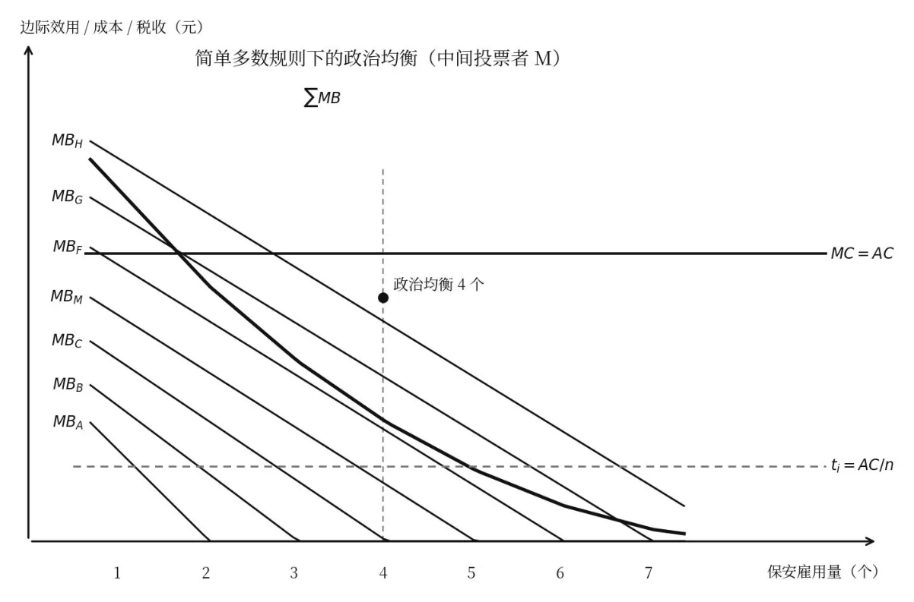
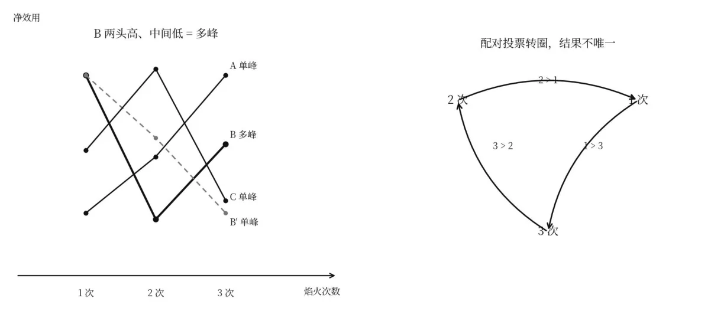
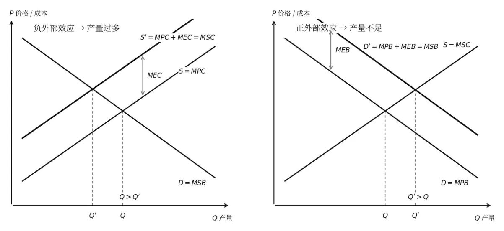
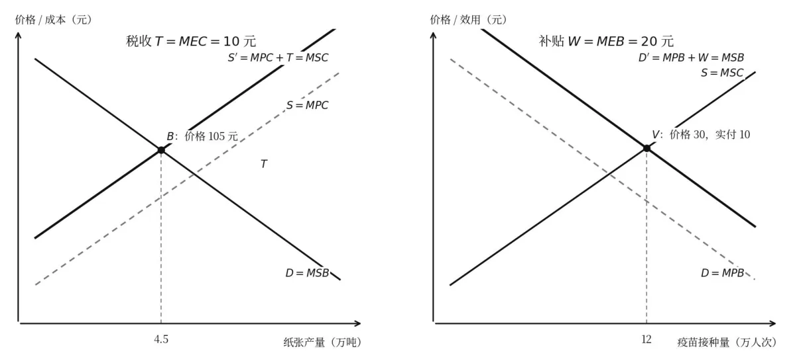

<!--folio:第1页-->

<!--col:L-->

<!--col:M-->

公共经济学课堂笔记

陈鹤华中科技大学公共管理学院

## 第四章公共品理论

复盘时先自己答一遍：公共品和私人品差在哪两个性质上；为什么公共品的需求曲线要垂直相加；小区保安那张表怎么算出最佳3 个人；自愿捐献为什么一定会走到零供给；林达尔均衡要哪两个前提才成立；宿舍空调和康园教师小区两个例子分别在说什么；公共品的需求最后为什么落到政治市场上去。

## 一、公共品的定义、特征与分类

#### 公共品这个词是谁先提出来的

“公共产品” public goods 一词最早由瑞典人林达尔Lindahl 在其博士论文《公平税收》中正式提出，1919 年产生的林达尔均衡是公共产品理论最早的成果之一。新古典综合学派代表人物萨缪尔森Paul Samuelson 在《公共支出纯理论》里下的定义成了经典：每一个人对这种产品的消费并不减少他人对这种产品的消费。

用式子记最清楚，公共产品X = Xi，任何一个消费者所能消费和支配的公共产品数量Xi，就是该公共产品的总和；私人产品则是X = ΣXi，总量等于各人消费量相加。前者是“人人消费同一个总量”，后者是“总量被各人分掉”，这一条是后面所有推导的根子。

#### 课件上特意提醒的三点注意

公共产品可能属于最终消费品，也可能具有中间投入品性质，天气预报既是人们生活所必需的，又是农业、交通运输业等必备的生产要素。从物理特征看，公共产品可以是有形产品，也可能是无形产品，制度安排、产权保护、法治秩序这类与道路、绿化相比，就属于无形公共产品。

信任资源也属于无形的公共产品。课外阅读给的是福山Francis Fukuyama《信任：社会道德与繁荣的创造》Trust: The Social Virtues and the Creation of Prosperity。

#### 案例分析传销

课堂案例问的是“中国为什么成了安利80% 的利润来源”。传销的原理是一次性地出售信任资源。什么样的社会适合传销发展？中国这样的转型期社会有双重特点：一方面市场经济正在蓬勃兴起，产生了一大批被淘汰的弱势群体；另一方面人际关系中还保留着大量的信任资源，没有被消耗干净。

有前者就有形成传销的动力，也就是会有骗子；有后者就有传销对象，也就是有受骗者，两者结合就可以形成无数传销网。经传销网洗劫之后，社会信任资源丧失殆尽，那时候全社会都成了骗子，缺乏足够的、有购买力的受骗对象，传销反而会渐渐萎缩。

这个例子要记的是：信任作为无形公共品，被过度取用之后会耗竭，正好接得上后面“公共地的悲剧”。

#### 两个核心特征非竞争性与非排他性

非竞争性Non-Rivalness 指某人对公共产品的消费不排斥和妨碍他人同时享用，也不会因此减少他人消费该种公共产品的数量或质量；换句话说，对于既定的公共产品产出水平，消费者人数增加所引起的边际成本等于零。老师举的是海上灯塔，增加一艘船经过暗礁时的边际成本为零，但再造一座灯塔的边际成本大于零，这两个“边际成本”不要混。

非排他性Non-Excludability指在技术上无法将那些不愿意为消费行为付款的人，也就是“免费搭车者”，排除在某种公共产品的受益范围之外；或者技术上虽然可以排他，但排他成本太高，以致于经济上不可行。同时，任何人也不能用拒绝付款的办法，把与其消费偏好不一致的公共产品排除在他的消费范围之外。

国防是最典型的，不可能排斥任何一位公民从国防安全中受益。也有学者认为还应加上第三条，使用的“不可分割性” Non-divisibility。把两边对照着记：公共物品是消费的非竞争性、受益的非排他性、使用的非可分割性；私人物品是消费的竞争性Rivalness、受益的排他性Excludability、使用的可分割性Divisibility。

#### 纯公共品与混合品怎么分

纯公共品是在消费过程中完全具有非竞争性和非排他性的社会产品，课件举例是国防、外交、环保等，特征是受益难以排他、消费非竞争。课上顺带抛了一个问题：警察是否属于纯公共品？参考阅读是埃莉诺·奥斯特罗姆《公共经济的比较研究》。混合品Mixed Goods 也叫准公共品、半公共品，指在消费过程中不充分具有非竞争性和非排他性的社会产品，又分两类。

第一类是具有竞争性、非排他性的商品或劳务，比如公共草原，随着消费者人数增加会出现拥挤现象，每个消费者的消费会影响他人的消费，但是不可能把免费搭车者排除在受益范围之外，或者排他成本太高，又称公共资源Public Resource，例子是公共池塘、公海资源，特征是受益难以排他、消费有竞争性。

第二类是具有非竞争性、排他性的商品或劳务，比如公园、桥梁、学校、医院、有线电视，这类产品可以把免费搭车者排除在受益范围外，收益可以定价，供给成本也可得到补偿，因此具有私人产品性质；但对受益范围之内的消费者，在未拥挤之前可以同时享用互不影响，因此又具有公共产品性质。

它还可以再分成地方性（俱乐部）公共品和拥挤性公共品：前者受益可以排他、消费没有竞争性，从正外部性角度也称“利益外溢型准公共品”，例子是各种俱乐部或地方提供的基本医疗卫生服务、教育等；后者受益可以排他、消费在一定范围内没有竞争性，例子是公路、桥梁、影院、非满载火车。

#### 囚徒困境里的公共地悲剧厕纸人脸识别智猪博弈

哈丁“公共地的悲剧”用囚徒困境那张收益矩阵讲：A、B 各自可选节制放牧或不节制放牧。

两人都节制，各得10、10；A 节制B 不节制，得6、12；A 不节制B 节制，得12、6；两人都不节制，得8、8。各自算计下来都会选不节制，结果落在8、8，比共同节制的10、10 更差，这就是后面讲免费搭车时反复要用的逻辑。

厕纸靠人脸识别是2017 年3 月30 日凤凰网的报道：北京天坛公厕附近居民偷拿卫生纸，相关部门给每一个公厕安装一台人脸识别系统，共装了6 台，每台960 美元。通过人脸识别后每次可以取60 厘米的卫生纸，但同一个人至少9 分钟内不能来取更多的卫生纸。CNN 和《华盛顿邮报》这样的美国主流媒体都报道了天坛公园的革新。

网友评论要记三条：一是这个系统在某种程度上有损人的尊严，你到公厕大便还要通过这道审查程序，对这些真正的“肛需”来说确实很不愉快，最大问题不在技术而在伦理，它假定每一个进厕所的人都是潜在的偷厕纸者，虽然已经让厕纸消耗减少了20%，但系统本身有点不文明、不尊重人；二是完全可以借鉴共享单车的理念，用加大供应的办法，

这是用工业社会的思维来应对小农意识的残余，也许会非常有效，凡是那些多拿厕纸回家的人就送他一卷卫生纸，这些卫生纸又不能变现，他能在家里藏多少呢，而且这种“精神倒逼”相比人脸识别或许会更好地刺激改变；三是向日本学习，厕纸全部改用再生纸，不洁白不坚韧沾水就溶化，灰不溜秋的除了上厕所谁也不会想拿着这样的纸，

节能环保还不会堵塞下水管，连公厕里装用过厕纸的废纸篓都可以省掉。

国际秩序那张是智猪博弈：大猪和小猪各有行动（按控制按钮）与等待（先进食）两种选择。都行动得5、1；大猪行动小猪等待得4、4；大猪等待小猪行动得9、-1；都等待得0、0。

国际秩序，联合国、IMF、世界银行等，是全球公共品，由大国提供，可以用智猪博弈模型来解释。

## 二、纯粹公共品的局部均衡分析

#### 为什么要先复习私人产品的局部均衡

从局部均衡角度看，一种产品的市场均衡产量和均衡价格由需求曲线和供给曲线决定，需求曲线以边际收益为基础，供给曲线以边际成本为基础，边际收益等于边际成本时帕累托最优得以实现。因为公共产品与私人产品性质不同，所以分析公共产品之前要先看私人产品的局部均衡。

#### 公共品的需求曲线为什么垂直相加

这是本章最关键的一问。

私人产品那边，每个消费者都是既定价格的接受者，他能调整的只是消费的数量，所以把各人的需求量在同一价格下横向加总；公共产品这边，每个消费者面对的消费数量是相同的，但不同消费者愿意支付的价格不一样，事实上就是愿意承担的税收不一样，所以要在同一个数量上把各人愿意出的价纵向叠起来，这就是垂直相加。

社会资源配置效率最大化的条件MSB = MSC 同样适用于公共物品，只不过纯粹公共物品的生产给所有社会成员带来正的外部效应，所以MSB = MPB + MEB = ∑MB，纯粹公共物品配置效率的实现条件就是MSB =∑MB = MSC。

#### 小区安保那张表务必会自己复算

三个消费者A、B、C 组成的小社区从安全保障中获得的边际效益，保安数量从1 到4。第1个保安，A 的MBA 是300，B 的MBB 是250，C 的MBC 是200，∑MB 是750。第2 个保安，分别是250、200、150，∑MB 是600。第3 个保安，分别是200、150、100，∑MB 是450。第4个保安，分别是150、100、50，∑MB 是300。假定保安工资每人450 元且可雇佣量无限，即AC= MC = 450 元= MSC，需求曲线D = ∑MB = MSB。于是均衡点在E，第3 个保安处∑MB 正好等于450，MSB = MSC，最佳雇佣量为3 人；第4 个保安∑MB 只有300，小于450，就不该再雇。

老师后面讲自愿供给时说的“整体最佳是3 人”，指的就是这张表。

## 三、公共品的供给分析

#### 自愿供给为什么一定是零

老师上课就是从这张表接着往下讲的：大家还记得这个表，哪怕是保安给A 带来的边际效用最高，A 也不会自己单独花钱去雇一个保安，因为第一个保安给A 带来的边际效益marginal benefit 只有300，不足以支付保安450 元的月薪，300 小于450，对个人不划算。

于是如果靠自愿供给，保安数量就是0，但零供给对整体显然是没有效率的，因为对整体来说最佳供应量是3人，也就是上次课看过的MSB 等于MSC 的那一点。这就是由于担心被别人搭便车而导致的供给为零、供给不足的问题，所以公共品或者公共服务，在理论上就必须以非市场的方式来提供。

#### 林达尔均衡自愿捐献能不能成

自愿供给有没有可能呢？前提条件由一位叫林达尔的经济学家提出，叫林达尔均衡Lindahl Equilibrium：若每一社会成员都按其所获MB 的大小而捐献自己应分担的公共物品的资金费用，公共物品的供给量就可以达到具有效率的最佳水平。在成员人数较少的社会中，通过自愿捐献和成本分担的合作方式，有可能让供给量达到最佳水平。

但这显然是一种非常理想的状态，它要两个前提同时成立：第一，每一社会成员都愿意准确披露自己的MB，不存在隐瞒或低估从而逃避应负担成本费用的动机，也就是很老实、很诚实，不想占别人的便宜，也不担心被别人占便宜；第二，每一社会成员都清楚了解其他人的嗜好和收入状况，掌握彼此真实的MB，不存在隐瞒个人MB 的可能。

老师打了个比方，这有点像老子《道德经》里讲的小国寡民，社会非常简单，人数又非常少，人和人之间有充分的信任，每个人都处在原始的初民状态，还没有被后世的各种学说比如儒家学说污染，心思都非常纯粹，那种情况下既没有隐瞒自己边际效用的动机，也隐瞒不了，相互之间又非常熟悉，才可以用自愿捐献来提供公共品。

#### 宿舍四个人开空调的例子理想状态长什么样

假设你们宿舍有四个成员，相互知根知底而且互相信任，宿舍里开空调用的电费怎么分担？

按林达尔均衡，就是每个人自愿披露自己的MB：我挺怕热的，开空调对我很有利，我愿意多出钱；另一个人说其实我根本不怕热，开不开空调都无所谓，那我少出钱；其他两个人也照实说。

大家相互之间非常信任，每个人都很诚实，这种情况就叫自愿分担，是公共物品供给方式的一种理想状态。

#### 现实里立刻变成免费搭车

正因为是理想状态，现实中基本上不可能，一开会就出现免费搭车。四个人讨论要不要开空调、要开空调就要用电、电费怎么分担，马上有人会说“我不怕热，你们随便”，那另外三个怕热的只好三个人分担电费，而那个号称自己不怕热的人显然也享受到了凉快。

你不可能把他赶出去，因为他在法理上就属于这个寝室，有居住的权利，这就是典型的联合消费、共同受益，没办法把不交钱的人排除出去。这种人叫免费搭车者free rider，免费搭车对任何人来说其实都是一种理性的选择。

再往下就会出公共地的悲剧：所有社会成员都想免费搭车，公共资源就被耗费掉，或者公共资源根本没有人愿意提供，而且社会成员越多、成分越复杂，公共地的悲剧就越严重。

课件把林达尔均衡的问题归成三条：人口众多社会中，没有人能做到对其他所有成员无所不知，存在隐瞒MB 的可能，于是不存在林达尔均衡；免费搭车者对任何人来说都是一种理性的选择；所有社会成员都免费搭车，就出现公共地的悲剧，社会成员越多越严重。

#### 买房例子为什么最重要的是邻居

老师特意提醒，上次课讲买房不是跑题讲房地产经济学，买房子时最重要需要考虑的因素还不是方位、地段、朝向那些，而是你的邻居。举的是身边的例子：正好讲房地产的谭院长也买了西边康园教师小区，老师也买了，买了就后悔了。

当年买的时候以为邻居都是本校老师，如果都是学校老师，就意味着大家收入状况差不多、受教育程度差不多，相应带来的价值观和生活方式也就大体相当，简单说就是同一个阶层，物以类聚人以群分；这里并没有带什么歧视的意思，只是不同的人群确实有不同的价值观、不同的生活方式。

本来以为住在一起会有共同的价值观念、共同的生活方式，是一个很容易同质化的群体，那么就很容易对公共品的供给达成共识。结果发现好多老师买房是准备拿去出租的，甚至有人准备装修成民宿，比如刘书记买了一套，公开委托给搞民宿的公司，而且不止他一个，好多人都把一套房子装成三个小间、五个小间去开民宿。

一旦租出去、变成商业化运营，跟你住在一起的人就不再是同质化的人了，生活方式、价值观念都不一样，就很难就公共品的供给达成共识，也就难以避免公共地的悲剧。

#### 物业费怎么一步步垮掉

如果邻居都不愿意出物业费，而我又觉得物业是必须的，那只好由我来出，我出了就被别人搭便车；我就会想，我干嘛要被别人搭便车呢，我也要占便宜、也要搭便车；人人都想搭便车，更没人交物业费，物业服务就变得很差，服务差了更没人交物业费，这是一个自我强化的恶性循环。

房产基本上是中国家庭最重要的资产，小区管理不善，这个资产就会急剧贬值。所以如果这个小区住的都是大学教师，房子就会增值；如果都变成一些不三不四的人天天在那进进出出，就会贬值，稍微用点脑筋推导一下就知道。老师最后说，我买了之后就很后悔，我不想住在那个小区，因为我要挑选我的邻居。

#### 美国房产税与学区房把逻辑接到公共财政

在美国其实也是一样的，地方政府的财政主要来自于房产税，而义务教育是由地方政府来提供的。地方政府能不能收到房产税，跟它当地办的公立学校教学水平是直接正相关的，有钱就能办教育，没有钱肯定办不好教育，办教育就是一个极度烧钱的活，所以就出现了学区房这样一个概念。

我们中国现在特别流行的学区房概念，其实就是从美国引进的。原因就在于有钱的地方政府能办更好的地方学校，而地方政府有钱来源于当地的房产税，房价高、税基厚，学校就好，学校好又推高房价，这个圈要能自己转起来。

#### 搭便车问题最后怎么收口

课件给的结论是公共财政。公共物品或服务不可或缺，免费搭车者问题不可避免，只有依靠政府部门使用非市场的方式，也就是公共财政来解决，有效途径是强制性的融资方式。课堂讨论留了三问：小区保安是如何实现强制性融资的？成本分担的原则是什么？存在着什么问题？

另外两个讨论题也要记：三个和尚没水喝的难题如何解决，参考阅读是陈抗《三个和尚一定没水喝吗？——奥尔森学术思想介绍》；私人生产公共品真的不可行吗，私人电视台为什么存在，解释是把正价值和负价值的公共品合在一起，比如电视节目加广告。

## 四、公共品的需求分析

#### 需求为什么搬到政治市场

公共产品需求的决定是在政治市场上进行的。政治市场Political Market 指人们参与政治活动时，与其他政治个体和政治组织发生关系的场所。政治市场上“交易”的对象是公共产品，需求方是投票者也就是纳税人，供给方是政治家及其任命的官员。经济学家认为，政治市场上的参与者与经济市场上的参与者一样，都是理性的经济人。

#### 政治市场上的四类人各自图什么

投票者Voter 总是按规定的投票规则和程序，从备选方案中选择能给自己带来最大满足程度、同时税收负担又最小的方案；投票者参与公共产品的决策既理性又无知，理性是指他会对收益超过成本的方案投赞成票，否则投反对票或弃权票，无知是指他对备选方案往往缺乏必要信息，也缺乏收集信息的动力，

主要依靠政治家和媒体免费提供的信息进行选择。特殊利益集团Special Interest Group 是少数有共同经济利益的投票者联合起来，不仅因为联合起来耗费较低，而且联合起来能左右公共决策，使有利于自己的方案顺利通过；它会与政治家、官员形成一个“铁三角”，政治家批准某一方案，官员实施某一方案，特殊利益集团从中获益。

政治家Politician 是通过选举任职、处于政治权力顶峰地位的人，如总统、议长等；有的追求某种政治信念，他们提供的公共产品往往也是社会公众希望得到的，不过这类人为数甚少；也有的追求权势与声誉，当选后也会尽力反映多数社会公众的偏好；还有的追求金钱，他们提供的公共产品往往反映极少数社会公众的偏好。

课件特意加了一句注意：对于普罗大众来说，追求某种政治信念的政治家并非一定优于追求权势或金钱的政治家。

官员Official 由当选政治家任命，具体负责公共产品的生产与供给，追求的目标是薪水、津贴、声誉、任免权和晋升机会等，这些又与政府规模联系在一起，因而具有扩张政府规模、追求预算支出最大化的动机；政治家或高级长官往往由于信息不对称等原因，难以监督属下的所作所为。

#### 经济市场与政治市场的四点不同

一是偏好表达方式不同，经济市场上人们以货币为“选票”，可以比较精确地表达自己对私人产品的真实偏好，政治市场上只能按政治程序用政治选票表达自己对公共产品的偏好。二是成本与收益对应程度不同，经济市场上个人既是选择者又是决策者，付费与得益相对应；政治市场上个人是选择者但未必是决策者，纳税与获益未必对应。

三是权责关联程度不同，经济市场上个人作出决策，决策损益由决策者负责；政治市场上集体作出决策，但决策损益由集团内部成员承担。四是强制程度不同，经济市场上遵循自愿服从原则，人人得其所愿；政治市场上遵循少数服从多数原则，个人被迫接受他不愿意接受的公共产品，缴纳他不愿意缴纳的税收。

#### 显示偏好的四条渠道从投票一直排到反叛

第一条通过投票表达，包括直接投票和间接投票两种机制，前者是消费者亲自对一揽子公共产品方案投票，后者是消费者选出代表或议员，由代表或议员投票。第二条通过发言表达，包括书面和口头两种方式，书面如投稿给媒体或上书有关部门，口头如游说议员、游行请愿、上街游行等。

第三条通过进退表达，又称“以足投票”，消费者认为某一社区供给的公共产品符合自己的偏好就迁入，反之就迁出。第四条通过反叛表达，消费者不愿接受政府提供的公共产品，上述方法又不奏效，在一定条件下就会发动政变或革命以推翻现政府。老师把这四条讲成一条“越来越激烈”的链子。

#### 发言表达为什么必须配上自由

录音里是从“第二步”接进来的：我可以通过发言来表达，还可以去游说，还可以自己办一个电视台、自己办一个网络平台来扩大我的声量，也许在下一轮投票的时候支持我的人就会变多，我就还能赢。

所以民主制度一定跟自由联系在一起，民主投票一定要配合新闻言论的自由；如果没有新闻言论、游行示威这种自由，那仅仅靠投票，就变成了多数人对少数人的一种专政。但如果我们再配合有新闻言论的自由，那么下一轮我还能翻盘，民主制度才有可能有自愈机制，或者说自我疗愈、自我纠错的机制。

老师接着举了现实里的争论：从特朗普上台之后，就有好多人讨论，说美国人最引以为豪的就是他们的民主制度是有自我纠错机制的，但是都出现了特朗普，所以美国制度已经彻底败坏了，已经没有自我纠错机制了；现在美国制度受到很大的挑战，不只是中国人在探讨，美国自己的政治学者其实都在怀疑美国制度现在已经彻底败坏、

没有自我纠错机制。

用脚投票进退表达如果用声音表达仍然不能达到目的，政府提供的公共品不是我想要的，还有第三步，用进退来表达、用脚投票。

我在这个社区生活，但我是少数派，投票永远投不过多数派，我可以办报纸、办电视台表达声音，问题是仍然不能说服多数人，那怎么办，“此处不留爷，自有留爷处；处处不留爷，也上树去住”，老师开玩笑说那我就上树了，我可以上月亮上去。这就是用进退来选择公共品、表达对公共品的偏好。

老师特别说明，这一条在我们中国人觉得比较难以理解，但在美国这种联邦制国家非常常见：每个州有每个州的宪法和法律，每个州提供的公共品差距会很大，收的税税率差距也很大，又有迁徙的自由，所以美国人是经常搬家的，对这个地方提供的公共品不满就搬走了，这种用脚投票在联邦式国家很常见，其实是很可以理解的一件事情。

#### 反叛表达与不走到这一步的条件

如果用进退表达都不足以表达，或者没有退出的机制留给我，那最激烈的状况就是用反叛来表达，叫揭竿起义。消费者如果不愿意接受当前政府所提供的公共产品，上述三种方法、三种渠道也都不奏效的话，在一定条件下就会发动政变或者革命来推翻现政府。

所以它其实也是一种表达，是对当前政府所提供的公共品不满的一种最激烈的显示偏好方式。老师用经济学把政治学里那些现象都串起来了。我们当然不希望走到这一步，怎样才能不走到这一步？前面那三种渠道如果都是畅通的，它就不会走到这一步。

#### 这一章回看

第四章其实只做了一件事：把“公共品”这个东西的特殊性一层层剥开。

因为非竞争、非排他，各人消费的是同一个总量，所以需求曲线要垂直相加，效率条件写成MSB = ∑MB = MSC；因为谁都可以不付钱就受益，自愿供给必然收敛到零，林达尔均衡要靠“人人诚实+ 彼此透明”两个几乎不成立的前提，现实里就是免费搭车和公共地悲剧，于是只能靠公共财政强制融资；供给问题解决了，需求问题却没解决，公共品的数量只能由大家共同定，

于是需求表达搬进政治市场，从投票、发言、进退一路排到反叛，也就顺理成章接出了第五章的公共选择理论。老师反复用小区安保、宿舍空调、康园教师小区、物业费这几个例子，是想让我们把“同质化小群体容易达成共识、人越多成分越复杂越容易崩”这条直觉和前面的公式对上。

## 第五章公共选择理论

复盘时先自己答一遍：公共选择为什么算经济学理论不算政治学理论；经济人假设在政治领域里分别落到政治家、选民、官员身上是什么目标；英国脱欧那个例子在质疑什么；经济市场和政治市场在媒介、杠杆、主体、动力上怎么对照；投票人为什么在MBi = ti 那一点停住；七人保安为什么均衡在4 个；循环投票是怎么被多峰偏好搅出来的；

阿罗不可能定理到底“不可能”在哪；政府失灵和寻租又怎么接上前面。

## 一、公共选择理论概述

从公共品需求自然过渡到公共选择老师讲完公共品就借着这个话题引入第二大理论：公共选择理论正好跟刚才说的公共品需求如何表达相关，它是一个以投票理论为主的理论，当然不限于投票理论。先做概述，然后重点介绍三大理论：投票理论、政府失灵的理论和寻租理论。

#### 定义与它到底属于哪门学科

公共选择public choice 指在市场经济条件下，以个人利益最大化为内在动力，通过民主投票实现的对公共经济的合理决策。它假设所有选择者都是理性经济人，用到的也是经济学上的理论，所以公共选择理论不是政治学的理论，它是经济学的理论，是用经济学理论来解释政治学现象、解释政治现象，这一点一定要搞清楚。

它是对政府决策过程的经济分析，核心就是研究投票问题、研究投票以及相关决策程序问题。

#### 代表人物和书

代表人物是詹姆士·麦吉尔·布坎南James McGill Buchanan（1919 年10 月3 日—2013 年1 月9 日）和戈登·塔洛克Gordon Tullock。布坎南的代表作课件列了《同意的计算》《成本选择》《公共选择论：经济学的政治运用》《自由的限度：在无政府主义状态和极权主义国家之间》《自由、市场与国家》，老师上课笑着说这些书说了你们也不会看的，提一下就行。

#### 五个特点一句话一句地记

前提是经济人假设；切入点是从划分市场决策与非市场决策来切入；理论特点是不做价值判断，不说这个东西是好的还是坏的、道德的还是不道德的，只做事实判断；实质是把经济分析的工具用在政治领域当中；交易概念的运用上，认为政治不过是经济交易过程的延伸，交易对象主要是公共品，交易特点是非自愿的、带有强制性的、不平等的。

课件对“交易”还多说了一层：在公共经济学看来，经济学的基本命题是交换，交易指经济人从利益最大化的目的出发，在经济主体之间自愿交换，从而实现个人利益最大化；交易的本质是帕累托改善过程，交易的结果是帕累托最优的实现；交易分简单交易和复杂交易，简单交易是基本的、直接的交换，一对一的银货两讫，

复杂交易是多个经济主体之间的多重交换，政治决策过程即是多个“经济人”相互交易的过程。

#### 经济人假设在政治领域里具体化成什么

人都是理性行为者，行为目的是谋求私利的最大化。政治领域中的人，政治家、文官及其他国家（政府）代理人，同私人经济中的人一样都是“经济人”，均以追求个人利益最大化为目标：政治家追求选票最大化，选民追求投票净利益最大化，执行决策的政府官员追求预算最大化，但他们都是算计自己的利益的。

#### 经济人假设受到的质疑卡普兰电影英国脱欧

关于理性经济人假设，经济学家内部其实存在很大的分歧。可以参考布赖恩·卡普兰《理性选民的神话》，上海人民出版社2010 年出的，光看标题就知道他不同意选民都是理性的。

老师还举了一部讲美国选举的电影：两党竞争，最后计票计出来两党票数完全相同，最终取决于其中一个投票人，也就是关键投票人投哪一边，两党都派人去游说他、想要收买他；可见这个投票人自己真的是理性的吗，貌似也不是，好多人投票觉得我这票无所谓的，所以可能会乱投。

乱投的结果会导致一个人人都不想要的结果，最经典的案例就是英国脱欧。

英国在脱欧之前，当时的时任英国政府做过很多次大型民意调查，委托了大量权威机构来做，调查结果是多数英国人不会赞成脱欧，政府自己也不愿意脱欧，所以就很放心大胆地让大家来投票：既然大多数人都不会赞成脱欧，那我们投一下票，表现一下民主，有什么不好呢，又可以堵住那些少数派的嘴。结果一投，脱欧议案居然被通过了。

后来很多政治学家研究，明明民意调查说不会赞同，为什么一投就赞同了？

结论大概是：很多人投的时候想，反正也不在乎我这一票，前面电视里广播里都在播，说大多数人都是反对脱欧的，我自己也是反对的，所以多一票少一票无所谓，那些反对脱欧的人就没去投票；而那些赞成脱欧的人，因为前面的民意调查都显示他们是少数派，越觉得自己是少数派就越想表达自己的意愿、维护自己的权益，投票率就会很高，

可能百分之百都去投了，而反对脱欧的人可能只有一半去投，结果就被赞成脱欧的人给投过了。可见这些投票人真的都是理性的吗，经济人假设因此受到很多质疑。

#### 决策环境怎么划分钞票与选票

切入点是把决策环境划成市场化的环境和非市场化的环境。市场化环境用钞票来表达需求、表达偏好，购买的是企业提供的私人产品，主体是企业和个人；非市场环境用投票、用选票来表达偏好，购买的是政府提供的公共产品，主体是政府和选民。

#### 经济市场与政治市场那张对照表背下来

内容上，经济市场是物物交换、商品交易，货币也是一种物、是代表一般等价物的商品；政治市场交易的是参与者公共承认的公共产品的成本，比如需要什么样的政策、需要多少法律制度、需要养多少警察、监狱、法庭等。媒介上，一个是钞票，一个是选票。

杠杆上，一个是价格，一个是规则；用价格做杠杆体现的是等价交换、平等自愿，而用规则做杠杆，只要是集体行动的规则就一定带有强迫性，带有不平等性和强制性，要求少数派必须服从。主体上，经济市场是个人之间进行的简单交易，一手交钱一手交货；政治市场是个人或集体之间非常复杂的交易，里头穿插着政客、特殊利益集团这种组织。

共同点在动力：两边相同，都是在追求个人利益最大化。

## 二、投票理论

#### 投票人决策的原理和买西红柿一模一样

公共选择理论最重要的就是投票，所以从投票理论讲起。投票人对某一项议案投赞成票还是反对票，决策原理跟在市场上决定要不要买一斤西红柿是一模一样的，因为都是经济学原理，都是追求MB 等于MC，只不过在形式上公共选择的决策是通过投票做出的。

最偏好的结果是公共物品数量达到这样一个水平：我自己所承担的税收正好等于该物品给我带来的边际效用。

西红柿有个价格，在这个既定价格之下买一斤、两斤还是不买，取决于最后一斤西红柿给我带来的边际效用，如果最后一斤的边际效用正好等于我为它支付的成本也就是价格，我就会买；所以我买两斤西红柿，就证明第二斤对我来说值三块钱，买五斤就说明第五斤对我来说值三块钱。

同样道理搬过来，每一个投票人偏好的结果也是该公共品最后一个单位给你带来的边际效用等于你为它支付的税收，这一点就是投票决策的均衡点，这就叫政治均衡political equilibrium：如果一个社会的人们根据既定的投票规则，就一种或多种公共物品或服务的供给以及相应的份额的分配达成了协议，就取得了所谓的政治均衡。

#### 那张图怎么画税价MB 递减Q*

公共产品的数量画在横轴上，纵轴是价格，在这里就是税收，在公共品理论里可以把它叫做“税价”，因为它既是价格，本质又是你被强制征去的税收。随着公共品数量增加，它给每一个投票人带来的边际效用是递减的，所以MBi 往右下方倾斜；而每一单位公共品要从你身上征收的税收假设是固定的，是一条水平线，就是每单位产量的税收ti。

两条线交在Z 点，对应横轴上的Q*，这个产量对投票人来说最合适，他投票要的就是这一点。由此也看得出政治均衡的主要决定因素有三个：税收份额在投票者之间的分布状况，公共物品或服务的效用在投票者之间的分布状况，以及投票规则。

#### 七人小区保安的例子简单多数规则

老师仍然讲小区，一个小区有七户居民，要投票选保安的雇佣数量。问题是一个小区只能有同一个数量的保安，不能说你用了一个、他用了七个，因为它是公共品，所以只能用投票、用政治市场的方式来表达对公共品的需求。假定每个保安的平均成本AC 既定，税收份额已经公布，平均平摊，每人缴纳同样的税收ti = AC/n，投票规则为简单多数规则。

A、B、C、M、F、G、H七个人从保安雇佣数量中获得的边际效用曲线，实质就是需求曲线，各条曲线斜率都不一样，也就是说每个人对同样的公共品需求强度不一样，“人过一百，形形色色”。课件图上还标了∑MB和MC = AC，以及MBA、MBB、MBM、MBF、MBG、MBH 各条线，纵轴刻度有350 和50，横轴是保安雇用量1 到7。

把那张投票结果表横着记下来：列是“增加保安雇用量至1、2、3、4、5、6、7”。A 只在1个赞成，2 到7 全反对；B 在1、2 赞成，3 往后反对；C 在1、2、3 赞成，4 往后反对；M 在1到4 赞成，5 往后反对；F 在1 到5 赞成；G 在1 到6 赞成；H 从1 到7 全赞成。最后一行投票结果是1、2、3、4 通过，5、6、7 否决。所以ABCMFGH 七人最偏好的保安数量分别是1、2、3、4、5、6、7，在MB 曲线既定的条件下，按简单多数规则取得的政治均衡为4 个保安的雇用量。

老师课上说到这里收住：我们要求的是那个∑MB，让∑MB 和MC 相交的那一点决定均衡的公共品数量，注意这是一个政治均衡，不是经济市场上的均衡；今天没有时间展开说了，下次课再讲，剩下两张PPT 都已经分享到群里，可以下载。

#### 中间投票者定理

中间投票者，就是上例里的M，指其最偏好的结果处于所有投票者最偏好的结果的中间状态。中间投票者定理Median voter rule：若所有投票者对公共物品的边际效益曲线均呈向右下方倾斜状态，也就是边际效用递减，那么中间投票者最偏好的公共物品的产量，就是简单多数投票规则下的政治均衡。

启示有四条：在多数规则下，反映中间投票者意愿的提案会最终获胜；当有两种以上方案可选时，多数规则并不能保证51% 的投票者获得他们最偏好的结果，实际上只有中间投票者获得最偏好结果；多数规则所保证的是，所有投票者最偏好的结果和最终达成的政治均衡之间的偏离度最小；任一政党或政治家要想赢得极大量选票，

必须使自己的竞选方案符合中间投票者的意愿。

#### 投票结果为什么会转圈焰火的例子

我们希望民主制度下投票结果是唯一的，但有时候会出现非唯一性或者循环性。例子是3 人组成的小社会就每年燃放焰火次数进行表决，每燃放一次焰火费用200 元，三人承担的税收份额tA = 100 元、tB = 75 元、tC = 25 元，面临每年燃放1 次、2 次、3 次三个选择，按简单多数规则票决。

偏好顺序表里数字1 表示最偏好，3 表示最不偏好：A 对1 次给3、2 次给2、3 次给1，也就是最喜欢3 次、其次2 次、最不喜欢1 次；B 对1 次给1、2 次给3、3 次给2，最喜欢1次、其次3 次、最不喜欢2 次；C 对1 次给2、2 次给1、3 次给3，最喜欢2 次、其次1 次、最不喜欢3 次。当有三个或更多方案备选时，就其中任意两个方案投票，叫“配对投票”。

第一轮1 次对2 次：A 投2 次，B 投1 次，C 投2 次，得票1 比2，2 次获胜。第二轮3 次对1 次：A 投3 次，B 投1 次，C 投1 次，得票1 比2，1 次获胜。第三轮2 次对3 次：A 投3次，B 投3 次，C 投2 次，得票1 比2，3 次获胜。于是2 次> 1 次，1 次> 3 次，3 次> 2 次，转了一圈。小结：按配对投票的次序不同，三种提案都可以在简单多数规则下获胜，出现投票结果的非唯一性问题；投票结果具有不确定性，政治均衡也不存在了。

#### 多峰偏好把B 改成B' 之后

循环性、非唯一性的原因是多峰偏好的存在。人们的偏好结构有单峰和多峰之别，单峰偏好Single-peaked Preference 意味着最理想的结果只有一个，多峰偏好Multiple-peaked Preference 意味着最理想的结果不止一个。上例里A 和C 是单峰偏好，B 是多峰偏好：B 最偏好1 次，最不偏好2 次，却把3 次排在第二，净效用曲线两头高、中间低。

假如把B 改成B'，顺序变成1 次给1、2 次给2、3 次给3，成了单峰，配对投票结果就实现唯一性：第一轮1 次对2 次，A 投2 次、B'投1 次、C 投2 次，2 次以2 比1 获胜；第二轮3 次对1 次，A 投3 次、B' 投1 次、C 投1 次，1次以2 比1 获胜；第三轮2 次对3 次，A 投3 次、B' 投2 次、C 投2 次，2 次以2 比1 获胜。于是2 次> 1 次> 3 次，唯一结果，循环解决。在没有多峰偏好者的情况下，中间偏好峰就是多数规则下的政治均衡。

由此记四条结论：若所有投票者的偏好都呈单峰形，多数规则下的投票结果就是唯一的，不会出现循环；如果多数规则下的投票结果出现循环，那就说明至少有一个投票者的偏好是多峰的；只要都是单峰，结果唯一，中间偏好峰即反映中间投票者最偏好的结果的提案获胜；只要都是单峰，不论税收份额如何，中间投票者定理成立。

中间投票人定理的正式提出者唐斯A.Downs 在1957 年出版的《民主的经济理论》中指出：如果在一个多数决策的模型中个人偏好都是单峰的，则反映中间投票人意愿的那种政策会最终获胜，因为选择该政策会使一个团体的福利损失最小。

讨论还留了一问：多峰偏好到底存不存在。边际效用递减规律说任何物品或服务的边际效用都随其数量增加而减少，多峰偏好同公共物品边际效用递减规律相矛盾；然而边际效用递减并不能排除多峰偏好的存在，事实上多峰偏好有可能存在。

事例一，人们对公立学校预算提案投票；事例二，一些国家的公民对待战争问题有时也会出现多峰偏好倾向，例如越南战争时期，许多美国公众更倾向于完全投入战争（包括使用核武器）或完全不参与战争，而对进行一场有限战争和局部战争不太感兴趣。

#### 投票交易互投赞成票与隐含的互投赞成票

互投赞成票Logrolling 指投票者必须同时就两个或两个以上的提案投票，提案中既有他赞成的也有他反对的，投票者对提案具有不同的偏好程度；只有在与提案有关的效益和损失不对称的情况下才会发生互投赞成票，若互抵则无此动机。给投票者带来的好处是大大增加了某些提案在多数规则下获得通过的可能性。

事例是就两项提案投票，一项可给石油生产者带来利益，另一项可给食品生产者带来利益。

隐含的互投赞成票Implicit logrolling 指分别代表不同利益集团的两个或更多议题被组合在一起，让投票者就此投票；例子是两个本来不相关的议题，对纺织品进口限额和新型轰炸机的研制被放在同一项提案中，涉及纺织集团和军火集团两个特殊利益集团，若组合后的一揽子项目提案令两个集团获得的效益均大于遭受的损失，他们就都会投赞成票，

即使没有事先的投票交易。

课堂举例：三个公民组成的社会就两项提案投票，简单多数规则；安全保障（保安雇用）MC = AC = 300 元，社会娱乐（焰火燃放）MC = AC = 300 元，每一投票者必须为每一单位的公共物品承担100 元的税收。无投票交易时，就焰火燃放和保安雇佣两项提案分别投票，简单多数规则下的结果是既不提供社会娱乐，也不提供安全保障。

把两项提案合二为一，A 和C 双双投赞成票，原不可能单独表决通过的方案，放在一起表决时却通过了。结论要记准：投票交易有可能造成资源配置效率的损失，但并非总是造成损失，回忆公共品那章的内容，关键要看∑MB 是否大于MSC，如果大于，则并没有效率损失。

#### 投票规则有哪些最优多数怎么定

假定社会公众能真实显示对公共产品的个人偏好，公共部门如何把个人偏好加总成一个集体的偏好？

比较简单的方法是依照习惯或独裁，前者指依照某种共同被接受且沿袭多年的习惯作出决策，后者指由某一个人或某几个人作出决策、强迫社会公众服从；在现代民主社会，偏好加总是通过投票完成的，为此人们提出了许多投票规则：一致同意规则Unanimity，相当于一票否决；相对一致同意规则Relative unanimity，如2/3、7/8 等；简单多数规则Simple majority；相对多数规则Plurality rule；计点投票规则Point-count voting，

每位投票人按照一定规则给备选议案计点打分，获得“点”数最多的备选议案获胜。

表决一个方案存在两种成本：一是决策成本，包括投票所需的时间、交通成本以及修改、解释方案所需的成本；二是预期外在成本，即一项方案强制实施以后给他人带来的损失。

图上纵、横轴分别表示成本和赞成比例，E 线是预期外在成本曲线，表示预期外在成本随赞成比例的增加而降低；D 线是决策成本曲线，表示决策成本随赞成比例的增加而增加。O 点是独裁状态，决策成本为零而预期外在成本很高；N 点是全体一致状态，决策成本很高而预期外在成本为零。若决策成本和预期外在成本之和最小，那便是最优多数规则。

注意E 线和D 线相交之处未必是总成本最小处，当E 线和D 线的斜率绝对值相等时，总成本才最小。

阿罗不可能定理民主政治社会进行公共选择必须遵循五项伦理准则。第一，个人理性假定：对于任何两个不同的可供选择的社会状态X、Y，任何人或者认为X 比Y 好，或者认为Y 比X 好，或者认为X与Y 无差异，除此之外别无选择；同时如果某人认为X 比Y 好、Y 又比Z 好，那么他一定认为X 比Z 好。

第二，与选择方案无关的独立性假定：在一组社会状态之间选择，只取决于每个人对于这些社会状态的偏好顺序，而与别的因素无关；比如选择只能在X 和Y 之间作出，若X 与W的关系发生变化，这种变化与X 和Y 之间的选择无关。

第三，帕累托最优假定：如果社会中所有人都认为X 比Y 好，则社会顺序必定表示为X 比Y 好；如果至少有一个社会成员认为X 比Y好，而别的社会成员认为X 与Y 无差异，则社会顺序必然为X 比Y 好。第四，定义域的非限制性假定：社会选择赖以产生的定义域必须包括所有可能的个人偏好顺序，不能通过限制个人偏好顺序的定义域来产生某一个社会顺序。

第五，非个人独裁假定：不存在某一个人，对于可供选择的X 和Y，如果他认为X 比Y 好，则社会严格地认为X 比Y 好，而不考虑其他个人的偏好。

阿罗发现，如果同时遵循这五项伦理准则，必然会出现“投票悖论” The Voting Paradox：正如前面所讲，在多峰偏好存在的情况下，按简单多数规则决策，就不可能得出一个稳定的且与每个投票者个人偏好相一致的均衡结果。

阿罗从投票悖论中得出的结论是：在每个社会成员对于社会状态各有其特定偏好的前提下，要找出一个在逻辑上不与个人偏好相矛盾的社会状态选择顺序是不可能的，这就是著名的“阿罗不可能定理” Arrow's Impossibility Theorem。

它表明现代民主制度下，公共部门无法把社会成员对于公共产品的不同个人偏好加总成一个集体的偏好；现实生活中总是通过修正五条伦理原则中的某一条以避免出现投票悖论，从而实现公共产品的偏好加总，对阿罗五原则的修正主要是对第四原则的修正，对投票者的选择进行限制，变多峰为单峰，也就是修正非限制原则，

或者采用打分投票。参考书目是阿罗Kenneth Joseph Arrow《社会选择：个性与多准则》Social Choice and Individual Values。

## 三、政府失灵

#### 定义与两种情形

政府失灵Government Failure 指政府干预经济不当，未能有效克服市场失灵，以致资源最优配置难以实现的状态。通常指两种情形：其一，政府干预经济活动达不到预期目标；其二，政府干预虽达到了预期目标但成本高昂。但政府失灵的衡量尺度并不像市场失灵那样明确，因为政府干预经济往往不是为了实现静态的“帕累托最优”，而是为了争取动态的公平和效率。

#### 表现原因官僚的特征

具体表现有四条：公共决策失误，政府组织规模增长过快，官僚机构的低效率，政府干预导致寻租。

原因有四条：契约关系的特殊性，政府是一个权力实体，它可以不履行契约，甚至重新修改或解释契约，对政府部门效率无法直接评估，对政府官员的评价一般只能从其错误中识别，“逃避错误”成为政府官员的行为准则，结果是政府部门普遍存在短视、惰性和缺乏创新精神；信息不充分，现代社会化市场经济活动的复杂性和多变性，

增加了政府对信息全面掌握和分析处理的难度；公共利益界定的困难；官僚主义。官僚的特征五条：缺乏竞争性，不存在同类产品提供者的竞争；缺乏激励机制，稳定性和程序性排斥了激励；非利润化，只保证供给，不计利润；缺乏敏感性，对公共产品的评价非市场化；个人影响力较大，政府信息不公开。

于是官僚机构追求公共权力极大化，到预算规模的极大化，再到公共物品供给量过剩，最后资源浪费。

#### 治理的四条路

一是进行宪政改革，宪政意味着政府应受制于宪法，它仅仅是一种有限政府，即只享有人民同意授予它的权力，长远来说要建立起对政府税收和支出加以约束的宪政机制；参考阅读给的是詹姆斯·M·布坎南《立宪经济学》，译自《立宪经济学探索》一书，美国1989 年版，以及盛洪《宪政经济学与宪政改革——代为布坎南〈宪政经济学〉中文版序》。

二是寻找合适的政府角色定位，政府退出竞争性私人产品领域，对于公共产品，能由私人部门生产的政府不要包揽，尽量通过多种途径委托私人部门生产。

三是削减政府权力的增长，减少权力行使的随意性并提高其透明度；寻租活动猖獗，从制度上说主要源于资源配置大权掌握在各级政府手中，一方面有赖于建章立制，让制度约束人，使政府行为法治化，另一方面要尽快使政治权力从经济生活中退位，进行市场化取向的政府管理改革。

四是扶持“第三部门”的发展，在市场失灵和政府失灵并存的情况下，可引入第三种力量起平衡作用；第三部门的独立发展建立在个人的独立自由权利得以确立和保障的基础之上，是随着缩小政府活动范围、限制政府权力和规范政府行为方式，完成对国家的改造而进行的。

## 四、寻租理论

#### 定义与经济租的本意

寻租Rent-Seeking 这一概念由美国经济学家克鲁格A.O. Krueger 正式提出。寻租有多种定义：塔洛克G. Tullock 早在1967 年对垄断租下过一个定义，在他看来，寻租是人们为获得垄断或取得政府其他庇护而从事的活动；布坎南J. Buchanan 把寻租定义为人们凭借政府保护进行的寻求财富转移而造成的浪费资源的活动；归纳起来看，寻租是人们为获得经济租而寻求权力拥有者庇护的活动。

“租金”或者“经济租”在经济学中的本意，是指支付给要素所有者的报酬中，超过要素在任何可替代用途上所能得到的报酬的那一部分，也就是说要素所有者的收入减去要素的机会成本之差。按照经典的均衡理论，只要市场是自由竞争的，每种要素在各产业部门中的配置都会使要素收入与机会成本相等。

但在现代社会中，人们会利用行政法律手段，阻碍生产要素在不同产业的自由流动和竞争，藉此维护既得利益或者对既得利益进行再分配；比如一个企业家开拓了一个市场之后，就可能寻求政府干预来阻止其他企业进入，以维护其独家垄断地位，确保他创造的经济租不扩散。

由于这类活动不再增进经济福利，性质就变成寻租活动，寻租使本来可以用于生产的资源用于对社会无益的非生产活动上，白白地消耗资源。

#### 寻利与寻租的三点区别

第一，寻利是经济主体通过自身参与市场竞争而获取“经济租”，不需借助政府干预；寻租是经济主体利用政府干预使自己取得特殊垄断地位，从而获取“经济租”。第二，寻利物化在生产过程之中，以商品和劳务的增加为基础，结果有利于自己也有利于社会；寻租游离于生产过程之外，是对既定财富量的分配，结果有利于自己但有害于社会。

第三，寻利以资本投入、技术发明、制度创新和公平交易等为基本途径，具有正的外部效应；寻租以游说、奉承、哄骗、行贿等为手段，具有负的外部效应。

#### 出租车牌照例子里的三个层次

假设一个城市的政府用发放限额营业执照的办法人为地限制出租汽车的数量，那么市场上的出租车数量就少于自由竞争市场的均衡水平，出租车业主就可以获取经济租。

人们受这种超额利润的吸引，就会设法从主管此事的官员那里得到营业执照，争相贿赂讨好，从而产生第一层次的寻租活动；由于这种活动给官员带来额外收益，又会吸引人们争夺主管营业执照的官位，由此产生第二层次的寻租竞争；如果部分或全部的出租车超额收入以执照费的形式转化为政府的财政收入，

那么有关利益集团又有可能为了这笔财政收入的分配而进行第三层次的寻租活动。

#### 寻租成本

一是寻求经济租所耗费的成本，主要包括搜集潜在经济租信息的成本、对政府官员进行游说的成本、贿赂有关人员的成本及维持垄断地位的成本等；二是垄断本身所造成的福利损失；三是寻租所失去的技术创新机会及福利，如果没有寻租活动，用于寻租的开支就可能被用于研究开发活动，降低成本增进社会福利，

在社会经济资源总量既定的情况下，用于寻租活动的资源越多，用于技术创新的资源必然相应减少，如果在形成垄断之后，垄断者对技术创新的投入比自由竞争者更少，那么社会福利损失更大。

图上那块也要记：纵、横轴分别表示价格和产量，设企业长期平均成本不变，以CE 线表示，DD 为需求曲线，完全竞争下的产量为Q*；如果是垄断者，则价格上升，产出仅为Qm，这时梯形PAEC 为消费者剩余减少额，其中PABC（塔洛克矩形）表示企业的垄断利润，三角形AEB（哈伯格三角形）即垄断的社会福利净损失。

在塔洛克和波斯纳等学者看来，PABC 也是垄断的福利损失，企业为谋取垄断租，就愿意耗费不大于这一区域的成本来谋取垄断地位，而消费者为了抗租，也愿意耗费不大于这一区域的成本来阻止垄断价格，因此他们认为，真正的垄断社会成本不仅包括哈伯格三角形，而且可能包括PABC。

#### 寻租与设租

寻租活动是政府干预的产物，没有政府干预就没有寻租活动，所以寻租与设租紧密相连，没有设租行为的话，也就不可能有寻租活动。所谓设租Rent-Setting 是指权力拥有者利用权力获取非生产性经济利益的行为。

一般商品交易关系与寻租-设租关系的差异要对照着记：交易领域，前者存在于经济市场，后者存在于政治领域；交易方式，前者是公开的竞价交易，后者是隐蔽的幕后交易；交易性质，前者是合法的交易，后者是非法的交易；交易后果，前者增进社会福利，后者是社会资源的浪费。

现代寻租理论的一个发展趋势是运用博弈论来分析寻租者与设租者之间既得利益的形成机理，寻租-设租关系作为一种特殊的经济利益关系，更多地表现为一种合作博弈Cooperative Game 关系：一方面，如果寻租者不肯让渡一部分租金，政府官员可能采用竞争、改变政策等手段，使寻租者得不到任何租金；另一方面，寻租者也懂得，如果不给政府官员分享租金，

自己也会得不到任何好处，因为政府官员总是处于有利地位，更何况寻租者众多，竞争十分激烈。

#### 寻租-设租关系与政府行为三个方面

与政府行为的范围有关：按布坎南的观点，寻租活动与政府的经济活动范围直接有关，政府经济活动范围越广，寻租的可能性越大；通常认为政府活动应当局限于市场机制不能有效发挥作用的那些领域，但现实生活中政府行为的范围很难局限于弥补市场缺陷，个中原因很多，如作为理性经济人的政府官员有追求租金最大化的倾向，

公民具有对公共产品的需求，部分企业还有对政府规制的需求等，所以政府干预越多，寻租问题越多。

与政府行为的具体方式有关：以政府订货的商品或工程为例，政府可以通过内定的方式选择生产经营者，也可以通过市场公开招标的方式选择生产经营者，前者往往与关系、私下交易等相联系，容易形成寻租-设租关系，后者就很难诱发寻租活动；在一些国家有不少私人企业生产军火或者承建高速公路工程，

但并非每个私人企业都能获得政府订购的商品或工程，只有那些有一定政治影响力的私人企业才有这种机会，产品或工程的质量也是由政府人员验收的，当双方形成某种默契时，企业就会虚报成本或降低质量以达到寻租的目的，从大量案例看，政治家们来自企业的竞选经费与企业获得的工程承包额之间呈强相关关系。

与政府行为所受的约束程度有关：瑞典著名经济学家缪尔达尔G. Myrdal 在研究南亚经济问题时提出了软政权Soft Political Power 这个概念，基本含义是法律、制度等都是软约束，政府官员可以执行也可以不执行，先决条件是看有没有利己效用；软政权的实质是行政的随意性控制，即权力约束软化，这种环境给政府官员提供大量可利用的机会，

另一方面使其他社会成员有机会谋利，这样必然形成寻租-设租关系。

#### 案例分析传统出租车与网约车之争

近年来出租车行业的困境受到广泛关注，围绕“网约车”的探讨不断。2023 年上海市两会期间，市人大代表、大众交通集团董事长杨国平提交了《关于严格控制本市网约车数量、加强租赁车从事网约车运营管理的建议》。

建议称，2020 年上海市交通委研究形成了本市出租汽车行业改革顶层设计方案，提出以“总量调控、优化运价管理”为核心的总体实施思路，预测上海2025 年出租汽车行业车辆需求总数约为8.8 万辆；截至2022 年6 月底，上海出租车（含巡游出租车和网约出租车）合计已经超过11 万辆，远高于交通委顶层设计对十四五末本市出租车8.8 万辆的规模预测；

本应作为市场个性化出行主力的巡游出租车，目前在数量上已经落后于网约车，形成倒挂，且两者的差距还在不断拉大。

杨国平呼吁三点：其一，暂停上海网约车车辆运营证的新增核发；其二，加快网约车合规化进程，继续加强对网约车非法营运行为和网约车平台市场垄断行为的监管和处罚，全面清退不符合条件的车辆和驾驶员；其三，在《上海市出租汽车管理条例》修订中应明确上海出租车总量调控的标准和手段，规划巡游车和网约车的合理比例。

课堂讨论留了两问：如何看待大众交通集团董事长杨国平的提案；不少人认为传统出租车比网约车更安全，尤其是在网约车出现恶性刑事案件被媒体炒作之后，对此你怎么看，参考是最高法权威数据，出租车案发率约为网约车的13 倍。

#### 这一章回看

第五章是把第四章结尾那句“需求怎么表达”接下去做成的完整一套。先立假设：政治领域里的人和市场里的人一样是经济人，只是目标换成选票、净利益和预算，于是整章都用经济学的工具去拆政治过程。

再由一个人的投票决策MBi = ti 推到全体的政治均衡，用七人保安落在中间投票者身上；接着马上拆台，多峰偏好会让配对投票转圈，阿罗不可能定理干脆说五条伦理准则同时满足时不可能加总出集体偏好，所以现实里只能靠限制偏好、打分投票这类修正来落地。投票交易、投票规则、最优多数都是在“规则怎么定”这一层打补丁。

最后两节是往回看：政府本身也会失灵，而政府手里握着资源配置权，就会长出设租和寻租，出租车牌照三个层次和上海网约车那个提案，正好把“政府干预越多、寻租越多”讲成了闭环。

## 第六章外部效应理论

复盘时先自己答一遍：外部效应的定义为什么强调“没有获得全部收益或没有支付全部成本”；天热冰淇淋涨价和天热海滩拥挤为什么一个不算一个算；负外部效应为什么产量过剩、正外部效应为什么产量不足；庇古税T = MEC 和矫正性补贴W = MEB 各自动的是哪条线；政府规制为什么只能当辅助；科斯定理里产权归谁为什么不影响结果；

排污权交易那个钢铁厂和造纸厂的数字怎么算出双方各赚100 万。

## 一、外部效应的定义与分类

#### 定义

外部效应指参与某项市场交易的个人或厂商没有获得该项交易的全部收益，或没有支付该项交易的全部成本。换个说法理解：某种产品的生产或消费，使生产者和消费者之外的社会成员遭受损失（获得利益）的特性，是市场失灵的主要原因。又称外部性、外部经济性、外溢性。

并非所有的人间互动都产生外部效应沙漠中的两个行人对一瓶水的竞争，没有帕累托改进的空间，不算。天热时海滩浴场的冰淇淋价格上升，天气变热、去海滩浴场的人数增加、对冰淇淋的需求增加、价格上升，新加入的人对其他人当然有影响，但这不是外部效应，因为增长的需求通过价格的调整内化了。

天热时海滩浴场更拥挤，这一条是外部性，因为外部性反映了市场的缺失，可能人们不愿意创新市场，比如出售位子。这三个例子是用来划边界的：有没有通过价格把影响内化掉，是关键。

#### 正外部效应与负外部效应

正外部效应Positive Externality，也叫外部经济性，指第三者受益而不用付出成本，事例是消防设备。负外部效应Negative Externality，也叫外部不经济性，指第三者受损而无法得到补偿，事例是工业污染。

课堂讨论三问：长得漂亮是否对他人产生负的外部效应，或者是否产生正的外部效应，你是否赞成“美丽税”；富人炫富是否对他人产生负的外部效应，你是否赞成政府禁止炫富；你是否赞成景区收取搜救费。

#### 景区有偿搜救的案例

甘孜州稻城亚丁景区有偿搜救制度、黄山风景名胜区有偿救援实施办法是课上配的材料。

背景是近些年在我国，户外探险活动逐渐成为时尚，越来越多人加入“驴友”行列，但其中大多数都是没有实际经验、没有户外生存技巧的新手；为了追求新鲜、刺激，活动之前基本上不会走正规的申报渠道，也鲜有专业的导游带路指导，因此近年来“驴友”因违规遇险的事件频频发生，景区也承担着巨额的搜救成本，

随后景区便发布了关于景区有偿搜救的详细制度。

制度里记几条：亚丁村至夏洛多吉区域、亚丁村至央迈勇区域（蓝月山谷）、亚丁村至仙乃日区域、亚丁村至卡斯地狱谷区域，搜救费用2 万元起；亚丁村、叶儿红村至康古贡嘎银河区域1.5 万元起；以上搜救费用仅包括搜救人员的劳务费用和搜救装备、工具的使用费用，不包括由此产生的交通费、救火费和医疗费用等其他费用；

搜救付款可采取现金支付或转账支付。

争议两边都要记：一方面是搜救资源的浪费，一方面是人的生命，有偿搜救该不该存在，网友看法不一，一些网友认为此项举措适合全国推广，公共资源不是用来浪费的；也有网友表示施救行为是政府职责，不应该收费，“对违法行为还是应该依法处罚，处罚的力度甚至可以高于救助成本，但施救是政府职责，不应收费。

非法行为引起的险情施救难道都要收费？违法作业引起的火灾，违法下水引起的溺水，违法驾驶引起的交通事故……施救难道都要收费？”

## 二、外部效应导致资源错配的分析

#### 负外部效应与产量过剩

负外部效应的实质是，产品或劳务的价格不能充分反映用于生产或提供这种产品或生产要素的社会边际成本。比如造纸厂会污染环境，也就是给除造纸厂之外的其他人造成损失，而造纸厂并不把这种损失计算到纸张价格之中，这就是外部边际成本。外部边际成本Marginal External Cost，简写MEC，指因增加一个单位的某种产品产量而给第三者带来的额外成本。

图上的推理要会自己讲：E 点并非效率要求的均衡点，因为S 线所代表的边际成本仅仅是私人边际成本，即S= MPC，而未将外部边际成本MEC 计算在内；反映社会边际成本MSC 的曲线应为S'，它与D线相交形成均衡点E'，E' 点所决定的均衡价格P' 和均衡产量Q' 才符合资源配置的效率要求；S线与S' 线之间的距离就是外部边际成本MEC，即S' = S + MEC = MPC + MEC。

从E 点到E'点，价格P' 高于P，而产量Q' 却小于Q，这说明负外部效应的存在会引起产量过多。

#### 正外部效应与产量不足

正外部效应的实质是产品或劳务的价格不能充分反映该种产品或劳务所能带来的社会边际收益。如疫苗接种就具有明显的正外部效应，它不仅使被接种者本人减少病菌感染的可能性，那些没有被接种疫苗的人也可由此减少传染病菌的机会，这就是外部边际收益。

外部边际收益Marginal External Benefit，简写MEB，指因增加一个单位的某种产品或劳务而给第三者所带来的额外收益。

图上：E 点并非效率所要求的均衡点，因为D 线反映的边际收益仅仅是私人边际收益，即D = MPB，没有把外部边际收益MEB 计算在内；真正全面反映社会边际收益的是D' 线，它与S 线相交于E' 点，E' 点所决定的均衡价格P' 和均衡产量Q' 才符合效率要求；D' 线与D 线之间的距离就是外部边际收益MEB，也即D' = D + MEB = MPB + MEB。从E 点到E' 点，价格P' 高于P，产量Q' 也大于Q，说明正外部效应的存在引起产量不足。

#### 原理实质一句话

原理是任何私人都是根据生产的私人成本与私人效用来决定其生产量的；实质是私人边际收益或成本不等于社会边际收益或成本，写成式子就是外部边际成本＝社会边际成本－私人边际成本，外部边际效用＝社会边际效用－私人边际效用。这一节和第四章MSB = ∑MB = MSC 是同一套语言，只不过那边是“收益被别人也享了”，这边是“成本或收益漏出了价格”。

## 三、公共部门对外部效应的矫正

#### 矫正的意思和三条路

外部效应的矫正，就是对产品或劳务的私人边际成本或私人边际收益进行调整，使之与社会边际成本或社会边际收益相一致，实现外部效应的内在化。公共部门对外部效应的矫正方式主要有税收、补贴、规制。

#### 矫正性税收庇古税

税收是实现外部效应内在化的传统手段，着眼于私人边际成本的调整，即对具有负外部效应的产品征收相当于其外部边际成本数量的税收，使私人边际成本提高到与社会边际成本相一致的水平；矫正性税收T 的额度取决于外部边际成本MEC 的大小，即T = MEC。

由于在20 世纪20年代初英国著名经济学家庇古A.C. Pigou 首先提出通过征税的办法对付环境污染问题，使税款等于效率产量造成的边际损失即外部边际成本，因而人们又把这种为实现负外部效应内在化而开征的税收（如环境污染税）称为“庇古税”。

矫正性税收T 的征收迫使厂商提高产品价格，价格提高必然使需求量减少，进而导致供给量即生产量减少，这就会减轻污染程度；如果厂商不愿缴纳污染税或者企图保持原有生产规模，那么只好改进生产设备或采用新的生产技术和方法。

图上的数字要记：每吨纸张的外部边际成本为10 元，则征收矫正性税收10 元，导致私人边际成本曲线左移至S'，与社会边际成本曲线重合，此时最优供给在B 点，纸张价格升至105，产量降至4.5 万吨。说明一句：社会净效用来源于社会总成本减少了GBHJ，社会总效用却只减少了ABHJ。

环境污染税税基的确定可以有不同方法，一是以污染物的排放量为税基，二是以污染厂商的产量为税基，三是以对那些可能引起污染的投入物（如含硫量较高的燃料）为税基等等。

税率应以外部边际成本为限，实际生活中可采用“反复试验调整法”，即不断改变每种污染物的单位税额，直到污染量达到环境检测标准许可的范围之内，因而环境污染税的税率形式应为具有弹性的定额税率；由于各地区气候条件、人口密度、产业水平及对环境洁净的要求等方面存在差异，同样的污染量在不同地区会造成不同的损害程度，

所以污染税的税率不能高度统一。讨论三问：矫正性税收能完全消除污染吗；矫正性税收收入应如何使用；对汽车尾气污染的矫正性税收有几种方式，优劣如何。

#### 矫正性补贴

补贴也是实现外部效应内在化的传统手段，着眼于私人边际收益的调整，即对具有正外部效应的产品发放相当于外部边际收益数量的补贴，使私人边际收益提高到与社会边际收益相一致的水平，矫正性补贴的数量取决于外部边际收益的大小，即W = MEB。

矫正性补贴在一些国家比较常见，如居民个人在自己的庭院内植树会改善自然环境，政府往往以优惠价格供应树苗；再如政府对有突出贡献的科技人员发放特殊津贴，以鼓励科技发明，因为科技发明往往具有正外部效应。

图上的数字：每人次疫苗的外部效用为20 元，则给予接种者补贴20 元，导致私人边际效用曲线右移至D'，与社会边际效用曲线重合，此时最优供给在V 点，疫苗市场价格升至30，产量升至12，但由于有补贴，消费者实际承担的费用只有10 元。

还有一张讲正外部效应里外部边际效应递减的情况：如果供给曲线如S，与MPB 相交于N 的左侧，则需要补贴；如S'，与MPB 相交于N 的右侧，则不需要补贴；在图中，疫苗接种数量达到16 万人次以上，则不再需要补贴。

政府规制政府规制Government Regulation 指政府部门依据有关法规，通过许可、禁止等手段，对企业的经济活动施加直接影响的行为，可以限制个人或企业所从事的具有负外部效应的经济活动。

主要有两种方式：对外部效应水平的规制，如政府通过制定环境质量标准，规定厂商排污的最大限额；对生产过程的规制，如禁止厂商倾倒化学废料，限期调整污染工业的生产布局，勒令厂商安装防污设备或改进生产工艺等。

对于公共资源问题也可通过规制解决，比如政府限定渔船的数量，只有获得捕捞许可证的渔船才能进行捕捞作业，许可证通过拍卖方式发售，出价高的才能获得；许可证价格实际上起到一种筛选作用，让生产成本较低者去生产，同时许可证拍卖收入还可弥补一部分政府规制的成本。

政府规制手段是强有力的，但往往只能起辅助作用，因为规制的成本比较高。

课件用两个厂商说明：假定有厂商X 和Y，边际收益曲线为MBX 和MBY，为方便起见假定X、Y 的私人边际成本曲线MPC 完全重合，最大利润的产量也相同，即X1 = Y1；再假定X、Y 的外部边际成本MEC 相同，也即MPCX + MEC = MPCY + MEC，这样符合效率要求的产出应由其边际收益曲线与社会边际成本曲线的交点决定，从图上看X、Y 的效率产量分别为X* 和Y*。

可见效率并不要求两个厂商等量地减少产量，要求Y 削减的产量远远超过X，因为两个厂商边际收益曲线MB的斜率不同；但在政府规制方式下，若要准确辨别这两个厂商边际收益曲线的形状，必须付出可观的成本，尤其在污染厂商数量较多的情况下成本巨大，结果往往要求所有污染厂商按同一定额或同一比例减少污染物排放量，

这又会引起政府规制的低效率。

课堂讨论：零污染是有效污染吗，“清零”是有效率的公共政策吗。

配的那张英文图写的是The Efficient Level of Emissions，横轴Level of Emissions，纵轴Dollars per unit of Emissions，图上有MSC 和MCA 两条线，MCA 是减少排放的边际成本，有效排放水平是12，也就是E*，在MCA = MSC 那一点；假定竞争性市场、产出与排放决策相互独立、选择利润最大化的产出；在E0 处减排的边际成本大于边际社会成本，在E1 处边际社会成本大于边际收益，所以零排放并不是有效率的。

## 四、私人部门对外部效应的矫正

#### 一体化

参考阿耶·L. 希尔曼《公共财政与公共政策——政府的责任与局限》。果农与蜂农相互之间正的外部效应，可以通过一体化经营来消除。课件留了一问：存在的困难是什么？

#### 科斯式谈判与科斯定理

这种思路源于著名的科斯定理Coase Theorem。美国著名经济学家科斯R.H. Coase 认为，外部性问题从根本上说是产权界定不明或界定不当所引起的；在产权明确的情况下，若交易成本为零或可以忽略不计，则无论初始时谁拥有产权，市场机制可以把外部性内部化，这就是科斯定理。例解是养牛者与农户，农户围栏的年成本为9 美元，谷物价格为每吨1 美元。

那张表：牛群1 头时谷物年损失1 吨，每增加一头牛造成的谷物损失1 吨；2 头时损失3 吨，边际2 吨；3 头时损失6 吨，边际3 吨；4 头时损失10 吨，边际4 吨。第一种情况，假定养牛者无权损害谷物，当牛群规模为3 头时须赔偿6 美元，增加到4 头时须赔偿10 美元，此时养牛者将修建围栏。

第二种情况，假定养牛者有权损害谷物，则农户可以容忍的牛群头数也为4 头，因为此时如果他修建围栏必须花9 美元，而不围栏时的损失为10 美元；因此当养牛者将牛群增为4 头时，农户将围栏。结论：假定没有交易费用，资源的配置状态就与产权的初始界定无关。

课件还配了“科斯定理的应用：吸烟交易”那张图，横轴吸烟数量0 到7 支，纵轴价格、边际效用、边际成本，图上有MCN 和MBS 两条线。

科斯定理的一个流行表述要背：如果交易成本为零，无论对产权如何进行初始配置，双方之间的谈判都将带来财富最大化的安排；如果交易成本不为零，则不同的产权配置会带来不同的资源分配结果；由于交易成本的存在，不同的权利定义和分配会带来不同的资源配置效益，这是进行资源优化配置的基础。

排污权交易排污权交易是一种新兴的环境治理制度。政府先为企业划定排污总量指标，哪个企业想争取更多的排污量，就要想办法从别人手里去购买，也可以将省下的排污量卖给其他企业；与此同时，政府通过每年回购市场上多余的指标，使得排污总量逐年缩减。

举例的数字要会算：某钢铁厂被允许的排污量为300 吨，如果自己减污100 吨需耗费600 万元；邻近的某造纸厂被允许的排污量也为300 吨，但它自己减污100 吨只需耗费400 万元。显然，钢铁厂向造纸厂购买100 吨排污权只耗费500 万元，可以净节省100 万元支出；造纸厂向钢铁厂出售100 吨排污权，获得收入500 万元，可以净增加100 万元收入。

排污权交易创造了一种有价值的资产，使那些能够以低于污染权的成本清除污染的人获得这项有价值的资产，通过污染权的市场交易，可以使政府将污染量控制在所指定的范围内的同时实现资源的最优配置。

优点是减少企业为排污所付出的成本，也减少政府治污的支出；缺点是排污权进入市场后，企业购买了排污指标就认为排污是理所当然的，另外有的企业可能用大量购买排污权的方式形成事实上的垄断。

#### 这一章回看

第六章换了个角度看市场失灵：前面几章是“公共品没人供”，这里是“私人决策时漏算了别人的成本或收益”。负外部效应让私人边际成本低于社会边际成本，产量就过多；正外部效应让私人边际收益低于社会边际收益，产量就不足，两边都靠“把漏掉的那块内化”来修。

公共部门的三招分别是动成本线（庇古税T = MEC）、动收益线（补贴W = MEB）、直接下命令（规制，但辨别各厂商边际收益曲线成本太高，只能当辅助）；私人部门的几招则绕开政府，靠一体化、靠产权明确后交易成本足够低的科斯式谈判、靠把排污权变成可交易资产。

最后那张有效排放水平图提醒一句：目标不是零污染，是MCA = MSC 那一点，这和“零供给不是效率”“零污染不是有效污染”是同一种分寸感。

<!--col:R-->

<!--/folio-->
