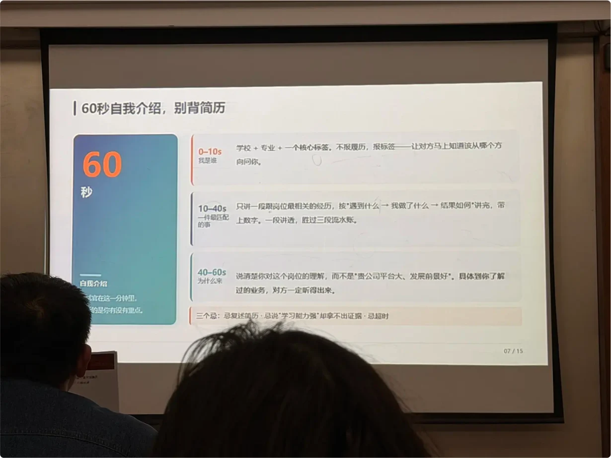
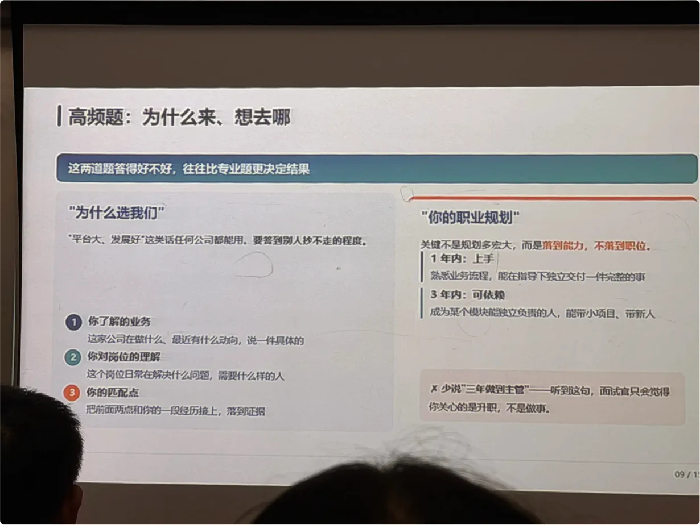
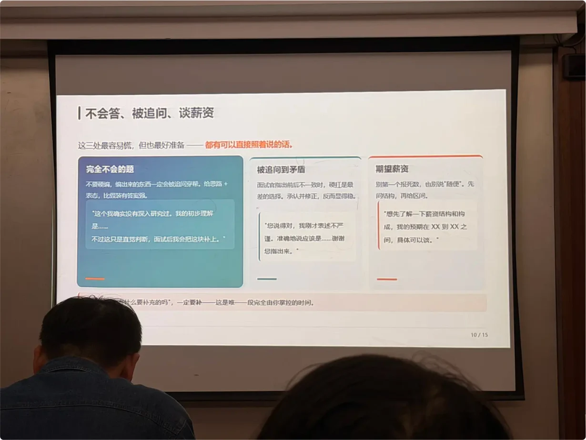
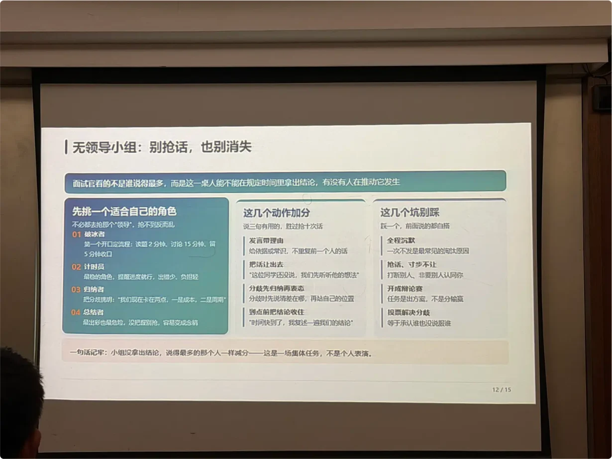

<!--folio:第1页-->

<!--col:L-->

<!--col:M-->

无领导面试

## 面试官视角拆解校招面试

面试官看什么？

1. 能不能干（基础技能）
2. 想不想干（为什么选择行业、公司）
3. 合不合拍（气场、沟通顺畅）

简历：动词——事项——量化结果：每个经历都能回答“所以呢”，有动作就有结果，就有数字，写不出来说明没想透彻

面试60s 自我介绍

• 讲经历用star

• 回答“为什么选我们？”“职业规划” 把为什么来想明白！

• 无领导小组

• 面试之后：复盘and 跟进

## 无领导经验

无领导常见于：银行、央国企、快消

• 考察维度和过程

考试互相讲话，考官观察-> 考查重点不是答案，而是沟通协作能力，看能力：在没有领导和明确指令的时候和陌生人完成任务

评价维度：1. 逻辑思维分析 2. 人际交往与倾听表达力 3. 组织协调力 4. 人际影响力（对观点贡献）5. 抗压能力

注意：要有效发言（能推进，能贡献到最后结论观点，不要重复）

• 扣分项：1. 不要随意打断别人发言 2. 注意发言时间

• 题型：开放类、两难类、选择排序类（频率最高）、资源争夺类

• 方法：

1. 审题时先写下自己排序的标准，如影响范围、可落地性、紧迫性等
2. 结构化表达（《金字塔原理》）标准→结论（选了什么）→保留（不确定...）
3. 边讨论边记录：把每个考生序号写下来，边听边记
4. 接话方式：补充、整合观点（eg2 号和3 好其实不冲突blabla；推动讨论的表达：善意提醒讨论时间久了，可以先定下来blabla）
5. 可以抢第一个发言（第一个抢考官注意力）可以说“我们5min 定标准，10min 讨论，最后定观点，可不可以blabla”

• 误区

1. 不要全程对着考官发言
2. 不要抢话，要倾听
3. 不要否定别人但不给理由，说：“你这个思路我有点担心，因为：...”
4. 不要把别人的观点换个说法变成自己的
5. 不要全程沉默
6. 不要为了不同而不同

• 无领导类型

央国企：8-12 人组内

外企：框架内辩论赛，正反方辩论

考验心理素质：心理素质好能否发挥全部实力

• 邪修

1. 候场过程中，先把所有人简单认识一遍，发挥时不会怯场
2. 公管就业多：人力（管理）、营销（roi 和净利润）、品牌（公关、社会舆情）→ 最后都要回归盈利为导向

• 面试：hr 选人标准：冰山模型（冰山上：简历 冰山下：eg 角色定位、从事的动机、三观和企业是否吻合...） → 所以面试交流

• 简历上内容核实清楚

• 意愿、动机、成就需要等弄明白（冰山下）

• 群面：语言艺术（接话等）、hr 关注点：leader 角色不要光抢，还要脑子里有框架； timer要掌握进度节奏并提醒，不止报时

leader：高收益高风险timer：要掌握进度节奏并提醒，不止报时motor：汇报者，除了结论，还要总结过程中如何解决分歧、问题答案不重要，分析过程最重要

<!--col:R-->

<!--/folio-->
