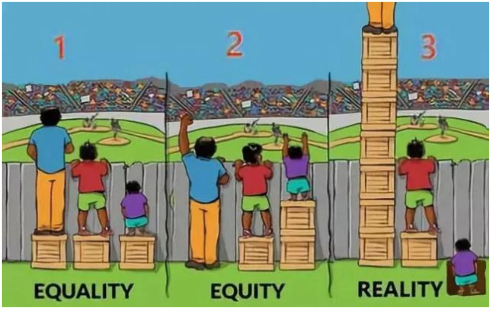
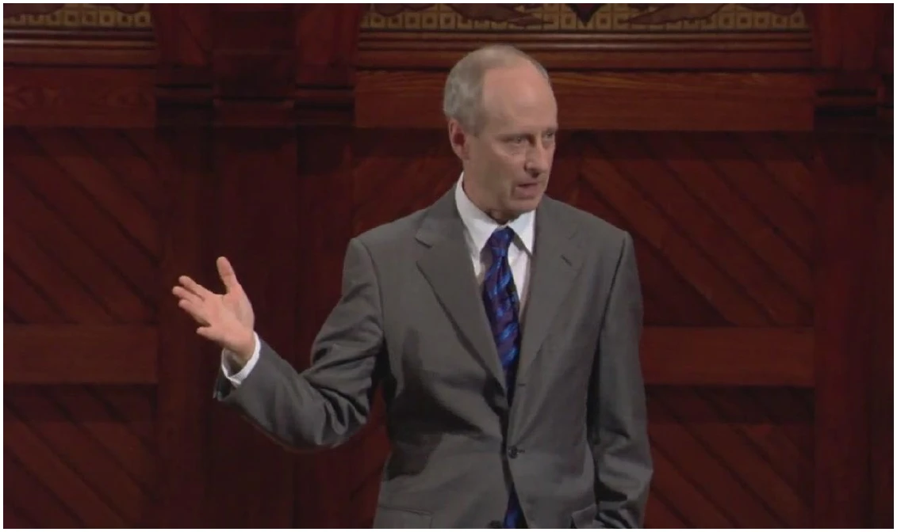
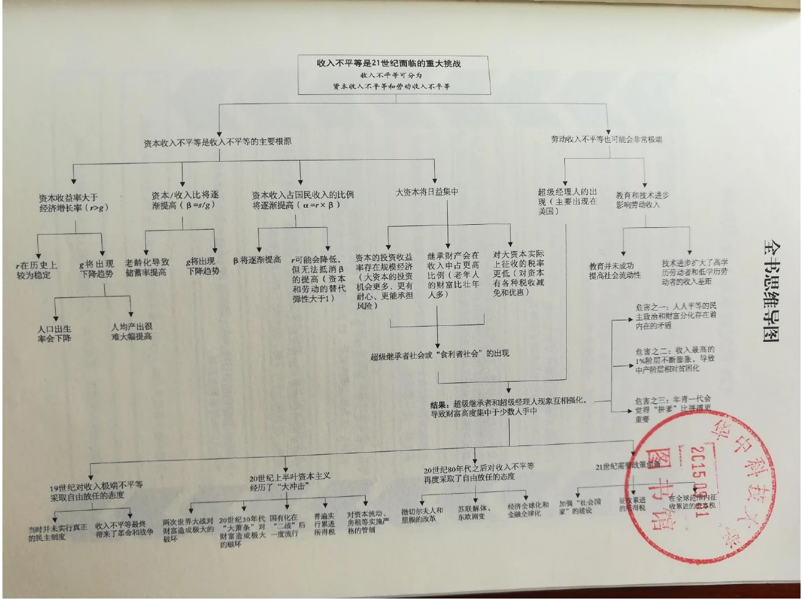

<!--folio-->
<!--col:M-->

## 公共经济学

陈鹤，华中科技大学公共管理学院

ch1797@本校官邮

## 第三章 公共经济学的基本价值观

- 效率

- 公平

- 自由

- 公共经济活动的功能

- 公共政策往往带来一系列直接和间接的效果。分析公共问题的第一步就是把这些效果都找出来，并提出对策建议。

经济学家在这样做时，会运用一整套工具。你必须掌握象稀缺性、机会成本、生产可能性曲线这些概念，还要会用供给和需求曲线，还有消费者选择、垄断与竞争、要素市场等。这些都是实证经济学的范畴（首先要学好经济学的基础概念）。

- 发现了政策的效果后，我们就要问：该政策是好是坏？这是规范经济学的范畴，即，用伦理和哲学来判断经济问题。有三个规范的标准：效率、平等和自由，这是最为人们普遍接受的。当然，人们对它们的定义也不一致。

### 一、效率

- 很多经济学家认为效率是第一位的。效率就是在成本一定的情况下获得最大收益，或在收益一定情况下支付最小成本。效率概念可用于公共政策。

- 例如，强制执行合同的政策。如果没有强制执行合同的政策，你将需要花费无数的时间精力去调查生意对手的个性、声誉；你将要求现金支付；借贷以及长期合同会大大减少；很多商品根本不会被生产出来。可见，强制执行合同的政策使经济更有效率了。

- 1.帕累托最优及帕累托改进

- 现代经济学所说的效率常常是指帕累托最优 （ P a r e t o Optimum）。帕累托提出了关于“效率”的定义：经济处于这样的一种状态，在此状态中没有任何一个人能在至少不使另一个人处境不变坏的基础上让自己的处境变好。也就是说，要让任何一个人的处境变好，必须使另一个人的处境变坏。

- 如果一个人的处境变好了，而同时没有使任何其他人的处境变坏，则实现了帕累托改进（Pareto Improvement） 。

帕累托改进是经济学家追求的目标。所有的改进都被完成了，就是帕累托最优。

- 现实中，所有的公共政策都会带来成本，所以不可能没有人受损失。（不可能纯粹的帕累托改进。中国改革开放初期，增量改革为主，得到绝大多数人拥护，接近帕累托改进。 ）

- 从现实的观点看，若一项政策带来的收益大于其成本，该政策就是有效率的政策（功利主义的效率观）。但这种效率并不要求获益者就是支付成本者。

- 经济学家还会问一个问题：从该政策获益的人能否补偿那么受损失的人，使他们的状况都比该政策执行前有所改善？如果能，则该政策的收益大于成本。即使这种补偿并没有实际发生，我们也可以认为是形成了一项“基金”。(希克斯改进)

- 2.卡尔多-希克斯改进（Kaldor-Hicks improvement）

- 卡尔多1939年发表的《经济学福利命题与个人之间的效用比较》论文，提出了“虚拟的补偿原则”作为其检验社会福利的标准，就是是看变动以后的结果是否得大于失。卡尔多补偿原则是一种假想的补偿，它使帕氏标准宽泛化了。

- 希克斯补充了卡尔多的福利标准，他认为，判断社会福利的标准应该从长期来观察，只要政府的一项经济政策从长期来看能够提高全社会的生产效率，尽管在短时间内某些人会受损，但经过较长时间以后，所有的人的境况都会由于社会生产率的提高而“自然而然地”获得补偿。因而人们称希克斯的补偿原则为“长期自然的补偿原则”。

### 案例：修路给三位村民带来福利改变，

### 用民主投票能否带来效率结果

|  | 村民A | 村民B | 村民C | 全村 |
| --- | --- | --- | --- | --- |
| 修路前的福利水平 | 100 | 100 | 100 | 300 |
| 修路后的福利水平（1） | 200 | 80 | 105 | 385 |
| 修路后的福利水平（2） | 110 | 80 | 105 | 295 |

- 3.功利主义标准

- 边沁(Jeremy Bentham,1748~1832)的“功利主义原则”。边沁认为人生的目的都是为了使自己获得最大幸福，增加幸福总量。幸福总量可以计算。

- 整个社会福利是每个人的效用之和，社会福利最大化，也就是总福利的最大化和平均福利的最大化。

- 质疑：福利（或者幸福）有没有高低贵贱之分呢？可以无差别地做加减乘除运算吗？1亿元资助1个国家大剧院，与资助100个流行乐队（或者1个芭蕾舞团与100个脱衣舞团）哪个带来的幸福更高?

### 讨论：偷盗有什么错？

- 不是简单的转移，而是产生净成本（即防盗成本）。因此，从帕氏或卡氏效率的标准来看，用偷盗的方式配置资源都是无效率的。

- 森林迷路，擅入他人房屋找食物。张三遇困，勇吃熊猫。

- 是否是有效犯罪？可用法律上的紧急避险制度来处理。

- 张维迎提出市场的逻辑（自愿交易一定是帕累托改进）与强盗的逻辑（强迫，或者政府行为，很少是帕累托改进）的区分。

- 但如果用功利主义的效率标准来衡量偷盗行为呢？

### 二、公平

- 有人认为，越平等地分配财富的政策就越是好政策，即使它是无效率的。

- 例如，向富人征税以补贴穷人，总是要支出管理成本，纳税人的负担超过了穷人的获益，但，这种税收政策被一些人认为是好的，因为它提高了平等度，让人感觉公平。

上图代表了西方左派的公平观，即追求结果公平equity

### 参考：Justice: What's the Right

### Thing to Do?

Michael J.Sandel

- 什么是公正？

- 从哲学上讲，公正(英文中有Equity,Justice和Fair,翻译为中文相应于公平、公正和正义),可以分为两种基本类型:

- 1.程序公正(Procedure Justice)。它要求类似情况、类似状态的人应类似对待。公正的意义在于人们尊重按照某种合理而公正的规则所产生的结果。

- 2.分配公正(Distribution Justice)。或称结果公正,它涉及到权利和义务的分配。分配公正有以下几种解释:

- 均等(Parity)。即要求义务和利益在个体之间平均分配,是一种不考虑个体差异的平均主义(Egalitarian)。

- 比例原则(Proportional Principle)。它要求根据参与分配者的贡献大小按比例分配义务和权利。它广泛用于经济学中的费用分摊和收益共享问题,又称受益原则(Benefit Principle)。

- 优先原则(Priority Principle)。人类最基本的需求应得到优先满足。

- 古典功利主义(Utilitarianism),又称边沁主义。它是指当一个社会的制度能最大限度地增加净满足时,这个社会就是安排恰当的。

- 最大最小原则(Maximin Principle)。它由哲学家卢梭和康德所倡导。1971年罗尔斯在《正义论》(A Theory Of Justice)中提出，在机会均等的原则之上,应追求“最小受惠者的最大利益”。

- 罗尔斯的正义观

- 设置原始状态，对正义原则的选择是在无知之幕（the veil of ignorance）后面作出的。

- 各方运用最大的最小值规则（maximin rule）是恰当的。

- 词典式序列（lexical order）：两个正义原则按编辑词典时的次序安排，第一个原则是平等自由的原则，第二个原则是机会的公正平等原则和差别原则的结合，其中第一个原则优先于第二个原则，而第二个原则中的机会公正平等原则又优先于差别原则。

- 两个正义原则暗示着社会基本结构的两大部分，一是有关公民的政治权利部分，一是有关社会和经济利益的部分。

包括两个优先规则：

- 第一个优先规则（自由的优先性）：自由只能为了自由的缘故而被限制。这有两种情形：（1）一种不够广泛的自由必须加强由所有人分享的完整自由体系；（2）一种不够平等的自由必须为那些拥有较少自由的公民所接受。

- 第二个优先规则（正义对效率及福利的优先）：正义优先于效率以及福利，同时公平机会又优先于差别原则。也有两种情形：（1）一种机会的不平等必须扩展那些机会较少者的机会；（2）一种过高的储蓄率必须最终减轻承受这一重负的人们的负担。

- 实际上，这两个优先的后面还蕴含着第三个也是最重要的优先，即正当（right）对善（good）的优先。

- 西方伦理思想史上的目的论与义务论：

- 目的论认为，善是独立于正当的，是更优先的，是据以判断事物正当与否的根本标准。如功利主义、快乐主义、至善论。

- 义务论认为，正当是独立于善的，是更优先的，如康德。罗尔斯的正义论也是一种非目的论意义上的义务论，强调正当对善的独立性和优先性。正义是正当的子范畴，即是应用于社会制度时的正当。

- 参考阅读：阿马蒂亚•森（Amartya Sen）《什么样的平等?》

### 经济学对公平的衡量方法

=0，绝对公平=1，绝对不公平

### 讨论：效率与正义真的是对立的吗？

- 奥地利学派认为这是虚假的对立。

- 索托（Soto）和罗斯巴德（Rothbard）提出“动态效率”。它关注的是“创造力”和“企业家精神”。

- 它的核心逻辑是：人类之所以能进步，是因为有人发现了新的机会，创造了新的东西。什么情况人才愿意去创造？只有当他的财产被保护、他的自由被尊重的时候。如果一个政府为了所谓的“国家效率”，去抢劫富人补贴穷人，或者随意管制企业，它可能在短期账面上好看（静态效率），但它破坏了正义。一旦正义被破坏，企业家就停止创新，社会死气沉沉。

- 结论：不正义的事情，从长远看，一定是低效的。正义（保护私产）本身就是最高级的效率。

### 三、自由

- 自由即有权做一切无害于他人的任何事情。——法国大革命纲领性文件《人权宣言》第4条(节选), 1789年

- 联合国世界人权宣言肯定了四大自由的精神:“人人享有言论和信仰自由并免于恐惧和匮乏。”

- 英国思想家约翰·斯图亚特·密尔（John Stuart Mill，也译为穆勒）在1859年所写的《论自由》被认为是从1791年美国宪法修正案到第一次世界大战前关于思想言论自由最重要的英文论著。

- 1.伯林

- 20世纪下半叶，以赛亚·伯林(Isaiah Berlin)开始用"两种自由 " 的概念来划分自由 : " 消极自由 " ( n e g a t i v e liberty)和"积极自由"(positive liberty)。

- 消极自由即没有受到别人干涉或没有受到人为的束缚。

- 对于积极自由，伯林提出过这样的说明:自由这个词的积极意义来自于个人希望能够做自己的主人。

- 2.罗尔斯

- 资本主义“自由、平等、博爱”的矛盾以及罗尔斯对此的调和

- 自由往往导致不平等，平等主义政策往往侵害自由。

- 右派——自由主义者；左派——平等主义者；罗尔斯——同时有平等主义与自由主义的倾向。

- 右派认为，对最少受惠者的偏爱是没有道理的，致力于事实上的平等将侵犯自由权利；左派认为对自由优先性的强调将影响平等和正义的实现，将有利于富人和剥削阶层。

- 从自由的角度出发，侵犯自由的政策是坏政策。例如，强迫富人给穷人金钱就是坏政策，尽管它带来平等。而强制执行合同则是好政策，因为它保护财产权以及自由交易。

- 所以，执极端自由观点者认为，所有的税收都是强迫，所有的商品（包括法庭）都应由市场来提供。

- 一般的自由观点是：至少，为一项政策承担成本的人应该就是受益者本人。

- 人们并不一定认为三个标准都达到才是好政策，而是对这三个标准有所侧重。如，完全的收入平等并不好，因为它会带来低效率。同样，很多人也并不太反对政府限制我们的行为，认为少一点自由可能带来多一些效率和平等。

- 思考：

- 1.该三大标准哪个你最认同？你的认同是情感上的还是有逻辑依据的？

- 2.你能否找到不需要经济学知识的判断公共政策好坏的伦理标准？

- 3.考虑以下三个标准：1）当一项政策对社会整体有利时，它是好的；2）当多数人喜欢它时，它是好的；3）当它强迫人们去做人们该做的事时，它是好的。你能找出这三个标准存在的问题吗？

### 四、公共经济活动的功能

### 功能一：参与资源配置

- 此类公共经济活动的价值观是追求效率

- 效率的实现条件：MSB=MSC

- MSB：

- 人们对某种物品的消费量每增加一个单位所增加的满足程度

- 以人们为增加一个单位的某种物品的消费量而愿付出的货币最高额来测定

- MSC：

- 人们对某种物品的生产量每增加一个单位所多耗的资源价值

- 以人们为补偿因增加一个单位的某种物品的生产量所多耗的资源价值而需付出的货币最低额来测定

资源配置效率最大化条件图解

- 公共部门经济活动必要性：完全竞争的市场机制可通过供求双方的自发调节而使资源配置达到最佳状态，但只是一种理论上的理想状态。现实中，价格信号并非总能充分地反映社会边际效益和社会边际成本。

- 公共品

- 外部性

- 垄断

### 功能二：协调收入分配

- 效率并非是评判资源配置状况的惟一标准，公平是必须加以考虑的重要因素。

- 公共财政履行调节收入分配职能的原因：由市场决定的初次分配往往极不公平。

- 市场经济框架内不存在再分配机制，需要用非市场方式（公共财政）

- 征税：税制上的巧妙安排，如累进所得税

- 补贴：各种转移性支付，如食品券补贴

托马斯·皮凯蒂（Thomas Piketty）《21世纪资本论》

（Capital in the Twenty-First Century）

### 案例分析：演员“限薪令”

- 2017年9月22日，中国广播电影电视社会组织联合会电视制片委员会、中国广播电影电视社会组织联合会演员委员会、中国电视剧制作产业协会、中国网络视听节目服务协会联合发布《关于电视剧网络剧制作成本配置比例的意见》。

- 随着我国影视行业的不断发展，……出现少数演员不合理高片酬现象，导致影视剧制作成本结构不合理，收入分配比例失衡，影响影视剧整体质量的提升。……各会员单位及影视制作机构要把演员片酬比例限定在合理的制作成本范围内，全部演员的总片酬不超过制作总成本的40%，其中，主要演员不超过总片酬的70%，其他演员不低于总片酬的30%。

- 讨论：你认为对演员的“限薪令”符合经济学原理吗？有效吗？

### 功能三：促进经济稳定

- 公共财政履行促进经济稳定发展职能的原因在于：市场经济不可能自动、平稳地向前发展。其价值观既包括效率，也包括公平，但不包括自由。

- 在凯恩斯主义指导下的公共财政政策安排：

- 自决的财政政策

- 以财政收支的不平衡换取整个社会总供求的平衡

- 非自决的财政政策

- 制度上巧妙安排，成为“自动稳定器”

- 政府干预经济周期的理论受到挑战。参考阅读：罗伯特·墨菲（Robert P. Murphy）的《第一本经济学》（的《第一本经济学》

（Lessons for the Young Economist）

- 大多数人认为，经济周期是纯粹市场经济固有的属性，甚至许多热爱资本主义的人也这样认为。事实上，由于这种普遍的观念，使得政府的反周期政策大受欢迎，据称这种反周期的政策能够驯服剧烈的市场动荡。

- 然而，政府干预能“修理好”经济吗？我们已经看到好几个例子，说明根本不是自由市场，而是政府的干预导致了诸多社会问题。这些例子有贫民窟恶房东、贩毒黑帮的暴力行为，还有大城市的公寓短缺等。经济周期不仅是由各国政府造成的，而且政府在经济衰退阶段给予的“解药”实际上是毒药。

- 可持续的繁荣和经济增长要依靠纪律和耐心。如果缺少了新的技术发明，或者发现不了新的可利用自然资源，那么没有什么神奇的办法能够增加劳动生产率，立即并永久地增加每个人的消费量。但政府官员没有耐心去等待可持续的经济增长，他们想要投资带来的好处，却不想忍受储蓄（即减少消费）的痛苦。为此，

中央银行（美联储）人为压低利率，使其低于自由市场原来的水平。美联储通过开动印钞机，把自己变成了新的可贷资金供给者，并使资金供给曲线向右移动。

- 为什么政府推动的虚假经济扩张和繁荣是有可能的？印刷新货币并将其注入金融市场所导致的虚假价格会误导企业家，让他们在不知情的情况下，开始进行没有足够真实储蓄支持的长期投资项目。并不是投入足够的资源“耕种”以维持现有的经济结构，而是通过“吃种粮”来让每个人看上去都享有更高的生活水平，这样的假象可以持续多年。

但是，一旦萧条来临，市场价格迅速变回真实的数字。

每个人都会意识到，自己在繁荣时期的表现有多么愚蠢。

虚假繁荣必然导致萧条。

<!--/folio-->
