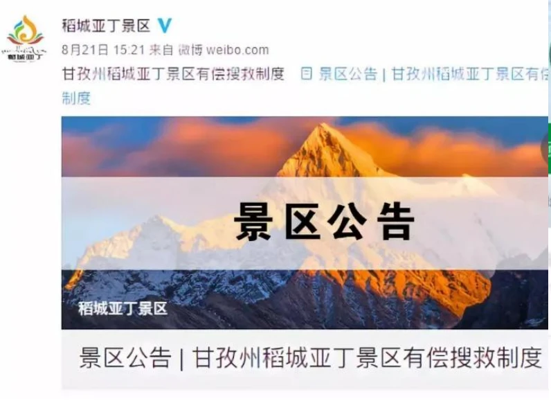
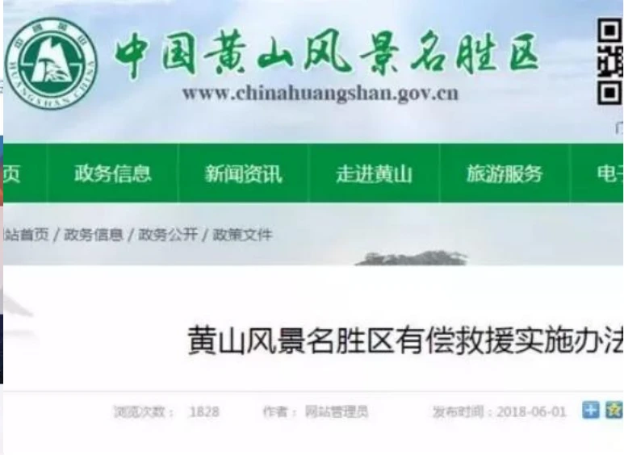
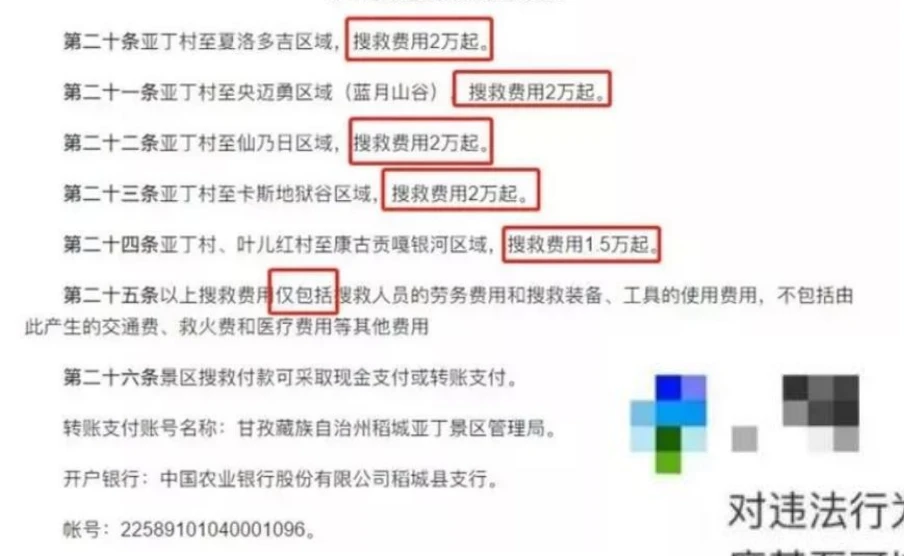

<!--folio-->
<!--col:M-->

## 公共经济学

陈鹤，华中科技大学公共管理学院

ch1797@本校官邮

## 第六章 外部效应理论

- 外部效应的定义与分类

- 外部效应导致资源错配的分析

- 公共部门对外部效应的矫正

- 私人部门对外部效应的矫正

### 一、外部效应的定义与分类

- 1.定义

- 指参与某项市场交易的个人或厂商没有获得该项交易的全部收益或没有支付该项交易的全部成本。

- 对该定义的理解：某种产品的生产或消费使生产者和消费者之外的社会成员遭受损失（获得利益）的特性，是市场失灵的主要原因。

- 又称外部性、外部经济性、外溢性

### 并非所有的人间互动都产生外部效应

- (1)沙漠中的两个行人对一瓶水的竞争？

- 没有帕累托改进的空间

- (2)天热时，海滩浴场的冰淇凌价格上升？

- 天气变热，去海滩浴场的人数增加，对冰淇凌的需求增加，价格上升。新加入的人对其他人当然有影响，但这不是外部效应，因为增长的需求通过价格的调整内化了。

- （3）天热时，海滩浴场更拥挤？

- 外部性反映了市场的缺失

- 可能人们不愿意创新市场（出售位子？）

- 2.分类

- 正外部效应（ Positive Externality，外部经济性）：

- 第三者受益而不用付出成本。事例：消防设备。

- 负外部效应（ Negative Externality，外部不经济性）：

- 第三者受损而无法得到补偿。事例：工业污染。

### 课堂讨论

- 1.长得漂亮是否对他人产生负的外部效应？或者是否产生正的外部效应？你是否赞成“美丽税”？

- 2.富人炫富是否对他人产生负的外部效应？你是否赞成政府禁止炫富？

- 3.你是否赞成景区收取搜救费？

- 近些年在我国，户外探险活动逐渐成为了时尚，虽然越来越多的人加入了“驴友”的行列，但其中大多数都是没有实际经验、没有户外生存技巧的新手。

- 为了追求新鲜、刺激，在进行活动之前，他们基本上不会走正规的申报渠道，也鲜有专业的导游带路指导。因此，近年来“驴友”因违规遇险的事件频频发生，景区也承担着巨额的搜救成本。随后，景区便发布了关于景区有偿搜救的详细制度。

- 一方面是搜救资源的浪费，一方面是人的生命，有偿搜救该不该存在？网友们看法不一。一些网友认为此项举措适合全国推广，公共资源不是用来浪费的。但也有网友表示：施救行为是政府职责，不应该收费。

### 二、外部效应导致资源错配的分析

### 1.负外部效应与产量过剩

- 负外部效应的实质是，产品或劳务的价格，不能充分反映用于生产或提供这种产品或生产要素的社会边际成本。

- 比如，造纸厂会污染环境，也即会给除造纸厂之外的其他人造成损失，而造纸厂并不把这种损失计算到它的纸张价格之中，这就是外部边际成本。

- 所谓外部边际成本(Marginal External Cost，简写为MEC)是指因增加一个单位的某种产品产量而给第三者带来的额外成本。

E点并非是效率要求的均衡点，因为S线所代表的边际成本仅仅是私人边际成本，即S=MPC，而未将外部边际成本MEC计算在内。反映社会边际成本MSC的曲线应为S′，它与D线相交形成均衡点E′，E′点所决定的均衡价格P′和均衡产量Q′才符合资源配置的效率要求。S线与S′线之间的距离就是外部边际成本MEC，即S′=S+MEC=MPC+MEC。从E点到E′点，不难看出价格P′高于P，而产量Q′却小于Q，

这说明负外部效应的存在会引起产量过多。

### 2.正外部效应与产量不足

- 正外部效应的实质是产品或劳务的价格，不能充分反映该种产品或劳务所能带来的社会边际收益。

- 如疫苗接种就具有明显的正外部效应，因为它不仅会使被接种者本人减少病菌感染的可能性，那些没有被接种疫苗的人也可由此减少传染病菌的机会，这就是外部边际收益。

- 所谓外部边际收益(Marginal External Benefit,简写为MEB)是指因增加一个单位的某种产品或劳务而给第三者所带来的额外收益。

E点并非是效率所要求的均衡点，因为D线所反映的边际收益仅仅是私人边际收益，即D=MPB，它没有把外部边际收益MEB计算在内。真正全面反映社会边际收益的是D′线，它与S线相交于E′点，E′点所决定的均衡价格P′和均衡产量Q′才符合资源配置的效率要求。D′线与D线之间的距离就是外部边际收益MPB，也即D′=D+MEB=MPB+MEB。从E点到E′点，不难看出，价格P′高于P，产量Q′也大于Q，

这说明正外部效应的存在引起产量不足。

### 3.外部效应的原理实质

- 原理：任何私人都是根据生产的私人成本与私人效用来决定其生产量的。

- 实质：私人边际收益或成本≠社会边际收益或成本

- 外部边际成本＝社会边际成本－私人边际成本

- 外部边际效用＝社会边际效用－私人边际效用

### 三、公共部门对外部效应的矫正

- 外部效应的矫正，就是指对产品或劳务的私人边际成本或私人边际收益进行调整，使之与社会边际成本或社会边际收益相一致,实现外部效应的内在化。

- 公共部门对外部效应的矫正方式，主要有：税收、补贴、规制。

### 1.税收

- 税收是实现外部效应内在化的传统手段。矫正性税收着眼于私人边际成本的调整，即对具有负外部效应的产品征收相当于其外部边际成本数量的税收，使私人边际成本提高到与社会边际成本相一致的水平。矫正性税收T的额度取决于外部边际成本MEC的大小，即T=MEC。

- 由于在 2 0 世纪 2 0 年代初英国著名经济学家庇古(A.C.Pigou)首先提出通过征税的办法对付环境污染问题，使税款等于效率产量造成的边际损失，即外部边际成本，因而人们又把这种为实现负外部效应内在化而开征的税收(如环境污染税)称为“庇古税”。

- 矫正性税收T的征收，迫使厂商提高产品的价格，而价格的提高必然使需求量减少，进而导致供给量即生产量减少，这就会减轻污染程度。如果厂商不愿缴纳污染税或者企图保持原有的生产规模，那么只好改进生产设备或采用新的生产技术和方法。

矫正性税收图示

说明：社会净效用来源于——社会总成本减少了GBHJ，社会总效用却只减少了ABHJ

- 环境污染税税基的确定可以有不同的方法。一是以污染物的排放量为税基；二是以污染厂商的产量为税基；三是以对那些可能引起污染的投入物(如含硫量较高的燃料)为税基等等。

- 环境污染税的税率应以外部边际成本为限，在实际生活中可采用“反复试验调整法”，即不断改变每种污染物的单位税额，直到污染量达到环境检测标准许可的范围之内，因而环境污染税的税率形式应为具有弹性的定额税率。由于各地区气候条件、人口密度、产业水平及对环境洁净的要求等方面存在差异，

同样的污染量在不同地区会造成不同的损害程度，所以，污染税的税率不能高度统一。

- 讨论：

- （1）矫正性税收能完全消除污染吗？

- （2）矫正性税收收入应如何使用？

- （3）对汽车尾气污染的矫正性税收有几种方式？优劣如何？

### 2.补贴

- 补贴也是实现外部效应内在化的传统手段。补贴着眼于私人边际收益的调整，即对具有正外部效应的产品发放相当于外部边际收益数量的补贴，使私人边际收益提高到与社会边际收益相一致的水平。矫正性补贴的数量取决于外部边际收益的大小，即W=MEB。

- 矫正性补贴在一些国家比较常见，如居民个人在自己的庭院内植树，由于会改善自然环境，政府往往以优惠的价格供应树苗；再如政府对有突出贡献的科技人员发放特殊津贴，以鼓励科技发明，因为科技发明往往具有正外部效应。

正的外部效应：外部边际效应递减的情况

### 3.政府规制

- 政府规制(Government Regulation)是指政府部门依据有关的法规，通过许可、禁止等手段，对企业的经济活动施加直接影响的行为。政府部门可以限制个人或企业所从事的具有负外部效应的经济活动。主要有两种方式：

- 对外部效应水平的规制，如政府通过制定环境质量标准，规定厂商排污的最大限额；

- 对生产过程的规制，如禁止厂商倾倒化学废料，限期调整污染工业的生产布局，勒令厂商安装防污设备或改进生产工艺等。

- 对于公共资源问题也可通过规制的方式来解决，比如，对于政府限定渔船的数量，只有获得捕捞许可证的渔船才能进行捕捞作业，许可证通过拍卖的方式发售，出价高的才能获得。许可证价格实际上起到一种筛选的作用，让生产成本较低者去生产；同时，许可证拍卖收入还可弥补一部分政府规制的成本。

- 政府规制手段是强有力的，但往往只能起辅助作用，因为规制的成本比较高。

- 假定有两个厂商X和Y，X、Y的边际收益曲线为MBX和MBY，为方便起见，假定X、Y的私人边际成本曲线MPC完全重合，最大利润的产量也相同，即X1=Y1。

假定X、Y的外部边际成本MEC相同，也即MPC +MEC=MPC +MEC，

X Y

这样，符合效率要求的产出应由其私人边际收益曲线与社会边际收益曲线的交点所决定，从图中看X、Y的效率产量分别为X*和Y*。可见，效率并不要求两个厂商等量地减少产量，要求Y削减的产量远远超过X，因为两个厂商的边际收益曲线MB的斜率是不同的。

但在政府规制方式下，若要准确地辨别这两个厂商边际收益曲线的形状，必须付出可观的成本，尤其在污染厂商数量较多的情况下，成本巨大。结果往往要求所有的污染厂商按同一定额或同一比例减少污染物的排放量，这又会引起政府规制的低效率。

### 讨论：零污染是有效污染吗？

- “清零”是有效率的公共政策吗？

### The Efficient Level of Emissions

Assume:

Level of Emissions 31

### 四、私人部门对外部效应的矫正

### 1.一体化

- 参考：阿耶·L.希尔曼《公共财政与公共政策——政府的责任与局限》

- 果农与蜂农相互之间正的外部效应，可以通过一体化经营来消除。

- 存在的困难是什么？

### 2.科斯式谈判

- 这种思路源于著名的科斯定理（Coase Theorem）。

- 美国著名经济学家科斯（R.H.Coase）认为，外部性问题从根本上说是产权界定不明或界定不当所引起的。在产权明确的情况下，若交易成本为零或可以忽略不计，则无论初始时谁拥有产权，市场机制可以把外部性内部化。这就是科斯定理。

科斯定理的例解：养牛者与农户；农户围栏的年成本为9美元，谷物价格为每吨1美元。

| 牛群数目（头） | 谷物年损失（吨） | 每增加一头牛所造成的谷物损失（吨） |
| --- | --- | --- |
| 1 | 1 | 1 |
| 2 | 3 | 2 |
| 3 | 6 | 3 |
| 4 | 10 | 4 |

- （1）假定养牛者无权损害谷物。当牛群规模为3头时，须赔偿6美元，增加到4头时，则须赔偿10美元，此时养牛者将修建围栏。

- （2）假定养牛者有权损害谷物。则农户可以容忍的牛群头数也为4头，因为此时如果他修建围栏，则必须花9美元，而不围栏时的损失为10美元；因此，当养牛者将牛群增为4头时，农户将围栏。

- 因此，假定没有交易费用，资源的配置状态就与产权的初始界定无关。

### 科斯定理的应用：吸烟交易

- 科斯定理的一个流行表述是：

- （a） 如果交易成本为零，无论对产权如何进行初始配置，双方之间的谈判都将带来财富最大化的安排；

- （2） 如果交易成本不为零，则不同的产权配置会带来不同的资源分配结果；

- （3） 由于交易成本的存在，不同的权利定义和分配会带来不同的资源配置效益，这是进行资源优化配置的基础。

### 3.排污权交易

- 排污权交易是一种新兴的环境治理制度。政府先为企业划定排污总量指标，哪个企业想争取更多的排污量，就要想办法从别人手里去购买，也可以将省下的排污量卖给其他企业。与此同时，政府则通过每年回购市场上多余的指标，使得排污总量逐年缩减。

- 举例，某钢铁厂被允许的排污量为300吨。如果自己减污100吨，需耗费600万元。与此同时，邻近的某造纸厂被允许的排污量也为300吨，但它自己减污100吨，只需耗费400万元。显然，钢铁厂向造纸厂购买100吨排污权，只耗费500万元，可以净节省100万元支出；造纸厂向钢铁厂出售100吨排污权，获得收入500万元，可以净增加100万元收入。

- 排污权交易创造了一种有价值的资产，使那些能够以低于污染权的成本清除污染的人获得这项有价值的资产，通过污染权的市场交易，可以使政府将污染量控制在所指定的范围内的同时，实现资源的最优配置。

- 排污权交易的优点是减少企业为排污所付出的成本，也减少政府治污的支出；缺点是排污权进入市场后，企业购买了排污指标，就认为排污是理所当然的；另外，有的企业可能用大量购买排污权的方式形成事实上的垄断。

<!--/folio-->
