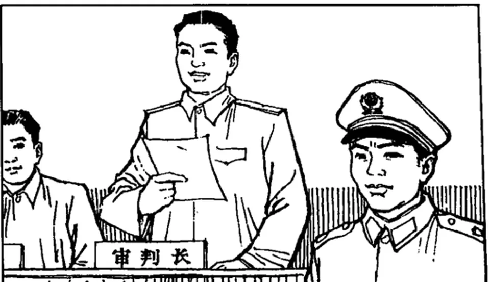

<!--folio:第1页-->

<!--col:M-->

中国法律：历史与现实

<h3 class="doc-title">窃书为雅罪</h3>

中华文化中的知识产权法

To Steal a Book Is an Elegant Offense： Intellectual Property Law in Chinese Civilization

［美］安守廉（William P. Alford）著　　李　琛 译

法律出版社 · 2010年11月第1版

<strong>内容提要：</strong>本书是一部中国知识产权制度的历史论纲，核心提出四大命题。其一，帝制中国并不曾发展出相当于知识产权法的有效本土制度，这在很大程度上可归因于中国的政治文化；其二，20世纪之交试图把欧美知识产权法引进中国的最初尝试并不成功，因为误以为外国压力足以导致法律的采纳与广泛遵守；其三，当代建立知识产权法的努力存在同样深刻的缺陷，没有调和西方法律价值、制度、形式与中国历史传统及现代环境制约之间的关系；其四，美国对华知识产权政策建立在对法律发展本质的误解之上，虽签订若干双边协议，成效仍令人质疑。全书依次考察帝制中国的本土限制、近代西方观念的输入、社会主义时期的知识产权立法、台湾地区的态度转变与美国对华政策，最终指出：如何培育对知识产权的尊重，取决于更广泛的政治与经济权利在中国的发展。

知识产权法　法制史　版权　帝制中国　盗版　台湾地区

题献

本书献给Daniel Shen Alford及其祖父母与外祖父母。希望他和祖辈一样拥有可敬的人生。

致谢

作为一本知识产权著作的序言，我想不出比鸣谢他人的贡献更合适的内容。在此首先要深深地感谢O’Melvey & Myers法律事务所为本研究项目提供的资助，这是该事务所为公益事业所作的诸多贡献之一。通过全球遴选，我成为O’Melvey & Myers为庆祝百年纪念所设资助的首位获得者，事务所为我提供了学术研究假。在此期间以及此后的时间里，我得以采访公共领域与私人领域的决策者以及侵害行为的受害人与加害人、埋首于国内外陈年的档案资料、为研究“盗版”而穿越偏僻的巷弄；并且通过更为传统的方式完成了作为本书基础的大部分研究资料。在始终保持学术独立性的同时，我也要感谢事务所前任管理合伙人Warren Christopher、Howard Chao、Gary Horlick、John Stamper、Ko-Yung Tung、已故的Richard Sherwood以及O’Melvey & Myers事务所其他成员所提供的睿智的建议。

我还由衷地感谢其他许多人的慷慨帮助。已故的Melville Nimmer教授曾给予我启发。虽然Melville是版权领域的卓越学者，却总是抽出时间帮助年轻的同事，而且在此方面以及其他许多方面，示范了一个人如何做到德才兼备。我非常幸运地与之共事的院长们——哈佛法学院的Robert Clark院长和加利福尼亚大学洛杉矶分校法学院的Susan Westerberg Prager院长以及Carole Goldberg-Ambrose教授，确实做到了优秀院长们应当做的一切，给予了我真诚的学术鼓励和许多令人感激的物质支持以满足本项目的需求。在本书几易其稿的过程中，Christine Cervenak、Jau-yuan Hwang、Margot Landman、Ouyang Jehng、Peter Lin、Liang Zhiping、Mark Ramseyer、Arthur Rosett、Shen Yuanyuan、Frank Upham、Lloyd Weinreb、Yin Xiong和Yu Xingzhong都曾慷慨而富有洞见地审阅了文稿的部分或全部。

我的老师Jerome Cohen和研究汉学的同事们——包括Randle Edwards、James Feinerman、Sharon Hom、Andrew Hsich、Philip Huang、William Jones、Nathalie Lichtenstein、Stanley Lubman、Hugh Scogin、Karen Turner、Susan Weld以及Margaret Woo，耐心而愉快地帮助我在很大程度上加深了对中国法的了解。Chang Wejen、Susan Cherniack、Eddy Harrison、David Ben Kay、Lawrence Liu、Michael Moser、Julia Murray、Shao Chiung-hui和Mark Sidel慷慨地向我提供了有关中国知识产权法的资料。斯坦福大学出版社的Muriel Bell、Peter Dreyer和John Feneron都是慷慨乐助而且极具文字功底的编辑。Han Deyun、Peter Neumann和Franklin Zee的确是不可多得的研究助理，发掘了大量的有价值的资讯。Cheryl Frost、Margaret Kiever、Susan Salvato、Melissa Smith、Deborah Soares和Kathryn Ying用极度的细心和耐心审阅了我几乎难以辨识的底稿。

除了上述名字，我还要感谢许多曾经接受采访的国内外人士。他们中的大多数要求我不要公开姓名，因此，通过采访获得的资料只标注时间和地点，而没有注明被采访者。

此外，我还要感谢下列机构：哈佛大学法学院及其东亚法律研究项目、哈佛—燕京图书馆、哈佛费正清东亚研究中心图书馆、蒋经国国际学术交流基金会、加利福尼亚大学洛杉矶分校法学院院长基金、加利福尼亚大学洛杉矶分校国际研究与海外项目、加利福尼亚大学洛杉矶分校学术评议会研究委员会、加利福尼亚大学洛杉矶分校法律图书馆与鲁道夫东方藏书；台湾地区“内政部”及“法务部”、台湾地区“中央”研究院、中国国家图书馆、中国版权局、中国人民大学知识产权中心、中国贸促会、中国专利代理（香港）有限公司；Baker & McKenzie；Lee & Li；Paul, Weiss, Rifkind, Wharton & Garrison；IBM公司（日本）；Lockheed公司；Universal/MCA；美国贸易代表处办公室；美国专利商标局；美国版权局和美国驻华及驻韩使馆。

我也要感谢下列高等教育机构，使本书的部分内容以论文形式得以发表，包括：亚利桑那大学法学院、波士顿大学法学院、凯斯西储大学、哥伦比亚大学法学院、康涅狄格大学法学院、哈佛法学院、路易克拉克大学西北法学院、中国台湾大学、华盛顿大学以及圣路易斯大学。同时感谢《中国法杂志》，曾在1993年第7卷第1期发表了本书第二章的早期版本。

最后，我要感谢我的父母Hyman和Rose Alford、我的妻子沈远远、我最亲爱的朋友Jonathan Kempner，感谢他们曾经付出并仍在付出的一切。

我把中文的名字和术语标注为拼音，除非有可能引起误认（如台北还是用“Taipei”）。若无特别说明，所有的翻译都是我个人成果。

尽管诸多人士与机构为我提供了慷慨的帮助，但书中的观点与谬误之责仍由本人承担。

W. P. A.

插图说明

这是1985年吉林省工商行政管理局制作的“中华人民共和国商标法图示”宣传画，配套的文字注明：“第40条假冒他人注册商标，包括擅自制造或者销售他人注册商标标识的，除赔偿被侵权人的损失，可以并处罚款外，对直接责任人员由司法机关依法追究刑事责任。”立于法官席者为审判长。

译者说明

书名“To Steal a Book is an Elegant Offense”据原著说明，系出自鲁迅的《孔乙己》，应为“窃书不算偷”之英译。原著作者愿以《窃书为雅罪》为题，故尊重其意思。

原著采用尾注，为了便于阅读，译文改为脚注。

原著引文采用缩略形式，在参考文献中方标明著述的完整名称。例如“Law, Law, What Law? Why Historians and Social Scientists of China Ignore Its Law”，在注解中仅用“Law, Law, What Law?”。译文照录，请读者注意对照“参考文献”部分查对文献的完整标题。原著对中文文献也同样处理（用拼音），例如“一部具有中国特色的专利法”缩略为“一部具有中国特色”，鉴于此方式不合乎中国人阅读习惯，译文完整译出。

论文后面标注的页码通常是所引内容在刊物中的页码，由于原著的脚注有时会省略刊物名称，故读者应结合“参考文献”查找出处。

为了便于中国读者的检索，对原著所引的中文文献的英译，译者尽力找到了中文出处，按中文原貌呈现。个别之处未能确证的，标注“转译”字样。原著对中文文献名称和中国人名采用拼音标注，若按音译，则出入甚大。译者尽了最大的努力核对出处，但精力所限，个别较生僻文献的作者人名未能查实，照录拼音。

所引英文文献原则上照录。为了便于读者的继续研究，凡有固定中文名的著名外国汉学家，注释中均采中文名（例如费正清、白凯），首次出现时加注英文原名。无固定中文名者，译法依据新华通讯社译名室编著的《英语姓名译名手册》（商务印书馆2007年版）。对原著所引的华人学者的英文名，译文中绝大多数已查对出中文原名，仅有个别实在难查对，只好按英文照录，请读者谅解。作者姓名的中英文对照参见“参考文献”部分。对著名的外文报刊（例如《华尔街日报》）也直接使用固定中文译名。

原书中有一些注解系针对西方读者（例如“文化大革命”、“任建新”），对中国读者无太大必要，故而略去。为了便于读者对照原书，注释编号仍然保留，在注解处标明“（略）”。

原著中所引的法律文件有些已失效或修订，请读者留意所引法规的颁布时间。

中译本序

哈佛大学安守廉（William P. Alford）教授的《窃书为雅罪》一书，最近由李琛教授译成。她嘱我作序。

《窃书为雅罪》出版于20世纪90年代，当时作者曾送书给我。这不是一本大部头的著作，译成中文，不过10万字上下，但是对中国学界的影响却很大。书甫问世，就引起强烈反响，安守廉在中国也因此声名大噪。先是郑成思教授撰文商榷，批评安守廉否定中国宋代出现著作权保护的论点。随后，梁治平教授翻译了该书的部分章节，在我主编的《中国知识产权评论》（商务印书馆）第1卷也曾有刊行。继而，李雨峰教授索性借用了该书第三章的标题“枪口下的法律”，作为他的博士学位论文题目。书中的观点多年来也反复被中国知识产权的论著引用。今天，法律出版社又延请李琛妙手再造，出版该书的全译本，足见中国法学界对该书学术价值的肯定。

从一定意义上来讲，《窃书为雅罪》是一部中国知识产权制度的历史论纲。

安守廉从一位西方法学家的角度，洞若观火，对中国的这段历史作了经济、政治、文化上的梳理，正面提出了自己的评论，甚至对某些有违法治的现象旗帜鲜明地提出了批评。

中国的读者对书中持论可能不尽赞成，但是对作者的治学方法、治学态度，对该著作所显示的深刻思想、追求事实的科学精神，以及理性的力量，特别是有关知识产权的理论、历史、制度及其实践问题，都表现出极大的兴趣。

安守廉提出的问题具有基础性、全局性、纲领性，对它们的回答关系着中国法治，乃至整个社会的未来。我认为，至少以下几个问题值得中国的学术界长期思考和认真研究：

（1）四大发明的故乡——中国为什么没最早出现知识产权制度。这个问题是老生常谈，却难回答。需要通过艰难的考据和科学、理性的分析研究才会作出合理的解释，这显非一日之功。

郑成思主张“版权伴生于印刷术的发明”，并坚持中国宋代就有著作权制度的观点，有其合理的一面。遗憾的是，他生前未及作出系统论证。

安守廉持不同意见，认为脱离当时社会的基本背景，仅靠印刷术这一因素，或古代典籍中的只言片语，不能断言唐、宋有著作权保护。

平心而论，知识产权制度形成的条件是复杂的，除去印刷术这一生产力要素外，生产关系和上层建筑也是重要的决定因素。古代中国，既没有形成工业化的生产手段，也未出现与之相适应的生产关系和上层建筑，更不曾形成有独立经济地位和诉求的创造者阶层。

作为中国知识分子原始型态的“士”，自古以来，就是权贵与财势的附庸。如果说变化，充其量是由豪门权势分散“包养”的“食客”，转为主要是被专制皇权通过1300年的科举制统一“包养”的“士大夫”。

“士大夫”阶层原本是皇权为遏止魏晋以来世家大族的豪强专权，在隋唐之际，通过科举制这一政治体系而形成的。作为精英政治的形式，“士大夫”的力量在两宋时期达到顶峰。他们和皇权之间经过磨合，双方关系达致平衡和谐。

元代以降，上述平衡被打破，“士”的地位大变，沦落到“七娼、八丐、九儒”的地步。明、清之际，皇权陡增，高度专制，不容自诩“以天下为己任”“家事国事天下事，事事关心”的士人任意纵论国是。科举制也成了皇权压制思想的工具。

理学的兴起，束缚了“士大夫”阶层的思想，使之逐渐失去独立性，发展成为皇权的附庸阶层。

尽管16世纪后的中国社会出现了资本主义的萌芽，但是资本主义生产方式并没有发生，中国仍然是典型的农业社会。虽然一些士人无望“宣室”，而弃儒业贾，但是他们的主体仍被科举制度所束缚，无法摆脱专制皇权设置的伦理窠臼。农业社会耕读持家，“万般皆下品，唯有读书高”的信条是天经地义的立世之本，科考功名是读书人亘古不变的人间正道。

此外，我们还应当看到一个重要事实，笼统的“印刷术”一语，用以界定产生著作权制度的技术条件是有困难的，是不充分的。活字印刷技术的发明以及成熟，有一个渐进和“升级、换代”过程。毕昇的技术发明于1041～1048年间，其活字用胶泥制成。在实践中，相继出现了以木、铜、磁、锡、铅为材料的活字，这一过程历经数百年。

“虽然中国很早就发明了活字印刷术，但始终未能脱离手工劳动方式，近代铅活字机器印刷技术是从西方输入中国的”（《中国大百科全书》（第10卷），2009年第2版，第397页）。

以胶泥或木质材料为活字构成的手工印刷术，和铅字机器印刷技术分属不同的生产方式。这种生产方式能否催生出市场社会中出版商、工人和作者这三个独立的经济主体，令人存疑。

所以，要为中国是否在唐宋时代就存在过著作权制度作出理性的、科学的、令人信服的说明，乃至于解释生产能力曾长期领先于世界的中国何以没有首先产生知识产权制度，是一项艰巨、长期的任务。

（2）恰当处理意识形态和发展文化产业的关系，为知识产权制度开辟广阔的发挥空间，才能促进社会物质生产与文化生产的平衡发展。改革开放的核心任务是解放生产力。未来的竞争是技术、文化创新能力的竞争，为此，必须调整与生产力发展不相适应的制度与观念。

早些年，我们到好莱坞考察美国的电影产业。哥伦比亚电影公司首席律师的几句话，让我印象深刻。他说，好莱坞是个生产快乐的大工厂。我们花钱请人写剧本、定导演、选演员，用摄影机将表演记录下来，压缩成胶片，再把经过取舍、剪辑的影片放给你看，你一高兴，就把原本你口袋里的钱放进我们的口袋。事情到此，已经全部结束。至于其中是否有艺术存在，对我们来说，纯属意外。我们关心的是市场，这就是娱乐产业。

在我国，按照传统的思维模式，片面强调文化的意识形态属性，长期不接受“文化产业”的概念，习惯于把意识形态抬高到政治的高度，突出政治，把政治和经济对立起来，动辄把“要算政治账，不算经济账”作为强调文化工作重要性的口头禅。

在立法上，有私法公法化的倾向。2001年11月27日修改前的《著作权法》第43条关于“广播电台、电视台非营业性地播放已经出版的录音制品，可以不经著作权人、表演者、录音制作者许可，不向其支付报酬”的做法，和2010年2月26日修改前的《著作权法》第4条第1款“法律禁止出版传播的作品，不受本法保护”的规定，是这一倾向的突出表现。

（本次修改主要是执行世界贸易组织纠纷解决机构的裁决。现改为：“著作权人行使著作权，不得违反宪法和法律，不得损害公共利益。国家对作品的出版、传播依法进行监督管理。”放弃原规定，无疑是文明的进步，对国内国际社会释放了善意。但新的表述则不免令人生疑，是否多少意味着对修改的不情愿？）

与这一倾向相呼应，理论上则出现了迎合上述诉求的“知识产权的私权公权化趋势”的观点。这些情况，阻碍了文化产业的发展，进而必然制约科技创新产业的发展。

改革开放30年，手段特殊、成果巨大。今后发展的唯一出路是创新，尤其须加强文化创新。国家应当改变以往重科技、轻文化的产业政策，调整重理、轻文的教育结构，放弃重物质财富、轻知识产权的传统观念。

发达国家的经验表明，科技和文化是推动社会进步发展的车之两轮、鸟之两翼，文化产业在经济、社会发展中的作用日益突出，甚至出现了超过传统制造业的趋势。我国虽然2000年才在中共中央的文件中出现“文化产业”概念，但是发展潜力巨大。可以预见，注重科学发展，平衡科技创新和文化创新的关系，发掘文化产业的潜能，将成为中国经济增长的新手段。

（3）创造与劳动的关系。如安守廉在第一章所指出的，研究知识产权法的困难之一，“在于思考基础合理性以及视野开阔的论著过于稀少”。

作为知识产权制度的继受者，在过去的30年中，我们更关注实用，对知识产权的基础理论，以及该制度形成的深刻原因，几无研究。本书提及的创造者的法律地位问题，创造与劳动的关系问题，也在其中。

安守廉在本书的第四章开篇就以“中国‘文革’时期的流行语（1966～1976）”，引用了“钢铁工人在本职工作中铸成的钢锭上有必要署上他的名字吗？如果没有必要，为什么一个知识分子就该享有在劳动成果上署名的特权呢？”

接着，该章第二段又引述了青年马克思1844年的一段话，作为上述观念的理论注解：“甚至当我从事科学工作时，即从事一种很少同别人直接交往的活动时，我从事的也是社会活动，因为这是人的活动。不仅我的活动所需要的材料，甚至思想者使用的语言本身，都是作为社会产品赋予我的。我本身的存在就是一种社会行为。因此，我自身的成果，是我为社会所劳作，并且意识到我是作为一个社会存在体而劳作。”

二者灵犀相通，无异于把但丁“放歌”《神曲》，雨果“描绘”《悲惨世界》的行为，等同于钢铁工人铸造钢锭。对这一问题的回答，也可用作知识产权正当性的答案。对此，我们也鲜有思考。

长期以来，我们把劳动和剥削作为经济活动两个基本范畴，经济活动的参与者非此即彼。“创造”从来没有独立的地位，而是劳动或剥削的附庸，“居无定所”，在“剥削”与“劳动”之间徘徊，有时被尊为劳动，有时被贬作剥削。

资产阶级和工人阶级各自占有剥削者和劳动者壁垒分明的两大阵营，是两张“皮”；主要以创造（或创作）为生计的知识分子，被认为是附在皮上的“毛”。创造者要么属于资产阶级，要么属于工人阶级，“皮之不存，毛将焉附”，没有独立的社会地位。这一逻辑，可用作邓小平最终把知识分子划入工人阶级一部分的理论诠释。

但是，这并不符合人类工业文明社会以来的历史事实。我的初步研究认为：创造当然不属于剥削，但也不隶属于劳动。创造是一个与二者并列的，或许是更为重要的概念。

我们崇尚劳动，所以把一切认为美好的事物都粉饰为劳动。当我们给创造者“落实政策”时，所能给予的最高奖励，就是以“劳动”的名义。其间虽然充满善意和溢美之词，但是称创造为劳动，确实是张冠李戴了。

按照马克思的观点，就一件劳动成果而言，无论劳动的具体方式差别、劳动的技术含量高低、劳动复杂程度如何，在质上，无一例外是人类无差别的智力与体力的综合支出的凝结；在量上，是具体劳动各自所花费的社会必要劳动时间。

可见，劳动是可以重复的行为；劳动作为技能，可以通过传承、学习、训练获得；劳动成果中所包含的劳动量，可以用同为劳动的尺度来计量；劳动成果可以重复再现；不同劳动成果之间可以比较、交换。

从分配上看，马克思为理想社会设计的最佳原则是按劳分配，按照该制度，“每一个生产者在作了各项扣除之后，从社会方面正好领回他所给予社会的一切。他所给予社会的，就是他个人的劳动量。例如，社会劳动日是由所有的个人劳动小时构成的；每一个生产者的个人劳动时间就是社会劳动日中他所提供的部分，就是他在社会劳动日里的一份。他从社会方面领得一张证书，证明他提供了多少劳动（扣除他为社会基金而进行的劳动），而他凭这张证书从社会储存中领得和他所提供的劳动量相当的一份消费资料。他以一种形式给予社会的劳动量，又以另一种形式全部领回来”（马克思：“哥达纲领批判”，载《马克思恩格斯选集》第3卷，人民出版社1995年第2版，第304页）。

可见，循此原则，劳动者获得报酬的标准是劳动的质和量，即由技术含量、繁复程度和力量强度所决定的劳动的质，和由时间为尺度来衡量的劳动的量。

反观创造，截然不同。创造与劳动之间，不同的创造之间，都是异质的，不具可比性。在经济价值上，相互之间没有可以交换的共同基础。创造成果是唯一的，创造不可再现。展现创造成果的技能可以学习，但是创造本身是无法训练和传承的。

梁漱溟认为，创造乃“凭空而来，前无所受”。创造所需要的表达的技术无疑属于劳动技能，表达的过程也可以归于劳动，但是创造本身不是劳动。完成创造成果所花费的劳动量，也不等于创造成果的市场价格。

从利益分配上看，创造者的获酬法则也与按劳分配不同。他们不是按照表达创造成果所运用的技术复杂程度和所消耗掉的时间来衡量，和所谓的价值规律无关。因其不是劳动成果，创造成果没有价值可供衡量，只有市场价格。

其价格完全取决于社会的认知、欣赏和需求，并没有与劳动相对应的所谓创造领域的“价值规律”。

总之，创造是无价的。千锤百炼的，或许一文不值；一挥而就的，可能价值千金。创造的成果实际上是为我们提供了一种新的生活方式。按照创造物的市场法则，谁接受和享用该生活方式，就有付费的义务。

创造者的一次行为所结之果，不但可以直接进入市场，还可以对之二度、三度、再度创造，并将所得成果市场化。它们一旦进入市场，获取财产回报的方式、机会和数额难以估算。哈利·波特一面世，就风靡全球。罗琳不仅暴富，而且惠及子孙。这种现象是按劳分配的原则所无法解释的。

通过以上简单的对比可以看出，创造与劳动的关系是：创造成果是汇万物以升华，从无到有、聚沙成器的质变的结果，是飞跃；劳动成果是从此及彼，积少成多的量变，是质变基础上的量的扩张，属于复制的结果。

按照这个初步研究结论，对“文革”流行语所提问题的回答是：署名是一种标记。标记的功能，是市场的参与者对自己提供的交换对象负道德和法律责任的表征。这是商品社会的法则。

钢锭同样需要表征，但表征的具体方式有别。目的是为鉴别它的质量是否符合既定的标准，以保证产品的功能和用途。同时也是考察劳动者行为是否符合既定的技术规范的手段。这种做法，古已有之，如果谁偶尔有幸见到被拆毁的北京明城墙砖，你会触目惊心地发现，每方城砖的侧面，都刻有砖窑的名号。明城墙之所以屹立数百年坚不可摧，每块砖的质量是它的基本保证。

所以，劳动者署名，是为自己求同排异、袭制守成的产品负责。创造者署名，是为自己与众不同、标新立异的贡献负责。二者虽无高低贵贱之分，行为性质却迥然不同。

顺便提及，历史事实是，“文革”中知识分子并无上述流行语中说的那样幸运，他们从未被当作劳动者对待。即便是批判、改造对象，也不被正眼看待，只是被当作剥削阶级的附庸，称作“资产阶级”知识分子。按照当时流行的说法，是排在地主、富农、反革命、坏分子、右派、叛徒、特务、走资派后面的“臭老九”。

（4）中国知识产权学者的遗憾。安守廉是美国著名的中国法专家。他对中国友好，致力于中美法学交流。近二十年来，在历次中美知识产权问题发生冲突之际，几乎都可以听到他的声音。

在波士顿的书斋里，作者站在宏观历史的立场，看待作为世界历史一部分的中国历史。他博览群书、居高远望，潜心研究异国的一段专史。

写历史无疑是一种冒险，写别国的历史更是冒险，写一个与母国迄今利益纠葛剪不断、理还乱的中国的知识产权历史，尤其冒险。

在《窃书为雅罪》中，作者还要甘冒在美国人看来的偏袒中国之嫌和在中国人看来可能冒犯中国的双重风险，直抒所见、所思、所愿，拿给我们一部有根据、有见地、持论允当的学术专著。这需要的不止是勇气，还要有治史必备的深厚、扎实的学养、敏锐而精湛的理论穿透力和驾驭历史走向的大局观。

尤其评论中国知识产权状况，这样一个事关吾土传统、吾民心理、容易触发国人神经的敏感话题，更是不容易把握。无论对材料的取舍、事实的描述，还是评价的拿捏，以及历史脉络的逻辑梳理，都是一件不容易的事情。

书中彰显了西方学者在治学方法上客观理性的心理优势，虽然不能免于欧美汉学家固有的冷漠，但对中国还是释放了真诚与善意。除了个别人有被外人闯入自家领地的感觉外，中国的知识界乐见这样的著作。这反映了中国社会在大规模改造中的成就，显示了中国社会应有的自信与宽容。

若是早二十几年，赶上意大利导演安东尼奥尼拍摄《中国》的时代，《窃书为雅罪》肯定被拒绝。同理，早几天在上海世博会新闻中心向世博局官员提出世博吉祥物侵权的美国记者，笃定是会被宣布为不受欢迎的人。

知识产权与工业文明一样，都不是中国的固有文化，但却和工业文明形影相随，相继在中国发生，这是不可抗拒的历史逻辑。

中国知识产权制度随着社会的变迁，起起伏伏、断断续续，也已历经百年。这100年，开启了中国这个老大帝国数千年未有之变局。

知识产权制度的历史，既可以从一个侧面记述维系专制统治两千余年的中国宗法社会形态的解体过程；还可以从另一个侧面提醒我们，用以保障我们走向现代国家之路的，新的社会体系的重新构造工程，是何等的宏大，民主与法制建设的过程，是何等的漫长、繁复与艰辛。

现实告诉我们，这一历史使命仍任重而道远。

按照钱穆先生“不知一国之史则不配做一国之民”的逻辑，说不清楚中国知识产权历史的人，就是不合格的知识产权学者。令人尴尬的是，帮助中国人厘清知识产权制度历史脉络的第一部有影响的学术著作，却出自哈佛学者之手。

反观中国，读者若想对知识产权问题借镜本土的著作，却不见端倪。既不见千锤百炼的皇皇巨著，也未闻令人信服的一家之言。联想到来自英伦三岛的世界名著《中国科学技术史》，纽约赫逊河畔畅言中国大历史的鸿篇巨制，长盛不衰的敦煌显学，拔得头筹者，不是东、西洋学者，就是海外游子。无论这种现象出自何种原因，都足以令中国的读书人汗颜。

历史研究的目的在于借古省今，为未来指明方向。为无憾于当代，不愧对后人，应当有中国人自己书写的中国知识产权法律史。这是学者的使命。

李琛教授才、学、识兼备，学术生涯所训练的技艺、积累的经验以及陶冶的修养，使她成为《窃书为雅罪》一书的恰当译者。她16岁进大学，在人大读硕士、博士期间，我是她的指导教师。其间，她曾远赴法国学习欧盟法律，英语、法语功底扎实。

她天资聪慧，犹锥处囊中，入学后的第一次开口，便注定了一生的教书生涯。一次课堂讨论，她的发言，提纲挈领，字字珠玑。初以为她在读稿，问之，答曰，全凭口述。我遂要她原样转为文字，后来，那文稿发表在《著作权》上。

课下，问起未来，她说，刚入学，不曾想。我说，不必想，留校教书。对曰，学校允许吗？我说，那是我的事。

不巧，毕业时，法学院因李琛是硕士，不同意留校。我以李琛学识难得、口才出众相辩。曾宪义院长提出，“法律专业学生向以舌辩见长，但自人大有辩论比赛以来，法学院从未获过名次。适逢今年大赛，不妨让李琛指导，倘能进前三名，便可留校。”后经李琛调教，法学院终获全校第一，李琛遂入教席。

从教十余年来，李琛表现出质朴、淡定、宁静致远的学者本色。她修学识、养品性，精进学术，贵重人品。在提升自己的同时，她关心社会，同情大众。凡听过她讲课的，无论学生、教师，无不赞叹她的才学，欣赏她的见识与气度；她的著作，如《知识产权的体系化》、《知识产权关键词》，一如其人，化繁为简，言简意赅。大陆、香港、台湾地区，都有李琛的“粉丝”。

她在《中国社会科学》的两篇论文，也是编辑被她在学术会议上独到的见地，清晰、流畅、别致的语言所打动，约她写的。

《窃书为雅罪》由李琛转换成汉语，严格地讲，已不再是原著本身。但是好的译本，堪与原作珠联璧合，让不同世界的人互通款曲。我相信，借助于译作，可以让中国读者从更多的角度认识自己，了解外部世界对我们的看法。我们应当意识到，在继承传统、维护自身权益的同时，大家是生活在一个与别国紧密相联、休戚相关的世界上。

是为序。

刘春田

2010年5月9日于中国人民大学

图书在版编目（CIP）数据

窃书为雅罪——中华文化中的知识产权法／（美）安守廉著；李琛译．—北京：法律出版社，2010.10书名原文：To Steal a Book Is an Elegant Offense：Intellectual Property Law in Chinese Civilization

ISBN 978-7-5118-1245-2

Ⅰ．①窃… Ⅱ．①安…②李… Ⅲ．①知识产权法—法制史—研究—中国 Ⅳ．①D923.402

中国版本图书馆CIP数据核字（2010）第190746号

窃书为雅罪——中华文化中的知识产权法[美]安守廉著李琛译

责任编辑：高山装帧设计：乔智炜

© 法律出版社 · 中国

开本：787×960毫米1/16

印张：13.25

字数：169千

版本：2010年11月第1版

印次：2010年11月第1次印刷

出版：法律出版社

编辑统筹：学术 · 对外出版分社

总发行：中国法律图书有限公司

经销：新华书店

印刷：北京北苑印刷有限责任公司

责任印制：陶松

法律出版社／北京市丰台区莲花池西里7号（100073）

电子邮件：info@lawpress.com.cn

销售热线：010-63939792/9779

网址：www.lawpress.com.cn

咨询电话：010-63939796

中国法律图书有限公司／北京市丰台区莲花池西里7号（100073）

全国各地中法图分、子公司电话：第一法律书店：010-63939781/9782西安分公司：029-85388843重庆公司：023-65382816/2908上海公司：021-62071010/1636北京分公司：010-62534456深圳公司：0755-83072995

书号：

ISBN 978-7-5118-1245-2

定价：32.00元

（如有缺页或倒装，中国法律图书有限公司负责退换）

目录

第一章　概述001

第二章　不止的反思：帝制中国因何没有本土的知识产权法011

第三章　枪口逼迫之下的法律启蒙：世纪之交西方知识产权观念的输入034

第四章　化圆为方：知识产权法与中国特色的社会主义商品经济061

第五章　当盗版者成为权利人：台湾地区对知识产权的态度转变104

第六章　绝非小事：美国对华知识产权政策123

参考文献136

索引177

第一章　概述

“窃书不算偷”

——中国古谚，语出不详*

尽管东西方的学者都将纸张、活字印刷和油墨的发明归功于中国人，但是，人们用浸染了油墨的活字在纸上创作的成果，在中国长久以来都得不到全面的保护。〔1〕当然，中国在建立知识产权的正式保护方面不乏努力。近年来，中国大陆和台湾地区已经采取了重要的步骤使它们的版权法和其他知识产权法更符合美国政府的期待，美国政府已经威胁要对它们分别施加数亿美元的贸易制裁，以此回应美方所称的“对美国财产的轻慢态度”。〔2〕尽管有上述发展，在中国大陆，知识产权保护更多地停留在口头上而非现实中，台湾地区也同样存在问题。

本书思考了知识产权——特别是版权在中国从未获得影响力的原因。为研究之便，本书中的“知识产权”主要被界定为版权、专利权和商标权，〔3〕尽管偶尔也会提及其他次要的知识产权类型。版权旨在保护具有独创性的文学、艺术和音乐作品，保护的重心是思想之表达，而非思想本身。至少在西方，国家对此权利的认可可追溯至启蒙运动时期，美国《宪法》第1条第8款第8项为该权利的保护提供了依据。〔4〕在当今世界，版权被认为主要包含了独占地复制、发行、展示、表演或演绎作品的权利。专利是政府赋予新颖的、非显而易见的、实用的产品、制造方法、机器、化学物质、设计或植物品种之发明人的有期限的垄断权，以换取相关发明的公开披露。至少在西方，历史学家认为专利源自15世纪的威尼斯，专利保护在美国也具有宪法依据。〔5〕在本书中，商标是指区分商品（对服务商标而言则是服务）来源的词语或符号。与版权和专利不同，商标保护没有宪法依据，它源于普通法上的英美判例，尽管美国和其他地区的商标保护如今已经成为文化。

本书的核心内容提出了四大命题。第一，与中国学者〔6〕的论断和西方理论家的设想相反，〔7〕帝制中国并不曾发展出相当于知识产权法的有效的本土制度，这一点在很大程度上可归因于中国的政治文化。第二，20世纪之交试图把欧美知识产权法引进到中国的最初尝试并不成功，因为忽视了中国要采用这些法律模式所需的相关因素，只是假想外国压力就足以导致这些法律的采纳与广泛遵守。第三，20世纪之初历史再一次未被察觉地重演，建立知识产权法的现有努力（特别是在中国大陆）存在一个深刻的缺陷：没有考虑到西方法律价值、制度、形式与中国历史传统以及中国现代环境制约之间的关系调和的难度。本书的最后一个命题是，虽然美国在知识产权问题上如同处理其他绝大多数问题那样，任意地动用了和中国之间的外交杠杆，但其成效令人质疑——尽管签订了一些被大肆鼓吹的双边协议。〔8〕美国知识产权政策建立在对法律发展本质的误解之上，因此需要重新制定。

除本章的概述外，本书的研究分为五大部分。第二章研究了19世纪末20世纪初西方的知识产权观念引入中国之前，中国是否存在本土自生的知识产权保护。有证据表明，对于某些书籍、符号和产品的未经许可的复制，存在过一些限制，但这种限制不应视为等同于美国人所理解的真正意义上的知识产权法，因为其目的不是保护财产或其他的私利。〔9〕对有关这种限制性规定之发展的通说进行简短回顾后，第二章接着分析了为什么中国文明尽管持续几个世纪在科学和技术上领先，并且长期以来依据任何标准都是文化最为先进的文明之一，对科学、技术和艺术创造的丰富产出却没有形成比较完善的保护。通过这种分析，建议有必要对帝制中国之法律传统的惯性描述用新的话语进行重塑。

第三章深入研究了把外国的知识产权法观念介绍到中国的早期努力。本章第一部分把20世纪初的谈判以及中英和中美贸易条约的尝试性履行作为重点，研究向中国人强加知识产权法这一结局不佳的外国努力。第二部分评价了另一代人所做的不成功的类似努力，即国民党政府对外国知识产权法稍加改头换面之后的移植。本章通篇强调，把某一社会产生的法律规范和法律制度作为法制发展的模型移植到另一个背景看上去完全不同的社会，存在先天的弊端。

第四章检视了新中国在知识产权法方面的各种历程。在新中国成立初期，中国的新一代领导人对知识产权的规范采取了一些措施，虽然这与马克思主义的影响有关，同时也因为知识产权与他们正努力消除的旧中国的一些因素之间存在共鸣。然而，到了20世纪80年代，这种立场受到了质疑，中国开始前所未有地努力发展具有“中国特色”的“社会主义”商标法、专利法和著作权法。本章研究了这种努力的合理性，这些法律的本质以及它们的实施。同时指出，这一现象为研究1976年“文化大革命”结束之后随即开始的全面法律改革的特征提供了一个更加开阔的视野。

第五章研究了台湾地区的状况。首先研究了长期以来台湾地区在形式上的立法和其作为知识产权盗用中心的国际名声之间的差距。接着，本章研究了近来台湾地区在修订“知识产权法”方面的成效，一方面出于美国的压力，另一方面出于正在发生的特殊的政治、经济、社会与技术转变。

本书的第六章（最后一章）批判性地检视了美国刺激中国知识产权法发展的政策，结论是，如何培育对知识产权的尊重，其方式取决于更为广泛的政治与经济权利在中国的发展。

这种研究在许多层面上都存在实质性的困难，首先是探求方式，这是至关重要的因素。真正有关中国知识产权法的探求依赖一个前提（无论是明示的或是暗含的）——来自于西方背景的知识产权概念。基于这个前提，人们必须避免把美国或其他法域的知识产权发展路径解释为评估中国发展的“标准的”或必然的路径。〔10〕事实上，甚至在英吉利海峡的两岸，知识产权法的发展也存在很大的差异，正如主要的工业化民主国家内部以及这些国家之间在知识产权法的许多重要领域存在分歧一样，〔11〕——包括“知识产权法能否有效地实现它所声称的刺激发明与创新的目标”这样的核心问题。〔12〕在考虑国外对美国知识产权的未经许可的使用时，〔13〕也要注意避免夸大美国相关法律在我们本土提供的保护程度，〔14〕或者夸大我们实际上的守法程度。在美国，无论是版权法、专利法、商标法还是其他任何知识产权法所确立的权利都不是绝对的。每种法律都提供了对权利的控制，表现为公众使用（如对作品的合理使用）、保护期限（如专利权的不可续展的17年期限）以及其他理由。而且正如查尔斯·狄更斯、安东尼·特罗洛普以及其他许多人以沉重的代价所知晓的那样，美国对外国版权作品曾经连形式上的保护都没有，直到1891年——此时我们度过了或许能称为“发展中国家”的时代，〔15〕美国也一直是大量侵权品的制造地与营销地。〔16〕我们当中有多少人能诚实地宣布自己从未以非法的方式使用过复印、录像或录音设备——即使我们知道法律最近对这些领域是如何规定的？〔17〕此外，为避免根据西方的情况推断所谓的“常态”，更加需要谨慎。首先，那些貌似中立的探求模式——例如经济分析，无论它们来自哪一种政治范畴，可能在历史或文化方面的偏激程度会超过通常的想象。因此，如相信“资本主义必定先于社会主义”的早期马克思理论认为，“东方专制”使“活化石”（马克思对中国的昵称）不可能成为迈向共产主义的先锋。〔18〕这种民族优越感也不限于左派，如我国许多主流经济理论长期以来认为，日本和亚洲“四小龙”（香港、新加坡、韩国和台湾地区）的政府干预措施事实上对经济的繁荣构成了难以克服的障碍，而这些国家和地区正在历经此繁荣。〔19〕

貌似的中立也会受到语言运用的挑战。不同社会对共同语汇的运用不能保证这些语汇在各自的背景下代表同样的意义。〔20〕事实上，意义会因为各种原因而不同，可能因为一个社会的词汇与概念被吸收到另一社会的过程，也可能为了表明和国际标准接轨而有意识地采用——而事实上可能并未达到。

同时对那些更为公然的“文化解释”也要谨慎。认为文化因素（无论含义多么广泛）就其本质而言，不如经济因素那样容易构成“硬”证据的看法并非当然。正如经济决定论具有线形思维的危险一样，把文化叙述为一成不变的——无论变化来自被研究的社会内部还是外部，这样的立场同样具有线形思维的危险。此外，我们必须意识到任何时候任何社会的文化都不会是单一的，因为存在阶级、性别、伦理、宗教和其他差异。

第二个主要的困难是：虽然美国有大量的知识产权法及相关问题的著作，但大部分都限于对理论的描述，因此通常无法提供一个有力的历史或概念基础供人们比较不同社会的知识产权保护。即便是有志于此的文章也有很大的不足——常见的不足是把讨论的前提建立在未阐明的（以及恐怕是不可靠的）关于知识产权法的起源与影响的假定之上，〔21〕或者是未能充分地探讨为什么这种特别的财产形式受到的对待不同于有体财产。〔22〕

研究知识产权法的困难还不仅仅因为思考基础合理性以及视野开阔的论著过于稀少，同时在该领域的另一方面，系统阐述知识产权法实践的论著也很少。有关实践的大多数素材要么体现为逸闻趣事，要么未经批判地依赖贸易协会和其他利害关系人提供的资料，因为知识产权的侵害者还没有善解人意到为学者编辑数据的程度。此外，知识财产的无体性使侵害行为难以察觉，尤其在现代科技背景之下。同时，即使在那些被视为非常注重保护知识产权的国家，公众对于侵害知识产权的行为较之其他非法行为亦更为宽容。〔23〕事实上，受害人对侵害发生的确认通常踌躇不定，害怕他们的知识产权价值可能因此而减少，并降低某些国家对该知识产权实施的接受程度。

进一步的障碍来自于对中国海峡两岸知识产权法的研究。具有讽刺性的是，虽然中国大陆正史无前例地努力发展一种适合于包含了儒家文化、共产主义和资本主义因素的社会法律体系，而研究当代中国大陆法律的学者却过分地关注法条注释。无论是中国学者还是外国学者，通常都忽视法律规则形成的过程以及规则在社会中的实际运行。如果研究中国大陆的大多数著述之弊在于“关注偏失”，那么困扰台湾地区的问题则是学术方面的“漠视”，因为台湾地区近年来在转变政治与法律生活方面的巨大努力没有引起其他国家的足够重视。

最后，还有些研究困难是由于资讯发布者不愿意提供下列行为的证据：可能被其他国家认为是不合法、不道德、不正确之行为；可能影响与美国或其他技术出口国的双边关系之行为；增加“入关”（关贸总协定）难度的行为。〔24〕在中国大陆，这些担心又因为政府的一种观念而强化——大量引进外国技术可以使中国快速地弥补因“文革”动乱造成的时间损失，〔25〕因此要尽可能地描绘出一个有利于技术转移和外国投资的环境。还有一些因素加重了汉学研究者的负担，包括中国大陆政府同时作为侵权者和审查者对媒体的介入，〔26〕以及繁多的法律层级的存在——其中一些重要部分不会公事公办地向外国人披露（或者对大部分中国人亦然），即使牵涉到他们的利益。〔27〕

考虑到这些理论上和实践上的困难，有人也许会质疑在东方背景下探求“西方”主题的妥当性。为回应对这种有理由之探究的质疑，一个事实可以提供补充性的回答：中国大陆与台湾地区都在使用西方知识产权法的模式，并且声称遵守主要的知识产权国际公约会带来利益，而所有的国际公约基本上都源自西方国家的经验。〔28〕并且，如果还需要进一步的理由，也许能够从侵权品的供应者和购买者的经历中找到，他们的日常行为提醒我们：东方与西方都无法摆脱地纠结于知识产权的问题之中。〔29〕

本章注释

*　本章题记所引的格言出自鲁迅的短篇小说《孔乙己》。见《鲁迅小说选》（英文），杨宪益、戴乃迭（Gladys Yang）译，Oriole Editions（未注明出版日期），第39～45页。

〔1〕　这些发明的历史，参见钱存训：《纸与印刷术》。

〔2〕　中国修改知识产权法的正式承诺体现于1992年1月17日和美国政府签订的谅解备忘录。第四章将深入探讨中国大陆修改版权、商标和专利立法的成效，关于此备忘录的谈判过程见第六章。有关台湾地区“知识产权法”的内容见第五章。关于美国政府对中国大陆的施压，参见安守廉，“Perspective on China”。美国对台湾地区的施压，见包瑞嘉（Baum Richard），“Taiwan on a Tightrope”。同时参见安守廉，“Intellectual Property”。

〔3〕　介绍美国知识产权法理论现状的著作，包括Nimmer, Nimmer on Copyright；Peter Rosenberg, Patent Law Fundamentals；以及McCarthy, Trademarks and Unfair Competition。在美国，其他知识产权形式也受到保护，包括半导体掩膜作品、商业秘密和技术秘密。

〔4〕　西方版权的早期历史见Patterson, Copyright in Historical Perspective；Rose, Authors and Owners；Woodmansee, Genius and the Copyright。

〔5〕　西方专利的早期历史见Kaufer, Economics of the Patent System。

〔6〕　邹身城：“版权保护始于何时何国？”；郑成思与Pendleton, Copyright Law in China，第9～17页。

〔7〕　Adelstein and Peretz, “Competition of Technologies and Markets for Ideas”, 209。

〔8〕　见《中美知识产权谅解备忘录》；安守廉，“Prospective on China”；Lachia，“China Settles Dispute”。

〔9〕　这并不是说西方的知识产权曾经是或现在是单维度的。一个有力论据是，现代美国社会中版权的核心目标是促进创意的市场化（即便我们承认私权在某些方面阻碍了信息的流动）。见Boyle，“Theory of Law and Information”。

〔10〕　比较知识产权法的学生会很快意识到，与其他西方国家相比，美国知识产权法的基本框架表明美国经验几乎不可能成为“标准的”发展模式，如我们的专利法实行先发明原则而非先申请原则。美国对先发明原则的坚持已经有效地中止了国际社会长达10年的协调专利法的努力。Teresa Riordan，“Patents: The Patent Office Takes a Stand on International Patent Policy, But It Is Confusing to Many”，New York Times, Feb. 7, 1994, D2。

〔11〕　尽管近年来共识不断增加——至少对共识的诉求不断增加，因为美国在1989年终于批准了保护文学艺术产权国际联盟（《伯尔尼公约》）——但大陆法系和英美法系的版权观念在根基上是不同的。虽然法国和德国版权法之间存在相当的不同，但都可以追溯到法国大革命之后的自然法思潮。见Stewart, International Copyright。英美法系的版权法则以功利的经济考量为基础。见Kaplan, Universal View of Copyright。关于现代技术如何挑战美国和其他工业化民主国家的知识产权法预设的概述，见美国技术评估办公室：Intellectual Property Rights。

〔12〕　关于“知识产权法究竟在多大程度上实现了其假想目标”的严峻追问，见Priest，“What Economists Can Tell Lawyers”；Breyer，“Uneasy Case for Copyright”；Fisher，“Reconstructing the Fair Use Doctrine”；Merges，“Commercial Success and Patent Standards”。一些经济学家的实证研究也值得关注，包括：Mansfield，“Patents and Innovation”；Levin等，“Appropriating the Returns from Industrial R&D”；Levin，“Appropriability, R&D Spending and Technological Performance”。知识产权对发展中国家的效用问题也同样复杂。一些评论者（其中一部分受雇于发达国家的企业，这些企业从强化的全球知识产权保护中获得了利益）认为，接受了更大程度的正式法治化的发展中国家的受益程度超过成本。参见Francis Brown和Carole Brown编著，Intellectual Property Rights；Sherwood, Intellectual Property；Gadbaw和Richards, Intellectual Property Rights；Rapp and Rozek，“Benefits and Costs”。这些作者中的一部分运用了大量的数据作为事实依据，尽管在某些情况下这些数据的前提假定是令人质疑的（例如，Rapp和Rozek基本上把立法和执行混为一谈），而且很少探究究竟是知识产权促进了经济繁荣，还是经济繁荣推动了知识产权法。另外一些评论者则在一定程度上对知识产权保护给发展中国家造成的经济和政治影响持怀疑态度。参见Goonatilake, Aborted Discovery；Oddi，“International Patent System”；Adikibi，“Multinational Corporation and Monopoly of Patents”；Kirim，“Reconsidering Patents”。

〔13〕　美国国际贸易委员会是一个半独立的联邦机构，其职责之一是提供美国国际经济活动的报告，它评估外国对美国知识产权的侵害损失相当于133,000个就业机会，每年损失利润为23.8亿～61亿美元，其中中国大陆和台湾地区的侵害活动占了相当比例。见美国国际贸易委员会，Effect of Foreign Product Counterfeiting and Foreign Protection of Intellectual Property Rights。另见Eduardo Lachica，“U. S. Steps Up Efforts to Form Pact on Patents”，Wall Street Journal, Feb. 29, 1988, 46。这些数字不能按表面价值被采信，因为它们是以寻求政府支持打击侵权的国内产业界提供的数据为基础的，通常依据标价作出从而夸大了侵权的损失。即使假定侵权者的数量评估是准确的，没有理由认为每个侵权者都愿意支付标价而不是停止使用相关产品——假定只有这两种选择。举例来说，中国的法律专业大学生每月的生活费不足35美元，他们更有可能停止使用盗版的美国教科书，而不是支付通常高于35美元的原价。不过，对美国知识产权的侵害不仅增加了成本、减少了收益和就业机会，而且还给因不知情而使用不合格产品的国内外消费者造成了损害，从劣质的小儿麻痹症疫苗到假冒的汽车配件和有缺陷的避孕用具。见Rakoff and Wolf，“Commercial Counterfeiting”。对各种形式的侵权活动及其损害的讨论，见美国审计总署，International Trade。

〔14〕　知识产权基本上一直是具有地域性的。也就是说，它们主要对授予权利的国家地域范围内发生的侵害提供救济。1883年诞生了有关专利和商标的保护工业产权国际联盟（《巴黎公约》），以及保护版权的《伯尔尼公约》，从此开始了促成一国国民在其他国家地域内获得相应权利的努力。比、荷、卢专利的发展、建立欧洲专利的成果以及推进“世界”专利的努力，预示着将来有可能使知识产权超越今天的地域性特点。但是，鉴于协调法律的难度，以及不同的国内解释所带来的问题，富有成效的知识产权法的协调还远未实现。在此法律协调的缺位之下，美国和其他饱受侵权困扰的国家最近在《关贸总协定》（GATT）的乌拉圭回合谈判中，把它们的知识产权受到尊重作为它们的国内市场对外国商品准入的条件。知识产权保护的国际架构和加强保护的建议案，见美国审计总署，International Trade。通过GATT解决知识产权问题的努力，参见安守廉，“Intellectual Property”。

〔15〕　美国在19世纪的大多数时期曾经因为缺乏对作者权利的保护而臭名昭著。其中一个比较著名的例子是：查尔斯·狄更斯的盗版作品大量地在美国销售。《圣诞颂歌》每本只售6分钱（英国售价为两块五），而且在美国的不同地区为了适应当地口味而被篡改。关于更多的美国版权法的早期历史，参见Aubert Clark, Movement for International Copyright。虽然美国在一百多年后才承认外国的版权，这种进步还受到了1891年“印刷条款”的限制。为了促进美国出版业的繁荣，印制条款把保护对象限定于在美国印刷的外国版权作品，这一制度一直延续到1986年。中国官员和学者已经敏锐地指出这段历史，为中国保护外国版权作品的历程进行辩护。发展中国家担心为获得必要的外国知识财产而花费有限的外汇，关于这一问题的进一步论述，见沈远远，“To Copy or Copyright”。

〔16〕　Rakoff and Wolf，“Commercial Counterfeiting”。

〔17〕　加利福尼亚大学洛杉矶分校的第1160号文件——《为教学科研对版权作品的复制》已经充分说明了合理使用理论的复杂性和难以实施性，该文件用了15页深奥难懂的内容试图向教学科研人员解释合理使用的范围。对合理使用的概说见Nimmer, Nimmer on Copyright。对合理使用的深入阐述，另见Fisher，“Reconstructing the Fair Use Doctrine”；Weinreb，“Fair’s Fair”。

〔18〕　马克思思想中的欧洲中心主义特征体现于，马克思，“Revolution in China and Europe”，New York Daily Tribune, June 14, 1853，转载于安守廉，“Role of Law in Chinese Society”。

〔19〕　Vogel, Four Little Dragons。另参见安守廉，“When is China Paraguay?”。

〔20〕　关于此问题的进一步讨论，见安守廉，“On the Limits of ‘Grand Theory’”。

〔21〕　因此，例如在另一场发生于Edmund Kitch及其论敌之间的激烈的专利辩论中，对一些基本问题——诸如美国因何把专利保护期定为17年（或任何期限）与所涉的专利价值无关——主要是想当然尔，并未认真地探究。引起这场辩论的文章是Kitch的“Nature and Function of the Patent System”。继续这一辩论的文章还包括Smith和McFetridge，“Patents, Prospects and Economic Surplus”和Kitch，“Patents, Prospects and Economic Surplus: A Reply”。一些重要的学术成果对版权也表达了类似的关注。例如，Richard Epstein最近对版权的批判中引用了著名案件International News Service v. Associated Press, 248 U.S. 215（1918），以此为据主张我们在考量知识产权时，应该更多地关注“习惯和产业实践”，而不要太看重法官为立法者的“实定法”。然而具有讽刺意味的是，尽管Epstein极力主张“习惯”在法律中日渐重要，但他对“一战”时期新闻汇编产业的核心讨论的依据却只是“二战”以来的不到6篇的司法意见、两种有关记者行为的资料出处所记载的零散逸闻。Epstein似乎并不关心20世纪初的记者（或者说，法官以外的任何人），而他在同一篇文章中却怀疑法官的“理性分析的技术”如何看待新闻汇编的“习惯和产业实践”。也没有证据表明他考虑了判定“习惯”所固有的一般意义上的或理论层面的难度，尤其是在事件发生70年乃至更长时间之后。见Richard Epstein，“International News Service v. Associated Press”。和Kitch、Epstein具有不同政治倾向的学者最近把注意力转向了版权法。其中最重要的著述包括：Martha Woodmansee，“Genius and the Copyright”；Jaszi，“Towards a Theory of Copyright”；Boyle，“Theory of Law and Information”。虽然他们采用了新颖的、富于想象力和刺激性的视角看待版权，但这些学者似乎处于两种力量的分裂之中：一方面他们渴望摆脱他们所谓的“作者身份和版权的社会性建构”，另一方面又想保留这种建构所提供的经济、道德和心理特权。例如，在1991年由Woodmansee和Jaszi组织的名为“知识产权与作者身份的建构”的研讨会上，与会者中止了三天里对“作者身份”观念和“版权”概念的猛烈抨击，转而尖刻地批判美国的版权登记处，并且大量地讨论他们如何才能在现有的版权法之下使自己的作品得到更充分的保护。

〔22〕　有关把知识产权与其他形式的财产区别对待的理由与反驳，见Gordon，“Inquiry into the Merits of Copyright”。

〔23〕　Yankelovich等，“Public Perception of Intellectual Property Rights Issue”；Shattuck，“Public Attitudes and the Enforceability of Law”。应当注意，主要的软件制造商贸易协会——商业软件联盟认为亚洲的软件盗版远甚于美国。

〔24〕　中国大陆和台湾地区都急切地想取得GATT缔约方的地位。相关问题的论述，见Feinerman，“Taiwan and the GATT”。

〔25〕　Alford，“See Truth from Facts”。关于中国1966～1976年间“文化大革命”引起的破坏，见Thurston，Enemies of the People。

〔26〕　中国大陆政府在未经许可地生产、销售外国知识产权产品的活动中所充当的角色及其审查活动，见第四章。

〔27〕　关于中国的内部法律和法律性文件的角色的深入探讨，见Jones，“Some Questions”。另见Nicholas Kristof，“What’s the Law in China? It’s No Secret (Finally)”，New York Times, Nov. 20, 1988, pt. I, 21。为了应对美国采取实质性贸易制裁的威胁，据美国首席谈判代表介绍（Massey，“301: The Successful Conclusion”，9）中国在1992年10月10日原则上同意取消涉及外贸的内部法律文件，发布“规范……规定，只有公开的并且容易被外国政府和旅居者获取的法律和条例（在1993年10月10日以后）才具有执行力”。即使考虑到1992年10月10日《中美市场准入谅解备忘录》的其他部分规定的例外（如允许排除未加界定的“违反公共利益的信息”），人们还是轻易地相信这一规定会改变中国长期的基本做法，这一改变会比美国中小学教育的改革（和日本共同进行的“结构性障碍改革”的一部分）还要有效得多，这一改革确实迅猛地提高了我们的公立学校的总体质量。主要在总统选举的驱动之下，美国在1992年极力要求中国承诺对外国商品开放市场，否则将面对大量的惩罚性关税，但自始至终都没有足够地关注这些承诺如何兑现、美国为达到目的所采取的手段会带来何种相关效应，本书第六章以知识产权为例探讨了贸易政策中的此类问题。

〔28〕　任薇：“21世纪国际专利制度世界研讨会在北京举行”。

〔29〕　见美国众议院，Unfair Foreign Trade Practices。

第二章　不止的反思：帝制中国因何没有本土的知识产权法

子曰：述而不作，信而好古。

——《论语·述而》第七

学术界有一种甚为流行的观点：认为著作权的产生紧随印刷术的发明。中国历史学家把著作权追溯到唐代，〔1〕西方的经济发展理论家也认为文本的廉价传播需要著作权提供的正式法律保护。〔2〕简言之，正如郑成思和迈克尔·彭道敦（Michael Pendleton）在他们的有关中国版权的新著中所言：知识产权学者的通说认为“版权伴生于印刷术的发明”。〔3〕

本章对这一通说提出了质疑，至少就帝制中国（公元前221～1911年）的情况而言。本章首先界定了探讨帝制中国法律史的适当范围，接着考证了20世纪以前中国调整文本复制以及其他创新活动的举措。在发现并不存在正式或非正式的相当于版权或其他知识产权的制度之后，本章转而思考：帝制中国面对印刷术和其他重要的科技进步，为什么没有采取中西方学者所构想的制度回应。

正如最为著名的研究中国法制史的西方学者德克·伯德（Derk Bodde）和克拉伦斯·莫里斯（Clarence Morris）所言，研究中国文化的学者长期以来认为，从帝制之初到帝制之末——从秦朝到清朝，中国法律的特点是“突出刑罚”。〔4〕详察每个朝代的帝制法典，如《大清律例》，〔5〕通说认为“实定法”——按李约瑟（Joseph Needham）的说法——限于“纯粹的刑罚目的”。〔6〕因此，“民法极度不发达”，在近代西方属于典型民事的事务只能由市政的管理者和宗族长者按照习惯处理。〔7〕

上述印象有待认真地再三斟酌。对公共实定法的偏重、民法与刑法的二元划分，这些在当代西方世界根深蒂固的观念导致了对帝制中国法律之角色与本质的错误描述。中国人既不把公共实定法视为社会秩序的核心，也不将法律截然地分为民法和刑法。实际上，中国人的思维把治理国家和维持社会和谐的规范按照重要性进行了等级排列：从天理、道、德、礼、习俗、乡约、家程再到正式的国家成文法。〔8〕公法与实定法只是支撑着而不是凌驾于那些更好的调整社会的手段，只有当其他手段无法引导出适当的行为时才借助公法与实定法。

帝制中国对于我们现在通过民法解决的事务并非漠不关心，事实上政府对其非常重视，尤其关注既是社会单位又是经济单位的家庭。为了适应由大家庭自觉组织而成的农业社会，上至天理、下到公共实定法的各类规范中体现的标准均涉及了“近代西方”通过民法调整的绝大多数事务。中外的法制史学者都不关注这些规范更为精致微妙的一面，并且过分执著于成文的刑罚，因此掩盖了制定这些刑罚的真正目的，使我们难以看清刑罚的真正意义。〔9〕我们绝不能无视这样的事实：帝制中国法律规定的十项最重的罪行（十恶），〔10〕有一半以上是涉及家庭的犯罪。例如，不尊敬尊长的后果比谋杀一个陌生人还要严重得多。实际上，鉴于帝国法典对此类事务的关注程度，或许可以断言，中国对于我们民法中的核心问题之一已经给予了特殊的关注。

认为国家依赖家庭与乡村的长者执行地方习惯的做法表明帝制中国忽略我们所谓的民法，这一看法也需要修正。国家依靠家长、乡绅和行会会长执行地方习惯——体现为家规[译者按：原文使用拼音“jiacheng（家程）”，为了合乎中文习惯，改为“家规”]、〔11〕行章〔12〕或类似习惯的非正式表达，应当被视为类似于受控制的政权委托。它使人联想起包税制（尽管不如包税制那样正式），在该制度下，个体商人负责征集政府税收。〔13〕因此，帝制中国的做法巧妙地使政府的影响力更加深远，如若不然，政府的影响力则要薄弱得多，因为要考虑到方言与习惯的差别、落后的通信设施、长期的预算困难，到清朝末期，平均每20万国民还摊不到一个地方官。〔14〕

帝制中国依靠家庭、乡村和行业首领执行地方习惯恰好反映出政府重视家庭与经济问题，而非轻视。这一观点并不激进——只要人们注意到下述事实：这些首领在作出决断时贯彻的基本价值观与官方代表直接介入时采纳的价值观可能完全一致。〔15〕用历史学家黄仁宇的话说，政权代表“要不断维护《四书》确立的社会准则”。〔16〕在家庭或行会的等级中安素其位（作为子女或作为学徒）〔17〕并尽其本分的重要性，也适用于国家。例如，地方官员被称为百姓的“父母官”。〔18〕在《论语》中，有人问孔子奚不为政，子曰“孝乎惟孝，友于兄弟，施于有政”。〔19〕

帝国时代的家庭、乡村与行会首领和地方官员的和谐互动模式，也可以进一步证明这些首领充当了非正式的政府代表。政府让宗族和行会首领承担一定的征税义务，并对他们下属成员的行为负责。〔20〕事实上，在某些情况下，地方官甚至需要行会首领的证明并审查这些首领制定的规则。〔21〕家庭和经济团体的首领也可以把疑难事务交给地方官员解决——尤其是当宗族或行会的规则或长者的权威受到挑战时。〔22〕另外，地方官需要面对许多比一般的人情事理更具法律性的事务，他们会及时地把适当的案件交还上述经济团体的首领去处理——尤其当官员需要正式处理的案件超过适当的数量则可能受到行政法规的处罚时。〔23〕

基于上述原因，研究帝制中国的法律不能局限于王朝法典的刑罚，至少还要关注公共实定法之外的规范。也就是说，除了国家直接用于维持社会秩序的公共实定法，还有各种通过家庭、乡村和行会形成的精巧的间接规范之网。

综观整个法律史，中国人对于未经授权复制文本或其他材料的行为并非坐视不管。有证据表明，在周朝于公元前1122年建立之前，中国人对区别商品的方式就产生了兴趣，〔24〕秦朝已经开始关注书面材料的发行，〔25〕汉朝（公元前206年～公元220年）开始注意禁止未经许可地复制典籍。〔26〕不过，直到唐朝随着印刷术的诞生，才出现了最早的实质而持久的规范出版与复制的措施。〔27〕公元835年，唐文宗发布的敕令是这种措施中最早的一个，该敕令按照惯例成为《唐律》的一部分。〔28〕该敕令禁止未经许可地复制历法、历书以及可能被用于预测的其他材料。当时，这些文本在西南地区被大量地复制并流通到全国。时间与天象问题远非神秘现象，而是皇帝可据以主张他是天人之中介的关键，因此要牢牢地掌握在宫廷天文学家的手里，而有关预测的著作之所以重要是因为它们可被用于预言王朝的衰亡。这个最早禁止复制官印著作的命令迅速扩展。在唐朝灭亡之前，还禁止擅自复制和发行国家法令〔29〕和官吏，以及复制、发行或保存“妖书妖言”以及大多数有关佛教与道教的著作。〔30〕遗憾的是，关于这些规定的实施情况无据可考。

在印刷术的进步和文化发展的推动下，宋朝（公元960～1279年）初年的印刷品数量有显著的增长，这些印刷者包括国子监和一些“私人”，实际上，这些“私人”中有不少是从事副业的政府官员。〔31〕考虑到一些不利的印刷品也在增加，1009年，宋真宗命令私人印刷者把拟印的著作交给地方官员作出版前的审查和登记。〔32〕

出版审查的主要目的是阻止私人复制国家专控的材料或异端之作。在宋朝，前述材料包括唐文宗于835年发布的诏令中涵盖的文本；以及经过核准的典籍（只能由国子监主持复印）；国家文官考试的标准答案；地图；涉及政府内部运作、政策和军事的材料。〔33〕广义的色情文字、使用皇族成员或先人的名字而采用了“不得体”笔调的作品或“无益于学者”的作品也被视为异端之作。〔34〕

国家精心设计的用于执行出版审查的刑罚凸显了该制度的目的。印刷的作品虽不属于国家专控作品或禁书、但预先没有获得官方许可的，印刷者会受到杖刑一百和毁版的处罚。复制专控作品或禁书的人会受到更严厉的惩罚。〔35〕例如，擅自复制天文图者将受到3000里流放。这是非常严厉的刑罚，因为服刑者不仅要被遣送到荒凉的边疆，而且基本上与他的家庭、宗祠、语言和文化的家园相隔绝。

宋朝的出版审查制度带来一个有趣的副产品：获得许可的印刷者有时会在著作中标注已经获得许可的声明，以此防止他人的擅自复制。此类声明的典型一例可见于，12世纪时四川的一部历史著作，“眉山程舍人宅刊行，已申上司，不许覆板”。〔36〕对于程家和其他类似境遇的人而言，不幸的是，那些精心而严厉地惩罚擅自复印典籍的行为并禁绝异端作品的法律既没有明确地禁止对一般作品的盗印，也没有规定惩罚措施。有证据表明，有的普通作品的印刷者寻求地方官员的帮助，以禁止他人未经许可地使用其作品，甚至张贴带有这种意思的文告。不过，这种做法是零星的、〔37〕个案的，而且很可能是因为私人印刷者与地方官员常常是一个人或同类人，像程舍人那样。事实上，到宋朝晚期，朝廷似乎已经很难执行有关擅自印刷国家专控作品的禁令了。〔38〕

宋朝的继任者，尤其是明朝（公元1368～1644年），努力强化国家对出版的控制，尽管一直到清代相关规范的形式结构并没有大的变化。〔39〕宋代以后的每个朝代都特别地禁止擅自复制天文、文官考试等方面的官方著作，以及其他被认为具有敏感性的材料。此外，每个朝代都有禁止“妖书”的规定，这些规定会通过特别诏令定期修订——例如，洪武帝（1368～1392）禁绝一切诋毁新建明王朝的作品，即便是以谐音双关的间接影射；〔40〕乾隆年间（1736～1796）著名的1774年诏令，要求所有的文字作品都要受到审查，以便销毁包含异端思想的一切作品。〔41〕

尽管明朝有意对出版进行更严格的控制，但起源于宋朝的正式的出版审查制度似乎已经失去了它的效力。明朝在中后期努力恢复官方的控制，主要是在地方一级，但似乎并不太成功，这从不断增加的商业性非法复制与文本篡改现象中可见一斑。〔42〕因此，清朝统治者强化了地方官员在这方面的职能，以至于在1778年重新建立了严格的地方出版审查制度。〔43〕

国家对于出版控制的这种高度关注，并不等于关注今日受到商标法或专利法所保护的对象的非法复制。虽然在20世纪以前，中国对工商业的监管比人们通常认为的要更为密切，〔44〕但它没有建立全面的、统一规定的有关商业标记和发明的正式法律保护。

王朝法典确实曾经通过精心设计的防止用度越制的法令，禁止使用某些与皇家（如五爪龙）〔45〕或官府有关的标记。法律还禁止模仿景德镇的瓷匠或其他专为皇室提供产品的匠人的标记，〔46〕并禁止某些匠人把技艺传到国外。〔47〕但是，这些禁令并非预示着一个更广泛的统一立法模式。

尽管帝制时代缺乏有关商标和发明的直接法律规范，但防止盗用的保护措施的发展并没有被完全遏制。北宋（960～1127年）的记录表明，山东济南的刘家曾经使用一个标记，包含一个白兔图形，并附有赞美缝衣针质量的文字。〔48〕刘家及其白兔标记并非孤例。行规、族规以及其他规范表明，至少从宋代开始，茶叶、丝绸、衣服、纸张、药品和其他产品的生产者，通过在商品上做标注、声明禁止其他人盗用标记、向行会或有时向地方官员登记其标记等方式，努力维护其发展起来的商号和商标。〔49〕此外，有的生产者，例如著名的同仁堂医药世家的生产者，只雇用家族成员或阉人，或将生产的关键部分对非家族雇员保密，以保持生产方法的秘密性。〔50〕

有关商标和生产方法之保护措施的记录材料也同样反映出这些措施遇到的困难。〔51〕似乎已经出现了大量的对著名商号和商标的仿冒，以及大量的模仿生产秘方的企图——不过效果通常都有问题。商人和生产者努力通过直接措施或通过行会及类似组织解决这些问题，但一旦失败（这似乎是常事），他们就会求助于当地官府。向官府提出的求助并不是以明确禁止这些模仿行为的法条为依据，而是恳求这些“父母官”制止不公与欺诈。〔52〕因此有一个例子，一些绸商的“带有牌子的”丝绸在上海被仿冒，1856年他们向地方官提出控告，官员下令禁止仿冒。〔53〕但是，即使把一些逸闻也算上，这样的起诉为数也并不多，而且起诉者也并不总是能够成功地制止仿冒的。

虽然帝制中国法律在总体上的刑事性质掩盖了该法律处理民事问题的程度，但不能因此认为中国的知识产权法比西方早了几个世纪。实际上，中国在20世纪之前对今日所谓知识产权的所有保护都是为了维护皇权。这些官方的努力仅仅是附带性地涉及（如果说确实涉及了的话）创造或对国家以外的个人或团体财产利益的维护，或对作者和发明者的鼓励。这一点或许最突出地反映在王朝法典禁止普通百姓复制与皇室或官府有关的标记的条款中，如禁用五爪龙。另一个证据是，虽然唐朝及其之后的王朝殚精竭虑地限制对政府材料的非法复制，并且确保获准复制的材料的准确性，但似乎没有涉及对其他作品的盗版或不当编辑。事实上，应当把出版审查制度、上述其他的复印限制制度以及对异端材料的绝对禁止结合起来，将其视为一个更大的思想表达控制体系的组成部分，而不是将其视为知识产权制度雏形的建立，无论对于印刷者、书商、作者或其他人而言都是如此。

只有印刷者、书商和其他行会或商人为建立他们特有的垄断而做的努力似乎预示了这样的观念：个人或国家以外的团体可以对无体财产享有利益，如同帝制中国历史的大部分时期对个人的有体动产或不动产提供的保护。〔54〕尽管这种有限的利益似乎已经被国家和地方政权代表所容许，主要是因为这种利益符合其他目的。官方表达中对擅自复制的关注总是集中于典籍、王朝历史以及其他正统著作的盗版中包含的内容歪曲和错误，或盗版者打破了地方官员抑或辖区内的士绅享有的垄断因而扰乱了地方的安宁，这绝非偶然。类似地，国家直接或间接地支持行会保护商号或商标，真正的用意是通过维护商业秩序、减少民众的欺诈事件以保持社会和谐，这种解读绝非标新立异。

并非只有中国人把国家利益和今日所谓之知识产权联系在一起。无论是普通法系还是大陆法系，禁止擅自复制图书的观念最初并不是出于“作品是作者之财产”的信条，而是希望促使出版者不会出版异端材料。〔55〕同样，西方专利法的早期历史主要归因于国家增强自身力量的愿望，而不是对发明者的任何固有财产利益的承认。〔56〕因此，例如英国王室将专利授予把新产品或新方法引入英国的外国人，即使这些人本身并不是这些革新的发明者。〔57〕

但是，欧洲在十七八世纪经历了向知识产权的发展，而在帝制中国并无相应的历程。简言之，在英格兰和欧洲大陆发展出了这样的观念：作者和发明者对其创造享有可对抗国家的财产利益。〔58〕越来越多的欧洲人相信，提供创造的动力和传播创造的成果可使社会受益。相反，中国仍然主要从如何维护国家权威的角度规范这一领域。

关注上述区别并不意味着中国人本应当追随西方的历程，〔59〕而是应当思考：为什么一个数百年来对出版规范给予特别关注的文明，一个长期以来在技术和科技方面领先世界、而且至少以某些创新类型而著称的文明，〔60〕却没有对其创造成果提供更为全面的保护？中外知识产权学者对这个问题都没有作充分的探究。例如，中国学者的典型做法是把皇朝为控制思想传播而采取的措施视为著作权保护，以此终结了探究。〔61〕他们认为没有太大的必要去思考，假如中国从唐朝开始就有了著作权（似乎忽略了实施问题），为什么后来其他国家在中国培植这些法律的努力没有成效，为什么其他的知识产权法没有同样地陆续出现？外国学者提供的帮助也很少。奇怪的是，西方的知识产权学者很少分析该法律在西方的发展过程，更遑论在其他国家的发展。相反，有关知识产权发展的现代学术著作，要么主要是历史叙事，〔62〕要么仅仅从经济发展的角度描述知识产权法——把它当作一般的工业化产物或是对特定技术突破的响应。〔63〕

很明显，在理解为什么帝制中国没有为革新和创造的成果提供系统的保护时，经济与技术因素不应被忽略。从7世纪到12世纪，中国的繁荣和技术进步不亚于世界上的任何国家。〔64〕但是，前工业化时代的中国很少有廉价的批量生产，而在一些学者看来，批量生产是建立知识产权法的动力之一。〔65〕因此，举例来说，虽然中国在唐代发明了印刷术、在宋代出现活字印刷，〔66〕“适合诸如报纸一类的批量印刷的材料”却在几个世纪之后源于西方。〔67〕此外，直至20世纪初，〔68〕中国的非文盲还不到人口的20%，并且公司组织的缺乏可能也妨碍了大规模商业革新所需要的资本形式，〔69〕这些事实也可以帮助我们理解为什么极少有人（除了前述程舍人和刘家针铺）关注知识产权保护。

除了这些经济和技术上的考量，我们还必须从政治文化中获得帝制中国为何没有自发形成现代意义上的知识产权法律观念的最重要的解释。〔70〕中国传统社会看待知识产权的核心观念，是从占据统治地位的儒家观点看待文明的本质，并且看重能够继往开来的共同历史传统在文明中所占据的根本地位。〔71〕这种观点认为，文明是由一系列的典型关系所确定的，每种关系都包含双向的（尽管未必是平等的）、当事人在道义上必须实现的责任与期待。标准状态下，个人会认识到自我处于若干种这样的关系之中——最重要的是君臣、父子和夫妻。〔72〕只有通过面对历史，个人才能在先圣的指导下懂得如何正确地保持他们所置身的关系，因为历史为自我的角色、自我与他人的关系以及与自然的互动提供了唯一的洞察力。〔73〕

历史的双重功能——作为个人的道德发展得以实现的工具，以及构成社会关系的内容尺度——形成了一种两难之境。个人的道德成长对传统的依赖要求所有的中国人对共同的遗产应当能广泛获取。但是，尊长教化卑幼的责任，〔74〕再加上由历史而非公共实定法或宗教来确定一种毕竟是不平等关系中的正当行为的界限，又要求对历史的接近有更多的控制。不过，历史的双重功能都阻碍了把知识成果作为私产的观念。

统治者与被统治者的关系是历史之力量的最好说明，同时也说明了适当地允许接近历史的理由。华夏一家、君为父母，是帝制之前就已存在并延至后世的重要观念。〔75〕从这个角度而言，统治者有一种受托的义务，要为民众提供精神与物质的幸福。反之，民众应当忠诚而勤劳。虽然中国很早就拥有非常复杂的正式法律体系，且远远超过国内外学者通常认为的复杂程度，但对于这种统治关系的真正本质而言，公共实定法并不是保证人们真正地理解在此关系中的自我角色的首要工具，也不是促使统治者以适当的方式承担责任的首要工具。正如孔子在《论语》中所言，“道之以政，齐之以刑，民免而无耻；道之以德，齐之以礼，有耻且格。”〔76〕

用以调整君臣关系的标准——德与礼，主要是从中国人的共同遗产中获得内容与合法性，而不是从任何在世人物的行为中获得，无论是政治的、法律的或其他行为，即便是统治者自身的行为。事实上，中国文明中潜藏的整体价值观基本上都是如此。〔77〕这一点最明显地体现于“礼”——确定道德与得体的“礼仪”。礼在孔子时代之前就已经从一系列的礼仪演化为行为法典，它同时体现和表达了建立社会、编纂典籍的所谓“先圣”的最深刻的洞见与经验。〔78〕因此，礼培育了一种相互强化的人际与社会的秩序，这种秩序把现在与过去和未来相连接。

历史之力量的意义也体现在“正名”的概念中。孔子指出，“正名”是他建议一个为政的统治者要做的第一件事。〔79〕在本质上，“正名”包含了一种期待：希望在位的统治者履行职责的方式能够符合他们最可敬的先圣们所创立的道德标准。“天命”的观念也体现了类似的期待。事实上，“天命”规定了不能根据标准履行职责的统治者——该标准源自帝制以前的时代，〔80〕并被假定为以普遍的形式为天下共知〔81〕——可能会失去他们据以行使统治权的“上天委命”。〔82〕简言之，共同的历史确定了当下的合法权力的界限。

考虑到历史具有潜在的确认有效或无效〔83〕的力量，权力的拥有者或渴望者都会以历史为掩护，同时也会把历史裁剪得合乎他们的特定需要。从帝制统治的基本结构、形式和形象的稳定程度上，可以看出对历史的赋予合法性的力量进行利用的渴望，尽管统治的内容可能经过上千年的成长、动乱和权力的剧烈更迭而发生了变化。实际上，即便是尽量清除权力之中的沿袭因素的叛乱者，也要建立起能够使自己从历史中获得合法性的新的替代因素。〔84〕

历史的力量也可以从隋朝（581～618年）至13世纪的中国统治者对世界上最早的文官制度的依赖性上反映出来。〔85〕至少在理论上，从远古开始，官员就已通过考试制度选拔，这种制度把有关历史的知识——同时包含在提出的问题和回答的方式中——作为解决现实问题的能力证明。〔86〕这一点反过来极大地影响了教育的特征。毕竟，典籍的深刻濡染，对于个性的发展以及随之形成的有效地服务于政府的能力所产生的影响，当然会远远地超过技术训练。后者就其本质而言，很少涉及道德，因此只能留给那些德行未完备到可以从典籍教育中充分受益的人。〔87〕

法律制度同样展现了对于从历史中获取合法性的关注。因此，从帝制以前的先驱到隋朝，皇朝法典从基本概念到分类结构大部分都没有变化，只有一些部分的修订。〔88〕这种修订又反过来为此后直到帝制末期的法典提供了基本格式，结果是，“30%～40% 的清朝法典（效力持续到20世纪）与653年的唐朝法典没有区别”。〔89〕就像政府的结构以及我们将要看到的文学艺术一样，这种对历史执著的利用不应掩盖其巨大的变化，但应当强调变化发生的背景。毕竟，清朝法典有60%～70% 的内容发生了变化，即使是30%～40% 的保留部分也在事实上通过大量的补充立法发生了变动，包括不断演化的“例”。〔90〕

出乎意料的是，帝制中国的法律制度没有采取一种正式的先例约束制度，虽然事实上法官和其他法务官员的确利用了他们所了解的先例汇编，并以此使自己的裁决获得正当性。〔91〕但仔细想来，缺乏先例的约束也许实际上意味着对历史的更深的接纳——因为官员在准备和参加考试时本应修习的世世代代的儒家道德和智慧，当然被视为比任何制定的规范和某个前任官员的先例更为真实、更具历史价值的裁决向导。〔92〕

用历史控制当下也曾经采取一种更为隐晦的形式。很久以前，中国人开始认识到那些控制历史编纂、诠释历史教训以及为历史的目的而描述当朝的人具有很大的影响力。因此在汉朝时建立了精心设计的国家编史机构，并为后朝所仿效，该机构对20世纪之前的历史资料从事了世界上最为系统而持续的收集。〔93〕但负面的是，在整个帝制历史中，该机构也不断隐蔽地塑造历史记录的内容。因此，毫不奇怪，出于对这种控制的未来结果的一种不祥预感，汉朝把划时代的史学家班固（32～92年）长期监禁，因为他从事了未经许可的史书创作。〔94〕同样也毫不奇怪，从第一个皇朝之初的秦始皇〔95〕到最末一个皇朝之衰微期的乾隆，〔96〕都极力消除他们所认为的异端。据载，中国的第一个丞相、秦始皇的谋士李斯曾言，“以古非今者，族。”〔97〕

和获取与维持帝国权力同样重要的是，更多的措施用于规制智力活动，而不是希望支持智力活动的需求。符合并强化了这种现实做法的观念，是把统治者视为受托者。在此意义上，统治者不仅拥有权威，而且也有责任确定如何最好地教化臣民。这种职责的核心是需要确定为了全体国民的最大利益哪些知识可以传播，哪些应当被阻止。统治者们父母般的角色扩大了帝国控制思想传播的合法性，并且意味着这种规制的一贯性程度大于学术通说所认为的程度。〔98〕

如墨子刻（Thomas Metzger）所言，“由于缺乏约翰·斯图亚特·米尔（John Stuart Mill）那样的认为观念的自由市场会让好的理论胜出的乐观看法，从孟子和荀子以来，中国的政治哲学家都强调人类容易在是与非的相互影响中变得迷惑。”〔99〕统治者在其受托角色中，有一种确定的义务，即要筛除有害的知识——例如“妖书妖言”中的知识，它们可能包含色情的或是在政治、宗教方面具有嫌疑的内容——而不是允许这些知识迷惑他的委托者。出于同样的原因，对于某些类别的资讯，例如地图、年历和天文书籍中包含的知识，只有帝王和官员才在受托的权限内进行合法的使用。相反，其他知识的传播，如典籍中的知识，可能有益于社会（并且，绝非偶然地，能强化皇权的地位），因此那些应国子监许可而复制典籍之合法版本的人们，有理由受到维护，特别是为了阻止那些“窜易节略”的印刷品或其他不准确的版本。最后，还有一些既非正统或官方的、亦非异端的知识，王朝政府不进行直接的保护、阻止或规制，根据当地的具体情况而区别对待。

皇室对合法思想的界定与监督并不像乍看之下那样是一种公然的极权主义，因为共同的历史鼓励着这种控制，这种历史必然地容纳着一种关于权力的外部界限的集体记忆。〔100〕不过，国家关注的重点显然主要是政治的秩序与稳定，而不是所有权与私益。这并不妨碍国家支持个人去阻止他人侵害复制某些材料或符号的垄断利益。通过出版前的审查程序，国家保护了受托复制某些材料的合法版本（如典籍）的印刷者的垄断利益。同样地，如前所述，国家直接通过地方官员，并间接通过向那些在商业领域承担相当责任的特定地方组织默示地授权，支持行会、家庭以及其他组织维护商号和商标的完整性。但无论是哪种情况，这种保护都是出于并最终限于国家维护皇权和社会和谐的需要。

帝制中国保护知识产权的理由决定了该保护的性质。无论是正式的还是非正式的法律，都没有赋予行会、家庭或其他寻求对特定产品进行垄断的主体以“权利”，使其可引以为据地对抗国家或在全国范围内对抗第三人。国家提供支持的规定——无论是直接的还是间接的，也仅仅是一种特权。统治者与被统治者的关系的基础是一种委托，为了符合这种委托的要旨，在文明人中存在一种关于何为正当与公平的预期，并存在一种观念：当这种预期无法实现时，应当保证可以向地方官员或其他国家代表提出诉求。因此，负责复制某些文本的印刷者或制造了某些药品的行会可以寻求官方的支持，以对抗那些占有了依正义观和惯例本应属于他们的利益的其他人，并且地方官在必要时会以公平的重要性和维护和谐作出回应。〔101〕

反过来，个人和团体对特定思想的表达进行控制是否具有正当性的预期，又取决于共同历史在儒家的个人道德和集体社会发展的理念中所占据的核心角色。简言之，和历史互动的需求，极大地削减了受托权限之外的任何人限制接触历史之表达的正当性程度。

历史的力量及其导致的可以正当占有智力成果的结论，在《论语》中体现得很明显：“子曰：述而不作，信而好古……”〔102〕人类理解力的本质早已为古人所洞悉，尤其是被那些生活在远古的“太平盛世”的被称为“先圣”的贤明统治者所洞悉。〔103〕后人为了能够获得这种理解力并以此指导自身的行为，必须以一种足够充分的方式与传统互动，才有可能得以述之。〔104〕然而，正如孔子在编纂典籍时所展现的以及在《论语》中对这些典籍所作的评论那样，“述”绝非一种消极的行为，如果要使其对自己、时人及后人有意义的话，“述”要包含选择与改编。〔105〕

有一种观念事实上渗透了中国文化的每个方面，即历史具有不可否认的相关性，与历史的互动以及对历史的重述都必须借助智力活动才得以可能。著名的中国文学研究者宇文所安（Stephen Owen）指出，在中国的文学传统中，“历史的经验大致对应于西方传统中对意义或真理的关注，并与后者具有相同的影响力。〔106〕因此，在中国古典文学中，历史存活着并令人深思，绝不仅仅是现代活动的明显陪衬，〔107〕其重要性远甚于此，因为“儒家的训诫主张，我们在面对古人时应当自新，以便从古人那里领略价值的体现，而不仅仅是方法。”〔108〕

因此，通过中国文学（尤其是古典诗歌）对那些源自经典、逐步演化的共用的隐喻与典故的托寄，造就了重述历史的方法。可以肯定的是，如艾略特所言，一切诗歌〔109〕——我们也可以说是一切文学——都汲取了历史从而受惠于历史。但是，中国文学对共享意象的利用方式有别于其他任何貌似类同的地方。用约瑟夫·利文森（Joseph Levenson）的话说，“引经据典成为一切表达的恰当方式”，〔110〕较之《圣经》在犹太——基督教世界或《古兰经》在伊斯兰世界的引用程度还要深远持久。“作为一切表达的恰当方式”，这些隐喻与典故事实上已经构成一种复杂的文化速记，至少在理论上，整个的文明世界（尤其是受到中国文化影响的世界）都可以接触它，以便从现在通向历史，因此也便于通向未来。

虽然相对而言，传统普遍地存在于中国诗歌之中，并且形成了一种独特的共享智力语库，但论及这一点并非暗示中国古诗缺乏独创性，也绝非将重述视为机械的过程，只是为了强调独创性产生与表达的背景，因此不可忽视14世纪的诗人高棅（1350～1423）所言“正中之变”。〔111〕事实上长期以来，中国的诗人和文论家就如何正确地对待传统已经提出了诸多观点。一部分主张在文句上忠实地袭古，如晚明时期著名的复古派李梦阳（1472～1529）主张“文必秦汉，诗必盛唐”。〔112〕他们辩称，“理由在于这些规则非创自古人，实创自自然。‘今人法师古人，非法师古人也，实物之则也。’”〔113〕另一些人，诸如公安派的袁中道（1570～1624）则持不同观点，认为李梦阳及其同道对古代作品“句拟字摩”，丧失了作为唐代伟大诗歌之生命力的更本质的“意味”。〔114〕但是，需要与传统交流并接近传统，并且成为一种主流的方式，是这些歧见的共性（广而言之，也是全部古典文学的共性）。

当然，诗歌只是证明这种对传统之关注的文学形式之一。在非常重要的历史学领域，用历史学家爱德华·普利布布兰克（Edward Pulleyblank）的话说，著作的典型模式是“许多摘录的拼凑，通常是摘引自其他历史学家的资料，但在其他方面没有改动，附以明显独立的个人评论或论断”。不仅几乎两千年来的正史如此，杂史也是如此。普利布布兰克认为，这种结构源自一种信念——“历史学家的工作是对能够自己说话的史料进行编纂而已，而不是对过去的事件进行想象性重构”。正如孔子本人对先圣的重述以及诗歌和其他文学形式大量采用经典中的比喻和引证那样，这种历史研究的方式绝不意味着缺乏独创性。如普利布布兰克所言，“对史学家的资料的选择与编排需要鉴别能力，而且关于事件原因或历史人物角色的判断可以在适当的地方得到独立的表达。”〔115〕

中国古典诗歌和文学对传统的重视也反映在中国的绘画和书法之中。如同诗歌那样，“通过在循环往复的当下使过去的资源不断获得新的生命力，〔116〕怀古以述新”。〔117〕因此对很多人而言，艺术的发展历程本身被理解为一种精神实践，人们的道德感因为这种活动而得到表达和提升。〔118〕文人尤其如此，至少他们在理论上（也许实际未必尽然）都赞同宋代艺术家米芾（1051～1107）的观点：“书画勿论价，士不为财役（英文转译）。”〔119〕

后来在绘画和书法中也产生了一种共同的语汇，以便于超越时空的交流，虽然这种语汇的产生比较晚，而且普遍性也较弱。〔120〕和文学一样，艺术家和理论家们〔121〕对于如何最恰当地对待传统存在许多争论。以清朝初期的“正统派”为代表的一部分人，认为在绘画中也存在“世系”，如同“儒家学说从孔子传承至明朝的王阳明”，他们主张忠实地承袭这种世系，至少在初学时应当如此。〔122〕吴历（1632～1718）曾言：“画不以宋元为基，则如弈棋无子，空枰何凭。”〔123〕另一些人的观点则更为开放，认为后世的绘画不应一味因袭，而是要努力把握使前人作品获得生命力的意象。〔124〕但这些人仍然认为有必要把传统作为表达自身观念的前提。清朝的艺术家道济（石涛，1642～1708）写道：“盖为近世画家专一演习古人……夫茫茫大盖之中，只有一法，得此一法，则无往而非法，而必拘拘然名之曰我法，又何法耶。”〔125〕和诗歌的情况一样，无论艺术家和学者们对传统的态度和利用传统的程度有多大差异，他们都同样关注传统。

鉴于在很大程度上“与传统的互动是中国传统文化中非常突出的一种智力与想象力的活动模式”，〔126〕他人重复这种活动的特定具体表达，尽管他们不是这种表达的首创者，绝不会具有如著名的历史学家和博物馆馆长方闻所言的“西方所认为的不光彩的意味”。〔127〕也不会像在西方常见的那样，这种使用方式只是作为学徒和弟子锻炼技能、展现学识，甚或支持某些特定价值观的工具时才被勉强接受，尽管这些现象在帝制中国也存在过。〔128〕相反，在中国的文化背景中，这种使用既更为正面，也更为必要。它证明了使用者对文明精髓的理解，以及对文明精髓的贡献，同时又为个人提供了在这些表达形式的前提下展现独创性的机会，以此使他们的现在与过去区别开来。

综上所述，确实如方闻所言，“中国的绘画大家对于自己的作品被仿制普遍地采取了宽容甚至接受的态度”。〔129〕事实上，这种仿制既证明了被仿作品的质量，也证明了创作者的大度与雅量。因此，据说有人建议沈周（1427～1509）阻止对其作品的仿制，沈周回应道：“使吾书画易事，而有微助于彼，吾何足靳邪！”〔130〕这种做法在他身上屡见不鲜。文学领域也大抵如此，儒家对商业的轻视培育了一种理念（尽管实际上并不尽然）：真正的学者为启迪教化和道德接续而创作，非为利而作。或者就像一句著名的中国格言之精当表述：“藏之名山，传之其人”。毕竟，如果构成中国语言的汉字本身就像宋代的著名政治家王安石（1021～1086）所说的那样，“皆本于自然，非人私智新能也。”〔131〕谁还有理由排斥他人继承文明社会的共同遗产呢？

本章注释

〔1〕　邹身城，“保护版权始于何时何国？”；郑成思、Pendleton，Copyright Law in China；陈学霖，“Control of Publishing in China, Past and Present”。

〔2〕　这一观点在Adelstein和Peretz所著的“Competition of Technologies and Markets”阐述得很清楚，该观点可视为Douglass North、Robert Paul Thomas等经济历史学家的宏观论点的具体运用，他们认为创新促进了合理界定私有财产权的必要性。（参见North、Thomas，Rise of the Western World）另见Libecap，“Property Rights”；Rapp and Rozek，“Benefits and Costs”；以及Mansfield，“Intellectual Property”。

〔3〕　郑成思、Pendleton，Copyright Law in China，第2页。

〔4〕　Bodde and Morris，Law In Imperial China, 3。

〔5〕　对帝制法典的讨论同上注。另参见丘汉平：《历代刑法志》，此书节录了从汉代到明代的法律。《大清律例》的部分内容已由George Staunton翻译成英文，由Guy Boulais翻译成法文。华盛顿大学的William Jones新近完成了现代译本。薛允升的《读例存疑》是关于《大清律例》的一本实用参考书。

〔6〕　李约瑟：Science and Civilization, 2：524。加利福尼亚大学洛杉矶分校的黄宗智（Philip Huang）和白凯瑞（Kathryn Bernhardt）已经开展了一个重大的研究项目——研究在清末民初的中国是否有“民法”。

〔7〕　李约瑟：Science and Civilization, 2：524～30。

〔8〕　张伟仁：“传统观念与现代法律：为什么要学中国法制史”。

〔9〕　对帝制法典中的刑罚片面的偏重，似乎可归结于若干影响因素，包括：儒家观念厌恶正式的法制，使学者没有兴趣考虑这些法律中的“民事”部分；关于法律体系的流行看法；早期的外国观察家比较中国司法和其本国司法之后对中国司法性质的宣传。关于西方学者缘何误解中国法律的深入阐述，见安守廉，“Law, Law, What Law?”。

〔10〕　“十恶”规定在《大清律例》总则的第2条。

〔11〕　关于家规的经典著作是刘王蕙貞的Traditional Chinese Clan Rules。

〔12〕　对行章的深入研究见罗威廉（Rowe）：《汉口》。

〔13〕　曼素恩（Susan Mann），Local Merchants。

〔14〕　萧公权：《中国乡村》；Watt, District Magistrate。

〔15〕　曼素恩的著作Local Merchants指出，这种情况存在于包税制和相关的财政事务中。

〔16〕　黄仁宇：《万历十五年》，第149页。

〔17〕　关于等级的角色，见安守廉，“The Inscrutable Occidental”。

〔18〕　中国人看待世界的眼光也折射出其家庭结构，中国人认为自己对蛮夷外族具有一种受命统领的责任。

〔19〕　《论语·为政》第二。

〔20〕　罗威廉，《汉口》，292～99；曼素恩，Local Merchants，多处出现。

〔21〕　罗威廉，《汉口》，292～99；刘王蕙貞：Traditional Chinese Clan Rules。

〔22〕　刘王蕙貞，Traditional Chinese Clan Rules。

〔23〕　黄宗智和白凯对中国民法的研究表明，法律事务比人们原先以为的要多得多。

〔24〕　张序九：《商标法教程》。

〔25〕　Bodde, China’s First Unifier。

〔26〕　张伟仁、安守廉：“Major Issues in Chinese Legal History”。

〔27〕　历史学家考证雕版印刷发明于公元590年到650年之间，活字印刷大约在公元1000年由毕昇发明。郑成思和Michael Pendleton认为，在西方“雕版印刷的采用不足以急剧加速图书出版……而中国则不然”，因为后者使用汉字而不是音标字母（Copyright Law in China, 11～12）。中国印刷术的历史见钱存训：《纸和印刷》；Carter, Invention of Printing；Pelliot, Debuts de l’imprimerie；Poon，“Books and Printing”；崔瑞德（Twitchett），Printing and Publishing。

〔28〕　陈学霖：“Control of Publishing”, 2。另见吉少甫：“中国古代的出版和单行的出版法令”，31；钱存训：《纸和印刷术》。Wallace Johnson已经发表了《唐律》总则的译文，并已完成该法典其他部分的翻译。见Johnson, T’ang Code。

〔29〕　国家法律的印制文本在帝制以前和帝制时期的中国都很少广泛传播。虽然识字者很少是原因之一，但认为法律不应该广泛传播的观念更多地基于“人民不需要法律”，因为君子无须借助法律就知道应如何行事，而小人研究成文法只是为了投机规避。有趣的是，中国政府继续限制本国国民和外国人获知那些规范他们的潜在法律。

〔30〕　陈学霖：“Control of Publishing”；崔瑞德（Twitchett Denis），Printing and Publishing。

〔31〕　对国子监的介绍，见郑成思与Pendleton，Copyright Law, 12。

〔32〕　叶德辉：《书林清话》。

〔33〕　同上；郑成思：“Printing and Publishing in China”；Thomas Lee, Government Education, 42。对宋代印刷的全面研究，见Poon，“Book and Printing”。

〔34〕　陈学霖：“Control of Publishing”；叶德辉：《书林清话》；吕光、潘贤模：《中国新闻法概论》，第4页。“名讳”已经成为中国历史中的一个常规主题。著名的例子包括14世纪中叶的洪武帝、18世纪末的乾隆帝以及“文革”时期的毛泽东。

〔35〕　叶德辉：《书林清话》，第143～145页。宋代出版法中的刑罚，详见[日]仁井田升（Niida Noboru），Chūgoku hōseishi kenkyū, 4：445～491。

〔36〕　Poon的“Printer’s Colophon”复制了该声明。叶德辉讨论了各地方禁止盗版的措施，见《书林清话》，第37～41页，第143～145页。另参见崔瑞德，Printing and Publishing。

〔37〕　即便是成书于晚清的《书林清话》，虽然比其他任何著作对宋代禁令的研究都更为全面，但仍以孤立的事件为主。

〔38〕　袁逸：“中国古代版权史考略”。

〔39〕　叶德辉：《书林清话》，参见顾颉刚：《明代文字狱祸考略》，第254页。关于明代出版控制的概述，见Goodrich, Literary Inquisition。

〔40〕　Hucker, Ming Dynasty, 70；吴光清：“Ming Printers and Printing”, 230。

〔41〕　Goodrich, Literary Inquisition。

〔42〕　吴光清，“Ming Printers and Printing”, 229。

〔43〕　陈学霖，“Control of Publishing”, 23～24。

〔44〕　曼素恩，Local Merchants；Santangelo，“Imperial Factories of Suzhou”。

〔45〕　参见《大清律例》第429条。关于禁止用度越制的法律，详见瞿同祖：《中国法律与中国社会》。

〔46〕　韩格理（Gary G. Hamilton）、黎志刚：《近世中国商标与全国都市市场》。

〔47〕　Edwards，“Imperial China’s Border Control Law”, 57～58。

〔48〕　该标记的复制图，可见张序九：《商标法教程》，第18页。

〔49〕　有关事例可见韩格理、黎志刚：“近世中国商标与全国都市市场”，载罗威廉：《汉口》。

〔50〕　韩格理、黎志刚：《近世中国商标与全国都市市场》，第4～15页。

〔51〕　同上。

〔52〕　郑成思：Chinese Intellectual Property, 21；韩格理、黎志刚：《近世中国商标与全国都市市场》，第4～15页。

〔53〕　韩格理、黎志刚：《近世中国商标与全国都市市场》。

〔54〕　有关这些努力的最佳参考文献是叶德辉的《书林清话》。对中国不动产历史的详述，见[日]仁井田升，Chūgoku hōseishi kenkyū，第4卷。

〔55〕　英格兰的情况，见Patterson，Copyright in Historical Perspective, 36～41；Eisenstein，Printing Press。法国的情况，见Darnton, Literary Underground。其他学者更多地把版权和浪漫主义的“作者身份”建构联系在一起。见Woodmansee，“Genius and the Copyright”, 425。

〔56〕　Machlup，“Patents”, 461。

〔57〕　Klemm, History of Western Technology, 171～173。

〔58〕　Patterson, Copyright in Historical Perspective；Machlup，“Patents”，462；Nathan Rosenberg and L. E. Birdzell, Jr., How the West Grew Rich；North and Thomas, Rise of the Western World。

〔59〕　安守廉，The Inscrutable Occidental；安守廉，“On the Limits of ‘Grand Theory’”, 975。

〔60〕　Temple, Genius of China, 9～12；Ross, Oracle Bones；Needham, Science and Civilization。

〔61〕　邹身城：“保护版权始于何时何国”或郑成思的著作。

〔62〕　Martha Woodmansee及其理论追随者认为版权来自于浪漫主义的作者观，即“把作者视为创造力源自其个性而非社会性的天才”，这种观点是值得关注的另类。见Woodmansee，“Genius and the Copyright”。

〔63〕　Adelstein and Peretz，“Competition of Technologies and Markets for Ideas”。

〔64〕　李约瑟，Science and Civilization；Elvin，Pattern of the Chinese Past。

〔65〕　Adelstein and Peretz，“Competition of Technologies and Markets for Ideas”。郑成思和Pendleton也持类似的观点，他们认为“版权概念紧随活字印刷的迅速发展之后，表明法律的发展总是紧随技术的发展”（Copyright Law in China, 14）。

〔66〕　钱存训：《纸和印刷术》。

〔67〕　Berman, Words Like Colored Glass, 105。

〔68〕　Richard Smith, China’s Cultural Heritage, 201。

〔69〕　Eastman, Family, Field and Ancestors。

〔70〕　在使用“政治文化”这一术语时，我无意于援引卢西恩·派伊（Lucian Pye）的成果。正如我下文尽力表明的那样，我试图给这个显然非常弹性化的概念赋予一种更为广义也更为多样化的内容。

〔71〕　关于传统在中国文化中的重要性，宇文所安（Owen Stephen）的作品Remembrances值得关注。

〔72〕　这些关系的重要性，参见安守廉：“The Inscrutable Occidental”。

〔73〕　萧公权：《中国政治思想史》。

〔74〕　杜维明，Centrality and Commonality。

〔75〕　安守廉，“The Inscrutable Occidental”。

〔76〕　《论语》为政第二。

〔77〕　郝大维（Hall Donald）、安乐哲（Roger Ames），Thinking Through Confucius。

〔78〕　安守廉：“The Inscrutable Occidental”。

〔79〕　《论语》子路第十三。“正名”观念在中国影响持久，如中国共产党的领导人曾经运用该名词，描述20世纪80年代初期劝退某些抵制邓小平政策的领导干部的措施。

〔80〕　Keightley，“Religious Commitment”, 220。

〔81〕　陈学霖：Legitimation in Imperial China。

〔82〕　据中国最伟大的传统典籍之一——《书经》的说法，商朝（公元前1700～1122年）最后的统治者“罔显于民祗，保越怨不易。……故天降丧于殷，罔爱于殷，惟逸。天非虐……”（“周书·酒诰”）。

〔83〕　使传统力量无效的一个例子是晚清富有争议的学者和改革者康有为（1858～1927），他认为当时的国家正统学说阻碍了中国的现代化。在他的《新学伪经考》中，康有为试图揭示光绪皇帝身边的保守派所推崇的一些儒家重要典籍是伪作。接着他指出，通过对可靠的儒家典籍的准确解读，可以证明孔子本人（康有为认为孔子自己撰写了而不是编纂了有关典籍）的思想支持许多改革措施。包括：节制皇权；引入选举制度；废除家庭、支持可以每年更改的自愿同居协议。康有为擅改、重塑历史的做法使他受到广泛的指责，大部分作品被禁绝（禁令后来被暂时取消）。保守派学者叶德辉是他的批判者之一，叶德辉有关宋代出版实践的著作在本书中多处被引用。叶德辉写道，“（康有为）其貌则孔也，其心则夷也”。引自徐中约，Rise of Modern China, 456。

〔84〕　孔飞力（Kuhn Philip），“Taiping Rebellion”, 264。

〔85〕　邓嗣禹，“Chinese Influence on the Western Examination System”, 267，回顾了中国选拔朝廷官员的方法对英国文官制度的影响。

〔86〕　距隋朝几百年之前（公元前3世纪），儒家就已经因为过度重视传统而受到批评。《韩非子·显学》：“今世儒者之说人主，不善今之所以为治，而语已治之功；不审官法之事，不察奸邪之情，而皆道上古之传，誉先王之成功。”引自狄百瑞（De Bary）等翻译，Sources of Chinese Tradition, I：142。

〔87〕　Thomas Lee, Government Education。

〔88〕　Bodde and Morris, Law in Imperial China。

〔89〕　同上，63。Bodde and Morris的推测主要参考了薛允升的《读例存疑》。薛允升在此书中不厌其烦地详尽列举了《大清律例》各种条文的起源和后来的修订历史。

〔90〕　关于“例”的运用，同上注，第63～68页。当然，援引传统并不是中国政府运用法制体现其权威的唯一方式。在福柯创作《规训与惩罚》的几百年以前，中国政府就已经认识到惩罚的象征性痛苦可能比实际的痛苦还要重要。至少从汉代（公元前206年～220年）以来（有观点认为公元前221年中国帝制出现以前早就存在），死刑被分类执行，但是最严重的犯人要等到秋审之后。虽然这种程序的起源可能与天人合一有关，把执行推迟到自然世界的主要衰亡期，中国人很快利用该做法同时展现国家的威权和仁慈。个人常常被判决“斩监候”，需要等待2年，期满后只有当国家愿意赦免时才可免除死刑。《大清律例》中一个类似的象征性惩罚是官员被判决有罪后只受笞刑（或轻或重）。这也是推定犯罪人能够了解惩罚的严厉，同时能体会国家的宽大。这些例子和本章的许多其他示例表明，哈贝马斯（Jürgen Habermas）在《合法性危机》一书中所指出的现代国家谋取自身正当性的措施似乎在帝制中国早有先例。

〔91〕　《刑案汇览》即为此类汇编之一，包含了刑部记录的各种案例，其蓝本是刑部官员为法官之便而进行的非正式汇编。

〔92〕　瞿同祖在30年前将很多类似的现象称为法律的“儒家化”，他用此概念指称汉代以来儒家价值观向法律的渗透。例如，法律对晚辈殴打长辈规定的处罚比长辈殴打晚辈要严厉得多。但是，什么是儒家的“法制化”仍有待界定——我是指法律的运用对信奉儒家的文人型官员的影响，对他们而言，正式的法制是一种较低级的社会规范。这些官员在实际中行事常常有意或无意地不从法制的角度看待影响他们的世界，很难想象他们会广泛、熟练地运用法律。简要的进一步探讨，见安守廉，“Law, Law, What Law?”相关问题的有趣探讨，见Karen Turner（主要研究早期中国的法制概念）、Mary Buck和Adam Alfert的成果（他们都研究了在法官判决的过程中正式法律制度和儒家理念的互动）。

〔93〕　Pulleyblank，“Chinese Historical Criticism”, 135。

〔94〕　Watson, Ssu-ma Ch’ien（司马迁）；Pulleyblank，“Historiographical Tradition”, 143, 152～153。

〔95〕　Bodde, China’s First Unifier。有一个令人震惊的例子反映了历史在现代话语中的生命力：1989年6月有一篇文章试图证明2200年之前被处死的人数被高估，而且这些死者都是一些命不足惜的个体。王宁军：“Tale of Qin Scholars Being Buried Alive Is Challenged”，载《中国日报》1989年8月1日第5版。

〔96〕　Goodrich, Literary Inquisition。

〔97〕　司马迁：《史记》，引自狄百瑞等翻译，Sources of Chinese Tradition。

〔98〕　Goodrich, Literary Inquisition。

〔99〕　墨子刻，“Foreword”, xiv。对美国最高法院判例的主要中国译文也许反映了同样的思想，所有的反对意见基本上都被删除，因为它们代表了错误观点，不值得研究。

〔100〕　拓展这种集体记忆的努力不仅表现为抨击某些文本是伪作（如康有为的做法），也包括“发现”据称遗失已久的典籍版本。事实上，到晚清时期，有太多的重要文本被“重新发现”，以至于后来有人增纂古书，反过来宣布是自己的发现，梁启超（他以康有为为盟友的身份开始其社会活动生涯）对此痛心疾首。梁启超：《饮冰室合集》。

〔101〕　对法官评估的部分依据是他们在辖区内维持“和谐”的程度，使得他们有一种强劲的动力去息讼或者减少其他有可能被上级视为不和谐的举动。Bodde and Morris, Law in Imperial China。

〔102〕　《论语》述而第七。

〔103〕　史华慈（Schwartz Benjamin），World of Thought in Ancient China。

〔104〕　宇文所安，Remembrances, 18。

〔105〕　新儒家的代表朱熹（1130～1200）认为，“然当是时，作者略备，夫子盖集群圣之大成而折衷之。其事虽述，而功则倍于作矣，此又不可不知也”。（转引自Murck, Artists and Traditions, xii.）另参见周汝式，“Through the Disciples’ Eyes”, 11～22。

〔106〕　宇文所安，Remembrances, 22。

〔107〕　同上，第14～15页。同时参见安守廉，“Inscrutable Occidental”。

〔108〕　宇文所安，Remembrances, 15。

〔109〕　Eliot, Notes Toward a Definition of Culture, 118。

〔110〕　Levenson, Confucian China, xvii。

〔111〕　Lynn，“Alternative Routes to Self-Realization”, 322。

〔112〕　引自同上，317。

〔113〕　引自Chaves，“Panoply of Images”, 357。

〔114〕　同上，343。

〔115〕　Pulleyblank，“Historiographic Tradition”, 150。

〔116〕　牟复礼（Mote Frederick），“The Arts and the ‘Theorizing Mode’ of Chinese Civilization”, 7。

〔117〕　Cahill, Compelling Image, 57。

〔118〕　Bush, Chinese Literati on Painting。

〔119〕　Levenson, Confucian China, I：21。

〔120〕　Murck, Artists and Traditions。

〔121〕　Bush, Chinese Literati on Painting。

〔122〕　Cahill，“Orthodox Movement”, 180。

〔123〕　Cahill, Compelling Image, 155。

〔124〕　何惠鉴，Eight Dynasties of Chinese Painting。

〔125〕　Cahill, Compelling Image, 155。

〔126〕　Murck, Artists and Traditions. xi。

〔127〕　方闻，“Problem of Forgeries”, 100。

〔128〕　同上，100。

〔129〕　同上，100。

〔130〕　方闻，“Problem of Forgeries”, 100。当然，这些建议反映了某些复制是未经许可的。

〔131〕　林顺夫，“Chiang K’uei’s Treatises”, 307。

第三章　枪口逼迫之下的法律启蒙：世纪之交西方知识产权观念的输入

万方来王，种种贵重之物，梯航毕集，无所不有，尔之正使等所亲见，然从不贵奇巧，并无更需尔国制办物件。

——乾隆皇帝致英王乔治三世书，1793年10月3日

乾隆（1736～1796）拒绝英王乔治关于“建立正式外交和贸易关系”之提议的著名举动，充分表露了他的王朝对外国物件、商品和观念的根深蒂固的漠视。〔1〕但是在清朝行将灭亡之时，这种冷漠发生了实质性的改变，〔2〕中国政府在这种改变之下首次采取了与系统保护“奇巧”之物有关的正式法律措施。本章首先探讨中西法律的早期交流，以此作为进一步详细研究知识产权法的前提，同时这种法律交流也为帝国晚期的中外关系研究提供了更开阔的启示。接着，本章将研究外国人和后来以改革派自居的中国人把知识产权的“现代”观念介绍到“无所不有”之地的最初尝试，最后再总结为什么这些早期的法律改革没有达到预期目标。

乾隆皇帝能够拒绝乔治国王的建议，因为他的中央帝国已经对“外夷”（清朝对欧洲人和北美人的称呼）恰当地给予了宽厚的待遇。〔3〕正如兰德尔·爱德华兹（R. Randle Edwards）曾经敏锐揭示的那样，〔4〕清朝不仅延续了明朝规范“化外人”（字面含义即中华文明以外的人）的基本制度框架，而且在乾隆时期还明确地采取了“俯顺夷情”的政策，对来自西方的不服管束的洋人采取一定的让步。〔5〕从1744年开始，允许外国人在一年中的部分时间居住在广东和澳门地区的指定聚居区，与被称为“行”〔6〕的中国特许代理商进行贸易。同时，为了适合外国人的行事方式，这些指定聚居区发生的外国人扰乱治安的事件，除谋杀华人的案件外，均通过行商委派给外夷的首领负责。〔7〕这些外夷首领也执意如此，因为中国官员甚至都不能分辨外国人的差别（如英国人、法国人、美国人等）。〔8〕

尽管中国官员相信他们正在对遥远的外夷做很大的让步，西方商人和他们的政府却对这种早期的管理结构感到不满。他们竭力地反对适用中国的法律处理谋杀华人的外国人或者在广东和澳门地区以外犯罪的外国人。用英国东印度公司代表的话说，“中国法律……不仅专制而腐败，并且建立在一种与欧洲的衡平公正理念不相容的体制之上。”〔9〕这些基本价值观的明显差异通过一系列的事件得以显现。从1784年的“休斯夫人号”案〔10〕到1839年鸦片战争的爆发，西方政权认为中国立法和法律程序的实施违背了起码的公正，而中国官员则认为外国看法的表达是对中国事务的无理干涉。

但是，其他国家对中国法律的关注并不限于谋杀或其他严重扰乱治安的案件。早在1793年英王乔治三世建议拓展两国关系之前，英国和其他外国商人已经表达出对广东公行制度的不满。他们指责这种制度限制了贸易，并且还要向行商交纳提成。〔11〕19世纪初期，因为中国人对“奇巧之物”不感兴趣，英国和其他国家的商人开始悍然地非法贩卖大量的印度鸦片，以此开辟外国制造商未曾成功开辟的进口市场。〔12〕这些交易迅速增加，到19世纪20年代，中国在经历过和英国及其他外夷之邦的贸易顺差之后，“开始经历有史以来的第一次贸易逆差”。〔13〕

清政府对鸦片所造成的华南民众的身体虚弱和经济摧残感到痛心。〔14〕起初，清政府只是单纯地根据中国法律强调鸦片贸易的非法性，并且直接对华人和洋人一并采取措施，增强法律的执行力。这些措施无效之后，受朝廷委任专门负责禁烟的林则徐开始求助于一种不同的法律类型——被国外称为“国际法”的法律。但是，他的外国听众对瑞士法学家埃默里克·德·瓦特勒（Emerich de Vattel）1758年所著的《万国律例》（译者按：林则徐请人将此书翻译成中文，以此作为自己处理涉外事务的国际法参考）的兴趣并不比对《大清律例》的兴趣高，〔15〕林则徐最后只好孤注一掷地以道德的理由向英国维多利亚女王陈情。在这封相当尖锐的信中，他恳求女王禁止英国商人从事这种在英国显然不能被允许的行为——但最终连一个礼节性的答复都没有得到。〔16〕

在随之而来的鸦片战争中（1839～1842），装备远为精良的英军击溃了中国军队，并且赢得了广泛的外交让步。根据1842年的南京条约，西方商人和传教士得以进入中国内地，并且在随后的20年间，中国又与美国和其他希望通过最惠国待遇享受类似特权的国家签订了类似的条约。〔17〕此外，为了直接回应对中国法律公正性的抱怨，这些条约还同意，被指控对中国国民犯罪的外国人可以由他们在中国的本国政府代表根据他们的本国法审理。〔18〕虽然最初这些制度只限于刑事领域，但到了19世纪后半期，越来越多的外国人和中国基督徒希望民事案件乃至涉及中国被告的刑事案件也由外国领事代表审理，或由专门处理上海租界法律事务的会审公廨进行审理。〔19〕

尽管有关治外法权之政治意义的学术研究成果颇丰，但相比而言，人们没有足够地关注治外法权制度对于身陷其中的中国人意味着什么。事实上，治外法权使得那些为对抗居于强势的洋人而寻求救济的中国人，在通常孤立无助的情况下，〔20〕被迫承受一种在基本原则上有别于中国法律传统的法治秩序。中国人习惯的法律文化是：无论从正式或非正式的角度，均依赖权威力量，通过“纠问式”发现真相。而治外法权使他们面临着一种对抗式的制度，争议双方必须在一个与外国当事人具同一国籍的法官〔21〕面前对各自主张的事实真相进行辩论，而且这个法官既不可能精通汉语，又不了解中国的习惯。即使中国人能够接触主要的外国制定法和判例法——这是否为常态，亦令人生疑〔22〕——这些材料通常都是外文的，而且还可能涉及先例或其他不熟悉西方法治理念的人未见得当然知晓的意义。以美国为例，上述困难综合反映于下列事实：如果担任法官的领事官（几乎没有受过法律训练）〔23〕错判了，必须上诉到美国本土。〔24〕这实际上就断绝了中国人向上一级法院寻求救济的机会，特别是1882年的排华法案通过之后，因为该法案禁止所有的中国人进入美国本土。〔25〕可笑的是，这种由西方人强加的制度，当初曾借口中国法律可能会对外国人不公正，后来却对许多的中国人造成了同样的不公正，使他们常常败诉并对西方的公正产生了怀疑。〔26〕

在鸦片战争之前甚至在此后的10年间，知识产权问题在中西方的经济与法律交流中都无足轻重。〔27〕外国的在华投资很少，贸易对象仅限于诸如鸦片、茶叶、原丝等，散装而非以品牌名义出售。可以肯定的是，偶尔发生过用劣等茶叶冒充更为昂贵的产自龙井或其他地方的茶叶的事件，但这些事件主要是涉及对消费者的欺诈。〔28〕

到19世纪末，随着外国经济与中国关系的拓展，对未经许可使用外国商号和商标的指控开始增多。〔29〕起初，非法使用主要表现为中国商人不当地利用西方商人的名义以逃避外国人不必缴纳的厘金（国内税），或为了取得国内的运输许可。〔30〕因此，英国沙逊洋行（David Sassoon and Sons Co.）在1884年和中国人王干英（谐音）的公司发生了争议，后者被指控曾经不当地利用外国商号的名义从事商业活动。〔31〕1879年，又发生控告汕头的中国鸦片加工者的诉讼，不是因为他们生产了鸦片，而是因为他们以一家英国商号的名义出售产品，可能是希望利用当地的中国官员不敢严厉处置外国人的弱点。〔32〕

到了19世纪末20世纪初，知识产权问题开始增加，因为中国企业希望借助进口货的声誉——这些商品产自外国人拥有的本地工厂。在国际社会前所未有地关注知识产权的氛围中——因为1883年成立了与专利商标有关的“保护工业产权国际联盟”（《巴黎公约》），1886年成立了与著作权有关的“保护文学艺术产权国际联盟”（《伯尔尼公约》），并出现了德国专利学者弗里茨·马克鲁普（Fritz Machlup）所谓的“知识产权法在西方的复兴”，〔33〕——外国商人希望他们在本国已经及时注册的商标能够在中国维系其完整性。〔34〕怀着这样的欲望，他们似乎无视这一事实：中国不是知识产权公约或任何知识产权条约之缔约方，没有正式的法律义务就外国人对中国人或其他外国人未经许可使用其商标的指控作出回应。而且他们也忽视了把外文的商标和商号翻译成中文时既保持原有商标的识别性又通顺得体的难度。〔35〕无论如何，有证据表明在19世纪末一定数量的外国商标被越来越多地滥用（至少在商标所有人看来是如此）。

外国商人虽然对一个拥有“四万万消费者”的预期市场感到鼓舞，〔36〕但并不力求通过任何协商的方式在中国的法律制度内寻求商标权救济。很大程度上，这反映了外国人对一个他们感到隔膜且轻蔑的制度的不屑。〔37〕

可以肯定的是，19世纪末的中国缺乏对知识产权的正式保护。《大清律例》第153条要求商业“行人”不得“令价不平”；第154条规定，通过“把持行市专取其利”或其他不正当影响获得暴利者要受到惩罚；第156条则禁止制造商把某些商品标示为质量更优的商品。〔38〕但是，没有证据表明这些宽泛的禁令曾经被正式地用于处理商标问题。后来，清政府在1898年的“百日维新”中颁布法令规范出版业〔39〕以及先进技术和发明的引进，但这些尝试性措施在外国人看来并未提供有意义的保护。在19世纪的最后几年中，清政府发布敕令对近20种出版物的印刷商授予垄断权，西方商界也并不认为有更大的效果。〔40〕但是某些中国行会的成员能够维持其商号的完整性，或者说服地方官员协助禁止他人仿制香烟、酒、药品或其他由自己创立声誉的产品，〔41〕这些保护总是地方性的，外国人无法获得。

因为外国商人认为不能指望中国人，于是他们求助于本国政府在当地的代表。到19世纪末，外国领事馆开始注册本国国民的商标，并将注册记录提交给大清海关〔42〕——这是根据中外条约于1854年建立并由外国人控制的机构。但这些措施并不奏效，一方面是因为缺乏有效的执行力，尤其是在上海租界或其他主要的条约开放口岸以外的地方；〔43〕另一方面是因为1900年的“义和拳”运动造成的国内动乱。〔44〕因此，英国外交部最初试图在《辛丑条约》的谈判中涉及商标和其他商业问题。但是，这一谈判很快显得过于复杂，而且还牵扯到中国和其他缔约国的关系。英国外交部于是决定商谈一个独立的商务条约，尽管有些所谓的“中国通”辩称英国没能在《辛丑条约》中加入它所希望的条款意味着“中国的自主权得到承认”。〔45〕

首先展开于中英之间、随后于中美和中日之间的谈判并不限于知识产权问题。外国缔约方希望建立一个他们认为适合开展国际贸易的环境。他们强迫中国人取消厘金，因为它阻碍了外国人进入四万万人之市场的努力；〔46〕采用统一的国内货币；〔47〕并且建立相应的法律调整采矿和合资企业以及知识产权。如果这些让步真的作出，他们会命令大清海关建立新的税率，并且再次禁止鸦片，〔48〕他们甚至可能“一俟查悉中国律例情形及其审断办法及一切相关事宜皆臻妥善，英国即允弃其治外法权”。〔49〕中国的谈判团队以著名的商人出身的官员盛宣怀为首，〔50〕还包括新成立的外务部的代表，以及从海关请来的外国顾问，他们几乎无法对这些议题进行任何抵制。〔51〕

商标保护是中国和英、美、日缔结的贸易条约中的核心问题。用中英条约的表述，中国政府的义务主要是“应允保护英国商标牌号，以防中国人民犯迹近假冒之弊”。〔52〕因为强调了中国的主权平等，以作为取消治外法权的第一步，反映了中国谈判者的利益，而且某些中国官员荒唐地相信中国产品在西方和日本有“两亿”人口的市场，〔53〕所以中国同意给予外国人上述保护，“以为本国国民在海外赢得同样的保护”。〔54〕

因为此时的中国没有商标法，这些条约带来一个问题：如何对外国商标提供保护。1902年的中英《马凯条约》（译者按：《中英续议通商行船条约》）规定，中国政府将要“建立牌号注册局所一处，派归海关管理其事，各商到局输纳秉公规费，即将贸易牌号呈明注册”。〔55〕但任何条约都没有注册要求，也没有明确谁有权注册或规定注册后的利益。究竟何为“英国商标”——尤其是考虑到“使用”而非“注册”在英国就足以产生排他的商标权？〔56〕中国国民能否在中国注册已在英国使用的商标？英国国民能否在中国注册已在中国使用、但未在英国使用的商标？简言之，谁是商标所有人？在已注册或未注册的情况下如何在中国保护他们的商标？1903年的中美条约把通过“美国主管机构”获得的注册作为保护前提，但该条约以及同时订立的中日条约都没有回答上述《马凯条约》所涉及的疑问。这些条约也没有规定何地、何因需要注册，只是规定“在中国所设立之注册局所由中国官员查察，缴纳公道规费，并遵守所定公平章程”。〔57〕

这些早期条约中涉及商标以外的知识产权形式的条款在一定程度上更为明确，但仍然留有悬而未决的重要问题。因此，1903年的中美条约（奇怪的是，这是三部条约中唯一涉及专利的）规定“凡在中国合法售卖之创制各物，已经美国给予执照者，若不犯中国人民所先出之创造，可由美国人民缴纳规费后，即给予专照保护，并以所订年数为限，与所给中国人民专照，一律无异。”〔58〕但该条约也表明，这种保护只能在中国政府建立专利局并制定专利法之后才能开始，但没有规定建立此保护机构或提供临时保护的时间。同样，中美条约规定，在“美国政府亦允许将美国版权之利益给予该国之人民”的条件下，〔59〕中国政府将“援照所允保护商标之办法及章程”充分保护美国人“专备为中国人民所用”〔60〕之作品的著作权。其他作品连这种不确定的保护程度都得不到，虽然这些作品在“被认为损害中国利益”时，其作者享有“获得正当法律程序”的“权利”——这些模糊的条款含义不明。

19～20世纪之交的贸易条约中涉及知识产权的条款虽然含糊而多变，但并非毫无成效，在商标领域最为典型。为了履行条约义务，外务部邀请海关拟写商标法草案，〔61〕因为海关与英国领事馆以及英国商人过往甚密，以英国籍的副总税务司为首的团队起草了一份基本上照搬了英国法、迎合了英国人利益的法案。〔62〕这一点最明显的体现是：草案规定在中国使用的外国商标即使在中国或外国都未注册也应得到保护。类似的表现还有：考虑到英国商人可能无法提供在英国已使用商标的注册证书，起草委员会决定，在中国申请注册外国商标者无须证明有在先的国外注册。〔63〕在确定注册申请的接受和处理机构方面，起草委员会选择了海关自身，这是一个深受英国摆布、而非由中国政府直接控制的机构。

由外务部提请的海关草拟法案并未得到中国初建的“商部”的认可。商部成立于1903年，承担多种职能，包括：负责建立现代的商法制度；减少中国对外国商品的不断增长的依赖性；促进出口；提高中国商品在海外销售的份额。〔64〕对海关草案的异议主要围绕着注册问题、外国人商标的待遇、管理职权与司法管辖。这一点反映在不久之后商部在日本顾问的协助之下起草的替代法案中。〔65〕与海关起草组采用的英美法模式大异其趣，商部草案（试办章程）在第1条就明确规定，“无论华洋商，欲专用商标者须依此条例注册。”〔66〕作为对外国利益的妥协，草案规定申请人可享有6个月的优先权，从中国商标局成立之时起算，在优先权期限内他们可以注册“经各地方官出示保护”〔67〕或在中国商标局成立前已经在外国注册的商标。后来在外国注册的商标的优先权缩短为4个月。但是，禁止注册下列商标：模仿官方标志者；“有害秩序、风俗并欺瞒世人者”；或“距呈请前2年以上已在中国公然使用之商标相同或相类似而用于同种之商品者”。〔68〕

商部草案在行政管理和司法管辖方面所作的改动具有相当的意义。商部引证了中美和中日条约没有规定由哪个机构负责商标注册的事实，并否决了《马凯条约》建议由海关注册的方案，理由是中英展开谈判时海关还没有建立。商部的立场是，应该在北京建立统一的国家商标局，可在津沪两地设分局以方便注册。〔69〕由于远未能摆脱治外法权，试办章程规定，涉及中外国民的侵权案件由被告方的政府官员审判，原告方的政府代表列席。

虽然商部草案规定得比较全面，但还是引起了英国的忧虑，英方认为该草案偏袒日方，却不能有效地制止中国人或其他外国人对英国商标的假冒。〔70〕但是德、法、瑞士和其他欧洲政府的反应甚至更为强烈。在它们看来，商部草案同时对英美制度和日本人作出了不适当的让步。对前者让步的例证是：对于在中国使用了2年以上的未注册商标予以保护；对后者让步的例证是：在草案的订立过程中只请日本人担任顾问。〔71〕欧洲国家声称，使上述问题更为严重的是，法案试图作出的改变未及时告知，中国也没有做好充分的准备管理任何类似的法律。

因此，欧洲大陆国家率先对中国施压，随后英美亦加入其列，要求搁置商部草案，需在广泛的外国“援助”下进行修订。〔72〕为此目的，列强组织了一个专门收集商人意见并向中国人提出“建议”的委员会。在数月内，委员会对草案提出了一系列的修改意见。其中最引人注目的、反映了英美与欧洲大陆法学家的妥协之处是：建议在20世纪初系列商约订立之前已经使用的未注册商标可以得到保护，而之后使用的商标必须经过注册才能得到保护。此外，为了防止中国的权力机构变得过于独立，委员会和其他的利害关系国要求，中国承认已经在缔约国正当注册的任何商标无须审查，并且要求在商标法起草的过程中要吸收更多的西方顾问、聘请大清海关——至少在注册事务上必须如此，〔73〕以便外国势力可以更深地介入。

尽管处于谈判的弱势，中国政府不仅在外国压力面前尽量强硬，而且努力地朝着有利于自己的方向扭转形势。中国官员提醒列强，清政府已经采纳了西方的建议，在起草之前研究了外国商标法，在回应外国委员会的修改建议时，他们强调了列强诸国的商标法之间存在的巨大差异。〔74〕他们还进一步提出，如果允许外国领事官员或中国法官处理特定案件，必定会引起混乱，因为“他们不可能通晓商标局的所有事务以及全部纠纷发生的背景”。商部认为，为处理侵害商标的案件，有必要在中国法院的体系之内、在商部的协助之下，建立一个“各种权力的集中统一”模式。〔75〕

虽然中国官员提醒国外的外交团——商标争议的集中管辖符合20世纪初商务条约中规定的待中国法律制度“现代化”之后即取消治外法权的承诺，但列强对中国的建议并不赞同。〔76〕其中英美两国共同努力说服中国改变立场，辩称草拟的制度歧视了它们的国民，而且考虑到西方对中国法制质量的看法，实行该草拟制度尚不成熟。〔77〕由于外方不同意中国的规定草案，中方也拒绝制定更符合外国意愿的替代方案，随之出现了僵局。大清政府以此僵局为理由，在此后的20年里都没有制定一部长效的商标法。因此，20世纪初商务条约中的保护承诺并没有实现，直到1923年才出现了一部有名无实的商标法。〔78〕

专利法、版权法以及相关管理机构的发展状况也与此类似。因此，虽然中国人在1903年承诺给某些美国发明提供专利保护，但即使是1912年首次规定的有名无实的保护，外国人也是在20多年后才获得的。1912年法颁布后的30年中，产生的专利总共不到1000项。〔79〕尽管在中美和中日的商约中规定了范围非常有限的相关条款，版权保护也并没有因此而更快地实现。在1906年、1907年和1908年，清政府对印刷和报纸分别立法，但法律所提供的登记制度旨在控制印刷者，最终这些法律对中外作者均不予以保护。〔80〕在多年之中，中国顶住了美国和其他列强要求颁布立法实施条约义务的压力。因为20世纪初的条约规定，版权保护“由中国政府援照所允保护商标之办法及章程”，中国政府辩称，在商标法“实施并被证实可行且有效”之前，〔81〕颁布版权法为时过早。在1910年中国终于屈从并颁布“临时试行版权法……给中国作者提供若干极其有限的独占权利”，〔82〕该法既“无意将上述条约规定付诸实施”，按照一位重要的实务人士的看法，也没有给外国人“任何保护”。〔83〕

出于对中国立法的失望和维持治外法权的欲望，〔84〕英国、美国和其他列强转而直接寻求对知识产权的保护、以抵制在中国发生的不同列强国民之间的侵权行为。〔85〕于是在1905年年底，主要的列强国开始相互地展开一系列双边协定的谈判，以提供对等保护。〔86〕例如，这些协定规定，一个已经在意大利注册了商标的美国国民可以在驻华的意大利领事法院，对该法院管辖的当事人提起诉讼。尽管一直存在对日本商人的抱怨，但这些双边协定还是迅速地大大缓解了列强国民之间的侵权问题。

列强所面临的中国人侵权的问题则没有轻易地得到改善。相反，从《马凯条约》订立到20世纪20年代末中国为履行条约中的知识产权保护承诺而颁布第一批法律的期间，这些问题不断增加。〔87〕工业化的发展提高了中国企业复制外国知识财产的能力，〔88〕同时白话运动〔89〕的发展和城市精英阶层的成长为盗版提供了日益强大的刺激。从当时的外交文件、商人以及地方政府机构的记录可以看出，〔90〕侵权对象从教科书到烟草制品，而且侵权活动非常猖獗。用时任美国驻上海领事及会审公廨的陪审官、后来在中国从事法律业务的诺伍德·奥尔曼（Norwood Allman）的话说，“毫无疑问，当今（1924年）在中国充斥着对外国专利产品的任意复制”。〔91〕

这些问题的一个典型事例是：著名的美国出版公司梅里亚姆（G & C Merriam）花费大量投资筹备了韦氏词典的双语版本，准备引进中国。〔92〕在进入中国市场之前，梅里亚姆公司发现上海的商务印书馆已经开始发行自己的中文版韦氏词典，于是该公司以1903年中美条约的版权和商标条款为据，在1923年向上海的会审公廨起诉商务印书馆。商务印书馆的律师提供了一系列的辩护：从1903年条约中有限定的版权条款的字面解读，到极力赞颂商务印书馆普及外国知识的爱国精神。法庭最终认为，词典不属于被限定的可获版权保护的美国作品的范围，但驳回了商务印书馆关于其使用韦氏词典的标记系出于巧合的抗辩。法庭判决商务印书馆作少量赔偿（白银1500两），但没有禁止其继续出版自己的韦氏词典版本——只是不得附有相同的标记。〔93〕

由于缺乏统一的国内知识产权法，在华的外国当事人开始寻求他们所能找到的一切替代性保护。有的向海关注册商标、专利和版权，虽然这些注册在1923年之前没有法律效力，但许多外国权利人认为，在此后向中国法院或官员寻求侵权救济时，注册也许能作为他们长期拥有所有权的证据。〔94〕有的以在本国领事馆注册为证，尽管事实上领事官员们无所作为，最多在他们自己的领事法庭内施加外交压力。还有一些人——尤其在外国人势力较强的上海以及一小部分特别地区，成功地说服了当地的中国官员行使自由裁量权禁止侵权（至少偶尔会成功）。上海的外资报《字林西报》曾经高度赞扬地报道，1907年夏，当地道台下令“禁止中国人继续仿制英美烟草有限公司制造的香烟的包装，以及伯基尔桑斯公司（Messrs. A. E. Burkill & Sons）独家代理的肥皂”。〔95〕上海会审公廨的记录也反映了一些此类案件，例如，在1915年涉及凡士林商标的案件中，法院在没有商标法的情况下依据衡平理由支持了外国商标所有人。〔96〕

外国知识财产所有人获得的零星保护以外国干预的淫威为后盾，国内的知识财产所有人通常是无法获得这种支持力量的。一些主要出版商和其他企业的史料、作者日记、商业指南、政府记录以及许多的其他文献生动地描述了中国人在具有潜在交易性的知识财产方面遇到的困难。随着中产阶级的发展和技术的变迁，这种财产的社会地位在不断提升。〔97〕例如，随着“城市读者群的出现以及快速印刷能力的提高”而诞生的“新一代商业作家”，发现他们以文谋生的尝试受到“版权法名存实亡”这一事实的阻碍。〔98〕

以《玉梨魂》而闻名的小说家徐枕亚的经历是中国作家困境的典型事例。这部小说最初在1912年以连载的形式发表于《民权报》，后来徐枕亚失望地发现，隶属于报社的民权出版部再版了这部爱情小说并获得可观的销售利润。徐枕亚希望获取一部分利润，但是与出版社交涉未果。据一位研究当时的中国文学的重要史学家描述，徐枕亚主张“西方新式的‘法律版权’应当属于作者”。〔99〕努力劝说无效之后，徐枕亚根据中国刚颁布的著作权法向法院起诉出版社并且胜诉，但这只不过使得在此期间他的流行爱情小说的盗版蔓延更广。盛怒之下，徐枕亚把自己的作品免费赠送或以成本价销售，以此还击那些毫无顾忌的盗版者，同时引起世人对其处境的关注。甚至后来，徐枕亚成立了自己的出版社，其保护自身作品的能力也没有明显地提高，依据是：“有人估计（他的另一部重要小说）发行量超过100万……而徐可能只卖出了几万册。”〔100〕

最早尝试把“现代”知识产权法移植到中国的西方外交官和商人把他们的失败归咎于中国人对这种法律的理解障碍。正如美国驻上海总领事在1904年致美国大使的信中所言，“中国人似乎分不清商标与专利”。〔101〕“您应该记得，”他补充道，“我们在商谈（1903年）条约时，几乎无法向他们解释清楚商标和专利的区别。”有这种感觉的并不只是美国人，从德国和其他国家对商部关于统一管理商标注册和侵权的建议所作的保留可以看出。〔102〕

外国人对于最初在中国培植“现代”知识产权法为何如此困难的推测在某种程度上是准确的。尽管沈家本〔103〕和伍廷芳〔104〕收集了有关外国法律制度的资料，并且中国政府后来聘用了英、日和其他国家的顾问，〔105〕但是在20世纪初，无论是中央还是地方的中国官员都没有彻底地研究过知识产权法对于中国的意义。商部早期涉及知识产权的备忘录之要旨可以为证。〔106〕备忘录首先记载了美、日和其他有专利法的国家在经济上取得了高度发展，随后建议中国也可采取类似的制度。但是，备忘录没有写明这些被中国人自己恰当地称为“史无前例”〔107〕的制度究竟怎样才能被成功地引进，甚至忽视了这些制度以及20世纪初其他方面的法律改革在实际运作时遇到的诸多困难。结果，这些备忘录把中外法律的颁布都等同于法律的实施。

外省和地方官员对知识产权事务也不甚了了。以1906年江南商务局颁布的专利规则为例：〔108〕该规则不自觉地重演了西方早期的专利法历程，规定向中国人颁发所谓“专利”的基础不是创新，而是模仿。凡模仿西方的造纸术、炼油术或其他有价值的工业方法者可以获得“专利”，期限视其引进技术的重要程度而定。

尽管存在上述困难，但切不可夸大晚清及民国初年中国人对知识产权法的陌生，也不能将此作为中国人在当时没有更为积极地接受知识产权法的唯一原因。那些反映出商部官员对知识产权法的很多方面非常无知、对采纳知识产权法的后果想法天真的史料，也同样能反映出他们已经认识到专利法给其他国家带来的经济发展以及商标对于贸易发展的作用。因此，这些商部的文件呼吁谈判代表争取对中国商标在海外的对等保护，以便为中国产品建立海外市场，同时维护中国的主权尊严。〔109〕而且很显然，中国代表对版权有足够的了解，从而能够提出中方保护的对象以“专备为中国人民所用”为限，“除以上所指明各书籍地图等件不准照样翻印外，其余均不得享此版权之利益。又彼此言明，不论美国人所著何项书籍地图，可听华人任便自行翻译华文刊印售卖。”〔110〕这一限制条件的规定不能仅仅归结于这样一种可能性——美国代表乐于看到美国观念在中国的传播，因为中国官方非常积极地支持本国国民行使1903年条约所赋予的复制和翻译美国作品的权利（实际上囊括了所有的美国作品）。〔111〕

至少在官员以外的圈子里，人们对某些可市场化的知识财产已经有所认识。随着印刷与制造技术的日益复杂，有少数作者和企业家组成公会以阻止他人未经许可地使用自己的创造成果，〔112〕虽然这种意识远未普及。中国人在1905年抵制美国货，〔113〕以此抗议美国违反柏林盖姆条约、通过驱逐华人的法案，〔114〕并且在1919年为表达对日本侵略的愤慨而进行商业抵制，〔115〕在这些事件中，中国民众（尤其是上海民众）表现出对商业品牌的一定程度的了解。虽然关于任何知识财产在中国都难以被得到保护的怨声载道，但也有少数外国观察家认为中国人对商标给予了一定的尊重。〔116〕

对知识产权法的理解障碍当然不是唯一的因素。中国政府高层的怀疑主义似乎已经在总体上妨碍了晚清的法律改革，即使这些改革获得了真正的支持，实施起来也非常困难。的确，沈家本和其他人强烈地要求法律改革，声称若不改革中国在竞争的世界里将无法生存，因为其他国家都不再像中国那样背负着沈家本所称的“过时的”法律制度。〔117〕尽管如此，慈禧太后和她的最有势力的幕僚们，尤其在“义和拳”运动发生后的几年里，至多把法律改革视为内平暴民、外抚列强所需的无奈权宜之计，以俟清朝政权重整旗鼓。〔118〕而且最关键的是，正如帝制中国历史的一贯传统，政府对出版的关注始终集中在思想控制和秩序维护，而不是对私人财产利益的保护或对思想交流平台的培育。〔119〕因此，被沈家本和他的同道视为法律改革中最重要的因素——例如取消《大清律例》中许多严重的身份差别，以制定强调平等的“现代”刑法典，被不置可否地“冷”处理，以至于淡化了采纳这些法律因素的目的。〔120〕

即使是某些法律改革得到了足够的支持、大部分均符合初衷地被采纳，但也面临着很多困难。例如，中国第一部《公司法》在1901年引入了有限责任的观念，并且尽力地反映企业主的要求。〔121〕该法设计了一种新的争议解决的组织机制，例如商会组织，在其协助之下可以进行中外当事人均可接受的仲裁。〔122〕然而，由于20世纪初期中央政府的羸弱，没有采取足够的措施去培训可以管理这些新规则和新机构的个人，或者向商人和更广泛的群体普及这些规则与机构的含义与作用。

据实而论，困扰着晚清法律改革尝试的问题在清王朝的最后几年以及民国初年变得日益严重，直到20世纪20年代晚期国民党的政权得到巩固。三岁的溥仪皇帝于1908年登基时，清朝政权一片混乱，执政能力遭到种种力量的削弱：自身的腐败；汉人对满族统治的强烈不满；中国半殖民地位的侵蚀性后果，〔123〕甚至进一步法律改革的拥护者都承认他们的作为无济于事。1911年革命后的20年中，那些要接续清朝改革的力量也没有获得成功。虽然在清朝灭亡后的权力真空期内，各种势力都在清朝法律改革成果的基础上作了一些尝试，但他们的动机似乎主要是谋求自身合法化，而不是真正的法律改革。最生动的一个例子就是1915年企图复辟称帝的民国初年的总统袁世凯。因急于为这种公然背叛其所效力的民国的举动扫平道路，袁世凯采用了“洪宪”（大宪法）年号，他相信这样可以表现出其自我标榜的守法承诺。〔124〕总之，这个时代的种种条件都不利于法律改革。

前述问题似乎还不是全部的根源，具有讽刺意味的是，列强在这种背景之下向中国推行知识产权的方式恰恰是阻碍知识产权被接受的主要因素。除了少数英国、日本和美国的核心人物以及为中国的立法和一般性的法律咨询当任顾问的外国专家提供过一些自私自利的建议外，列强们似乎并未采取实质性的努力向中国政府表明，为什么知识产权法有利于中国，也没有帮助中国培训处理知识产权事务的官员或者向中国民众普及知识产权的基本原理。〔125〕他们也没有采取任何正式的措施团结那些拥有具备商业价值之知识财产的中国人共同要求立法，而且也不考虑中国的环境——中美和中日条约的版权条款除外。相反，列强诸国的国民想当然地认为有利于本国者亦有利于中国。

中国官员不甘心被迫订立20世纪初的商务条约，他们起初认为，接受这些条约所要求的法律和其他“改革”（包括知识产权法）至少能够加快废除令人厌恶的治外法权。因此，他们开始采用这些法律装饰来迎合列强。〔126〕不久，这些列强显然地怠于履行取消治外法权的条约承诺，中国人最初的在知识产权领域立法的有限动力也就大大地被削弱。如前所述，最初的动力转化成以知识产权法为工具向列强斗争的努力。结果，美国大使柔克义（Rockhill）发现，“由于中国没有版权法，对其本国国民没有给予保护，使得美国人和中国人一样毫无所得”。这段话发表于1906年，在20世纪初的条约订立后的20年中，情况依然如此。〔127〕

如果清王朝覆灭后的20年的混乱不利于建设一个健全的新的法律秩序，那么南京政府初建时带来的短暂的平稳局面也没能提供更有利的环境。20世纪20年代晚期，国民党以暴力压制了共产党，并且艰难地结束了军阀割据，重新统一了中国。借助着国父孙中山〔128〕的感召力，国民党于1928年取得了政权，〔129〕1931年东北事变爆发后，随之演变成第二次世界大战，此时共产主义也有待铲除。因此，国民党不可能逃脱暴力的循环而实现长久的和平。

尽管是以暴力夺权，国民党很快就转而寻求中国政府的彻底改革，以便奠定良好的基础，结束长期以来困扰着中国的动荡，也为了说服列强治外法权不再具有正当性。〔130〕以孙中山的“五权分立”思想为基础，国民党在执政初期建立了其所谓的新中国的现代政府。〔131〕在此之上，国民党建立并公布了被其法律顾问（大多数有留学经历）认为是合理的、正式的法律框架。〔132〕

建立规范创造性与发明性成果的法律，是培植一个新的法律体系的要素。这方面的第一个措施，就是国民党1928年执政不久后制定的著作权法。〔133〕这部以德国法为蓝本、兼受日本法影响的法律规定，作者在内政部注册后，其书籍、乐谱、照片、模型、雕刻以及其他科学、文学和艺术作品均受到保护。中国国民享有的精神权利和财产权利之期限为作者终生加死后30年。然而，外国人的著作权期限只有10年，〔134〕根据实施细则的规定，还仅限于“专供中国人应用之著作物”，且“以其本国承认中国人民得在该国享有著作权者为限”。虽然特定的译本受到保护，但是在国外有版权的作品的翻译权却不受保护。受到侵害的权利人可以提起民事诉讼，请求损害赔偿或禁止继续发行，无论被告是中国人还是外国人，都可以向中国法院起诉。

法律在赋予内政部以注册权限的同时，还规定内政部“发现有下列情事之一者，得拒绝注册：(1)显违党义者；(2)其他经法律规定禁止发行者”。〔135〕这些限制在2年后颁布的出版法及其实施细则中得到了补充，〔136〕甚至在“二战”开始后又进一步扩展。〔137〕根据《出版法》第19条之规定，出版品不得包含以下内容：“意图破坏国民党或三民主义者；意图颠覆国民政府或损害中华民国利益者；意图破坏公共秩序者；妨害善良风俗者。”〔138〕为保证这些禁令的执行，书籍、报纸和其他作品如果包含了“党义或党务”，未经内政部或国民党中央党部宣传部的许可不得发行。〔139〕该许可是取得著作权的前提条件，然而根据《出版法》的规定，其作品未能获得授权者，将被处以少量的罚金；未经许可发行此类作品者可能被监禁、罚款、扣押出版物并扣押其底版。〔140〕

虽然商标、专利与政治生活的联系不如著作权那么密切，国民党政府颁布的商标与专利制度中也仍有一些引人注意的条款。商标的保护必须先经中央政府的注册，根据1930年颁布后于1935年修正的商标法规定，注册机关可以禁止下列商标注册：妨碍公共秩序者；使用孙中山的肖像或姓名者；使用梅花或其他近似于国民政府或国民党的标志者。〔141〕注册有效期为20年，在注册后1年内必须开始在中国使用，并在此后持续使用。非中国居民的外国人通过中国的代理人可以注册商标，只要其所属国对中国人提供对等的保护。如果一标记在注册前已经被使用，在中国最先使用者可得注册，即使他人在国外已经在先注册该标记。和著作权一样，侵权纠纷由中国法院审理，不论被告的国籍。

1932年的《奖励工业技术暂行条例》开始保护中国人的发明（不包括外国人）。〔142〕这些奖励措施后来得到国民党政府1949年专利法的补充。*该法在5年前就已制定，一位持怀疑态度的外国人对其评价道：“几乎收罗了所有的著名专利法条款。”法律拟对中外国民给予专利保护，化学品、食品和药品除外。保护外国人的条件是：他们的国家对中国人也提供了对等保护。〔143〕专利保护不是绝对的，发明在3年内必须实施，否则可能被强制许可。此外，中国法院是侵权纠纷的裁决者，诉讼类型可能是民事或刑事。

尽管作出了如此细致的法律“现代化”的努力，但从中外观察者的记录来看，国民党政府在大陆执政的20年中，实践状况并没有大的改善。〔144〕因此，举例而言，戴维·卡瑟（David Kaser）在1969年的研究台湾地区图书盗版的论文中指出：1928年著作权法“没有关注国际保护”。接着，他评价道：“任何类型的文学产权的保护在中国都没有引起重视，极少有侵权事件会通过诉讼解决，虽不是毫无先例，但极为罕见。”〔145〕其他人也发表过类似的评论，例如国家版权局第一任局长沈仁干认为，“尽管国民党政府颁布了法律，但不可能……保障作者的正当权利与利益”，〔146〕台湾大学的版权法权威贺德芬教授也有类似的观点。〔147〕商标专利方面的情况也没有明显的差异。1930年，英国出版的两本中国指南的观点很有代表性：“当发生侵害商标权的案件时，……地方法院对商标局的意见毫不在乎”；相反，法院在判决时根本不考虑商标正当注册的事实。〔148〕总部设在纽约的美国国家外贸委员会的一个附属委员会在1945年的报告中表达了同感，“如果中国要得到真正的益处，只是制定合适的专利、商标、版权立法是不够的……无论立法多么健全，不执行就毫无价值。”〔149〕

显然，1931年满洲遭受入侵、蒋介石对共产党的持续清剿、日本的进一步侵略以及中国内战等事件的干扰，使国民党执政之初的20年所颁布的知识产权法的新生遭到了破坏。但是，这些法律未能达到预想目标的深层原因在于，它们所预设的法律结构（更确切地说，是法律意识）根本就不存在，而且在此时此地也不可能顺利成长。从结构而言，这些法律只向那些在指定的政府机构登记了知识产权的人赋权，而且规定这些权利只能向国内法院系统寻求救济。这种登记要求借鉴自外国，在国外的社会背景中这种要求确实是有价值的。但是，这在20世纪初的中国是极不合时宜的，因为用蒋介石自己的话说，“什么东西到了政府，就衙门化了——所有的改革计划都被执行得懒懒散散、漫不经心、效率低下”，〔150〕而且也因为确实缺乏训练有素的人员管理这种登记制度。〔151〕

在通过法院支持权利方面也有同样的问题。中国有2000个县，每个县的平均人口是20万，只有大约10% 的县有一个地方法院。〔152〕很多法院的法官和律师所具备的专业训练和专业知识当然是非常有限的。即使在法律改革的后10年，情况也没有大的改善。到1946年，中国还只有479个法院，其中不少法院没有配备专业法官。〔153〕因此，曾就读哈佛大学的政治学家钱端升对南京政权的末期总结道：“这些法典总体上制定得很好。如果说它们没有被很好地执行，……那是因为法院不足，法官缺乏能力，而且尤其是在司法的管理中行政干预大于司法。”〔154〕起初，国民党政府引用孙中山的“训政”理论为宪法改革的缓慢进行辩护。孙中山认为，中国人自古以来不习惯民主，考虑到对大众的教育有待时日，只有在国民党的铁腕控制之下朝着民主的方向有节制地前进，才能成功地改造中国。然而，作为民国法律改革的一个典型，从总体来看，法学家和官员在制定商标、专利和版权制度时把民众假想为城市的行家，和外国人一样熟悉法律。在这些立法及其实施中，很少考虑到中国民众的绝大多数不仅不熟悉“现代知识产权”的益处，而且也不习惯积极地通过对抗性的正式法律程序维护权利。

法律意识问题并不仅仅存在于占据人口90% 的农村居民中。城市中的法学家和制定民国现代法典的相关人士似乎并不赞同一种强大而独立的法制观念，这种观念本来是他们所制定的法律的根基，却不符合他们所效力的政府对自身职能的认知。国民政府把这些新法典放在纸面上，一旦这些法律可能妨碍政治议程，它就很少依法办事。例如，在1931～1937年这一段以纲纪废弛而著称的时期，有69,000名被指控腐败的官员绝非偶然地由中央政府的监察院处理，只有268人被认为有罪，其中不到60% 的人受到惩罚。〔155〕著作权法或许强调了保护作者权利的重要性，而一旦面临着无可置疑的控制思想传播的需要时，这些权利就要自动让位。简言之，国民党政府过分关注了1924年1月国民党全国代表大会宣言中的一句话：“盖民国之民权……必不轻授此权于反对民国之人……”〔156〕

本章注释

〔1〕　Richard Smith, China’s Cultural Heritage。

〔2〕　郝延平、王尔敏：“Changing Chinese Views”, 156～172。

〔3〕　Edwards，“Ch’ing Legal Jurisdiction”, 222。

〔4〕　Edwards，“Canton System”。

〔5〕　Edwards，“Ch’ing Legal Jurisdiction”, 223。

〔6〕　“行”的介绍，见费正清，Trade and Diplomacy。

〔7〕　中国人希望通过这种方式把外夷体系的行为纳入中国人的仪轨之中，就像行会和行会成员的关系一样，中国人希望团体首领能够为成员负责。

〔8〕　费正清、邓嗣禹主编，China’s Response to the West。

〔9〕　转引自Edwards，“Canton System”, 245。

〔10〕　“休斯夫人号”是一艘英国商船，在鸣礼炮时不幸导致一名中国水手的死亡。起初英国船长拒绝把炮手交给中方，辩称很难确定谁应对发射的失误负责，而且英国法院能够实现公正。英方后来在压力之下作出让步，但中方判决水手以绞刑感到震惊。中国人认为这是一种仁慈，因为水手能得全尸，符合“离世不应损伤受之父母的身体发肤”这一儒家道德观。英国人则支持一种更为利索的处决方式——他们认为更加人道，而绞刑是中国人野蛮的标志，并且此后他们拒绝将英国公民交给中国法院审判。关于“休斯夫人号”事件的记录已由张富美博士等人作为哈佛东亚法律研究项目的成果而翻译，并被安守廉著“Role of Law in Chinese Society”转载。

〔11〕　张馨保：Commissioner Lin, 1～15。

〔12〕　史景迁（Spence Jonathan）：“Opium Smoking”, 143～173。

〔13〕　郝延平：Commercial Revolution, 121。

〔14〕　张馨保：Commissioner Lin, 95, 39～46。

〔15〕　孔杰荣（Cohen Jerome）、丘宏达：People’s China and International Law, 14。

〔16〕　致维多利亚女王书的译文收入费正清、邓嗣禹主编：China’s Response to the West. 24～27。

〔17〕　根据在清代中国享有的最惠国待遇，一缔约方享有中国给予任何其他列强的特权。确立最惠国待遇的主要条约转载于Mayers主编：Treaties。

〔18〕　《中美望厦条约》第12条，1844年7月3日订立于望厦，转载于Mayers主编：Treaties, 76。

〔19〕　Fishel, End of Extraterritoriality；Kotenev, Shanghai and Its Mixed Court；夏晋麟：Status of Shanghai。

〔20〕　虽然有所谓的“讼棍”和其他人为卷入中国法律程序的人提供专业建议（见安守廉，“Of Arsenic and Old Laws”, 1180），一般认为在伍廷芳于1877年出现在上海会审公廨之前，“中国当事人的法律代表被认为是可有可无的”（陈志让：China and the West, 231），事实上，甚至到了1926年，在人口超过300万的上海，中国律师还不到250人。

〔21〕　Lobingier，“American Court in China”, 24。

〔22〕　相关的美国法律见“Jurisprudence and Jurisdiction”, 503～5, 508～Ⅱ。

〔23〕　19世纪中叶的美国驻华大使德威士（J. W. Davis）在向美国参议院提交的报告中指出：“那些不得不执行这些法律的人……并不具备全部的法律知识”。见Senate Executive Document 72, 31st Cong., 1st sess [Sept. 1850], 8～19。转载于Fishel, End of Extraterritoriality。

〔24〕　Act Creating the United States Court for China and Limiting Jurisdiction of Consular Courts in China, 34 U. S. Stats at L., ch. 74（1906）。

〔25〕　虽然1882年排华法案的目的是针对中国“劳工”，但立法中不精确的定义使许多出于其他目的赴美的中国人也受到阻碍。见Hunt, Making of Special Relationship, 85～96。

〔26〕　孔杰荣、丘宏达：People’s China and International Law。

〔27〕　最值得注意的例外是洪仁玕（19世纪中叶太平天国运动的领袖之一）的关于建立专利制度的提议，但最终无果。见郑成思：Chinese Intellectual Property, 51～52。

〔28〕　Gardella，“Boom Years of the Fukien Tea Trade”, 69～70。

〔29〕　Morse, International Relations, 3：378。

〔30〕　郝延平：Commercial Revolution, 263。另参见Allen and Donnithorne, Western Enterprise。

〔31〕　Jernigan, China in Law, 270。

〔32〕　郝延平：Commercial Revolution, 265。

〔33〕　Machlup，“Patents”. Machlup and Penrose, Patent Controversy, I；Ricketson, Berne Convention。

〔34〕　Morse, International Relations, 3：378～387。

〔35〕　时至今日，把西方的商标翻译成中文仍非易事，特别是同一汉字在不同方言中有不同读法所带来的麻烦。有时候，一个商标在一种方言中听来十分得体，而在另一种方言中则别有含义（且未必是褒义）。

〔36〕　Crow, 400 Million Customers, 15～31。

〔37〕　Gutzlaff, Sketch of Chinese History, 34～53；Doolittle, Social Life, 335～341；MacGowan, Sidelights on Chinese Life, 272～296。

〔38〕　Jones, The Great Qing Code。

〔39〕　国家档案局明清档案馆编辑：《戊戌变法档案史料》，第435～454页。

〔40〕　袁逸：“中国近代版权的演变时期”，第46～47页。

〔41〕　Cochran, Big Business in China；韩格理、黎志刚：《近世中国商标与全国都市市场》。

〔42〕　Morse, International Relations, 3（多处）。

〔43〕　Heuser，“Chinese Trademark Law of 1994”, 187～188。

〔44〕　Morse, International Relations, 3：157～187。

〔45〕　转引自Heuser，“Chinese Trademark Law of 1994”, 183。

〔46〕　Morse, International Relations, 3：191。虽然厘金在理论上只对中国货物征收，但外国货物需取得“转运证”，相当于对中国货物所征之税的一半，而且总体上不均衡的行政管理水平使列强把厘金税视为对华贸易的障碍。

〔47〕　关于缺乏全国统一货币带来的问题，见King, Money and Monetary Policy in China, 113。

〔48〕　Morse, International Relations, 3：360～380。

〔49〕　1903年《中美通商行船续订条约》第12条、第15条，转载于MacMurray主编，Treaties and Agreements。

〔50〕　Feuerwerker, China’s Early Industrialization。

〔51〕　在同一时期中国和其他外国列强（如德国）的谈判情况相同，但这些谈判最后没有达成全面的贸易协议。

〔52〕　《马凯条约》（Mackay Treaty）转载于Allman, Protection of Trademarks，第7条。

〔53〕　“论商标法注册不应展期”，第143页。

〔54〕　《中美通商行船续订条约》第9条。这种对互惠的考量是象征性的，当时由于1882年排华法案和其他排斥中国移民的立法，在美的华人还不到10万，而且可以想见，他们也很少有闲心去关注取得商标保护的必要性。

〔55〕　《马凯条约》第7条。

〔56〕　Clark, Analytic Summaries。

〔57〕　《中美通商行船续订条约》第9条。

〔58〕　同上，第10条。

〔59〕　同上，第11条。最常用的“Copyright”之汉译——“版权”或“著作权”在此之前从未出现于正式的出版资料。可以肯定的是，个别中国作者——其中最引人注目的是著名翻译家严复，他曾译过洛克、霍布斯、孟德斯鸠和其他重要西方哲学家的作品——此前他曾简单地提到过版权。谢湘、郭家宽：“历史的足音——写在著作权法实施前夕”，第20页。

〔60〕　《中美通商行船续订条约》，第11条。

〔61〕　Heuser，“Chinese Trademark Law of 1994”, 192。

〔62〕　Joseph K. H. Cheng，“Chinese Law in Transition”, Ⅲ。

〔63〕　1909年《改定商标条例》，第2条。

〔64〕　Joseph K. H. Cheng，“Chinese Law in Transition”, 96。

〔65〕　Heuser，“Chinese Trademark Law of 1994”, 200～201。

〔66〕　《商标注册试办章程》，转载于Foreign Relations of the United States, Aug. 15, 1994, item no. 1681, Art. 1。

〔67〕　《商标注册试办章程》，转载于Foreign Relations of the United States, Aug. 15, 1994, item no. 1681, Art. 27。

〔68〕　同上，第8条。

〔69〕　同上，第2条。

〔70〕　“致商部令”（英文转译），载《东方杂志》，光绪三十年（1904年）2月25号。译者查对过《东方杂志》的篇目数据库（可参考http://em.rebook.com.cn），但未能找到匹配的期号，按原著照录，下同。

〔71〕　Conger，致国务卿海约翰（John Hay）的信，1904年10月13日。

〔72〕　Heuser，“Chinese Trademark Law of 1994”, 203。

〔73〕　Conger部长致国务卿海约翰的书信附件，1904年10月8日。

〔74〕　《字林西报》（North China Herald），1904年9月16日。

〔75〕　商部备忘录，转引自Heuser，“Chinese Trademark Law of 1994”, 203。

〔76〕　Coolidge，致国务卿海约翰的书信，1905年1月7日。

〔77〕　Allman, Protection of Trademarks, 1～13。

〔78〕　同上；Willoughby, Foreign Rights, 902～918。

〔79〕　王家福和夏叔华指出，颁发的专利不超过360项（《专利法简论》，第66～68页），郑成思的数据是692项（Chinese Intellectual Property, 51）。而同一时期的美国专利局正“面临着不断高涨的申请浪潮”，每年颁发的专利比中国这30年还多。Noble, America by Design, 102。

〔80〕　这些法律见戈公振：《中国报学史》，第334～379页。

〔81〕　Allman, Protection of Trademarks, 178～179。

〔82〕　同上，107。实践中使用“标记……作为权利证明”始于这一时期（郑成思，Chinese Intellectual Property, 87）。

〔83〕　Allman, Protection of Trademarks, 107。

〔84〕　Fishel, End of Extraterritoriality, 26～50。

〔85〕　参见美国部长致驻华公使柔克义（W. W. Rockhill）以及德国部长的书信，A. V. Mumm, Aug. 22, 1905，收入Foreign Relations of the United States（1906）, 232。

〔86〕　见美国和比利时、丹麦、法国、德国、英国、意大利、日本、荷兰、俄国和瑞典之间的外交照会，收入MacMurray, Treaties and Agreements, 1：542, 641, 538, 544, 502, 546, 735, 540，以及2：1002。

〔87〕　Willoughby, Foreign Rights, 902～918。

〔88〕　May、费正清主编：America’s China Trade, 151～203。

〔89〕　对白话运动的探讨，见费正清：Great Chinese Revolution, 189～191。

〔90〕　Foreign Relations of the United States（1907），第1部分，262。

〔91〕　Allman, Trademark Protection, 96。

〔92〕　张静庐：《中国现代出版史料》，第334页；Dregé, Commercial Press, 58。

〔93〕　张静庐：《中国现代出版史料》，第335页。

〔94〕　Willoughby, Foreign Rights, 905。由于认为通过中国获得救济是不可能的，直到1920年英国当局甚至都懒得和中国官员接触。

〔95〕　“Trade-marks in China”，《字林西报》1907年8月20日。

〔96〕　Willoughby, Foreign Rights, 912～918。

〔97〕　张静庐：《中国现代出版史料》，多处。

〔98〕　林培瑞（Link Perry）：Mandarin Ducks, 150。

〔99〕　同上，51。

〔100〕　同上，53。

〔101〕　转引自Heuser，“Chinese Trademark Law of 1904”, 50。

〔102〕　Conger，致国务卿海约翰的书信，1904年10月13日。

〔103〕　（略）

〔104〕　（略）

〔105〕　Meijer, Introduction of Modern Criminal Law in China；Joseph K. H. Cheng, “Chinese Law in Transition”。

〔106〕　《东方杂志》，光绪三十二年（1906）2月。

〔107〕　同上，光绪三十一年（1905）2月。

〔108〕　江南商务局报告，同上，光绪三十年（1904年）9月25日。

〔109〕　江南商务局报告，同上，光绪三十年（1904年）9月25日。“起草商标注册试办章程的理由”（英文转译）。最接近的资料是“商部奏拟定商标注册试办折”，载1905年3月30日出版的《东方杂志》。

〔110〕　1903年《中美通商行船续订条约》，第9条。

〔111〕　庆亲王奕劻致柔克义的书信，1907年6月1日，收入Foreign Relations of the United States（1907），第284项。

〔112〕　林培瑞，Mandarin Ducks, 161～170。

〔113〕　白寿彝：《中国史纲要》，英译本，第491页。

〔114〕　McKee, Chinese Exclusion。

〔115〕　周策纵：May Fourth Movement, 117～170。

〔116〕　Arnold, China, 343～347。

〔117〕　用沈家本的话说，“而我国介乎列强之间，迫于交通之势，盖有万难守旧者”（转引自Joseph K. H. Cheng，“Chinese Law in Transition”, 209）。

〔118〕　白寿彝：《中国史纲要》，英译本，第447～448, 480～483页；Meijer, Introduction of Modern Criminal Law in China。

〔119〕　Berman, Words Like Colored Glass, 100～121。

〔120〕　Joseph K. H. Cheng，“Chinese Law in Transition”, 196～258。

〔121〕　同上，196～258。

〔122〕　曾小萍（Madeline Zelin）的近作认为，至少在当时的四川盐业中，某些商会能够迅速而熟练地处理商人之间的纠纷。曾小萍：“Merchant Dispute Mediation”。

〔123〕　费正清：Great Chinese Revolution, 156。

〔124〕　Levenson, Confucian China, 1～21。和清朝一样，袁世凯在他短暂的独裁期间颁布了严格的出版法。

〔125〕　因此，中国在1913年和1920年顶住国际压力，拒绝加入伯尔尼公约，理由是加入公约只会损害中国的经济和教育制度。见郑成思：Chinese Intellectual Property, 88。

〔126〕　Meijer, Introduction of Modern Criminal Law in China。

〔127〕　Allman, Protection of Trademarks, 179。

〔128〕　Eastman, Abortive Revolution。

〔129〕　Sheridan, China in Disintegration。

〔130〕　邹谠：America’s Failure in China, 48～49。

〔131〕　孙的观点体现于三民主义。对国民党政府早期活动的研究见Eastman, Abortive Revolution。

〔132〕　陈志让：China and the West, 231, 728～729；安守廉、沈远远：“Law is My Idol”。

〔133〕　（略）

〔134〕　为回应美国的异议，该法在1944年被修订，对中外国民一视同仁。

〔135〕　同上，第22条。

〔136〕　《出版法》全文收入戈公振：《中国报学史》，第334页。

〔137〕　丁丽霞（音译，Ting Lee-hsia）：Government Control, 126～159。

〔138〕　《出版法》，第19条。

〔139〕　同上，第15条。

〔140〕　同上。参见丁丽霞：Government Control。

〔141〕　1930年《商标法》，第2条。

〔142〕　对这些问题讨论见美国国家外贸委员会知识产权分会：“The Protection of Industrial and Intellectual Property in China”。

*　译者按：该法于1944年公布，规定自1949年1月1日起施行，故国内著作多称为1944年专利法。

〔143〕　1949年《专利法》第4条、第14条。

〔144〕　Hall，“Pirating of American Books”, 1914。

〔145〕　Kaser, Book Pirating, 19。

〔146〕　沈仁干、钟颖科：《版权法》，第101页。

〔147〕　贺德芬：《著作权法论文集》。

〔148〕　Beale and Pelham, Trade and Economic Conditions, 48～49。

〔149〕　美国国家外贸委员会知识产权分会：“The Protection of Industrial and Intellectual Property in China”。

〔150〕　转引自Eastman, Abortive Revolution, Ⅱ。

〔151〕　受过法律训练的人员之匮乏，见钱端升：Government and Politics, 249。

〔152〕　陈志让：China and the West, 328。

〔153〕　同上，254。

〔154〕　钱端升：Government and Politics。白凯在她的研究民国早期离婚制度的成果中指出，正式的法律程序可能没有假定的那样令人生畏。见白凯：“Women and the Law”。

〔155〕　费正清：Great Chinese Revolution, 223。监察院是孙中山政府的“五院”之一，广义而言，它的功能类似于帝制时期监督官员的检查机构，威慑官员的不当行为与渎职行为。

〔156〕　转引自Edwards, Henkin, and Nathan, Human Rights in Contemporary China, 90。

第四章　化圆为方：知识产权法与中国特色的社会主义商品经济

钢铁工人在本职工作中铸成的钢锭上有必要署上他的名字吗？如果没必要，为什么一个知识分子就该享有在劳动成果上署名的特权呢？

——中国“文革”时期的流行语（1966～1976）

尽管中华人民共和国的缔造者批判国民党对外国思想与实践的盲目崇信，〔1〕但他们在建设“新中国”法制的过程中也借鉴了其他国家。〔2〕在1949年彻底废除民国法统之前，〔3〕中国共产党广泛地借鉴了苏联的经验，从而在中国农村成立了“苏维埃”模式，并且开始建构法律体系。〔4〕随着1949年10月1日中华人民共和国的成立，诸如此类的向外国学习的努力进一步加强。

在知识产权法领域，与国民党的措施相比，苏联模式被证明更适合中国。〔5〕在很大程度上，这是因为苏联模式的价值观基础映射出中国传统对待知识产权的态度。突出的表现是，把发明或创造视为个人从事的社会性活动，是对本属于社会全体成员的知识库存加以利用的行为。正如年轻的马克思在1844年所述：“甚至当我从事科学工作时，即从事一种很少同别人直接交往的活动时，我从事的也是社会活动，因为这是人的活动。不仅我的活动所需的材料，甚至思想者使用的语言本身，都是作为社会产品赋予我的。我本身的存在就是一种社会行为。因此，我自身的成果，是我为社会所劳作，并且意识到我是作为一个社会存在体而劳作。”〔6〕

当然，马克思对语言和发明的社会本质的看法与孔子的文化重述观念源自截然不同的观念基础。但是，它们分别以自己的方式把智力创造在本质上视为源自更广大的社会群体的产物，而且都没有为智力成果被视为私产利益提供有力的支持。

在对待知识传播的态度上，苏联模式也呼应了中国传统。当然，马克思列宁主义和儒家观念有许多差异，前者的最终目标是建立无阶级差别的社会，而后者则认为有必要维护等级秩序。〔7〕尽管如此，它们都明确地认为控制思想观点在民众之中的传播是合理的，甚至是必要的。此外，它们都认为这种控制应该由少数人群体根据社会总体的利益来实施。在这一方面，苏联模式也比民国模式更加符合中国领导人的意图和中国的大环境，民国模式假定存在一个思想的自由交流场，这既不为中国共产党的领导所接受，在这个中央大国亦史无前例。

中华人民共和国规范知识产权的早期努力的基石，是1950年8月11日颁布的《保障发明权与专利权暂行条例》，它仿效了苏联的“双轨制”模式。〔8〕首选方案是向适格的发明人颁发国家发明证书，该证书赋予个人或组织相应的资格确认和金钱奖励，奖金根据应用发明所实现的节余而定，但实施与推广发明的权利属于国家。另一种方案是国家把发明的所有权和基本支配权赋予个人，他们有权获取通过自由协商可得的使用费。〔9〕

与苏联不同的是，中国精心设计这种“双轨制”不是为了安抚西方跨国企业的忧虑。〔10〕两轨分立主要出自共产党的“国家重建”这一核心政策，以此获得国家所需的技术并且安抚中国的知识分子以及拥有大量私产的人士，他们的参与是国家重建所不可或缺的。〔11〕劳动者在本职工作以外完成的发明，私有企业的个人发明，或者居住在中国的外国人的发明，可以根据发明人的选择申请发明证书或专利。如果选择申请专利，发明人有权决定发明的未来使用方式并获得使用费。但是，发明人在国家单位工作并在其本职范围内完成的发明、涉及国防或“有关广大群众福利”的发明——例如农牧业品种或药品的改进，〔12〕属于国家财产。发明人可以获得发明人证书，但对其发明不再享有任何后续的财产利益。因此，国家可以决定他们的创造是否由其他国内单位使用以及使用的方式，无须事先征得发明人的许可或支付许可费。

《保障发明权与专利权暂行条例》开宗明义，要尽可能地把审核权赋予国家。因此，例如，条例规定主要的管理与执行机关——政务院财政经济委员会中央技术管理局有权在3～15年的范围内确定专利和发明证书的保护期，确定证书持有人获得报酬的比例。其他限制还包括：专利必须在2年内实施；未经中央主管机关的批准、禁止转让专利权。后来的若干补充措施，尤其以1954年的《有关生产的发明、技术改进及合理化建议的奖励暂行条例》为突出代表，均保留了中央主管机关对保护期限的审核权，不过，对发明证书的奖励以“采用发明所节约的价值”为基数，规定了固定的比例。〔13〕

虽然相对而言，专利受到了较多的关注，但商标与稿酬问题在新中国成立初期也有所规范。1950年，中国政府颁布了处理在前国民党政府商标局注册的商标的程序规定，以及《商标注册暂行条例》。前者废除了国民党政府时期的所有商标注册，后者则建立了新的以注册主义为原则的商标法体系。〔14〕在特定条件下外国文字构成的商标也可以注册，注册制度似乎已经在很大程度上为属于所谓“民族资本家”的商标提供了至少是名义上的保护。〔15〕但无论是资本家或其他商标所有人，真正注册商标者寥寥无几——或许因为没有必要注册；或是因为管理这部法律的机构尚不成熟；也可能因为人们不熟悉知识产权制度或对于主张此类财产权所导致的政治后果仍有很深的疑虑。

在新中国成立之初，版权领域没有和专利、商标领域类似的规范，直到后来的若干年中也是如此。不过，除了国家对出版内容的控制之外，作者与出版社的关系问题在新中国成立初期也受到了一定的关注。中国的官员和学者细致地研究了苏联模式，至少在理论上认为作者应该就其作品享有固定的“基本报酬”并有权制止对作品的任意篡改，中文把这种报酬称为“稿费”，主要以作品的印数为基数。〔16〕不过，任何权利的享有都有赖于国家的认可，所有的合法出版渠道都受到国家的控制。

以苏联模式为蓝本，新中国最初把作者的报酬问题当做鼓励知识分子这一大政方针的组成部分，以此满足一个饱经战乱的国家发展科学知识的渴求，同时也是为了在总体上细致地维护对“出版物”的管理控制。涉及此类报酬最早的官方文件，是1950年10月在文化部领导下召开的第一届全国出版会议通过的五点决议。这些决议不具有法律效力，但是清晰地表明了官方的政策，决议规定“出版业应尊重著作权及出版权，不得有翻版、抄袭、窜改等行为”。〔17〕决议还为作者与出版社的关系提出了广泛的指导原则。核心的指导意见是“计算稿酬的标准，原则上应根据著作物的性质、质量、字数及印数。”〔18〕

50年代初，通过国家出版总署和其他机构颁布了一系列更严密地规范出版业的文件，前述五点决议的基本原则得到了加强。尤其是1952年的《关于国营出版社编辑机构及工作制度的规定》，要求国营出版社编辑机构的领导和作者订立“合同”。〔19〕这些合同在更大程度上是对国家计划所认可的关系的确认，而不是自由磋商的协议，内容上沿袭了苏联模式，涉及交稿、出版与稿酬等。〔20〕此外涉及这些问题的各方面的正式规范，还包括50年代的一系列官方公告，例如《关于纠正任意翻印图书现象的规定》、有关出版的一般性规范、文学与社会科学作品的作者应获报酬的规定等，〔21〕以及从未正式公布的有关中外作者的各种规范草案。〔22〕通过这些规定，1950年决议确立的报酬标准继续得到执行。

对新中国的知识产权制度的效果进行评估非常困难，尤其是对70年代末实行开放政策之前的时代作出评估。无论如何，我们有理由相信，尽管采取了吸引知识分子和其他民族资本家的努力，新中国早期建立的规范没能适应50年代处于变革之中的政治环境。因此，尽管1954年对发明的奖酬结构进行了合理调整，截至1958年，也只颁发了6件发明证书和5件专利。〔23〕同时，出现了大量的“仿制、实施先进国家的技术、工艺和产品却不支付任何许可费”的现象。〔24〕同样，在商标领域，整个50年代“未经许可使用他人商标的行为不断增加”。〔25〕此外，根据中国权威人士的介绍，“到1956年，大部分资本家和商业企业都已经完成了社会主义改造……因此商标法的管理被视为单纯的产品质量监督，不再存在保护商标专用权的问题。”〔26〕在出版方面，对财产权归属明确的作品非法使用的行为不断滋长，甚至像新华书店这样的唯一被授权发行图书的国营企业也不例外。关于出版机构订立出版合同的1952年规定也没有发挥真正的效力——考虑到当时的中国缺乏基本的合同法和对民事违法行为的救济，这一点毫不奇怪。〔27〕

60年代初期，开始了对新中国成立之初调整专利、商标和稿酬的法律雏形的改造。这些改造主要不是因为原来的规范效果不佳，而是出于压倒性的政治考量。1957年的“反右”运动和1958～1960年之间的“大跃进”，加深了对发明创造者和工商业者获取物质鼓励的正当性的怀疑。此外，1962年开展的社会主义教育运动提倡恢复思想的纯洁性，铲除各种从50年代以来逐渐抬头的“反社会主义”倾向，包括对物质激励的使用。结果，在“红”与“专”的斗争中，科学工作者和其他知识分子被指责为“重专业发展甚于共产主义目标”，因此有必要比过去投入更多的时间用于政治学习和体力劳动。〔28〕

为了突出时代的政治主题，中国刚刚起步的知识产权法在这一时期受到修正，以削弱原有法律规定的对财产权的关注以及对物质激励的依赖。1963年10月3日，国务院〔29〕用两部正式规范——《发明奖励条例》和《技术改进条例》取代了《保障发明权与专利权暂行条例》。〔30〕虽然在此前的6年里没有颁布一件专利，这些新规范还是从法律中划除了专利保护，并规定此后的发明和技术改进属于国家的专有财产。〔31〕事实上，连没有确立财产权、只是允许发明人根据其创造成果实现的节余获取报酬的发明证书制度都没有保留。

根据重要的共产党党报——《人民日报》的说法，1963年条例取代了专利制度与发明证书制度，通过宣布从事技术革新的个人与组织能够得到“物质”和“精神”奖励，“鼓舞了科学家和技术人员，同时也鼓舞了广大劳动者和工人从事发明与技术改进。”〔32〕不过，为了保证“在给予物质奖励时，要政治挂帅，要深入落实思想工作，要坚持精神奖励与物质奖励相结合的原则”，新条例规定的物质奖励比原有的按固定比例确定的“奖金”要低得多。新的物质奖励得到一系列精神奖励的补充：颁发光荣证书或奖旗；以创造者的名字为发明命名；去工人疗养地免费旅游。〔33〕尽管削弱了物质激励，据《光明日报》的说法，〔34〕仍然“有人看重名利……把知识和技术看做私有财产，垄断技术知识，不愿意在研究中交流自己的经验。因为在思想上存有‘市场垄断’意识，他们不愿意公开自己的能力与技术”。〔35〕

保护的削弱并不限于发明活动。1963年4月10日，国务院用《商标管理条例》取代了原来的《商标注册暂行条例》。〔36〕《暂行条例》规定了商标专用权，而新条例则对“权利”或“专有使用”只字未提。新条例宣称其是“为了加强商标管理，促使企业保证和提高产品质量”，〔37〕——这一目标在当时的社会条件下难以通过其他的途径达到，因为缺乏实质性的消费者保护法，并且主要依靠计划而非市场力量。为了突出这一重点，新条例及其实施细则要求所有的商标都必须注册。注册申请中包括商品的质量声明，而且中央工商行政管理局要承担监督的职责。因此，中央工商局有权受理关于商品未达到设定标准的投诉，投诉一旦查实即撤销注册。〔38〕

当然，在版权领域，没有完整的暂行条例需要修正。但是为了和削减类似“权利”的运动保持一致，兴起于50年代末的降低稿费的运动也得到了加强。〔39〕1961年3月1日，文化部发布了一份文件，取消过去的按照图书印数或重印数量计算报酬的做法。〔40〕取而代之的是，作者应根据作品的字数和“质量”获取低得多的报酬。“质量”的评判标准没有确定，大概是要反映共产党的政治路线。

尽管60年代初对中国知识产权法的调整非常重大，但远远比不上始于1966年的“无产阶级文化大革命”的影响。为了对中国社会进行根本性的改革，“合格话语”的范围得到史无前例的压缩。〔41〕例如，从1966年到1971年，除了八大革命样板戏，〔42〕其他所有的戏剧作品都被禁绝。同时，几乎所有的科学工作者、作家和其他知识分子的专业活动都被中断，他们中的大多数被遣送到农村、监狱或遭受肉体折磨。正式的法律制度被批判为走“黑路线”，因而天然地、无可救药地具有反动性，许多非正式的争议解决程序也遭到摒弃或被政治化之后完全丧失效果。〔43〕

在这种氛围下，即使是60年代初已经修正过的知识产权规范也不免遭到攻击。不仅国家不再支付被1963年发明条例降低了的报酬，〔44〕人们也越来越不愿意承认自己在发明活动中的个人地位。例如，1966年新华社的一篇报道指出：“就中国的大多数发明而言，很多情况下不可能确定谁是发明人，因为包含了许多群众和单位的合作劳动，而且也没有人归功于自己。例如，大庆油田的人民在过去的6年里作出了重大发现与发明，对此没有任何人要求报酬或专利权。”〔45〕

1963年建立商标强制注册制度后，每年核准的商标有2000～3000件，这一工作也逐渐中止。此外，为商品使用商标的观念（即使是为了消费者的利益保证质量），被斥责为向商品经济让步，因此与新中国不符。〔46〕事实上，如马克·塞德尔（Mark Sidel）所言，“成千上万的类似与不类似的商品”都使用着思想纯洁却无法分辨的标签，诸如“红旗”“东风”“工农兵”之类，结果质量参差不齐，仿冒大量出现，引起消费者混淆的现象极其严重。〔47〕

随着合格话语的严重限缩，许多作者发现他们的作品不再适合发行，〔48〕合同保护已形同虚设。作品能够发表的作者不可能获得任何保护，因为政府自身就在任意地复制作品或纵容作品的任意复制，根本不征求作者或原出版者的许可，甚至在某些情况下，连作者身份都不予承认。〔49〕正如“文革”时期的诘问，“钢铁工人在本职工作中铸成的钢锭上有必要署上他的名字吗？如果没必要，为什么一个知识分子就该享有在劳动成果上署名的特权呢？”〔50〕“文革”直到1976年秋天才随着“四人帮”的被捕而结束，但早在1975年，周恩来、邓小平、华国锋〔51〕以及其他为中国的发展迟缓而忧虑的领导人已经开始提出“四个现代化”的规划，旨在使中国在农业、工业、科技和军事方面到20世纪末赶上世界水平。到1977年，这些目标占据了核心地位，因为邓小平和其他一些曾经在中国的社会主义建设过程中主张“实事求是”而为此受到排挤的人士在20世纪末掌握了领导权。

中国的新领导人认为，国家要弥补“文革”十年所造成的发展与人才培养方面的损失，〔52〕鼓励科学和其他智力劳动是关键，于是采取了一系列的措施提高知识分子的地位，为他们的努力提供便利。〔53〕这些措施中的一部分指向了知识产权法——包括振兴高等教育、恢复高考、用鼓舞人心的话语肯定知识分子在社会主义建设中的作用等。〔54〕在对内乱摧残之后的法律进行整体重建的大背景下，〔55〕中国从1977年开始逐步恢复了“文革”之前建立的知识产权制度。在科学领域，政府于1978年重新颁布了对发明提供物质与精神奖励的1963年条例。〔56〕一年之后，国家颁布了《自然科学奖励条例》，把1963年条例的基本原则延伸至自然科学领域。

在商标方面，也开展了恢复1963年法制状况的类似工作。新成立的国家工商行政管理局、中国国际贸易促进委员会和其他机构重新适用1963年《商标注册条例》。〔57〕不可忽视的是，这些机构不仅努力地重建中国的国内商标制度，也致力于国际商标关系的重建，二者在“文革”期间都受到损害。〔58〕在版权领域，1977年国家出版局颁布了《新闻出版稿酬及补贴试行办法》，〔59〕至少在名义上使作者的报酬恢复到“文革”以前的水平。不久以后，该办法被《关于书籍稿酬的暂行规定》所取代，后者将作者的报酬标准恢复到“大跃进”以前的水平。〔60〕

由于采取了上述措施，卡特政府认为中国满足了美国1974年《贸易法案》关于和社会主义国家缔约的条件，中美双方得以在1979年订立了贸易协定。〔61〕根据协定，双方“承认有效保护专利、商标、版权的重要性”，〔62〕并且承诺“采取适当措施依据……本国法律和规章并适当考虑国际做法”为对方国民的作品提供保护。〔63〕

作为一种过渡措施、恢复了“文革”之前有关发明和商标的制度框架后，中国领导人开始提议，要建立一个有利于实现中国的科技与经济发展目标的法律体系。1978年，重新被设为副总理级单位的国家科委承担了“指导科学技术发展宏观政策”的职能，并被指派逐步建立有关发明的长期政策。〔64〕一年之后，国家工商局在商标方面承担了类似的职责，80年代初，专门的版权法起草组也得以成立。〔65〕

这些机构所面临的任务是令人生畏的。它们的成员缺乏知识产权方面的直接经验（这是非社会主义集团才熟悉的知识），却要设计出一种规范，使其既能扶持正处于生机勃勃且史无前例的变革之中的经济，又不能逾越共产党的模糊而善变的政治界线。为此，他们无可避免地要面对（至少是心照不宣地）关于中国社会主义的角色与方向的基本难题，以及创造能力和创新动力的源泉等更为基础的问题。

关于专利法起草的争论，是毛泽东去世后的头十年中经济立法领域最激烈的争论之一，既反映了这一特殊任务的复杂性，也反映了那个时代中国法律改革特有的紧张局势。

支持用专利法保护所有人利益的一派突出强调了立法可能带来的积极的经济效果，〔66〕指出中国需要打破“文革”时期的“铁饭碗”意识，这种不论工作质量的分配平均主义已经扼杀了人们的积极性、阻碍了国家发展。〔67〕他们认为，只有采纳一种有意义的物质激励才能打破旧局面。通过允许作出贡献的人收获劳动果实，专利法还可以使中国最有创新能力的组织集中资本、强化管理，进一步激励创新活动，有助于弥补“文革”浪费的光阴。〔68〕专利制度的建立要求系统地公布专利，这也可以为中国的科学工作者提供信息的交流。如果没有专利制度，科学工作者害怕信息披露会损害自己最起码的报偿，与之相比，信息交流可以为技术的进步提供更广阔的途径。〔69〕

专利的支持者虽然更多地强调国内情况，但并没有忽略可能为中国的国际地位带来的好处。他们承认，早期的“开放”政策所实现的国外技术引进无论在质上还是量上都没有达到领导者所期望的水平。〔70〕由于认识到这种现象的主要原因是外国人对缺乏有效的知识产权保护心存疑虑，〔71〕中国的学者和官员——包括像张友渔、任建新这样的知名人士，通过国内外媒体主张中国需要建立专利体制，“以引入先进技术加快四个现代化”。〔72〕这种制度不仅可以减轻外国人在中国支配其技术的忧虑，还可以使中国参与国际专利申请信息的交流，因此拓展了中国的科学工作者可能获得的资讯范围。〔73〕

专利的支持者们指出，除了有助于中国所急需的外国技术的转让，还有可能带来其他的国际性利益。因为，正如一位支持者所言，已有将近150个国家实行了专利法——包括许多社会主义和发展中国家，在该领域建立法制，有助于让那些对技术转让不热心的潜在的外国投资者相信，中国正在认真地建立促进国际贸易的法律制度，也有利于提高中国在国际大家庭中的整体形象。〔74〕制定符合国际标准的专利法还可以使中国加入《巴黎公约》，中国的技术因此能在国外得到更好的保护。〔75〕中国的主要媒体都表示，由于中国的技术革新在国外得不到专利保护，已经导致中国的发明被外国人占有。〔76〕并且，人们认为中国的科学成果在国外保护的重要性在将来会越来越突显，反映了中国领导人和科学界对科技发展前景的乐观态度。〔77〕

尽管如此，仍然有不少人以专利法在本质上违反社会主义原则、具有天然的腐朽性为由予以反对。〔78〕他们认为，授予这种财产性私权会损害国家利益，使少数个人控制重要技术，使他们既能获取不正当的利益又能封锁重要的信息。

反对专利者还表达了对西方的“文化—产业恐惧症”，一部分人认为专利在中国的推广会遏制本土科学的发展，使国家在经济、科技、军事等方面依赖他国。他们辩称，冒险用中国有限的外汇储备支付许可费是鲁莽的做法——尤其是许多技术本来无须授权也能免费获取。此外，还有人认为，专利制度下的技术公开可能使外国组织窃取中国的最新创造成果。〔79〕

鉴于争议双方针锋相对，最后由邓小平等高级领导人确定，中国应当制定一部兼顾发明人对其创造之权利和对国家之义务的专利法。〔80〕决定一经作出，起草小组的关注重点就转向如何建构这部法律。在正式起草之前，小组重新开始甄别可选方案的范围，成员们被分派到专利体制不同的主要工业国（包括美国、西德和日本），以及被中国人认为相对繁荣的社会主义国家（例如罗马尼亚和南斯拉夫），还有主要的知识产权国际组织（包括世界知识产权组织和联合国教科文组织）。〔81〕35个国家和地区的专利法全文以及100多个国家的专利法概要被译成中文，立法人员还仔细研究了国民党在1949年之前的立法与实践，以及台湾地区和香港地区的经验。〔82〕起草小组不仅关注了境外，也“咨询了工厂干部、科研机构、大学和政府代表”。〔83〕最终，起草小组历经5年、易稿20次才提交了草案，全国人大在1984年3月12日通过之前，又异乎寻常地作出了修订。〔84〕

专利法的通过在国内外被广泛宣传，被视为中国经济与法律发展的一个新时代的标志。〔85〕在欢呼一种新的财产权的创立时，中国的评论者渴望激励技术的引进，外国观察者为中国终于开始通情达理而感到振奋，但是他们都没有关注立法者究竟对邓小平的指令严格遵守到何种程度、把他们设定的权利限制在何种程度。在对待中国法律改革的问题上，总是有太多的个人有意无意地采取一种一元的法制观，认为中国采取某种法律形式就会产生同类法律在工业化国家所具有的类似效果。于是，他们忽略了这种法律形式为了符合中国的目标所作的修改，以及中国的历史传统和现实状况带来的挑战。

事实上，和整个80年代制定的许多法律一样，中国努力在专利法中调和“社会主义法制与中国特色”，尽力使外国的法制适应中国的环境，从而使得与旧做法的背离不如人们设想的那样激烈。新专利法在原则上借鉴外国模式而得以建立，但它们的范围受到充分的限制，以确保不会与中央领导所理解的国家利益发生冲突，这些领导人刚刚恢复在产业部门的领导地位，无意于触动政治领域。换言之，无论对中国人还是外国人而言，新专利法赋予的权利在实际上比表象上要少得多，更何况法律还区别对待中国人和外国人——这是从帝制时期到“文革”后的法律改革初期中国法制的一个重要特点。

虽然1984年法规定，个人或组织的发明创造如果符合新颖性、创造性、实用性就可以被授予“专利权”，但仍然反映出对一种全新的财产性私权的不安。法律及其实施条例微妙地把看似宽泛的权利限定在可以容许的范围之内——一方面使个人很难获得可带来垄断利益的权利，另一方面又提供了物质奖励的许诺以鼓励个人的创新。这一点突出地反映如下：该法引导中国人不热衷于有15年保护期的发明专利，而是热衷于权利更少、只有5年保护期的实用新型专利或是取代权利的奖金。〔86〕该法第6条规定，只有单位才能申请“职务发明”，“职务发明”被宽泛地界定为：任何在工作中作出或与工作有关的发明；利用工作单位的物质条件或资料作出的发明；或在离开单位后一年内作出的发明。〔87〕考虑到80年代中期“单位”的中心地位——一般情况下不仅为产业工人提供就业，还要提供住房、福利和社会关系〔88〕——而且考虑到当时独立地获取复杂设备和大量资本的难度，这条规定有效地排除了中国国民以个人名义获得发明专利。〔89〕然而，作出“职务发明”的个人可以从单位获得“奖金”，在单位之外从事发明活动的个人可以申请实用新型专利，或放弃申请权而根据在1982年特此修正的1963年发明条例获得奖励。〔90〕

对中国人有资格获得的权利的限制在专利法的其他部分也显而易见。例如，第29条规定，在国外提交了专利申请的外国人享有12个月的优先权期限，而中国人则不享有类似的优惠。关于强制许可的规定也同样地不利于中国人。第14条规定国务院和省级政府有权决定国有单位许可其持有的专利，前提条件仅仅是“根据国家计划”并根据国家规定支付使用费。集体单位和个人的情况也好不了多少，因为根据第14条规定，只要他们的专利“对国家利益或者公共利益具有重大意义，需要推广应用的”，政府主管部门就可以决定专利许可。但是，外国人的专利或中外合资企业的专利只有在下列情况下才实施强制许可：专利权人在取得专利权之后3年之内没有“在中国制造其专利产品、使用其专利方法或许可他人在中国制造其专利产品、使用其专利方法。”〔91〕

表面上，专利法似乎荒唐地重现了清末门户开放时期对外国人实行超国民待遇的情形。按理分析，这种让步的根源可以解释为：领导人相信，如果外国人的权利像中国人的权利一样受到限制，他们不会向中国转让先进技术。但是，这种区别以及在法律改革过程中创立的其他差别待遇，不仅与政府宣称的从计划经济改为国内外利益在同一经济基础之上竞争的方向相背，而且存在对外国人的保护基于中国人的危险，因为这些区别措施采取的时机正是中国市场成长的关键形成期。〔92〕

然而，进一步考察专利法及其细则就会发现，暂且不论中国人可能面临的不利，外国专利权人遭受着其他特有的不利，同时还要分担与中国人同样的不利。例如，第25条对化学品、药品、食品的可专利性的排除，在名义上对任何人都平等适用，但事实上外国人在这些领域的损失显然要大得多。根据在美国开展的实证研究表明，这些领域的发明步骤相对而言容易被了解与复制，因此法律保护也特别有价值。〔93〕1984年法的第11条也有类似的问题。该条没有充分地保护方法专利（涉及制造产品的方法），因为不能禁止把产品从专利方法不受保护的第三国进口到中国，从而大大地减少了在中国构成侵权的可能性。类似的逻辑体现于第45条对发明专利的保护限于10年的规定，这一点对外国人特别不利，因为他们的申请正如法律的预设（事实也证明了这一点），通常涉及的技术在价值上远远超过中国人的类似申请。第19条规定中外申请人同等地通过适格的专利代理机构申请专利，但实际情况并不像表述上那样平等，*因为大多数外国人相对而言不了解中国的情况（于是他们更依赖代理人，而代理人的独立性——尤其在侵权事务中的独立性是存疑的）。〔94〕此外，他们不像中国申请人那样可以从上千个代理机构中自由选择，选择的余地最初只有一家，后来也只有少数几家。

无论中外专利权人各自必须面对怎样的特殊困难，他们都要为专利权很难获得法律救济而大伤脑筋。1984年专利法对权利内容的规定远远多于个人如何实现权利的规定，这是“文革”后法律改革的头十年中自宪法以下各种规范的典型模式。当然，第60条规定需要寻求保护的专利权人可以“直接向人民法院起诉”，但是，专利法的总体要旨是倾向于广泛的行政程序，和专利法颁布时的种种宣传使人们所设想的方式相比，这种方式更符合中央指令的经济模式。例如，第65条规定，“任何侵夺”他人权利或利益者，“由所在单位或者上级主管机关给予行政处分”。但是第65条和其他中国法律的任何条款，都没有规定这种行政解决依照何种程序进行，也没有说明那些很可能不懂专利原理的单位和主管机关如何能够解决按照专利法的其他规定需要借助专门代理机构的问题。排除对非诉讼争议解决方式的歧视，人们很难想象在80年代中期的中国（当时劳动力的流动性和公共机构的竞争程度极其有限），个人会尽力地在自己和上级共同的雇主面前针对上级主张权利，或是在处理机构为对方单位的情况下指控外单位的人侵权。

如果说第65条是对中国人可能获得的救济的特别限制，外国人在专利法的其他救济中也没能获得太多的宽慰。专利法采取了一种颇能反映中国法治倾向（至少在80年代中期是如此）的做法，即把救济方式主要限于行政和刑事救济，这些途径把主要的救济权交给了官僚机构，而更有可能为专利权人考虑的民事救济则规定甚少。因此，专利法规定专利局“有权责令侵权人停止侵权行为，并赔偿损失”，并规定对“假冒他人专利”者应依据刑法予以追究，专利法实施细则则还规定了行政调处的范围。〔95〕和这些条款的模糊性以及行政救济执行力的不确定性一样，专利法对民事救济的规定也不清晰。平心而论，人们可以假定专利法的起草者认为原有的民事诉讼法已经赋予法院发布禁令、判处罚金和判令损害赔偿的权力。但是，这些一般性规则不能替代法定的赔偿，事实上，任何健全的专利法都建立了法定赔偿制度，因为侵权行为的受害人几乎不可能精确地知晓自己所受的损失。无论是暂行的或正式的民事诉讼法中的一般性救济规定，还是专利局或最高人民法院后来发布的有关专利纠纷的规定，都没有规定特别的禁令发布权，也没有规定返还诉讼费用或其他大多数国家对侵害专利权采取的行之有效的措施。〔96〕

虽然1984年专利法是中国在“文革”结束初期用法律支撑经济改革的重点举措之一，但在知识产权领域的其他关键工作中也出现了专利法所突显的紧张。和专利法一样，1982年商标法被中外观察家视为商标领域调整手段的明显突破。但是有一点没能被彻底认识——至少在当时没有被完全承认：1982年商标法和1984年专利法一样，在一定程度上不只是确立了私有财产权，同时也冲淡了这些权利，尽管这些权利被创立并且被广为宣传。

当然，1982年商标法确实为“商标专用权”提供了保护，但之所以如此，在很大程度上是因为商标权被认为可以促进“社会主义商品经济的发展”。〔97〕在“文革”后法律改革的初期，中国没有足够的用以界定、组织新兴市场力量的正式法律架构。〔98〕这种法律架构在短期内也不可能建成，因为那些混杂着政治困扰的问题使立法工作面临着巨大的挑战。例如，在相当程度上仍然是以强大而市场反应迟缓的国有企业为主体的经济制度下，如何禁止阻碍竞争和其他不公平的贸易行为？至少在某些中国领导人看来，商标法可以为尚不成熟的市场充当维持秩序的临时手段。因此法律规定商标可以被用于“监督商品质量，制止欺骗消费者的行为”。〔99〕出于这一目的，负责管理商标法的国家工商局的重要任务之一是：当商品“粗制滥造，以次充好，欺骗消费者”时有权撤销商标；有权通报批评、罚款或对违法者进行更重的处罚。〔100〕于是，尽管专利法对药品不给予专利保护，但《商标法实施细则》把商标当做药品规范的中介，规定药品必须“使用注册商标”，无论其生产者是否愿意，而且在申请药品商标注册时，“应当附送省、自治区、直辖市卫生厅、局的批准生产的证明文件”。〔101〕

和专利类似，商标权及其救济在实际上受到的限制多于表象。首先，法律不保护服务商标、集体商标、证明商标和防御商标；以及“有害于社会主义道德风尚或有其他不良影响”的商标；“夸大宣传并带有欺骗性的”商标；或“带有民族歧视性的”商标。〔102〕该法还通过规定“一标一类”的申请原则而非一标多类，进一步限制了那些有可能取得注册的商标，这与许多国家的做法不同，它使得希望在多种类别上获得保护的个人要承受更烦琐的手续和更多的费用，并且提高了恶意抢注他人商标的可能性。严格的申请在先原则、有限的异议与撤销程序（即便注册是恶意的）以及中国销售渠道的多变导致的商品类别界定的狭隘，〔103〕都使得出现后一种问题（抢注）的可能性大大提高——特别是抢注外国的驰名商标。

1982年商标法的救济制度也存在问题。与专利法类似，该法尽管也规定了向法院起诉的权利，重点仍强调了行政救济。但是和专利法一样，商标法及其实施细则没有具体规定行政主管机关如何处理；行政机关与法院的管辖如何区分；以及行政裁决如何执行。并且，和中国法律的一般水平以及国际惯例相比，商标法规定的处罚程度要轻得多。〔104〕

专利法与商标法问世过程中的一个固有的难题——如何才能在不损害国家利益的前提下创立新的财产形式，在著作权法的制定过程中更为突出。按照著名民法学者、20世纪80年代末曾任全国人大常委会法律委员会副主任的江平的说法，〔105〕“著作权法的道路和中国知识分子的道路一样曲折”。从邓小平发布指示到1979年中美签订贸易协定，〔106〕中国官员又恢复了在“文革”前曾被摒弃的把艺术生产纳入国家计划的做法。最初的效果体现在1980年～1986年之间的一系列调整文字和视听作品创作的规范与相关措施（有不少只在内部传达），涉及的事项包括交稿、出版、报酬等。〔107〕其中最典型的就是1984年的《书籍稿酬试行规定》，把中国的作者、编者、译者、校对者、索引编制者和其他文字工作者分为9类，确定了每类主体获得报酬的范围，甚至细到每类人可以免费获得的样书数目。例如，索引编制者可以获得每千字10～20元，而翻译者只能得到每千字4～14元。*尽管这些规定细致到索引编制者和翻译者的不同报酬，却很少涉及非法复制甚至很少提到“著作权”——最多会列举禁止传播的可能带有反动性质的作品类型（尤其是视听作品），而不提私权的保护。〔108〕

“曲折的道路”在1986年随着民法通则的颁布而出现了转机。〔109〕

民法通则第94条成为新中国首次公开承认著作权的重要规定，尽管只是原则性规定。依据该条，“公民、法人享有著作权（版权），依法享有署名、发表、出版、获得报酬等权利。”〔110〕但是，民法通则没有规定操作性条款，也没有其他任何涉及著作权的条文。于是，在民法通则颁布到著作权法生效之间的4年半中，主管部门只能依靠党的政策和它们自身的公平观处理了500多件诉讼案和400多件行政投诉。用两位中国评论者的话说，“相关法律的欠缺……使法院工作很困难，有的案子要好几年才能了结。”〔111〕

围绕着民法通则第94条和后来的著作权法的争论，引发了许多和专利法争论类似的问题。〔112〕最主要的有：在一个社会主义国家建立一种新型私权的正当性；中国用硬通货支付许可费的能力；在何种程度上对知识产权进行至少是形式上的保护以推动先进技术的转让。和专利一样，这些问题在著作权领域并没有真正地得到解决。

这些冲突在起草过程中得到了体现。著作权法的制定被全国人大副委员长王汉斌称为新中国历史上“最复杂的”立法，〔113〕人们拟定了20多个草案，许多草案因为权力在三种利益代表之间的转移而有实质性的差异。第一类人主张立法应接近国际标准，代表人物包括一部分关注到中国在80年代从国外引进的技术质量之低令人失望的官员；国内的软件生产商、其他希望这部法律能够增加开放程度的各类企业家和个人。他们认为中国要提高国际竞争力就别无选择，无论短期内多么痛苦。第二类人则坚定地采取质疑的态度，他们包括一些在政治上比较保守的中央政府官员，在强化控制印刷媒体的出版法完善之前就创立新的权利，他们对此感到忧虑；还有教育界和其他极度需要自由使用外国有版权资料的行业的重要人物。第三类人则主张中国应当在名义上而非实质上保护著作权，以此赢得更多的时间，逐渐地适应终究要采纳的国际标准。〔114〕

和专利与商标一样，1990年9月7日最终公布的著作权法带着起草过程中的明显分歧，所规定的权利与其表述和国内外最初的评论相比要有限得多。〔115〕例如，第16条规定，“公民为完成法人或非法人单位工作任务所创作的作品”〔116〕原则上属于作者，但进一步地仔细研究就会发现，有足够的理由对这一看似广泛的权利声明作出更为狭隘的解读。从经济的眼光来看这一点很明显，第16条一开始就规定了工作单位（这是一个大多数作者仍然是“文化工人”的国家）“有权在其业务范围内优先使用”。根据该法，单位还不是唯一有权自由使用作者的创作成果的主体。在合理使用的弹性条款中，规定了“国家机关”（在当时遍布着中国的政治、经济、文化生活领域）“为执行公务”可以未经许可地使用有版权的材料，只有一条含糊的保护性限制：不得“无故”损害著作权人的利益。〔117〕并且最有经济意义的是，稿费制度只是稍加修正地继续沿用，这就意味着享有财产权的作者基本上只能得到相当微薄的国家统一规定的报偿，而不论其作品的个体价值。〔118〕

如果说著作权法在财产权的确认方面有所限制的话，在政治观点的容许范围方面也同样作出了限制。这部法律无意中应和了历史上用著作权限制异端思想传播的效果，它规定“依法禁止出版、传播的作品”不享有著作权保护，同时指出“著作权人行使著作权，不得违反宪法和法律，不得损害公共利益”。〔119〕尽管这一条款的限定范围有意地未予说明，但围绕着著作权法和出版法的起草所引发的争论表明，这一条款的意图是“出于意识形态的考虑”〔120〕，禁止违反四项基本原则和“破坏民族团结；宣扬偷盗、色情、暴力、纵火或其他犯罪行为……以及违反宪法”〔121〕的内容。此言确实不虚，因为国家新闻出版总署在此领域可以履行职责——既可直接通过政府审查和书号管理（出版被许可之前要获得“书号”），也可间接地通过国家版权局，国家版权局是从新闻出版署分化出来的，和新闻出版署一直存在隶属关系。〔122〕

著作权法也体现出专利法中明显存在的差别待遇，该法为外国人提供了优于中国人的保护条款，以此满足国际市场的要求。和中国作者不同，外国作者可以获得他们所能商议到的任何许可费——或者像法律委婉规定的那样，“合同另有约定的，也可以按照合同支付报酬”。〔123〕而且最初中国还尽力向外国人保证，在适用第4条有关出版限制的规定时，对“可以接受的外国作品”不会太严格。〔124〕

然而，和专利法一样，外国国民的实际地位看似优越，实则不然。例如，第2条就是一个明显的证据，该条规定中国人的作品“不论是否发表”都受到保护，而外国人的作品如果不能依据条约享有更广泛的权利，必须首先“在中国境内发表”才能获得保护。〔125〕由国家版权局负责管理版权法也进一步暗示了对外国人的限制。国家版权局不仅是一个成立不久、人手不足、和其他政府机构相比力量较弱的部门，〔126〕而且它的很多人员都来自新闻出版署并继续与后者保持着密切的联系。新闻出版署除了担当审查功能，还是国际版权事务的主要承担者，数十年来都在监管着大量的由中国出版商未经许可复制的有版权的外国资料。考虑到这一状况，人们不禁要怀疑看似公平的合理使用制度是否在实践中会对外国人造成不利影响。法律在表象上给予外国人的其他优惠（例如通过合意获得许可费的自由）也会因中国的外汇制度受到削减，该制度限制那些自己无法赚取外汇的机构（例如学校、图书馆等）取得外汇，无论是购买原版资料、为复制支付许可费或为了其他用途。〔127〕

著作权法的救济规定和专利法、商标法基本一致。虽然该法明确规定当事人有权直接向人民法院起诉，但仍以行政解决为主。因此，诸如罚款、赔礼道歉等行政救济措施的规定比相应的司法救济规定要细致得多，尽管按照国际标准这些规定仍显粗疏。〔128〕

紧随著作权法之后颁布的《计算机软件保护条例》和《计算机软件著作权登记办法》反映了类似的情况。〔129〕貌似广泛的权利再次受制于各种条件。在基本定义的层面，条例没有说明软件是否被视为文字作品，没有界定“首次发表”的含义，也没有涉及半导体芯片上的程序。更具实质意义的是，条例中有关国家利益的宽泛的规定限制了权利的范围。因此，第31条规定新开发的软件和已有软件的相似如果是“由于必须执行国家有关政策、法律、法规和规章；由于必须执行国家技术标准”，则“不构成对已经存在的软件著作权的侵犯”，但没有界定“国家政策”或“国家技术标准”，也没有规定对受影响的软件开发者的补偿。条例还规定，国有企业开发的“对于国家利益和公共利益具有重大意义”的软件有可能被征用，但法律没有规定判断此类利益的标准。第28条禁止中国人未经政府批准向外国人许可使用软件，和1985年技术引进条例要求当事人在订立技术引进合同之前要获得批准非常类似。〔130〕并且，在1991年7月4日软件条例颁布之前发表的软件（属于外国人的显然占大多数）被推定为已经进入公有领域。〔131〕

和本章讨论的其他知识产权类型相比，若加以细察，很显然软件条例的救济规定更加限制了它本应保护的权利。因此，作为寻求行政或司法救济的“前提”，软件开发人必须在登记程序中向电子工业部提供关键的财产权证明材料，该登记程序比其他许多国家的程序都更为严苛，尤其要考虑到条例援引国家利益的随意性。〔132〕然而，条例援引国家利益的随意性和它的侵权条款很不相称。条例规定如果侵害人“不知道或者没有合理依据知道该软件是侵权品”，可以免除责任——软件著作权人不得不找寻侵权品的“提供者”以获得该条例规定得含糊不清的救济。〔133〕

总体上，中国官员和外国观察者都急于宣称“文革”后的首批知识产权法获得了成功。正如最高人民法院院长、长期作为中国最令人瞩目的知识产权事务发言人的任建新于中国的新知识产权法颁布之后在国际媒体前对法律效果的赞美，“中国的法律和知识产权制度可以对在中国合法取得的专利权……商标专用权和著作权提供充分的保护”。〔134〕但是，若对这些新规则在社会中的运作仔细考察，就会发现实际情况要复杂得多——一些中国观察者最近也开始承认这一点。〔135〕考虑到以下因素，中国的新知识产权法在实施中的困难并不奇怪：传统政治文化和新中国大多数历史时期的正统意识形态对知识的私有化与商品化所持的敌意；法律本身明显存在的悬而未决的冲突；严重缺乏训练有素的独立法官、法律执业者和公务员——人们又必须依靠他们实现权利并解决与权利相关的不确定因素。〔136〕

中国官员用以证明中国首批知识产权法达到预定目标的最有利的数据也许就是专利与商标的申请量。官方非常自豪地展示，在1984年专利法修订前的8年中，专利的申请量达到284,000件，其中超过40,000件的申请来自65个国家和地区的外国人。〔137〕在1983年商标法公布到最近作重要修订的10年中，受理的商标申请达到366,000件，其中超过53,000件来自68个国家和地区的外国人。〔138〕申请量的总体上升趋势——尤其是来自国外的申请，被用来证明中国新知识产权制度的效果。如中国专利代理（香港）有限公司（设在香港地区的中国国有专利代理机构）总经理郑松宇所言，该制度“有力地调动了广大人民从事发明创造活动的积极性，促进了发明创造的普及与申请，从国外引进了先进技术，改善了中国的投资环境并积极地实现了中外经济技术合作与交流”。〔139〕

如果对这些数字作仔细的分析——尤其是专利方面的数字，至少会对人们所谓的成功提出质疑，即便是指知识产权法这一特定方面的成功。专利申请量在新中国第一部专利法颁布后的8年中确实有增长，但是中国人申请的三分之二都是实用新型和外观设计申请，发明专利申请的80% 都是由外国人提出的。〔140〕就本质而言，实用新型和外观设计涉及较小的技术进步，提供的保护范围小于发明专利，保护期也较短，而且不要求实质性审查，允许申请人在无效宣告程序中修正权利要求（因此权利的执行也更为复杂）。此外，1984～1992年之间，中国人申请的三分之二的专利都是非职务创造，主要涉及一些低水平的技术，由个体企业主或国有、集体单位的劳动者在本职范围以外作出。最近的数据也没有反映出实质性的转变，例如，1993年的数据表明，80% 以上的中国人的专利申请和95% 以上授予中国人的专利都属于实用新型或外观设计领域，三分之二以上属于非职务创造，而75% 以上的外国人专利申请和外国人取得的专利都属于发明专利领域。〔141〕

从某种角度上，人们也可以把这些数据解释为1984年法成功地创立了一种促进市场分化的专利体制，给外国人提供了具有足够吸引力的权利，促使他们公开具有国际水平的技术，而要求本国人用自己的创新获取较小的利益。当然，这不是中国官方曾经主张或可能会主张的辩解，尽管他们曾经极力地宣扬这部法律的成功之处。不过，即使他们如此主张，这样狭隘地界定“成功”有可能忽略中国的新知识产权制度的其他重要目标——例如培育重要的本土技术的发展，以及中国科学家之间的资讯交流。一般而言，中国企业很少致力于产出自有的、具有重大知识产权价值的技术。因此，以1992年为例，尽管中国的申请量增加了11倍，但获得授权的发明专利的三分之二属于外国人。〔142〕这些数据还不包括中外合资企业——它们中的多数在专利活动中非常积极，但被视为国内企业。〔143〕

国外跨国公司占有专利权的绝大多数份额并不是中国的特有现象，在尚未广泛产出具有重大商业价值的本土技术的发展中国家非常普遍。〔144〕但事实上，中国不是典型的发展中国家，也不希望用这样的称谓作自我定位，除了有时为了便于结盟或在国际组织争取选票。不应忘记，中国在20世纪60年代就制造了自己的核武器，在“文革”结束后不久就开始了世界上最有雄心的发展科技的尝试，而且这种尝试的一小部分已经得到落实，例如，1991年投入了6.6亿人民币（合1.2亿美元）支持13万从事新研究的科学家的工作。〔145〕

在一定程度上，整个20世纪80年代乃至更长时间内中国企业对专利权的相对漠视，必须结合国有企业长期占据的突出地位来理解，尤其在重工业和资本密集型产业，尽管近年来有很多关于这些企业倒闭的报道。〔146〕有一份研究表明，从1985年到1992年6月，12,000家最大的国有企业平均每年提出的各种专利类型的申请案还不到1件。这证实了《人民日报》的说法：“大型企业很少考虑发明专利，也不重视用人力、物力和财力支持发明专利。”〔147〕但是非国有企业的记录也没有大的改善，它们中的大多数都是小型的资本薄弱的企业以及服务行业。广东或其他经济最为开放的地区也没有明显的格局差异。简言之，如果专利法的目的是促进中国人的创造力，则成功并不明显。

中国专利制度的领导人在展望未来时，还非常明显地混淆了量与质的标准。专利局局长高卢麟虽然对中国步入“专利申请受理量的世界前15强”感到满意，仍然表示中国还要进一步努力，争取在世纪之交成为“专利大国”。高卢麟指出，这一有价值的目标可以实现，因为专利局已经制订了一个计划，要在下一个十年授予40万件专利，这无意之中反映了中国知识产权政策核心的典型矛盾。〔148〕

权利的授予当然不等于权利的实现。如果专利申请的数据可以作不同的解读，那么有关权利侵害的数据（较之前者必然会更加零散）具有更多的解读可能。只举一个例子，虽然是特别重要的例子，总体上仍然不清楚过多的侵权诉讼应当被解读为相关法律是有效的（从执行严格的角度看）还是无效的（从法律经常被违反的角度看）。中国的实情正是如此，国家工商局曾经自豪地指出每年处理了上千件侵权案，以此证明商标法的效果；而专利局也不无自豪地强调，侵害外国人利益的案件数量很少的“事实”已经引起了它的注意，表明专利法已经如人所愿地发挥了作用。〔149〕

无论人们如何选择对这些数据的解读，有大量的来源于各种渠道的资料——中国的、外国的、公开的、秘密的——反映出侵权曾经且仍然是个大问题，尽管执行力度有所加强。从20世纪70年代末中国实行“开放政策”以来，中国企业制造了广泛的侵权商品，包括假冒的IBM计算机配件；Levi’s的牛仔裤；Johnnie Walker的威士忌（黑牌级以上）；Heinz和Nestlé 的婴儿食品；Mars的甜品（例如声名狼藉的“W & W”牌糖果，号称“入口即化”）；Coco-Cola的软饮料；Bass的鞋；Rolex的手表；以及其他的大量日常消费品。在很多情况下，这些模仿非常拙劣，明显地是为了迎合一种在长期封闭之后渴求外国商品又对其不甚熟悉的国内市场。但是，至少在个别案例中，侵权品与正品几乎难以分辨，而且已经通过台湾地区和韩国出口到北美与欧洲。〔150〕

但是，侵权不仅仅涉及在知识产权类型中最具可见性的商标，中国在1991年被视为“最大的世界性盗版国”。这是约瑟夫·马西（Joseph Massey）的说法，他曾任美国贸易代表（USTR）助理，负责以此身份保护美国在其他主要竞争国的利益，他的继任者也反复重申过同样的观点。〔151〕整个20世纪80年代乃至进入90年代以来，中国的出版社任意地未经许可复制外国资料。例如，中国的精英可以每天阅读《参考消息》以及其他内部流通的报纸和杂志，上面充斥着未经许可的对外国新闻报道的翻译，这些内容被认为太敏感从而不能与普通民众分享。〔152〕但这绝不意味着普通民众不能获取外国的有版权资讯。学生可以在图书馆和研究中心的书架上看到大量的擅自复制的外国作品，他们在可以满足校际交流的计算机中心成长为计算机人才，却看不到任何获得授权的软件。〔153〕消费者更为普遍地进入专营盗版外国作品的国营书店，这些书店不接待外国人，作品上标注着“内部限制流通”，这意味着依法禁止外国人阅读或携带出境。这些“特权”并不只是针对那些对现代化进程有用的作品，如果只针对这类作品倒在意料之中，因为20世纪80年代有的中国官员辩称：作为一个发展中国家，中国没有能力为科学、医药、技术和其他与发展相关的重要作品支付许可费。然而，除了常用的而且通常是过时的（但仍然有版权）《格雷氏解剖学》、美国判例集以及《韦氏词典》（历史再次重演*）之外，人们还可发现霍桑的《红字》和艾萨克·巴什维斯·辛格的《卢布林的魔法师》之类“对建设社会主义商品经济至关重要”的作品。〔154〕

事实上，连“神圣”的米老鼠形象也未能幸免，尽管迪斯尼公司施加了广泛的压力，包括与中国政府订立协议并大加宣扬。20世纪80年代，到处泛滥着红极一时的“米老鼠及其朋友们”的非法复制品，证明了世界真的很小很小。这些形象仍然自由地在这片土地上散播——在公园出售的塑料面具上，在装饰宾馆房间的门铃上，在街头贩卖的连环画上，以及其他的成套商品上。〔155〕评论家比尔·霍尔姆（Bill Holm）曾经生动地写道：“在任何一天沿着西安的街道，你都会遇到成群结队的卡通老鼠、鸭子、猎犬和兔子。在暖瓶店里，你能买到绘着花花绿绿的米奇鼠、米妮鼠、唐老鸭和高飞狗的塑料壳；娇贵的‘独生子’穿着带有跳舞卡通老鼠的T恤；戴着红领巾的少先队员的笔记本上没有马克思的头像，倒是有永远微笑的米奇鼠。在糖果店，将来要建设四个现代化的小拳头，汗津津地攥着分币伸向柜台购买上海糖果，那是一种水果硬糖，塑料皮上印着与著名的上海白兔手拉手的米妮鼠。‘Trixon’和‘Mow the Helmsman’品牌没能让中国向西方开放，但沃尔特·迪斯尼做到了。”〔156〕

侵权的受害人并不仅限于外国人，虽然这一事实不能让他们得到安慰，更重要的是，他们也没有从这一事实中意识到结盟的可能。中国的制造企业发现他们的产品包装被仿冒——有时给消费者造成致命的后果。〔157〕虽然与公共安全的关系不大，“中国自行车中的卡迪拉克”——“飞鸽”、“凤凰”和“永久”自行车（这些车与20世纪50年代的经典“Raleigh”自行车在外观上有点相似），在若干年中遭到猖獗的仿冒。最有名的中国“茅台”酒、“红塔山”香烟、著名的“猴王”牌系列产品和其他上百种产品都遇到类似的情况，何况当时中国社会的商标比美国要少得多。〔158〕事实上，有新闻报道，“当地印刷厂承接的1400件与商标有关的订单中，四分之一都没有授权使用商标的证明。”〔159〕

中国的印刷商似乎对版权也不太关注。近来，中国有若干案例被广为宣传，例如邓小平的女儿因其撰写的邓小平传记著作权被侵害而起诉并最终胜诉；著名的革命作家鲁迅和李劫夫的后代获得了许可费（新近再次流行的李劫夫的著名音乐作品“祝福毛主席万寿无疆”被擅自使用）。〔160〕尽管如此，侵权仍然猖獗，和其他的知识产权领域相比，这一领域的行政救济与正式法律救济更难获取。事实上，根据一份有关“后毛泽东时代”的出版状况的研究报告，在整个20世纪80年代到90年代，“在市场上流通的大多数书籍……都是以不同形式盗版的”。〔161〕

郑成思教授遭遇的窘境极具讽刺意味地表明了这一问题。虽然郑教授是“唯一的全程参与了中国著作权法制定的学者”，也是中国唯一的被国务院授予“国家级知识产权专家”荣誉的个人，〔162〕他在数年中也未能免受侵权者的劫掠，有些侵权者甚至无耻地未经许可大量节选郑教授的多部知识产权著作。但是，这些事件都不足以使他对1992年秋末中国检察出版社的行为产生心理准备。该出版社隶属于最高人民检察院，后者是中国政府中负责起诉犯罪的部门（包括涉及知识产权的犯罪）。为了利用人们对1992年中美谅解备忘录（主要涉及版权问题）的关注热度，中国检察出版社推出了一套《知识产权法律全书》。这套书实际上完全是未经许可甚至未注明出处地节录了郑成思的5本有关版权和其他知识产权的不同著作。克服种种疑虑之后，郑教授终于说服了北京版权局对侵权者处以罚款，但他希望获取应得之许可费的努力没有成功。可想而知，法院不愿意在一场直接起诉其检察同行的案件中进行充分的听证。〔163〕

虽然判别的难度更大，但专利的侵害也是一个问题。中国国家专利局公布，从1984年专利法颁布到1992年修订，发生了不到2000起的行政处理和不到500件的诉讼。〔164〕但根据一些轶闻资料，这些数字可能低估了现实。例如，一名专利权人在取得专利权6个月后，仅河南一个县就有不少于45家工厂侵害其权利。〔165〕即使问题被发现并引起相关部门的注意，有时解决的结果也不是以保护知识产权为目的。例如，1989年江苏有一起诉讼，地方法院免除了被告的责任，理由是：被告通过改进专利产品的质量为社会作出了有益的贡献。〔166〕

当然，即使在中国官员不太愿意公开承认知识产权问题的早期，也并不意味着他们完全漠视知识产权的存在，有时他们会将知识产权问题化弊为利，例如，20世纪80年代中期与末期的Vitasoy事件和“四通集团”案。前者涉及一个豆浆商标，豆浆是在全球华人社区非常流行的饮品。在很大程度上，这一事件代表了主要的跨国公司的境况，能够反映外国人对中国贸易环境的感受，尤其是在中国初次对外国投资者开放国门的时期。早在进入中国市场之前，“Vitasoy”的商标权人已经在全世界广泛注册，因此符合《巴黎公约》规定的“驰名商标”标准，鉴于中国已经加入此公约，该商标应当很容易在中国获准注册。但是，中国商标审查员不止一次，而是两次断然地驳回了“Vitasoy”的注册申请，理由是该标记是“通用的”，因为它的英文名称来自“Vitamin（维他命）”和“Soy（大豆）”，中文名称来自汉字“维他”和“奶”。直到Vitasoy公司和它的顾问一再反映此案，中国商标官员的态度才发生大逆转，指示注册该商标，以“使中国的朋友满意”，并暗示外国人，这一愉快的结果显示了中国愿意利用“任何可能的手段，消除对其注册制度的分歧，获得对其注册制度的赞同，从而赢得一般公众的信任”。大多数公众对注册制度知之甚少，也不太关心。〔167〕

四通集团案同样以中国坚决履行知识产权保护的面貌而呈现于外界，这一点起初也为外界所接受。但这一案件涉及更为复杂的系列事件，这些事件同样反映出与中国新法制建设有关的道德的多元性。〔168〕案件争议（至少在表面上）的焦点是：国有的中国印刷科学技术研究院的工程师流动到四通集团，他们是否带走了原单位的资料从而违反了民法通则的知识产权条款和劳动合同。但是，争议很快变成了更大意义上的检验两种愿望的焦点：一种愿望来自当时中国最大的私营企业——四通集团，以及它的领导万润南（他通过公司建立了“中国首个民间智库，尤其是有关政治、经济和法律”）；〔169〕另一种愿望则来自中国印刷科技研究所的主管部门——国家新闻出版署，以及其他态度注定保守的政府机构。万润南后来被指控犯罪，后来逃往巴黎。《人民日报》旋即发表了一份特别声明，宣称万润南作为一个恶劣的危险分子，无权再使用“四通”的名义和其他任何有关的商标，〔170〕从而肯定了知识产权与政治的关系。

从Vitasoy、四通和其他被标榜为肯定了中国知识产权法之有效性（也许令人怀疑）的著名案件开始，中国官方开始了更为集中的执行这些法律的努力。在筹备1992年1月的中美谅解备忘录的数月中，中国官方机构加强了执行措施，尽管政府否认存在严重问题。〔171〕备忘录签订以后政府旋即又采取了类似的措施，但并不见得更成功。后来，在中国最重要的商业中心建立了专门审理知识产权案件的法庭。〔172〕被某些半官方消息渠道称为“全国运动”（至少看上去和以前的“运动”相像）的措施已经展开，旨在提高法律真正实施的水平。副总理李岚清最近在谈到制造销售“假冒伪劣商品”时指出，“对这样的害人者和恶劣行径绝不能心慈手软”。〔173〕在劝阻华盛顿对中国采取贸易制裁而未果之后，全国人大常委会在1994年夏通过了关于侵害版权的刑事责任的立法，国务院发表了白皮书，肯定过去10年中国在知识产权保护方面的进展。〔174〕

虽然采取了这些措施，其中包括对至少4人判处了死刑，对至少5人判处了无期徒刑，对至少500名侵害商标权者判处了有期徒刑，主要问题仍然存在。侵害商标的现象非常普遍，《中国日报》1993年9月报道，必须采取“更有力的措施”处理过多的非法行为，这些行为“已经严重破坏了正常的经济秩序，损害了消费者的权利，损害了人民的生命健康，也损害了中国商品在世界市场的形象”。〔175〕根据某些观察者的看法，版权问题变得越来越严重。《时代周刊》最近把中国称为“世界上最大的CD盗版窝点”，《华尔街日报》指出部分盗版者隶属于本应司管理之责的政府主管机关。根据一位中国出版主管的说法，“至少在图书出版领域，对版权的侵犯有大幅度的增加”。凡此种种，都印证了美国贸易代表米基·坎特（Mickey Kantor）在1994年6月的断言：法律执行“事实上不存在”。〔176〕有实力的企业侵犯外地人专利的事例不断增加，侵权者知道本地法院不可能在外地人提起的诉讼中处罚本地企业，〔177〕因为法院的财政收入主要依靠当地税收，而这些企业正是纳税人。总之，至少在当前，建立为社会主义市场经济服务的“有中国特色的”知识产权法制仍然任重而道远。

尽管中国政府曾积极促进对知识产权法的有力遵守，但在程度上还是不如同时采取的重申国家直接控制思想传播的措施，后者的力度要大得多。用一位资深观察家的评说，从1993年秋天开始，北京开始了“对不同政见者和记者的猛攻……以继续控制所有的资讯”。〔178〕这些措施表现为各种形式。一些记者，包括香港的新闻记者和其他一些被指控为公开国家机密（例如江泽民主席即将发表的公开讲话的稿件）的人士被逮捕，有的甚至被判处无期徒刑。〔179〕书号的专卖被禁止，以便对即将出版的书籍进行直接的集中控制。除了通过国家批准的机构安装，不允许随意安装碟形卫星天线收看被禁的外国节目，根据时任广电部部长王枫的说法，这样“有利于在公民之间培养爱国主义，保持中华民族的优良传统，促进社会主义文明，并维持社会稳定”。〔180〕政府每年限制引进120种外国CD，也许这是中国工厂生产上千万盗版的外国流行CD（从杰克逊到麦当娜以及其他）的原因之一——还有一个原因是为了挣取大量的出口外汇。〔181〕当然，CD的例子表明，这些用来控制资讯的措施未必比知识产权保护措施更有效，但这些措施无意间反映出政府沿袭了帝制时期与国民党时期优先考虑思想控制的态度。

“文革”之后的第一代知识产权法明显蕴涵的矛盾在很多方面代表了同一时期更为广泛的法律改革措施。和专利、商标、版权领域一样，更为广泛地建立正式法律制度的努力引起了中国领导人的很大兴趣。这种努力已经成为在国内外争取合法性的无与伦比的工具，也体现了“文革”后与“文革”前的领导层的区别（尽管“文革”前的一些领导人又出现在“文革”后的领导层），同时还使得外国人在提供中国现代化所需的技术和资本时感到安心。同样重要的是，它代表了一种唯一适合领导者看似矛盾的目标的工具——既要消除计划经济的僵化（例如，逐渐用合同取代行政指令），又不能放弃集中的政治权力或破坏稳定。事实上，有些人对建立新的法律秩序感兴趣，是因为相信这样可以扭转省级和地方官员的过度分权，从而为国家的集中提供工具。

中国的领导层已经看到进一步发展正式法律制度的好处，并不一定意味着领导层中的个体（更别说他们的同僚）也完全赞赏或彻底愿意接受相关的代价。在一个有“社会主义”之称的国家引入公民与外国人的新权利，已经引发了有关中国社会在国内以及在国际经济中的本质与方向的令人不安的问题——尤其在一个全世界正多方面激烈转型的时期。从更为个人化的角度而言，领导层中的许多人深受传统政治文化的濡染，主张掌权者要享有高度的裁量权；他们抱持着否认法律自治理念的正统意识形态，而且还夹杂着相当的傲慢与自私，对于自己和自己的决定要服从超越本人控制的规范与制度，他们仍然感到犹豫。

和知识产权领域的情况一样，这种矛盾从宪法学说到其他法律学说都有所体现，常常是尽力设定新的权利，同时又严格地限制权利的范围，给权利的实现提供最少的途径，无论是对普通公民还是对外国国民。可以肯定，在评估中国的法律改革时，认为中国存在其他社会中的绝对权利，或是忽略所有国家中的法治的工具性，都是不正确的。任何国家的法律都会展现个体与集体利害关系之间、公民权利与领导特权之间、工具性与自治性之间的冲突。或许，处于正式法治发展的早期或正在重构基本社会秩序的国家尤其如此。但是，许多社会都通过下列措施尽力协调这种冲突：增强法律的明确性与稳定性；把界定法律的权力交给专业的司法人员和公务员；为公民实现其主张的权利提供便利。〔182〕然而，从20世纪80年代到90年代，中国的领导层对于这些措施充其量只是展现了一种深刻的矛盾态度——假如不是全然地缺乏热情。

矛盾的是，中国试图“二者兼得”——一方面宣布权利，但又不受制于全面的权利兑现，至少在“文革”后法律改革的头十五年是如此。虽然不可否认20世纪70年代以来在制定并努力实施新生立法方面的成就，但一些重要法律的实施仍遇到不少困难，从而削弱了作为法治本质的稳定性、可预见性、中立性与自治性。这些本质使法律区别于政治，而且最终构成了它的特性。于是，领导层希望通过建立“文革”后法律秩序获得的益处大大地被削减。同时，期待也开始萌生，在削弱（如果不能说是挑战）而非强化政党合法性方面拥有共同利益的人们有了一个关注点。正如即将在第五章探讨的台湾地区的状况和第六章的中美互动问题一样，要发展一种有效而持久的法律改革——无论在知识产权或是更广泛的领域，绝不能与更宏观的政治改革问题相割裂。

本章注释

*　译者按：化圆为方（squaring circles）是古希腊的一道尺规作图名题，只能用直尺和圆规求作一正方形，使其面积等于已知圆。1882年，法国数学家林德曼证明这是不可能的。

〔1〕　毛泽东：《论反对日本帝国主义的策略》，第153～178页。

〔2〕　朱锡森：《商标与商标法》，第20～31页。

〔3〕　《中国人民政治协商会议的共同纲领》。

〔4〕　王家福、夏叔华：《专利法简论》，第68～69页。

〔5〕　相关时期的苏联知识产权法见Levitsky, Copyright, Defamation, and Privacy；Swanson, Scientific Discoveries；Hazard, Communist and Their Laws。

〔6〕　马克思：Early Writings, 157。

〔7〕　安守廉：“Inscrutable Occidental”, 975。

〔8〕　中国常常首先以“暂行”或“试行”的形式颁布一些重要的法律法规。这种做法使得中国可以颁布一些相当原则的规范去检验特定的简洁方案，并且（用马克思的话说）使法律和其他上层建筑的要素容易适应经济基础的变化。正如下文即将探讨的那样，法律制度的前述特点以及其他特点所反映的灵活性，不付出相当的代价是无法实现的。

〔9〕　沈远远：《发明与发现权》，第1页；Hsia Tao-tai, “China’s New Patent Law”, 19。

〔10〕　Kay, “Patent Law”, 343～344。

〔11〕　中国第一部宪法颁布于1954年，明确承认私有财产，见1954年宪法第5、8～12、14条。

〔12〕　程开源：“一部具有中国特色的专利法”，第42页。

〔13〕　“政务院关于奖励有关生产的发明、技术改进合理化建议的决定”，见王家福、夏叔华：《专利法简论》，第70～72页。

〔14〕　取得国民党时期商标的权利人在规定的6个月期限内交出商标证，然后按照中华人民共和国的规范申请注册。有趣的是，在中国共产党取得政权之前，就已经在他们的根据地颁发了商标。见刘丽：“试论中国商标法律制度”。

〔15〕　Sidel，“Copyright, Trademark and Patent”, 270。

〔16〕　沈仁干、钟颖科：《版权法浅谈》，第260～261页（译者查对的版本只有112页，所引内容似在第105～106页。下文仍按英文原作标注）。

〔17〕　同上。

〔18〕　同上。

〔19〕　《关于国营出版编辑机构及工作制度的规定》。对中华人民共和国的合同研究，详见成露茜、Arthur Rosett，“Contract with a Chinese Face”；Potter, Economic Contract Law。当时的其他法律文件包括《管理书刊出版业印刷业发行业暂行条例》、《关于纠正任意翻印图书现象的规定》。见沈仁干、钟颖科：《版权法浅谈》，第106～108页。

〔20〕　沈仁干、钟颖科：《版权法浅谈》，第262页。

〔21〕　同上。这些早期措施也可参见谢湘、郭家宽：“历史的足音——写在著作权法实施前夕”，第20页。

〔22〕　郑成思，“Future Chinese Copyright System”, 144～145。

〔23〕　Richman, Industrial Society, 384。

〔24〕　Sidel，“Copyright, Trademark and Patent”, 271。

〔25〕　汤宗舜：“Protection of Intellectual Property”, 4。

〔26〕　《关于国营出版编辑机构及工作制度的规定》。参见郑成思：“Future Chinese Copyright System”, 148。

〔27〕　安守廉、Birenbaum，“Ventures in the China Trade”, 101～102。

〔28〕　包瑞嘉（Baum Richard）、泰伟斯（Frederick Teiwes）：Ssu-ch’ing。

〔29〕　当时实施的1954年宪法和1982年宪法都规定国务院是最高国家行政机构。

〔30〕　《发明奖励条例》、《技术改进奖励条例》。

〔31〕　《发明奖励条例》第23条。

〔32〕　转引自Hsia Tao-tai, “China’s New Patent Law”, 20。

〔33〕　Richman, Industrial Society, 319。

〔34〕　（略）

〔35〕　转引自Gale，“Concept of Intellectual Property”, 350。

〔36〕　《商标管理条例》。

〔37〕　同上，第1条。

〔38〕　1963年《商标管理条例》第2条。

〔39〕　Goldman, Literary Dissent, 241。

〔40〕　沈仁干、钟颖科：《版权法浅谈》，第47页。

〔41〕　Leys, Chinese Shadows, 132。

〔42〕　事实上，八大样板戏包含五部京剧，两部芭蕾舞剧和一部交响乐作品。

〔43〕　Lubman，“Emerging Functions”, 235。

〔44〕　王家福、夏叔华：《专利法简论》。

〔45〕　Gale，“Concept of Intellectual Property”, 351。

〔46〕　郑成思：“Trade marks in China”, 278。

〔47〕　Sidel，“Copyright, Trademark and Patent”。

〔48〕　Leys, Chinese Shadows, 132, 135～136。

〔49〕　据本书作者于1986年6月～12月、1987年1月～8月在北京、重庆、上海、广州和香港地区进行的采访，1986年4月～6月、1987年1月～6月以及1987年7月和1988年3月在洛杉矶的采访。

〔50〕　转引自郑成思：“Future Chinese Copyright System”, 152。20世纪70年代，我在中国参观过“艺术工厂”，在那里艺术家合作绘画。

〔51〕　（略）

〔52〕　Kay，“Patent Law”, 351。

〔53〕　在中国，“知识分子”包括高中毕业的人以及受到更高教育的人士。

〔54〕　“文革”后知识分子的状况在林培瑞的Evening Chats中有生动的描绘。

〔55〕　对重建努力的反思性探讨，见Lubman，“Emerging Functions”。

〔56〕　Kay，“Patent Law”, 351。

〔57〕　郑成思：“Trade Mark in China”。

〔58〕　因此，例如新中国于1979年颁布的第一部全面的刑法典规定，故意假冒商品者要承担刑事责任。

〔59〕　《关于执行新闻出版稿费及补贴办法的通知》。对这一通知的简要讨论，见沈仁干、钟颖科：《版权法浅谈》。

〔60〕　对这些规范的简单介绍，见赵秀文：《著作权》，第50～51页。

〔61〕　1974年《贸易法案》第2435条确立了必须满足的标准，只有符合该标准，总统才可以授权对缔约方产品实行非歧视待遇的双边贸易协定生效，直到此待遇被否决。如果所涉的国家不是主要知识产权国际公约的缔约方，第2435条要求协议须“规定美国国民在该国的专利和商标方面的权利……以及版权”不少于这些公约规定的权利。19 U. S. C. 2435。

〔62〕　1979年《中美贸易协定》第6条。美国愿意接受一个当时没有专利法和版权法且商标保护相当少的国家用如此宽泛的措辞，因为它渴望和新中国的关系“正常化”，而且尝试着从美国商界得到支持，因为美国对华政策意味着经商环境的改善。然而，在这一举措以及一系列用以实现关系正常化的类似举措中，卡特政府使得美国商界、广大美国公众以及中国人自己高估了中国环境对国际贸易的适应程度。

〔63〕　1979年贸易协定第6条究竟是要求中国实际保护美国知识产权还是仅仅希望获得这种保护，中美双方对此有分歧。几年来，中国评论者驳斥了“第6条确立了任何提供特别保护的义务”。有趣的是，随着1990年中国著作权法的颁布，一些中国评论者主张事实上第6条形成了一种以制定此法为目的的双边版权协议，因此使一方的国民能够在另一方获得权利，无论其作品首先发表于何处。“Copyright Law Is Put into Effect”，载《中国日报》1991年6月1日第1版；Kay，“PRC: Regulations”。

〔64〕　王家福、夏叔华：《专利法简论》，第73～74页。对国家科委的集中介绍见赛奇（Saich Tony），China’s Science Policy；Simon and Goldman, Science and Technology。

〔65〕　Sidel，“Copyright, Trademark and Patent”。

〔66〕　“Making the Right Moves”, China Trade Reports (July 1987)：5～7。

〔67〕　参见王家福、夏叔华：《专利法简论》；程开源：“一部具有中国特色的专利法”。另据作者1986年在北京的采访。

〔68〕　Kay，“Patent Law”, 357。段瑞林：《专利法商标法概论》，第48～50页。

〔69〕　段瑞林：《专利法商标法概论》，第48～50页。政府发现还有一个附带的好处，可以减少对许多科研机构的直接拨款。赛奇：China’s Science Policy。

〔70〕　赵泽路：“专利权”。

〔71〕　Michael Parks, “China Adopts Controversial Patent Law”, Los Angeles Times, Mar. 13, 1984。

〔72〕　Hsia Tao-tai, “China’s New Patent Law”, 23。

〔73〕　夏叔华：《专利法概要》，第13～14页。

〔74〕　同上，朱文清：“试论专利法的任务”，第1238～1239页。为了争取专利法发展的正当性，中国官员暗示，前总理周恩来曾经对专利法的制定很关注。见王正发：“转折点上的中国知识产权制度”，第22～23页。

〔75〕　王家福、夏叔华：《专利法简论》。

〔76〕　《光明日报》和《经济日报》，转引自Hsia Tao-tai，“China’s New Patent Law”, 25。

〔77〕　王玉洁：“中国特色社会主义专利法”，第20页。

〔78〕　这些观点见王家福：“试论专利法的制定”，第27～32页。

〔79〕　据作者1986年6月和1987年6～8月在北京的采访，以及1987年2月在洛杉矶的采访。对外国利用的担忧推动了1987年《技术合同法》的通过，该法试图禁止限制性条款并要求对重要合同进行中央审查。

〔80〕　据作者1986年6月和1987年6～8月在北京的采访，以及1987年2月在洛杉矶的采访。对外国利用的担忧推动了1987年《技术合同法》的通过，该法试图禁止限制性条款并要求对重要合同进行中央审查。

〔81〕　同上。

〔82〕　王家福：“试论专利法的制定”，第27～32页；同时参见方阳春：“博采他国之长，走中国自己的道路”，第10页。另据作者1986年6月、1987年6～8月在北京和1987年2月在洛杉矶的采访。

〔83〕　Hsia Tao-tai，“China’s New Patent Law”, 23。

〔84〕　同上。由于受到拟定立法的支持者与反对者的持续困扰，起草委员会最终秘密离开北京以便不受干扰地工作。随着法律的颁布，中国加入了管理巴黎同盟和伯尔尼同盟的世界知识产权组织。Chwang and Thurston, “Technology Takes Command”, 145。

〔85〕　程开源：“一部具有中国特色的专利法”；Heuser，“Industrial Property”, 8。

〔86〕　Kay，“Patent Law”, 361。

〔87〕　《中华人民共和国专利法实施细则》第10条。

〔88〕　魏昂德（Walder Andrew）：Communist Neo-Traditionalism，多处。

〔89〕　中国官员——包括专利局的奠基领导黄坤益都默认了这一点。参见黄坤益：“关于中华人民共和国专利法的说明”, 176～182页。本章后文提供的专利数据确认了这一点。

〔90〕　《中华人民共和国专利法实施细则》第70～75条。参见黄坤益：“关于中华人民共和国专利法的说明”, 第180～181页。发明条例经国务院1993年的修订仍然有效。见“国务院决定修改三个奖励条例”，载《人民日报》1993年6月15日第1版。

〔91〕　《中华人民共和国专利法》第51～52条。

〔92〕　安守廉：“When is China Paraguay?”124～127。另外一个差别对待的例子（虽然在一定程度上有可能不利于外国人）是国内技术转让和国际技术转让的不同规则。

〔93〕　Levin，“Appropriating the Returns from Industrial R & D”。

*　译者按：该条规定，中国单位或个人“可以委托”专利代理机构办理，而外国人“应当委托”，所以表述上并不等同。外国人申请专利或商标必须委托保护国的代理机构进行属于国际惯例。

〔94〕　据作者在1993年9月在北京的采访。

〔95〕　《中华人民共和国专利法》第63条。

〔96〕　参见1989年专利局颁布的《专利管理机关处理专利纠纷办法》，以及《最高人民法院关于开展专利审判工作的几个问题的通知》、《最高人民法院关于审理专利申请权纠纷案件若干问题的通知》和《最高人民法院关于审理专利纠纷案件若干问题的解答》，由最高人民法院分别于1985年、1987年和1992年颁布。

〔97〕　《中华人民共和国商标法》第1条。

〔98〕　安守廉：“When is China Paraguay?”。

〔99〕　《中华人民共和国商标法》第6条。

〔100〕　同上，第31条。

〔101〕　《中华人民共和国商标法实施细则》第4条。通过商标法（以及后来的补充特别规定）规范药品生产的决定和1984年专利法不对药品给予专利保护的决定形成对比。认为“药品太过重要而不适合专利保护”并不仅仅是中国的看法。美国企业对于药品不受专利保护非常不满，因此说服政府在双边贸易谈判中将此作为高度优先议题。在1992年《中美知识产权谅解备忘录》中，中国政府承诺改变这种排除保护的做法——很快修订了原来的专利法。形成谅解备忘录的艰难谈判以及该备忘录对中国知识产权法进一步发展的影响，见本书第6章。

〔102〕　《中华人民共和国商标法》第8条。

〔103〕　同上，第18条。

〔104〕　救济规定在商标法的第37～40条和刑法的第127条，对假冒可以处3年以下有期徒刑。如今，按照中国法律，上百种不同的罪行可以适用死刑。

〔105〕　谭宏凯：“New Copyright Law Is a Welcome Start”，载《中国日报》1990年12月12日第4版。

〔106〕　据作者1990年8月在北京的访谈。

〔107〕　这些包括1980年《关于书籍稿费的暂行规定》；1982年《录音录像制品管理暂行规定》；1984年《书籍稿费试行规定》；1985年《美术出版物稿费试行办法》；1986年《关于针对录音录像制品市场、制止违章翻录销售活动的通知》、《录音录像出版物出版保护暂行条例》和《录音录像出版工作暂行条例》。这些规范见郑成思与Pendleton, Copyright Law in China, 20～35，本书也讨论了职务作者的含义（第54～60页）。

*　译者按：此处介绍有误。按照《书籍稿酬试行规定》，索引编制的报酬标准是每千字2～4元。《规定》中出现“10～20元”字样的，只有“约请社外人员编选的书籍付编选费，按每万字10至20元付酬”。

〔108〕　最明显的是1986年《关于针对录音录像制品市场、制止违章翻录销售活动的通知》，由国家工商局、商务部和广电总局联合发布。

〔109〕　《中华人民共和国民法通则》。对《民法通则》的深刻批评，见Jones，“Some Questions”。

〔110〕　关于《民法通则》对版权的保护，参见“Copyright Protected Even Without a Law”，载《中国日报》1988年3月7日第1版；郑成思：“建立全面版权保护制度一谈”，载《光明日报》1986年11月12日第3版；郭寿康：“民法通则与知识产权”。《民法通则》中的财产观念，见Edward Epstein，“Theoretical System of Property Rights,” 177。

〔111〕　谢湘、郭家宽：“历史的足音——写在著作权法实施前夕”。

〔112〕　“著作权”和“版权”称谓之争非常激烈，前者占了优势是因为立法者希望强调对作者的保护。见沈仁干：“版权与著作权小议”，第55页。尽管他们选择了这样的中文表述，但中国政府文件的英译仍然用“copyright（版权）”。译者按：安守廉把“著作权”的英译对应于“作者权”（author’s right）。

〔113〕　转引自“Copyright as Industrial Property”, China News Analysis, no. 1445, 1995年10月15日，第2～9页。新中国立法的一个重要模本是台湾地区的法律，见王光：“台湾与大陆著作权比较”，第68页。

〔114〕　据作者1990年7月在北京的采访。

〔115〕　Schloss，“China’s Long-Awaited Copyright Law” 24, 26～27。参见黄竹海（音译）：“关于我国著作权立法特点的思考”。

〔116〕　法人被界定为原则上包括国有企业、集体企业、中外合资企业、政府机关和其他组织体，以及这些组织体的联合体。

〔117〕　郑成思和Pendleton认为“中国法律的这一规定只针对司法或准司法机关的复制，而且只能在司法或准司法职责的履行过程中”（郑成思、Pendleton，“Response”, 259）。但第22条第7项并不支持这一观点，它用的表述是“国家机关”（郑成思等译为“state organ”）以及“执行公务”（郑成思等译为“for the purpose of performing its official duties.”）。中国专利代理（香港）有限公司的创始领导柳谷书认为，“国家机关”意味着“立法机构、行政机构和司法机构等”，而“公务”是指“政府职能”范围以内之事（柳谷书：“举世关心的著作权法中的几个问题”，第21～23页）。虽然柳的观点比郑成思等的观点更标准，但也说明了前文指出的一部分问题：个人的保证替代了明晰的标准以及容易获取的具有可预见性的中立争议解决途径，著作权法的执行规范或其他任何与著作权有关的公开的官方材料都没有实质性地限定合理使用条款的宽泛范围。

〔118〕　柳谷书：“举世关心的著作权法中的几个问题”；作者1990年8月在北京的采访。近年来，这种统一模式有突破。

〔119〕　《中华人民共和国著作权法》第4条。

〔120〕　1990年8月作者在北京的采访。意识形态上较为保守的官员在出版法没有制定之前，努力拖延著作权法的颁布。

〔121〕　谭宏凯：“New Copyright Law Is a Welcome Start”，载《中国日报》1990年12月12日第4版。

〔122〕　Cary Huang, “CPC Resumes Prepublication Censorship,” Hong Kong Standard, 1991年9月，A～8。国家版权局在1980年代中期取代原来的国家出版局（后来变成国家新闻出版署）而成立，此后承担了原来由不同部委管理的版权事务（如文化部）。国家新闻出版署在意识形态上的正统通过下述事实可以看出：国家在整个20世纪80年代中期能够维持对出版的严密控制，部分原因是监控了对出版社的资金和纸张供应，并且掌握了新华社，这是唯一面向全国的合法图书发行机构（译者按：作者本意可能是指新华书店）。80年代末，这种体制被打破，出现了民营的出版者和销售者。1989年之后，高度的国家控制又被强调。对1990年代早期中国出版状况的概述，见Chen Yi, “Publishing in China in the Post-Mao Era”。

〔123〕　《中华人民共和国著作权法》第27条。

〔124〕　作者1990年8月北京采访。

〔125〕　郑成思、Pendleton（Copyright Law in China, 112～114）认为第2条的“发表”（可以译为“to publish”或“to divulge”）实际上意味着中国法对外国人的保护超过了美国法和大多数外国法。他们的逻辑是：这个表述使一个仅仅是展示了作品而没有提供数量上可满足公众需求的复制品的外国人有可能在中国得到保护。但正如他们所承认，法律的实施条例和实践都没有证明这种多少有些牵强的解释。

〔126〕　可以肯定的是，国家版权局为数量极少的固定人员的工作得到了同样人手很少的省级版权局的略微的支持。例如，1993年上海版权局有四个工作人员，他们不隶属于国家版权局，而隶属于上海市政府——尽管有时在涉及上海内外的侵权案中国家局和省局也会联合工作。1993年10月作者上海采访。

〔127〕　Gelatt，“Foreign Exchange Quandary”, 28。

〔128〕　第46条规定国家版权局和法院都有权决定侵权“损害赔偿”的支付，但前者有权科以民事罚款。无论如何，根据中国专家的观点，“版权纠纷大多数发生在知识分子之间，他们通常不愿意去法院，宁愿选择能主持公道的力量来调解……版权事务的行政机关（国家版权局和省级版权局）已经成为侵害版权纠纷的主要调停者。”柳松：“中国政府在著作权保护方面的作用”，第65页。

〔129〕　《计算机软件保护条例》、《计算机软件著作权登记办法》。

〔130〕　《中华人民共和国技术引进合同管理条例》。

〔131〕　1992年1月《中美知识产权备忘录》旨在解决这些问题。本书第6章将进一步讨论。溯及力问题使中国著作权法的起草者感到棘手。著作权法第55条规定，“本法规定的著作权人和出版者、表演者、录音录像制作者、广播电台、电视台的权利，在本法施行之日尚未超过本法规定的保护期的，依照本法予以保护。”在字面上，似乎中国试图为著作权法生效前50年内死亡的任何作者的任何作品提供溯及的著作权保护。虽然《伯尔尼公约》第18条之二承认公约的成员国可以对加入公约之前的版权作品给予溯及保护，但似乎无法支持第55条的合理性。以上对第55条的解读反映了至少某一个起草者的意图，郑成思和Pendleton的Copyright Law in China（第207～209页）中对溯及力所做的在一定程度上令人困惑的阐述似乎证明了这一点。有趣的是，在1992年谅解备忘录中，中国政府没有完全改变涉及“使用在中国法律保护生效之前获得的外国版权资料”的基本立场。第3条第7款规定，法人或自然人在中国和美国建立双边版权关系之前（根据备忘录，生效时间不早于1992年3月17日）使用前述资料者，“可以继续使用该作品的复制本而不承担责任，只要该复制本不被复制，也不以任何不合理地损害该作品版权所有者合法利益的方式使用。”一些外国观察者担心中国会援引该条款为继续复制、发行外国版权资料辩护——尽管少于商业规模数量。见Simone，“Copyright-MOU”, 14。

〔132〕　《计算机软件保护条例》，第23～24条。外国对这一程序的关注，见“Software Firms Slow to Export to China,” Chicago Tribune, Dec. 30, 1991, 7～C。还应注意，因为《伯尔尼公约》和《世界版权公约》都不要求软件登记，中国在加入这两个公约后已经规定外国计算机程序无须登记。由于存在其他因素，这只是表面现象。外国人可以不登记，但如果他们作此选择，就欠缺软件条例第24条规定的“提出软件权利纠纷行政处理或者诉讼的前提”。然而，中国国民连这种“无选择的选择”都没有。

〔133〕　《计算机软件保护条例》第32条。

〔134〕　任建新：“中国司法制度对知识产权的保护”，第17页。平心而论，应当注意到，并非只有任建新这样的官员才高估了中国新知识产权法的成效。一些国际官员——例如世界知识产权组织总干事鲍格胥几年来对中国在专利、商标和版权方面的努力给予了大量的溢美之辞。参见：“有朋自远方来——记WIPO总干事鲍格胥博士及随行人员访港一日行”，载《中国专利与商标》1992年第4期，第4页。无论是出于对中国环境的天真、一种认为轻易的赞美会更好地推动中国进步的真诚愿望、一种把世界上人口最多的国家吸纳到世界知识产权组织（无论该国是否符合国际准则）的官僚愿望，还是出于一种对国际官员身份以及对中国影响的敏感关注，鲍格胥及其同事都过于草率地把中国知识产权的确立等同于实施。见“WIPO总干事鲍格胥博士在京会见江泽民总书记并获北京大学名誉教授称号”，载《中国专利与商标》1992年第1期，第118页。

〔135〕　刘春田：“透过案例看中国的著作权法制现状”。

〔136〕　虽然“职业化”和“独立性”几乎不可能是中立的或自我界定的术语，我们不应当认为这是对于中国人而言全然陌生的建设利器从而不适宜考量。正如第2章所述，从唐代开始，就有了采用客观标准选拔文官的观念。如孔杰荣所言，在新中国初建的几年中，中共自身努力防止法官具有一定程度的独立性，即便仅仅是为了防止干部以权谋私。见孔杰荣：“Chinese Communist Party and ‘Judicial Independence,’” 967。平心而论，应当看到中国正在极尽努力为法官提供在职培训，截至1985年不到10% 的法官接受了正式的法律教育。

〔137〕　姜颖：“回顾与展望”；高卢麟：“有关中国现行专利法的修订”；“Foreign Patent Filings Lag Behind Domestic Increase”，载《中国日报·商业周刊》1992年4月12日第1版；“Aiming to be World ‘Patent Powerhouse’”，载《中国日报·商业周刊》1991年10月28日。

〔138〕　董葆霖：“奋进的十年——庆祝《中华人民共和国商标法》颁布十周年”。

〔139〕　郑松宇：“总结过去，展望未来，更好地为我国工业产权事业服务”。

〔140〕　这些数字来源于中国专利局，每季度公布于《中国专利与商标》。最先引起我对这些重要数据关注的是Wang Liwei关于专利法的大作，例如他的文章“China’s Patent Law,” 254。

〔141〕　“统计与资料”，载《中国专利与商标》1994年第2期，第85～86页。

〔142〕　“统计与资料”，载《中国专利与商标》1993年第1期，第109页。1993年国内申请有所增加，但企业相对而言还是不积极。

〔143〕　事实上，中国关于外商投资的数据一般需要仔细的推敲，因为它们常被操纵用以支持某种特定观点。例如，在香港地区注册的中国公司对内地投资时，通常按外资对待，一方面是因为和纯粹的外国资本投资的数据相比，这样能增强中国值得信赖的印象；另一方面是因为这些企业能够享受免税或其他外资可享受的优惠。

〔144〕　Goonatilake, Aborted Discovery.

〔145〕　Zhang Lin，“Scientists Complete 11000 Projects”，载《中国日报》1991年9月18日。这种努力被称为“科技是第一生产力”，China News Analysis, No. 1446 (Nov. 1, 1991)。

〔146〕　据诺贝尔经济学奖获得者米尔顿·弗莱德曼对中国经济中国有企业继续占主导现象的最新研究，见法新社，“Friedman Says Beijing Still Controls Economy”，载《国际先驱论坛报》（International Herald Tribune）1992年8月24日第2版。

〔147〕　“发明专利在国内申请中的比例过低（转译）”，载《人民日报海外版》1989年8月5日，转引自Wang Liwei，“China’s Patent Law”。数据来源于“工作研究：国有企业财产的流失”，载《中国专利报》1992年8月24日第2版。中国国有企业相对于集体企业和私营企业的生产力低下问题，见Conner，“To Get Rich Is Precarious”, 1。在比较国企和其他企业时，当然不能忽略在规模、社会福利责任、产出的性质、对原材料的获取和价格控制等方面的重大区别。

〔148〕　“Aiming to be a World ‘Patent Powerhouse’”，载《中国日报商业周刊》1991年10月28日第1版。

〔149〕　高卢麟：“有关中国现行专利法的修订”；作者1993年8月北京采访。

〔150〕　作者1990年5月华盛顿、1990年8月以及1993年8～10月在北京采访。参见Crothall，“‘Pirated’ Products”, 3；“Official on Foreign Trademark Protection”，新华社1992年1月23日；“IBM v. Six Shenzhen Companies”；“M & Ms v. W&Ws”载FBIS（Foreign Broadcast Information Service）, CHI-92-16, Jan. 23, 1992。公平地说，有些外国人以及（特别是）香港地区、台湾地区的华人是一些侵权活动的操纵者，尤其是在华南地区。参见Dorener，“Pirates of the High Cs”。中国官员私下向作者抱怨，有些香港地区的华人利用中国大陆作为“外国”产品的生产基地，卖给没有经验的中国人，而且利用大陆机关在监控假冒产品出口方面的记录掌握不如香港地区的机关这一漏洞。在1997年香港地区的回归之后大陆与香港地区的如何在知识产权事务方面互动，将是一个有趣的问题。关于香港地区的知识产权问题，参见Pendleton, Law of Intellectual and Industrial Property。

〔151〕　James McGregor，“China Adopts a Hard Line in Trade Talks”，载《华尔街日报》1991年12月23日，A6；Murphy，“CD Pirates Make China a Home Port as Sales Soar”。

〔152〕　我曾经既荣幸又失望地发现自己的许多文章（甚至谈话）被未经许可地复制——包括未经许可地编辑或翻译后的文本，并且不同程度地被曲解。事实上，就在此书付印的不久之前，我遭遇了一场令人不安的经历：一位中国同仁引用了（幸好是以夸赞的角度）我的一篇关于专利法改革的文章，据说发表于1992年。也许我早该忘事，但我确实不记得写过这样一篇文章，尽管赞美总是令人愉快的——无论是否属实。

〔153〕　1990年8月作者北京采访以及1986～1993年的亲眼目睹。或许中国的大学在盗版方面也不逊色，某大学是一个典型。该学校的反光材料研究所仿制了微软的全息图，甚至连微软的执行官都难辨真假。Blass，“Case for Sherlock Holmes”。

*　译者注：指清末关于《韦氏词典》的诉讼，参见第三章。

〔154〕　辛格先生对此消息感到茫然。“我常想，”他说，“中国人和犹太人有很多共性——此事可为证。”（1989年2月在马萨诸塞坎布里奇与作者的谈话）。

〔155〕　1986年～1993年作者亲睹。参见安守廉，“Perspective on China: Pressuring the Pirate”，载《洛杉矶时报》，1992年1月12日，D5。Syron，“Year of the Mouse”, 5。作者拥有的与米老鼠有关的物品包括：未经许可的动漫书系列《米老鼠与唐老鸭》，由北京科学普及出版社出版；各种迪斯尼服装（包括史高治·麦克老鸭和米奇鼠的领带）以及大量的玩具和装饰品。“米老鼠”商标起初在中国被广东生产商公然抢注。后来，迪斯尼公司通过中国专利代理（香港）有限公司取得了“米奇”和其他上百种标记的注册。虽然“米奇”似乎在美丽的杭州获得了一些保护（见“杭州查处侵犯‘米老鼠’‘唐老鸭’（图形）注册商标专用权案”，载《中国专利与商标》1990年第2期，第70页），但整个20世纪80年代到20世纪90年代全国范围的侵权如此猖獗，以至于迪斯尼取消了它的广受欢迎的以可爱的老鼠为主角的电视节目，以示抗议。如今迪斯尼重返中国，最近在北京赢得一场诉讼，从中国侵权者处获得超过60万元人民币（7万美元）的赔偿。

〔156〕　Holm, Coming Home Crazy, 115～116.

〔157〕　王永红（音译），“Deeper Crackdown Urged”；王正发，“对我国假药劣品的泛滥应综合治理”，第40页。

〔158〕　1982年商标法颁布后的头几年中的假冒状况，见Christopher Wren，“China Fighting a Boom in Counterfeit Bicycles”，载《纽约时报》1983年10月7日第4版；“商标法及实施细则在上海的执行情况”，载《上海法苑》1986年9月5日；“Crackdown on Fake Wine Stepped Up”，载《中国日报》1987年4月3日。最近的侵权问题见Crothall，“‘Pirated’ Products”及王永红，“Deeper Crackdown Urged”。

〔159〕　“Inspection Target Fake Trade Marks”，载《中国日报》1987年5月2日；参见新华社：“全国打击假冒食品斗争取得成功”，载FBIS CHI-88-007 (Jan. 12, 1988), 29。

〔160〕　作者1994年6月华盛顿采访；刘春田：“透过案例看中国的著作权法制现状”。

〔161〕　Chen Yi，“Publishing in China in the Post-Mao Era”；Freemantle, The Steal；Crothall，“‘Pirated’ Products”。

〔162〕　郑成思、Pendleton, Copyright Law in China。

〔163〕　“发生在知识保护领域的怪事：侵权侵到版权法专家家头上”，载《光明日报》1992年3月22日第4版。郑成思：“我与《知识产权法律全书》的版权纠纷”，载《光明日报》1993年3月31日第5版。

〔164〕　高卢麟：“有关中国现行专利法的修订”。

〔165〕　“Patent Violators Fined”，载《中国日报》1987年4月30日第3版。

〔166〕　参见何沛平诉吴县经济技术发展研究所案，报道于“我们怎样审理专利纠纷案件”，载《法制日报》1989年12月31日第3版。

〔167〕　任薇：“‘维他奶’及其商标注册”；Crothall，“‘Pirated’ Products”；Horsley，“Protecting Intellectual Property”；田英，“Trademark Controls Are Taking Effect”；以及作者1986年12月、1987年6月香港地区采访。

〔168〕　作者1988年6月香港地区采访。参见Faison and Marlowe Hood，“Hi-Tech Dispute Tests Scope of China’s Reforms”，载《南华早报》1988年6月11日第1版。

〔169〕　Howson，“Cao Siyuan”, 270.

〔170〕　“北京四通集团公司的严正声明（转译）”，载《人民日报》1990年2月10日第7版，转载于FBIS CHI-90-031 (Feb. 12, 1990) II。参见“万润南搬起‘石头’要砸谁”，载《人民日报》1989年8月7日。

〔171〕　田英：“Trademark Controls Are Taking Effect”，载《中国日报商业周刊》1992年1月19日第4版。鲁光灿：“第二次全国专利工作会议在北京召开”。

〔172〕　事实上，这些新法庭均有前身。参见“New Court Settles Patent Dispute: China’s Legal Eagles Grapple with Intellectual Property Disputes”，载《中国日报商业周刊》1991年9月9日第1版。这些在北京、上海、福建、广东和海南建立的新的知识产权庭是否起到倡导者所预想的效果，尚不明确。90% 以上的商标案件通过行政解决（王正发：“中国知识产权侵权的行政解决”），而版权和专利的权利人（尤其是海外的）不愿意通过法院主张权利，据说是因为不相信法院执行判决的能力。据作者1993年8月在北京的采访。中国政府自己报道，从1986年到1993年，中国法院（包括前面提到的新法庭）配备了受过大学教育的和固定的法官，一共审理了包括知识产权案件在内的3505起民事案件（据《中国知识产权保护状况》）。

〔173〕　王永红，“Deeper Crackdown Urged”。从愤世嫉俗的观点出发，人们不禁怀疑关于这些执行效果的广告是否主要是向外国人展示的。别忘了，中国的半官方外语媒体（例如《中国日报》）通常讳言严厉的刑事处罚，似乎只特别愿意强调根据知识产权法处以的死刑或其他严厉惩罚。例如，《中国日报》最近用头版介绍了一位33岁的贵州男子因出售假冒的茅台酒被处死，报纸称是为了“明确警示”全国的假冒。

〔174〕　《中国知识产权保护状况》。

〔175〕　王永红，“Deeper Crackdown Urged”。

〔176〕　Doerner，“Pirates of the High Cs”；Brauchli，“Fake CD’s”；Murphy，“CD Pirates Make China a Home Port as Sales Soar”；Geoffrey Crothall，“Copyright Laws Prove Ineffective”，载《南华早报》1993年9月6日，B2；Reuters，“China Called Top Pirate of Software”，载《国际先驱论坛报》1993年10月21日第16版。据说邓小平在1992年南巡时为了显示对经济改革的支持，参观了先科激光公司——中国最臭名昭著的CD侵权商。

〔177〕　作者1993年10月北京采访。中国政府已经在努力地宣传知识产权法。为工厂管理者提供的宣传材料样本，见彭海卿：《专利文献实用指南》。新华社在新的知识产权法的宣传方面走到了极端。例如，1992年初刊发的一篇文章写道：现在一位晚宴的客人要“得体地恭维”主人，会说：“你的手艺都可以申请专利了”。新华社通讯，1992年1月23日，载FBIS CHI-92-16 (Jan. 24, 1992), 21。广泛宣传该法的更典型的例子，见本书插图。

〔178〕　Robin Munro语，转引自Kathy Chen，“Beijing Takes Harder Line on Dissident and the Press”，载《亚洲华尔街日报》1993年10月25日第1版。参见Jernow，“Amicable Divorce”；Nicholas Kristof，“Signalling New Hard Line, Chinese Jail a Dissident”，载《纽约时报》1993年7月12日A9版。

〔179〕　“Peking Paper Chase: China Orders Life in Jail for Local Journalist”，载《远东经济评论》156, No. 37 (Sept. 16, 1993): 5。

〔180〕　“Satellite Ban to Keep Out ‘Foreign’ Influence”，载《南华早报》1993年10月16日第10版。

〔181〕　Doerner，“Pirates of the High Cs”。

〔182〕　当然，中国公民有越来越多的机会获得法律的救济。一些中国名人获得法律救济的系列案件，见安守廉：“Double-Edged Swords”。越来越多的普通民众（尽管相对中国的人口还是很少）求助于行政诉讼法，该法规定了公民在法院针对行政决定提起诉讼的程序。

第五章　当盗版者成为权利人：台湾地区对知识产权的态度转变

我们仍然不得不强扭着工程师的胳膊去申请专利……我们为他们实行了许多激励计划，当然，这些激励计划包括金钱。金钱的数额相当于几年前IBM公司付给我们的5倍，而我们还是没法使他们去申请专利……这是我们正在非常努力地加以改变的一个领域。

——Alvin Tong，宏碁公司执行副总裁

当国民党在大陆被共产党击败、于1949年秋天迁移到台湾地区之时，知识产权保护几乎不可能成为国民党优先考虑的事项。〔1〕相反，国民党在台湾地区的最初几年里更关心如何严密地控制思想的传播，以禁止民众接触任何可能具有煽动性的资讯。〔2〕至于不太紧迫的知识产权问题，像其他的许多领域一样，可以等到回归大陆之后再解决——当时领导层的许多人都认为这是指日可待的。

虽然到了20世纪50年代，不可能很快返回大陆的事实已经变得越来越明显，国民党“政府”对知识产权的关注仍限于审查问题。为了补贴复杂的审查机构的支出，“政府”最初把图书的版权登记费规定为封面标价的25倍。〔3〕可以想见的结果是，国民党统治台湾地区的头十年中登记的图书不到600种，其中外国图书不到30种，〔4〕尽管事实上“到1959年年中，重印的外国图书已经超过2000种”。〔5〕

最初，外国出版商似乎不太重视台湾地区对他们财产的侵犯。至少美国的出版商和作者是如此，或许一方面归因于战后早期外国市场利益的缺乏（有一实践为证，美国出版业经常以一次总付的计费方式把国际版权卖给英国企业）〔6〕，另一方面则出于对台湾地区市场的问题和引起问题的可能性特别忽视。当然，无论是美国原版还是在日本或东亚其他地区许可出版的较为廉价的“远东”版本，在台湾地区的销售量都不大。但是对台湾地区细加观察就会发现，外国图书（这些图书有不少由当地印刷商相互盗印，也有的从国外盗印）的市场在台湾地区人民和美国驻守部队的军人之间迅速增长。〔7〕美国政府主动提供的急切支持国民党制度的种种帮助措施，对于促进美国出版工业的利益也毫无作为。

然而，到20世纪50年代末，种种因素结合在一起惹恼了美国出版商。一些最新和最贵的外国图书被盗印（包括最新版的《不列颠百科全书》、《韦氏词典》和《格雷氏解剖学》），并且出口到西方以及出版商们的其他潜在市场，于是引起了外国出版商的注意。〔8〕例如，《大不列颠百科全书》的出版商对于大范围的盗版大为光火。他们看到国民党“政府”拖延注册此书的版权，官方声称必须审查“其中包含的涉及中华人民共和国……外蒙古……鸦片烟……（以及毛泽东）的错误讯息”，〔9〕故意以此帮助当地的盗版者。他们认为，这些违法者攫取了大量的利润，而后“立即将其作为投资，对其他的上百种外国作品原封不动地盗印”。〔10〕

愤怒之下，西方出版商敦促其政府对台湾地区动用外交措施。例如，美国出版商主张作为台湾地区防御生命线的《共同防御计划》应当重新受到审查。他们还质疑台湾地区加入《资讯媒体保障计划》的资格。该计划为货币不能自由兑换的国家和地区提供购买美国图书和电影所必需的美元。他们声称，只有采取这些措施才能说服台湾地区当局修订知识产权法、加入《世界版权公约》，并采取任何必要的措施履行1946年《中美友好通商航海条约》中旨在保护美国知识产权的义务。

台湾地区当局尽力回应这种施压，辩称未经许可的复制源于学生获取最新外国资讯的需求，尤其是科学资讯，而他们没有购买能力。〔11〕但是，由于台湾地区依赖美国的财政、军事和外交支持，它不可能完全抵制美国的要求。1959年，为了缓解美国的压力同时又维持岛内的出版产业，国民党无奈地修正了台湾地区尚不成熟的版权规范。〔12〕这些修正降低了登记费用，为外国人提供了中国人享有的同等保护期。一年后，政府又继而宣布，出口盗印的图书和录音将按走私罪论处。1964年，“立法院”通过了“版权法”的补充修订，旨在制止对外国作品的盗版。〔13〕

尽管采取了这些措施，情况并未得到明显改善。为了回应60年代和70年代美国的密集施压，台湾地区当局在法律执行和民众教育方面采取了一些措施并大加宣扬，〔14〕但这些措施也没有任何更明显的效果。这主要是因为在当时的程序之下，中外当事人都很难证明侵害事实，在实际审理的大量诉讼中也很难得到有意义的制裁。〔15〕于是，70年代中期，台湾地区的1400多家出版商和印刷商中很少有人认为值得花费金钱与精力取得版权登记，尽管未登记的作品无法获得法律保护以对抗盗版。〔16〕他们对法律缺乏信心的一个标志是，1975年——一个典型的年份，登记的版权还不到1000件，而且全部属于35家出版商。〔17〕这一年还有一件事实可以证明相同的结论，只有12件侵权案向台北地方法院（台湾地区受案最多的法院之一）提起了诉讼，最后有8起在判决前撤诉，只有一起经历了完整的审判。〔18〕毫不奇怪，台湾地区未经许可的图书、唱片、磁带以及70年代的计算机软件的复制品销往世界各地，包括美国、欧洲、非洲、中东甚至中国大陆。〔19〕

在60年代和70年代，对外国品牌和专利商品的仿冒也并不少见。〔20〕内行的观察者指出，为了替代进口和促进出口，政府官员最初可能是鼓励这些仿冒的。〔21〕这一时期的“商标法”和“专利法”的修订对于限制仿冒收效甚微，因为这些法律对外国权利人提供的救济不足，缺乏有效的评估损害的方法，所规定的刑罚可以用少量的金钱折抵，而且无论怎样，法律的执行都不严格。〔22〕到了70年代，台湾地区拥有了一个成长迅速的充斥着仿冒商品的国际市场，包括药品；“钢笔、手表、服装、汽车配件、计算机、化学工艺；”“洋娃娃、玩具……相机……电池、益智玩具；”飞机和直升机配件，以及其他产品。〔23〕因此，在1978年，《新闻周刊》把台湾地区称为世界仿冒之都，随后《纽约时报》称台湾地区的仿冒“有如迈阿密的毒品交易”。〔24〕更多的官方谴责来自美国国际贸易委员会，1984年该委员会认定，全球每年生产的价值8亿美元的仿冒品中有60% 来自台湾地区。这还仅仅是对5个主要产业的采样调查结果。〔25〕

随着仿冒的速度、范围和质量的提升，〔26〕美国政府日益关注仿冒活动对美国迅速增长的贸易赤字造成了影响，〔27〕于80年代初开始对台湾地区更加密集地施压，尤其是针对台湾地区对美国市场的极度依赖性采取措施。最初的措施主要以“普惠制”为中心，这是一项通过对特定商品削减关税帮助发展中国家的计划。〔28〕1984年《贸易关税法案》规定，普惠制待遇的持续获得取决于“该国根据其法律对外国国民提供的充分、有效的途径以取得、实施、执行知识产权（包括专利、商标和版权）”的程度”。〔29〕这一措施非同小可，因为台湾地区长期以来是该计划的最大受益者之一，每年得到的关税利益超过4亿美元。〔30〕但是，在1988年，美国政府取消了这一工具。为了遏制贸易的不平衡，美国取消了台湾地区和其他“东亚三小龙”的普惠制待遇。〔31〕不过，这一杠杆作用的空缺在一定程度上可由1974年贸易法案的“301条款”予以弥补，该条款授权总统对不充分尊重美国知识产权的国家采取广泛的报复措施，后文还将论及。〔32〕

上述压力，加上苹果计算机、IBM公司和美国其他的主要跨国公司保护知识产权的不断努力，以及国际新闻媒体的广泛宣传，促进了台湾地区知识产权法的变革，以及声势浩大的教育与执行运动。〔33〕因此，台湾地区在1981年规定，凡即将出口品牌商品者，必须向海关提供其有权使用该商标的证明文件。〔34〕2年以后，台湾地区修订“商标法”，保护未注册的“外国驰名商标”，授权警察没收侵权货物，加重了侵犯注册商标权的刑罚——最高处5年监禁，而且不能用罚金折抵。〔35〕1985年，法律再一次修订，允许外国企业在没有注册的情况下也可提起诉讼，同时减轻了原告对损害的举证责任。〔36〕

在80年代，台湾地区的“版权法”和“专利法”在保护范围、诉讼资格和侵害等内容上也进行了修订。在1985年的修订中，版权法规定，对台湾地区人民而言，版权（涵盖计算机程序、〔37〕电影、录音、演说、音乐和艺术表演、舞蹈、雕塑、科技工程图形以及曾经规定的传统媒介）经“作品完成”而产生，而不是登记。〔38〕后来，台北地方法院根据“行政院”的指示，把这一权利扩展到美国作品。〔39〕虽然其他大多数外国国民的作品仍需要登记，但1985年修正案规定，外国人可以对侵害人提起民事诉讼或刑事自诉，只要其所属国给予台湾地区人民同等权利，〔40〕从而在一定程度上减轻了登记负担。和“商标法”一样，新增加的执行措施明确了在何种条件下可以没收有盗版之嫌的作品，规定最低民事赔偿为被侵害作品零售价的500倍，把最高刑期提到5年，并取消了罚金折抵。〔41〕有关诉讼资格和执行的类似措施，也成为1986年“专利法”修正案和“反不正当竞争法”草案的核心内容。〔42〕

虽然在很多方面作了实质性的明确规定，但台湾地区80年代中期的知识产权法改革并未解决已提出的全部问题，也没有提出全部的重要问题。第一个缺陷的典型是，被大为吹捧的1983年“商标法”修正案规定了对外国未注册“驰名商标”的保护，〔43〕但是该法及其实施条例或其他官方文件都没有界定操作规范。可想而知，尽管法律作出了修订，整个80年代只有少数的外国权利人获得了此种保护，而侵权问题仍在继续，证据是，在台湾地区仍在销售着所谓的“Eeready”牌电池、“Champion”牌火花塞、“Rolex”牌手表、“Chanel”牌香水、“Super K”牌篮球、“Dunlop”牌运动商品，而且出现了一个名副其实的模仿“苹果”计算机的果园，包括“菠萝”牌、“金色（美味）”牌、“桔子”牌，甚至“柠檬”牌。〔44〕此外，80年代中期的知识产权改革没有关注溯及力、法律之间的衔接，台湾地区的条约义务、受害人证明损害的能力等关键问题。〔45〕在保护期限、翻译权、强制许可、依单方申请没收假冒商品等棘手问题方面也没有取得进展。

80年代中期的台湾地区“知识产权法”改革被大肆渲染。很多宣传强调相关“政府”部门工作的加强，包括“经济事务部”、“外贸局”、“警察局”、“检察院”、“法院”，以及民间机构的努力，如“台湾反假冒委员会”。〔46〕这种渲染还包括对检察机构严厉公诉的强调、国内外杂志的大量友好文章、“政府”与民间组织发起的民众教育运动、不断传出的关于台美讨论订立版权协定的新闻。〔47〕

虽然对侵权的追诉有了实质性的加强，某些易见的侵权形式也明显减少，但促发这些改革措施的问题仍然存续至80年代末。〔48〕对计算机硬件和软件、电子商品、录音录像带、手表、纺织品以及其他大量商品的仿冒依然存在，有时，从小规模的街头巷里的盗版发展为更为严重的犯罪形式。“台湾地区的盗版猖獗。它们公然而为，挑战法律”，当地的一名观察者在1987年美国在台协会（AIT）和“台湾反假冒委员会”共同主持的论坛上如是说。〔49〕其他人暗示，“虽然台湾地区当局自称清白，实际上它知道在发生什么（就假冒而言）……台湾地区的假冒者利用商标局作为假冒的正面支持——通过检索发现一个商标的潜力，然后改换商品来利用它。”〔50〕还有一些对台湾地区当局似乎容忍对《大不列颠百科全书》的继续盗版感到担忧的人们也表达了同样的感受，当局这样做可能是为了报复美国出版商在中国大陆推出了一种特别双语版本。〔51〕

由于认为问题越来越严重，美国政府在80年代末采取了更具攻击性的手段。〔52〕如上所述，外国的侵权不是什么新鲜事，但是在里根执政时期，美国公司通过诊断国内经济的病因以及对这些病因的救治开出药方，成功地把知识产权保护与国际贸易联系在了一起。〔53〕它们指出，如果东亚国家购买而不是盗用美国的知识财产，不断增长的财政赤字（尤其是与东亚国家之间）一定会小得多。它们还主张，只有把加大知识产权保护作为这些国家向美国出口的前提条件，这些滥用行为才会停止。

“特别301”是这种联系发挥作用的工具。作为1988年美国《综合贸易与竞争力法案》的一部分，“特别301”是《1974年贸易法案》中“301条款”的变种，“301条款”要求美国贸易代表将没有充分保护知识产权的“重点国家”定期告知国会，并且采取一切必要措施在规定期限内弥补这些不足。〔54〕为了加强“特别301”作为谈判工具的效果，在法律通过之后，美国贸易代表又开始汇集“重点观察名单”和“观察名单”，针对那些还没有够上“重点国家和地区”但保护标准没有改进的国家和地区。〔55〕

1989年5月，美国把台湾地区列入“重点观察名单”，由此引发了一场激烈的外交斗争，但最终全部得到了解决。〔56〕因为知道一旦达不成协议，台湾地区就会被列为重点地区，从而带来限制进入美国市场的报复性后果。美国在台协会和台湾地区的北美事务协调委员会（CCNAA）开始了美台之间的谈判，一位资深观察者称之为“最艰难的对话”。〔57〕从1989年7月开始，双方达成了一个内容丰富的协议，台湾地区谈判者同意采取变革，处理美国长期关心的问题。一份囊括了诸如首次销售、公开表演、翻译权和保护期等问题的台湾地区“版权法”修正案草案即将提交“立法院”，行政方面也要采取措施加强已有法律的执行。1989年11月，出于对这些承诺的满意，美国贸易代表处把台湾地区从“重点观察名单”清除，转入威胁较小的“一般观察名单”。〔58〕

如果说美国利益最初在1989年协议中得到了满足，台湾地区则绝不然。台湾地区报纸和其他评论者谴责美国的压力，用《经济日报》的话说，“政府不应当仓促地制定损己利人的法律。”〔59〕台湾地区学术界的观察者也应和了这一态度，认为美国的谈判技巧以及后来施压要求台湾地区“法官在侵权案中要更严厉地判决”、每月向美国提供执行计划的数据等，侵犯了台湾地区的“自主权”。实践中有些情况更为过火，甚至把代表在台的美国知识产权人的律师指责为“汉奸”。更有甚者，台湾地区谈判代表——包括为首的“内政部”版权委员会执行秘书王全禄（Louis Wang），也表达了他们的担心，扬言要辞职以使人们更为关注他们所谓的“美国人的过分”。〔60〕

这种愤怒有助于解释为什么从台湾地区强求来的协议并没有真正发挥很大的效果。如果说在传统的侵权形式方面有一些小的改观，例如，在街角出售10美元的“Rolex”手表以及对美国课本的盗印，那么现在是出现了越来越多的更为复杂且涉案价值高昂的侵权类型，尤其是涉及软件和录音。〔61〕旨在制止对美国和其他电影的商业性盗播而修订的版权法，也没有遏制台北声名狼藉的MTV营业所的流行。台湾地区当局大为夸耀的禁止出口侵权货物的机制也没有发挥作用，1985年建立的“精巧的商标出口监视系统”并没有成功，在其实施的头6年中只有一家出口商丧失了出口许可。〔62〕

上述以及其他例子表明台湾地区不愿意及时履行1989年协议的字面规定和精神，这一点并没有逃脱觉察。早在1990年，国际知识产权联盟（IIPA）的总顾问埃里克·史密斯（Eric Smith），已经注意到“自从台湾承诺改进法律以来，版权领域的执行已经削弱”；如其所言，台湾地区履行的认真程度已经成为问题。〔63〕1991年，“被海关收缴的进口至美国的侵权计算机和电子商品中，大约70% 来自台湾地区”。〔64〕一年以后，美国一家主要软件制造商的顾问宣称台湾地区仍然是假冒软件的全球最大来源地。这些判断不仅仅来自外国观察者。微软公司在台业务的前任总经理在1992年指出，“微软所发现的世界市场的盗版软件有90% 来自台湾地区。”〔65〕台湾地区最大的软件生产商的副总裁Simon Huang也表达了类似的看法，他在1992年声称“目前台湾地区市场的每一份正版软件，同时伴有三份盗版软件在使用……人们不愿意为软件付钱”。〔66〕

被国际知识产权联盟、越来越多的协会和独立公司的抱怨所驱，美国贸易代表处再一次关注台湾地区。被称为“几年来争议最多的”更为艰难的谈判又随之展开。〔67〕尽管美国贸易代表处已不止是微妙地暗示，台湾地区的继续抗拒可能会给美国对台湾地区加入关贸总协定（GATT）的支持带来障碍，〔68〕但数月后谈判毫无结果。恼怒之下，1992年4月29日，美国贸易代表处终于根据“特别301”条款把台湾列为“重点地区”，称其为“盗版和假冒美国商标的中心”。〔69〕依据“特别301”，正式调查展开，美国贸易代表处必须在6个月内解决问题或提出制裁。

台湾地区没有忽略美国贸易代表处使用“贸易救济的核武器”（虚张声势的恫吓成分居多）的决定。在一周之内，李登辉表示了他的关注，要求“行政院”、“立法院”和“司法院”采取必要措施卸除该武器。〔70〕奉李登辉之命，“立法院”于5月22号批准了本来还要考量两三年的“版权法”草案。1992年6月12日，未经许可翻译外国有版权作品被认定非法，版权期限延展至作者终生加死后50年，对侵权的处罚被实质性加大（包括销毁侵权物品），还采取了其他一系列有利于外国知识产权人的措施。〔71〕

虽然1992年修正案代表了一位台湾地区专家所称的“从1928年以来规模最大的版权法修正”，〔72〕美国贸易代表处还是认为，仅仅通过法案尚不足以符合1989年AIT-CCNAA所要求的“版权法”变革——尤其是平行进口、公开表演、合理使用与溯及保护等问题。〔73〕当然，这些修正也没有涉及困扰美国的其他知识产权法律领域以及整体的执行问题。

于是，1992年6月5日，美国在台协会和北美事务协调委员会达成了旨在解决上述问题的“谅解书”。〔74〕北美事务协调委员会的代表承诺，尽“最大的努力”确保1989年双边协议以最快的速度被批准，无论如何不晚于1993年1月31日。此外，台湾地区同意向“立法院”提交“专利法”和“商标法”的修正案，并起草有线电视、商业秘密、半导体保护的“法律”草案以使台湾地区达到GATT贸易谈判乌拉圭回合的邓克尔（Dunkel）文本的标准。〔75〕为了提高执行效果，“六五谅解书”要求台湾“指示检察官考虑假冒行为对经济和国际形象造成的不利影响……（因此）严厉求刑”，并且加强出口监管，打击非法的MTV演播室和有线台，汇集详细的资料以便于对台湾地区的知识产权制度进行定期审查。〔76〕

“六五谅解书”非但没有解决恼人的争议，反而激化了矛盾。主要是因为谈判的方式引发了两方面的冲突：一是有关台湾地区日益增长的民主政治生活的权力分配，二是有关台湾地区的国际地位，尤其是台美之间的地位。〔77〕特别针对国民党的批评以及对“立法院”长期以来的附属地位的声讨，很快开始攻击“行政院”对立法权的僭越，前者总是命令后者在规定期限内把特别措施落实于法律之中。〔78〕此外，这些批评和其他意见还指出，“六五谅解书”是一个“耻辱”，协议让美国不仅对台湾地区选举出来的代表颐指气使，而且还要求台湾地区的保护标准超越《伯尔尼公约》。〔79〕鉴于美国不愿意支持台湾地区加入《伯尔尼公约》或其他多边知识产权协议，这一要求更为可恶。于是毫不奇怪地出现下列现象：民进党的立法代表“要求公开谈判过程的细节，呼吁惩罚国民党的谈判代表”，〔80〕而另一些人则改换了传统的“汉奸”称谓，用“台奸”指责谅解书的支持者。〔81〕

正如全世界的立法者在遇到棘手问题时所采取的惯常做法，“立法院”拖沓不决，直到批准1989年协议的最后期限（1993年1月31日）前一天的11点。〔82〕虽然最终获得批准，但“立法机构”为总共22条的协议增加了不下8处的保留。尽管这些涉及平行进口、公开表演和溯及力的保留着重削减了美国曾经强调的条款，但“立法院”的成员认为这些条款要么违反台湾地区“宪法”，要么超过了国际准则。

美国的反应毫不含糊。贸易协会和独立的公司不断向美国贸易代表处提供数据，表明台湾地区的盗用在增加。例如，国际知识产权联盟声称，仅1992年的版权侵害就比1991年翻了一番，其他大量的机构也认为台湾地区的情况构成了“重中之重”，一位资深的台湾地区观察家指出，虽然经历了数年的贸易谈判，“台湾地区仍然是令美国最广泛的产业部门继续面临最致命的假冒与知识产权保护问题的地方”。〔83〕尽管对产业界的夸大其词要打折扣，但美国商界显然不愿意接受台湾地区“立法院”的折中。

美国贸易代表处指出，除了禁止平行进口的极少数例外，保留不可接受。它警告，如果台湾地区坚持，只能别无选择地把台湾地区再次列为“重点地区”。在这种情况下，美国政府可以自由地立即对台湾地区出口实行报复，甚至可以不经过针对初犯者的6个月调查期。报复措施意味着大幅地征收惩罚性关税或是对台湾地区出口实行严厉的数量限制，以削弱对台湾地区申请加入GATT的支持。〔84〕

美国贸易代表处的威胁引起了台湾地区股票交易的大幅下挫，使得李登辉亲自采取积极措施，努力向立法者说明采取行动的必要性，并鼓励提高执行的警觉程度。〔85〕最终，在1993年4月26日，“立法院”以美国人满意的方式批准了1989年协议，但是也增加了一些措施防止“行政院”再次单方面地妨碍立法。作为回应，美国在4月30日公布滥用美国知识产权的国家和地区名单时，没有把台湾地区列为“重点地区”，但还是列入“重点观察名单”。台湾地区维持原状，尽管后来通过了旨在防止有线电视提供者侵权的立法，并提出了《保护知识产权综合行动计划》，该计划的内容之一是建议成立特别知识产权法庭，并成立一个新的机构提高处理知识产权事务的政府部门、警察局和法院之间的协调能力。〔86〕根据美国贸易代表米基·坎特的说法，台湾地区可能要维持原状，直到“立法院”在版权、专利和商标方面进一步采取重大措施。〔87〕

美国的压力已经成为台湾地区前所未有地进行知识产权修订的催化剂，这一点是不容否认的。但仅仅出于无法进入最大的出口市场和失去最重要的盟友的恐惧，台湾地区不应该自1989年以来按这样的方式或步伐修改“版权法”及其他知识产权法。外国压力本身不足以解释已经出现的法律改革，更重要的是，如果法律能够维持下去并实现预定的目标，就需要说服人们理解知识产权，而外国压力不可能成为这种说服的基础。毕竟，如果像某些人鼓吹的那样，外国压力是肯定的答案，为什么台湾地区在最为依赖美国经济和军事支持的数十年中可以抵制压力，而当它拥有世界上最多的人均外汇储备并在国际共同体中创立了自己的地位时反而屈服让步？〔88〕这一问题的答案，可以从近十年台湾地区经济、政治、技术和外交的重大变革及其对社会文化的影响中寻求。台湾地区的突破性经济扩展、不断提高的本土技术需求意识、日趋多元的政治文化生活、对正式法律程序的日益信赖以及国际社会的启迪，使知识产权法的需求显而易见，并且培育了用正当理由支持知识产权的国内拥护者。

在经济阵地，〔89〕曾经在前几十年中支撑台湾地区的表面经济增长的低人工成本、低技术含量模式，显然不足以维持台湾地区人民已经渐渐习惯的生活质量。政府和产业界都发现，如果将来要与其他的领先经济相竞争，台湾地区需要生产自己的世界水平的技术。用前任“经济事务部”部长萧万长的话说，对知识产权的更大保护“对于台湾地区自身的产业更新非常关键，措施不力……会挫伤研究与发展”。〔90〕因此，由著名的新竹科技园的企业、台湾地区新兴软件产业的工程师、面对本土盗版的出版商、本地电影与娱乐产业的诸多人士以及其他力量组成的各种团体，最近提高了支持强化保护的呼声。〔91〕

这种关注并不限于风头浪尖的力量，本地商界开始关注商标就是一个例证。曾有一度，标注外国品牌的台湾地区产品如此之多，以至于一位外国人打趣道，台湾地区“不是一个出口区……而只是一个服务于美国市场的国际分包商的集合地”。〔92〕但是如今本土的商标，例如，“Kenex”、“Acer”和“大同”已经形成了高度的质量声誉，以至于它们在海内外都成为侵权的受害者。〔93〕因此，许多当事人，包括很有威望的代表了台湾地区大多数企业的台湾产业联合会曾经为更严格的商标保护而游说，这一点毫不奇怪。〔94〕

然而，假如台湾地区没有发生持续的政治变革，这些创造者和企业的呼声也许无法传达。在过去的10年中，台湾地区已经在很多方面发生了变化，从一个高度集权、一党专政的“政府”转向富有生气的多党民主。当然，国民党对电子媒体和其他方面的高度控制仍使其在政治进程中处于上风，把政党路线作为捷径的腐败力量也继续阻碍着这种变革。〔95〕尽管如此，悄然发生的变革显然是中国历史上前所未有（就此而言，可以说在世界上大多数国家也是前所未有的）且无法逆转的。

如果说台湾地区不断发展的民主使台美版权协议的缔结变得更为复杂，因为谈判过程中渗入了多元的声音，但这也有助于消除中国文化中长期存在的言论审查与版权之间的关联，并且还有利于形成一种环境，使数量更多、范围更广的民众对自我意见的表达更为关切。在80年代末以前，国民党通过直接和间接的手段（诸如“三限”）以前朝统治者相同的方式，基本上维持了对印刷媒体的高度控制。〔96〕但是到了1988年，这种控制在实质上（如果说形式上还没有）发生了戏剧性的瓦解，出现了大量不同形式的独立出版者，在中国历史上前所未有。这些媒体实行并不断强化多元主义，为政府和政党以外的观点表达提供了空前的机会。〔97〕反过来，这又为关注政治、经济的核心人士增加了公开其言论的理由，因而也提供了关注版权的理由。

过去10年政治上的自由主义也扩大了（至少是间接地）台湾地区法院管辖知识产权问题以及一般民事争议的机会。多年来，台湾地区的“司法制度”面临着1949年之前曾困扰民国法院、至今仍困扰大陆法院的问题：〔98〕人员过多，却欠缺足够的能力、完整性与独立性；适用的实体法与诉讼法常常脱离当地的情况；法院不是对侵权和相关问题进行救济的途径，反而更像是一种障碍。

然而，台湾地区的“司法体制”在近几年来开始改变。随着民主化的社会日益关注正义的实现，以及城市化、工业化和国际化带来的传统争议解决方式的衰落，法院的作用已经得到扩展，不再限于一个秩序的维持者。于是人们不断地采取措施，提升司法机构、公立与私立律师事务所和相关裁判管理人员的地位、素质和独立性。〔99〕虽然问题尚存，但推动着法院改进的政治、社会和经济因素继续发挥作用，随着这种改进，知识产权人诉诸法院的意愿肯定也会继续维持。

台湾地区在国际舞台扮演的崭新而突出的角色，为支持知识产权法提供了另一个理由。随着欧洲冷战的结束和共产主义在中国大陆的特征转变，台湾地区发现当前的机遇和岛内的诸多压力要求自己在国际上应当采取更为积极的态度。〔100〕这不仅意味着要加入GATT之类的重要经济实体，〔101〕还要通过明智地利用新积累的财富广泛鼓励有价值的研发与教育事业，以进一步获得国际合法性。但是，无论情况如何，长期以来违反国际准则的“假冒天堂”形象妨碍了台湾地区赢得进一步的国际参与和国际声誉，尽管其非常繁荣。〔102〕

经济的增长、政治的自由化、外交的雄心，加上其他的本土利益和外来的压力，共同激发了台湾地区对知识产权的进一步关注，但这一点绝不能保证台湾地区会迅速地消除10美元的劳力士手表和廉价软件。不过假以时日，Alvin Tong想必会思考比“强扭着工程师的胳膊去申请专利”更为重要的问题。

本章注释

〔1〕　陆培涌（又名陆品清）等主编：Kuomintang Debacle。

〔2〕　虽然台湾地区人民最初欢迎国民党军队，因为他们的到来结束了日本殖民统治，但国民党为了巩固自身地位而采取的严酷措施甚至在他们总体撤退到台湾地区之前就已经激起了当地人民的仇恨。有观察者估算，大约有10,000～25,000名台湾地区的人被杀，留下的仇恨延续至今。见赖泽涵、马若孟（Ramon Myers）：Tragic Beginning；Chao，“Exorcising Ghosts”。

〔3〕　Kaser, Book Pirating, 31.

〔4〕　贺德芬：“Comparative Study”, 339。

〔5〕　Kaser, Book Pirating, 40.

〔6〕　Benjamin, U. S. Books Abroad.

〔7〕　Kaser, Book Pirating, 48.

〔8〕　贺德芬：“Comparative Study”, 335。

〔9〕　Kaser, Book Pirating, 48.

〔10〕　同上，第67～70页。

〔11〕　贺德芬：《著作权法论文集》，第29页。

〔12〕　在字面上，台湾地区在此领域的相关法律——“著作权法”应当被翻译成“作者权法（law on author’s rights）”，但台湾地区出版物在英译中使用“版权（copyright）”。

〔13〕　施文高：《著作权法制原论》、《国际著作权法制析论》。

〔14〕　Kaser, Book Pirating, 多处。Publisher’s Weekly, May 30, 1996, 58.

〔15〕　美国审计总署：International Trade。

〔16〕　《台湾出版年鉴》，第174页，转引自Simone，“Protection of American Copyright”, 115。

〔17〕　贺德芬：“Comparative Study”, 339。

〔18〕　同上，368。其他三起采用折抵方式减轻处罚。直到1983年，每年登记的著作权不到1000件。

〔19〕　Freemantle, The Steal。早在1987年放宽海峡两岸的旅行和其他交往限制之前，台湾地区和大陆都已经有大量的对彼岸文字材料的未经许可的复制（据作者在台北和北京的直接观察）。有趣的是，出于政治目的，大陆当局对于其作品被非法复制的台湾地区作者的所谓“基本稿酬”实行特殊标准。

〔20〕　Han，“Protection from Commercial Counterfeiters”, 64.

〔21〕　Maria Shao，“Taiwan Lowers Boom on Counterfeiters”，载《亚洲华尔街日报》第1版。

〔22〕　Hickman，“Protecting Intellectual Property”，117；C. V. Chen，“Legal Protection”。

〔23〕　Lohr，“Crackdown on Counterfeiting”；Asia Magazine, Dec. 30, 1984；Freemantle, The Steal.

〔24〕　“Taiwan’s Brazen Pirates”，载《新闻周刊》，1982年11月15日；Lohr，“Crackdown on Counterfeiting”。

〔25〕　美国国际贸易委员会：Effect of Foreign Product Counterfeiting。

〔26〕　贺德芬：《著作权法论文集》，第29～30页。

〔27〕　安守廉：“Intellectual Property”。

〔28〕　为了通过关税优惠帮助发展中世界的经济增长，关贸总协定允许发达国家打破非歧视原则，依据该原则，凡给予某一贸易方的特权必须给予其他所有贸易方。见Belassa，“Tokyo Round”, 93；Dorris，“Very Specialized United States Generalized System of Preferences”, 39。

〔29〕　19 U. S. §§ 2462(c)(5)、2464(c)(3)(B)(2)。

〔30〕　“Can Asia’s Four Tigers Be Tamed?”，载《商业周刊》1988年2月15日，第46页。

〔31〕　1988年美国众议院第100届第2次会议：“美国总统传达其意愿，把台湾地区……从普惠制特惠发展中国家和地区的名单中除名”（H. R. Doc. No. 162）。

〔32〕　《1988年综合贸易与竞争力法案》，Pub. L. No. 100–418，§§ 1301, 1303, 102 Stat. 1164–76, 1179–81 (1988)（修订1974年贸易法案，Pub. L. No. 93–316，§§ 302(b), 182 (1974)）。

〔33〕　Han，“Protection from Commercial Counterfeiters”, 650；贺德芬：《著作权法论文集》，第29～30页。对这些运动的讨论见台湾地区反假冒委员会：Intellectual Property。

〔34〕　见Pow and Lee，“Taiwan’s Anti-Counterfeit Measures”, 157。

〔35〕　台湾地区“商标法”第62条。该修正案对于侵犯未注册的外国驰名商标的刑罚（最高处3年监禁）没有限制用金钱折抵的可能性。

〔36〕　台湾地区“商标法”第66条、第64条。同时参见“商标法修正说明”；Silk，“Legal Efforts”, 301.

〔37〕　台湾地区“著作权法”第4条第14项。计算机程序的定义规定于第3条第19项。参见林瑞龙：“Protection”。

〔38〕　台湾地区“著作权法”，第4条。

〔39〕　台北地方法院1988年移字第2574号刑事判决，1988年9月20日，对此案的讨论见丘宏达：“Contemporary Practice”；Stone，“Legal Aspects”，210～211。

〔40〕　台湾地区“著作权法”第17条第3款。

〔41〕　同上，第40条。

〔42〕　“专利法条文修正草案说明”；台湾地区“专利法”1986年12月24日修正案。

〔43〕　台湾地区“商标法”第62条第1款。

〔44〕　作者1986年9月在台北的采访与观察。参见Freemantle, The Steal。

〔45〕　N. S. Cheng and M. H. Chao，“Update On Intellectual Property”，19；Silk，“Legal Efforts”，326～327。

〔46〕　Cho，“Anti-Counterfeiting Committee”, 25. 参见美国国际贸易委员会：Foreign Protection, K-33；吴文雅：“Board of Foreign Trade”, 32；黄茂荣：“Assistance and Service”, 160。

〔47〕　Ye Yuqi，“商标法修正的影响”，第69页；Silk，“Legal Efforts”；台湾地区反假冒委员会：Intellectual Property, 25～29, 160～163。

〔48〕　Silk，“Legal Efforts”，附录第3～7页；Goldstein，“Parting Gesture”, 19。

〔49〕　Seng，“Film and Video Piracy”（增补），第1卷。

〔50〕　Freemantle, The Steal, 120, 126.

〔51〕　作者1986年9月在台北的采访。

〔52〕　国际知识产权联盟提交给美国贸易代表处的报告：“Trade Losses”。

〔53〕　安守廉：“Intellectual Property”。

〔54〕　国内事务资讯社（Bureau of National Affairs）：“USTR Fact Sheet on Special 301”。

〔55〕　Bello and Holmer，“Special 301”, 259.

〔56〕　1989年作者在台北的采访。

〔57〕　Y. T. Zhao，《世界日报》1988年4月21日。自1979年美国终止与台湾地区的正式外交关系以来，双方通过美国在台协会（AIT）和北美事务协调委员会（CCNAA）建立了准官方关系。

〔58〕　Winkler，“US-ROC Trade Talks”，14～15；Bello and Holmer，“GATT Uruguay Round”, 307.

〔59〕　《经济日报》1990年1月24日第4版。

〔60〕　1991年作者在台北的采访。虽然王的辞请没有获准，他没有再全程参加后来的谈判。

〔61〕　Clifford，“Pirates Lair”.

〔62〕　Francis S. L. Wang，“Analysis of AIT-CCNAA Understanding”.

〔63〕　转引自国内事务资讯社：“SIX Parties Comments”, 301。

〔64〕　Francis Wang，“Taming the Infringers”, 527.

〔65〕　Clifford，“Pirates Lair”.

〔66〕　同上。

〔67〕　国内事务资讯社：“Taiwan Tries”。

〔68〕　台湾地区申请加入GATT的问题，见Einerman，“Taiwan and GATT”。

〔69〕　美国贸易代表处：“Fact Sheet on AIT-CCNAA Understanding”。

〔70〕　邵琼慧：“Internationalization of Copyright Protection in Taiwan”, 20。

〔71〕　Wang and Young，“Taiwan’s New Copyright Regime”.

〔72〕　邵琼慧：“Internationalization of Copyright Protection in Taiwan”, 26。

〔73〕　此处的“平行进口”指通过非经授权的方式从境外取得有版权的作品。版权人通常出于两个原因反对这种做法：其一，削弱了他们的垄断地位；其二，有些在这种背景下的进口人可能会损害权利人的信誉，如进口人不注重服务标准。

〔74〕　《在台协会和北美事务协调委员会的谅解书》，1992年6月5日。

〔75〕　对邓克尔文本的讨论，见Bello and Holmer，“GATT Uruguay Round”。

〔76〕　美国贸易代表处：“Fact Sheet on AIT-CCNAA Understanding”。

〔77〕　对台湾地区政治生活的这些变化的记叙，见Simon and Kao主编：Taiwan: Beyond the Economic Miracle。

〔78〕　1992年6月作者在马萨诸塞坎布里奇的采访。

〔79〕　邵琼慧：“Internationalization of Copyright Protection in Taiwan”, 68。

〔80〕　Susan Yu，“US Retaliation Fear”.

〔81〕　1993年6月作者在马萨诸塞坎布里奇的采访。

〔82〕　1993年1月15日《立法院公报》。

〔83〕　Francis Wang，“Taming the Infringers”, S 27.

〔84〕　Susan Yu，“ROC Avoids US Trade Sanctions”，载《自由中国》1993年5月4日第32期，第1页。

〔85〕　Susan Yu，“US Retaliation Fear”，邵琼慧，“Internationalization of Copyright Protection in Taiwan”, 59。

〔86〕　Daisy Wong，“Comprehensive Action Plan for the Protection of Intellectual Property Rights Approved”，IP Asia, No. 6（1993年8月6日）。

〔87〕　“U. S. See Progress in Thai, Taiwan, Hungarian Intellectual Property Efforts”，法新社，1993年8月3日。

〔88〕　安守廉：Intellectual Property。

〔89〕　对台湾地区“经济奇迹”的讨论，见Cal Clark, Taiwan’s Development；Haggard, Pathways from the Periphery；Vogel, Four Little Dragons。

〔90〕　Liu，“Tougher Laws Make Better Software”, 42. 参见秦宗春：“From Imitation to Innovation”。

〔91〕　Simon，“Taiwan’s Emerging Technological Trajectory”；Chang Yuwen，“Single Digit Growth”, 46；Liu，“Tougher Laws Make Better Software”；张静：“大陆出版品法律问题探讨”，第26页；“海峡两岸专利、商标、著作权研讨会在珠海举行”；“CPA v. NPA”, 39；Winkler，“Taiwan”, 22；“Legal Cable TV One Step Away: Proposed Law Sets 48 Districts”，载《自由中国》1992年2月11日，第4页。海峡两岸的合作如今看来包含了大量的侵权活动，从高科技领域（Clifford，“Pirates Lair”）到未发表的硕士论文的买卖。

〔92〕　Douglas Sease，“Taiwan’s Export Boom to the U. S. Owes Much to American Firms”，载《华尔街日报》1987年5月27日第1版。

〔93〕　David Chen，“‘Made in Taiwan’ Makes the Grade”，载《自由中国》1993年6月15日，第7页；Maria Shao，“Stan Shih（施振荣）Wants ‘Made in Taiwan’ to Mean First-Rate”，载《商业周刊》1987年6月8日，第109页；“Headway for Computer Firms, Brand names, OEM Mode”，载《自由中国》1992年2月11日，第8页。

〔94〕　Philip Liu，“Rejecting the Old Boy Network”, 18.

〔95〕　“Taiwan: Oiling Palms”，载《经济学家》1993年6月12日，第83页；“Taiwan Cabinet to Oppose Anti-Corruption Bill”，路透社1992年4月16日。

〔96〕　Berman, Words Like Colored Class, 122～169。“三限”包括：报纸在出版前须在政府部门登记；报社必须位于发行区域内；印刷的页数不得超过政府批准。

〔97〕　Shin Jae Hoon，“Freer to Speak Out”, 12.

〔98〕　Mark Cohen, Taiwan at the Crossroads, 309～351. Lawrence Liu，“A Lesson in Persuasion”.

〔99〕　Mendel，“Judicial Power and Illusion”, 157～190.

〔100〕　Jeremy Mark，“Taiwan Finds Diplomatic Gold Mine in Relations with New C. I. S. States”，载《华尔街日报》1992年2月7日第5版。

〔101〕　关贸总协定与知识产权问题的关联日渐紧密，乌拉圭回合《与贸易有关的知识产权协议》就是一个证明。安守廉：“Intellectual Property”。

〔102〕　Wu Xianxiang，“不总是著作权”，第13页。版权问题和台湾地区的国际地位问题在New York Chinese TV Programs v. U. E. Enterprises案中以某种全新的方式杂糅于一处（Civil Action No. 88 Civ. 4170 [JMW], U. S. Dist. Ct., S. D., N. Y., Mar. 8, 1989.）。在本案中，被指控在台湾地区侵犯了录像带版权的一方提出抗辩，主张原告在美国没有可执行的版权，理由是：1. 1946年《中美友好通商条约》不能适用于台湾地区；2. 即使《中美友好通商条约》适用于台湾地区，根据“台湾关系法”，1978年12月31日美国不承认台湾政权之后，美国和台湾地区之间的版权关系也不能再合宪地存续。尽管被告的抗辩借助了哈佛大学法学院Laurence Tribe教授准备的法律备忘录，但法院予以驳回，下达了停止侵害的永久禁令。联邦上诉第二巡回法院于1992年1月24日维持了地区法院的判决（New York Chinese TV Programs v. U. E. Enterprises, 954 F. 2d 847 [1992]）。

第六章　绝非小事：美国对华知识产权政策

“其实说到知识产权，美国截流大批中国留学生是对知识产权极大的掠夺！”

——王可：“中美贸易摩擦升级之实质”

（1992年1月5日）

1989年5月底，美国政府正在与中国政府进行知识产权保护谈判，能否取得成功对美国政府意义重大。〔1〕布什政府表示，对中国内部事务的关注不会超过知识产权事务。事实上，美国政府此阶段正不断地以大规模的、史无前例的贸易制裁相威胁——假如中国不承诺为计算机软件提供符合美国要求的保护。〔2〕整个5月美国谈判代表正忙于拿出关于计算机软件保护备忘录的最后方案。

美国政府对1989年“政治风波”关注不够，而是动用了相当程度的外交杠杆以获得有关软件的承诺。这表明20世纪80年代中期以来知识产权保护在美国对中国和其他国家的外交政策中所占的比重，以及随之形成的一种信念：获得保护的关键在于通过新的立法，并且在必要的时候要借助施压。如第五章所述，布什和克林顿政府已经把知识产权作为美台之间半官方关系的重点。在这一方面，台湾地区绝非特例。尽管1989年5月间美国对中国的人权关注进一步加强，但是知识产权问题仍然是或者近乎是中美谈判议程的核心。

布什政府后期所发生的一系列事件图画般地表现了知识产权保护在中美关系中的重要程度，这些事件最终导致1992年1月17日《中美知识产权谅解备忘录》的签署。1991年11月，国务卿詹姆士·贝克（James Baker）成为北京1989年“政治风波”之后首次访华的内阁官员。基于前两年下级官员不断传达的直接讯息，贝克告知中国政府，对美国知识产权的滥用，已经等同向违反国际法的国家（如伊朗）销售大规模杀伤性武器、违反基本人权，成为阻碍两国关系发展的三大因素之一。〔3〕12月6日，美国政府开始单独强调知识产权问题，贸易代表处的卡拉·希尔斯（Carla Hills）下了最后通牒，要求中国同意在1个月内按美国的要求修订知识产权法，否则就要面临上亿美元的惩罚性关税。〔4〕

几天之后，中国政府以类似的方式回应了希尔斯的最后通牒，表示可能对美国出口到中国的商品征收同等的关税。这一做法反过来使得在任期内曾坚定地抵制国会以人权或其他理由限制中国享有最惠国税率的布什政府威胁要终止最惠国待遇、减少在华的进一步投资、阻挠中国加入GATT的申请。〔5〕面对二十多年来美国施加的最重大的威胁，就在希尔任期届满的几个小时前，中国作出妥协，签署了协议。〔6〕与此同时，美中外交关系也逐渐回暖。〔7〕

在执政的头一年半中，克林顿政府的执政路线似乎与乔治·布什没有实质性的区别。事实上，它在对台关系中甚至表现得较其前任更为突出知识产权问题，如第五章所述，它要求台湾地区按照美国的时间表实行进一步的法律改革。但人们似乎很少关注，这有可能把台湾地区的谈判者置于“宪法”窘境，而且鉴于台湾地区史无前例的民主化这一极为复杂的内部基础以及在世界舞台日益活跃的角色，谈判者同时可能陷入政治的困境。在与中国政府打交道时，克林顿政府最初表示它比前任更关注人权与战略问题，但是随着强调这两个问题，给美国出口商带来的代价越来越明显，用《纽约时报》的外交通讯员托马斯·弗里德曼（Thomas Friedman）的话说，克林顿政府“把人权问题扔到了背后”，结果是“中美最主要的摩擦源自贸易问题，尤其是版权侵害问题”。

1994年6月30日美国贸易代表坎特（Kantor）的决定证实了这一点，该决定根据1988年贸易法案的“特别301”条款把中国列为“重点国家”。〔8〕

由于20世纪80年代中期以来影响产业的方式已经使知识产权问题成为政治上的首要问题，所以不管中国大陆和台湾地区存在怎样的差异，它们都要把知识产权作为对美交往的核心问题。虽然假冒问题由来已久，但直到这一时期，美国国内的核心产业才成功地促成了一种强烈的感受：它们的损失和国家的重大贸易息息相关。〔9〕它们根据一种假定来计算损失，即现有的侵权者将会以定价购买而不是停止使用产品。于是它们主张，侵权是引起美国不断增长的贸易赤字的原因——尤其在东亚——此外，侵权威胁着纯粹的服务性产业和高科技产业，而这些产业是光明前景的基础。对政客而言，可以把国内的注意力从美国看来难以解决的经济问题转移到外国人身上——尤其是既不大量购买美国产品，又对侵占美国技术能力的成果感到心安理得的遥远的外国人，这种诱惑力实在难以抗拒。大量的关注知识产权的核心产业位于选举的重要地区，如南北加利福尼亚、得克萨斯和纽约，而且和大众传媒关系密切，这一点更加深了诱惑力。

当然，布什政府施加的史无前例的压力确实促成了中美谅解备忘录的签订，中国在该文件中保证加强主要的知识产权法律。在专利领域，中国同意修改专利法，把发明专利的保护期延长到20年；保护对象延及药品、化学品和食品；加强方法专利的保护；减少强制许可的必要性。在版权方面，中国同意在1992年年底之前加入《伯尔尼公约》，在1993年6月1日之前加入《日内瓦录音制品公约》；把软件作为文字作品，即使在没有进行正式登记之前亦给予保护；对于可能使已发表作品进入公有领域的弹性条款，应至少增加最低的限定*。此外，中国还承诺尽“最大努力”在1994年1月1日之前颁布商业秘密立法，在商标领域发展“更有效的程序”。〔10〕

中国实际贯彻了1992年1月的谅解备忘录中的正式承诺——其中部分承诺早就准备作出。专利法得到修改，以体现备忘录中讨论过的内容。中国不仅加入了《伯尔尼公约》、《日内瓦公约》和《世界版权公约》，还颁布了条例确认民法通则第142条的规定，即当条约义务和国内法发生冲突时，条约义务优先。〔11〕新的反不正当竞争法使中国首次为商业秘密提供了直接的保护。〔12〕商标法作出了修订，保护范围扩大到服务商标，简化了异议与撤销程序，加强了对侵权的刑事惩罚，并且采取了许多最低措施改进商标立法。

显然，作为中国知识产权立法补充的1992年协议，以及后来中国采取的修正法律规则的种种措施，使双方受益。在最直接的效果上，中美几十年来最严重的争议之一（也许很少宣扬）至少在短期内得到了缓和。更重要的是，中国在一个日益重要与复杂的领域建立了正式的法律制度，使两个国家都从中受益，而且中国法律接近普遍性国际标准的努力，有利于其融入世界经济的政策。〔13〕从更宏观的角度而言，对权利的进一步宣示——尽管是极为形式主义的，堪称是为通往更加法治化之社会的漫漫修途铺设了垫脚石。

无论这些措施看上去产生了何种益处，至关重要的是，人们不要把新知识产权法的颁布等同于中国人生活的重大改变，尽管中美政府都有倾向以各自的方式给人造成一种印象：这二者是等同的。〔14〕现在要给“文革”之后第二代知识产权法的全部效果下一个定论虽然为时过早，但是也没有迹象表明这些新法律在知识产权领域深刻地改变了以前的实践，即使考虑到法律颁布之后被大加宣扬的政府的普法工作。相反，人们完全可以辩称，作为新中国第一代知识产权法之特点的张力（这也是“文革”后法律改革总体的特点，它制约了政府目标的实现）仍然存在于新一代的知识产权法中，因此也留存于整个法律改革的进程中。〔15〕

如第四章所述，中国在“文革”结束之初的法律改革在总体上的特点是：设置权利，但对于权利的实现不作充分的规定。近来的举措确实有助于澄清许多的模糊区并填补空白。有人也许认为，由此开始了建立有意义的国内标准、告别可能招致制裁的标准的进程。然而，即使承认这一点，这些措施既没有涉及“当前中国法律规则中不重视救济措施”的问题，也没有涉及“如何培育更充分地实现已有权利的制度与价值”这一更为棘手的问题。因此，即使在90年代初的修正之后，中国知识产权法在表面上也没有充分地处理救济问题，如专利与版权领域；或者仍然高度依赖令人回想起计划经济时代的行政救济，如商标领域。但是，即便当事人可以主张和采取的救济被更为充分地规定，实现这些规定必须倚仗的制度媒介——无论是司法的还是行政的——仍然不够独立与专业。而且，或许更为关键的是，在这些已有的救济措施和制度能够被充分利用以及其他方面改进之前，还有一种需求要进一步培植，即所谓的“权利意识”——它是这样的一种信念：个人被赋予了其有资格主张的权利，即便在具有权威的人面前也不例外。

一个在某种程度上无力保护米老鼠之完整性的外国政府，能够并应当在改变其他民众对待权利的态度过程中扮演重要的角色——如果说这种看法未免太不诚实，那么还有一个问题值得争议：大量采用密集施压的办法促使他国法律规则在形式上作出改变的政策，是否在方法和目标上都存在重大缺陷，并且最终在法律改变的过程和效果方面都自我欺骗？一个国家总是倾向于并经常使用大量的威胁以换得另一主权国家国内法的改变，这样可能会获得为了平息压力而作出的短期让步，而且可能甚至建立一种恰当的标准，使他国公民可以以此评估他们的政府在多大程度上愿意遵守它自己的规则。但是，这种做法在他国国内无法产生合理性基础以及形成持久的变革所需的条件，而且还会存在严重的危险：人们会质疑这样一种暗示——至少在表面上，进一步尊重权利的需求与保护该权利所应通过的法律程序被分离了。

按理说，这种危险在中国更为突出，一个多世纪以来外国借法治和所谓的更高理念之名，使用强权迫使让步的历史，加上当今某些有权势的人不断滥用法律程序牟取私利，导致了人们对法治的怀疑。〔16〕此外，1900年和1990年的中美关系同样承受过和抵制过的压力，所产生的突出结果却是颁行了西方式的知识产权法，这一事实当然是具有讽刺性的，而且反映出中美双方政府对法律变革的含义所采取的静态的、片面的看法是不正确的。如果不同时培植相应的制度、人员、利益和价值观以支撑一种自由主义的、以权利为基础的法治（而20世纪初和20世纪末中美双方的谈判者几乎都没有把这些因素当做首要的考量），那么缺乏基础的清高的私有财产权之舶来规则——主要的利用者又是外国当事人，最终的效果是有限的。换言之，美国政府在选择手段和目标时，实际上花费了大量的外交资源所换取的让步没有真正地触及中国法治发展的主要障碍，因此也没有真正地触及加强知识产权保护的主要障碍。

质疑美国处理中国知识产权问题的手段和目标，并不意味着外国当事人应当停止利益主张或通过自己的力量引起中国大陆和台湾地区的注意。很明显，在一个越来越互相依赖的世界上，观念、物品和人员大量地跨越国界，无论政府是否希望如此，都别无选择。确切地说，这种质疑只是强调政府在干预之前有必要更仔细地衡量干预的合理性、角色和牵涉面；只是强调达到目标（而不是扭曲目标）之手段的能力限度；只是强调必须记住一国的主权事务最终还是主要由该国自身来决定。

如果美国对华知识产权政策的目标是获得对美国财产利益的真正保护，那么就有必要首先理解为什么中国人同样不容易获得这种保护——因为难以想象一种主要是为了保护美国利益而不是中国人的制度能够在现代中国存续，还要考虑到一个多世纪以来的外国特权留下的痛苦回忆。尽管无法证明在生活的试验室中完全不可能把相互交织的变量分离开来，但或许是非常困难的。本书认为，我们应当超越书面规则本身，考虑更为广阔的社会与思想背景，尤其是孕育法律并充当法律运作基础的政治文化。显然，政治文化不是一个精确的概念，在中国超过4000年的历史中，政治文化的内涵也不可能固定不变，它与经济和其他变量互相作用，无论如何中国的政治文化不会是单一的。但是，在承认这一概念的局限性的同时，本书的核心内容之一就是：中国的知识产权观念之所以发展迟缓而且相对而言价值甚微，一个重要的解释因素——假如没有更好的名词，我们称之为“政治文化”，而且尤其在于政府为谋求自身的合法化和权力对于控制思想传播的特别重视。一种由国家决定思想能否传播的制度与强化知识产权的制度深刻地不相容，依据后者，个人有权决定如何利用其思想之表达，而且很容易通过私人的法律救济来主张这些权利。〔17〕

政治文化并不是一成不变的，台湾地区的经历就是一个例子。在台湾地区，一场不同寻常的（尽管是在发展之中的）政治自由化已经使表达的多元化达到前所未有的程度。交往的开放性加上经济、外交和其他在第五章讨论过的因素，为中外公民的知识产权保护提供的现实性基础超过了此前的中国大陆。〔18〕在中国大陆，这些变化无疑更加不确定也更加复杂，考虑到它的幅员、贫困程度、教育普及程度。尽管如此，正如第四章所言，即使在中国大陆，变化的端倪也是明显的。

就广义的政治文化已经成为中国现代知识产权法的首要障碍而言，关心知识产权保护的美国人应该更直接地关注这种政治文化，因为没有进一步的政治自由和更多的配套制度与价值观支撑权利本位的法治，知识产权原则自身的细节改进价值有限。存在的挑战很艰巨，因为就其本质而言，政治文化包含了作为一个国家核心特征的持久的价值观和实践，外国人当然不能轻易地假定他们拥有道德上的权威或能力去施加有意义的影响。与保护其公民的知识产权关系密切。

界定哪些权利是基本的民事权利和政治权利，当然也是一件艰巨的挑战，尤其是认识到政治文化和不同的历史经验（其本身是政治文化的组成部分）对于此种界定的重要作用。〔19〕本书的用意不在于界定这些权利的范围，除了参考主要的国际公约确立的一般标准——其中有些公约中国和美国都没有批准；也不在于试图对经济社会权利和公民政治权利的关系作详细的阐述。本人也无意于支持许多美国人所持的一种虽具诱惑力但是过于简单化的看法——把“关注人权问题”等同于“认为中国的缺点应该遭致最惠国待遇的取消”，因为我已经在其他场合表明，最惠国问题在很多方面成为美国政治考量的牺牲品，这些考量遮蔽了对一个具有说服力的答案的追寻，该答案针对一个真正的难题：什么才能最好地推动中国的国际人权事业（或者其他国家的同样事业）。〔20〕

尽管上述的挑战艰巨，但对于那些希望在中国培育对知识产权和其他法律权利之尊重的人而言，它们还不是唯一的挑战。随着中国法律改革的推进，越来越有必要时刻警惕究竟是谁正在利用法律、要达到什么目标。显而易见，这种关注在任何社会都是必要的，但是，考虑到中国新的正式法律制度的历史、新鲜程度和脆弱性，在现有的中国背景之下更有必要强调这一点。法律已经以高度工具化的方式成为一种武器。〔21〕如果权利要受到保护，法律改革不仅要便于各种团体和个人主张它们的特定利益，还要提供普遍的、可见的途径使它们之间的竞争能够得到公平的处理。

同时，还有必要仔细地认清和思考过去在计划经济中处于核心的部门和个人的影响，以及现在的行政部门在改革的名义之下推动的全新但往往是褊狭的规则，目的是把它们自身重塑为改革的代表，要求获取资源，并且保证它们自身在未来的中国继续保有一席之地。例如，提倡进一步尊重知识产权的人们需要仔细地评估那些看似纯粹正面的措施——诸如国家工商局最近为打击侵害商标权而发起的“培养6000人的专业执法队伍”活动。减少假冒所获得的利益，是否值得冒险给改革之前全方位严密监督地方商业活动的机构提供一个现成的借口、对不受政府控制的零售企业实施全面的行政权力？毫无疑问，许多主体从事着违反知识产权法的活动，而且随着经济的进一步自由化以及随之而来的对效益的重视，它们可能是进一步侵权的主要实施者。但是，这些主体也是经济全面改革的积极倡导者，而改革有益于已经产生的知识产权法继续发展，也在整体上使中国接近世界经济。

与知识产权有关的美国人和其他外国人也许还不得不面对一个两难现实所派生的各种问题：一方面是中国商品在其本国的准入，另一方面是来自中国人的更为普遍的竞争。向主要的外国市场出口赢利并因此促进投资，已经成为中国出口商——尤其是东南部地区出口商享受自治的重要因素，主要是从中央政府和政党机构（不然，则来自地方的相应机构）获得的经济自治——不过在逐渐增加。如果改革继续下去，而且将来的中国企业能够从政府以外的渠道获得足够的资本从事研究，以开发它们自己的具有商业价值的知识产权，出口必然会增加。例如，美国已经限制中国具有比较优势的纺织品、鞋类和其他劳动密集型产品的进口，并且出于对美中之间不断增加的贸易赤字的关注，美国郑重表示要施加进一步的限制。〔22〕虽然提供更开放的市场不一定会直接导致中国知识产权法的快速发展，但限制中国向主要工业国的市场准入肯定会延缓这一发展。关注在华知识产权的美国人应当意识到，有可能促进中国知识产权保护的条件或许是允许中国出口品更为自由地在美国市场竞争，而不是更加不自由。

有一个挑战深藏于侵权增加问题和进一步市场准入问题之中——可能强化中国知识产权保护的环境，也可能提升中国与美国经济竞争的整体能力。如果说中国对外国知识产权的严格保护必须有待于中国自身具有商业价值的知识产权的发展，结果必然是：中国愿意给美国知识产权人赋予更多的他们正在寻求的权利，由此也产生更多的技术含量高、具有国际商业竞争力的中国企业。简言之，孕育知识产权保护的条件也是孕育知识产权相关竞争力的条件。

仅仅认识到当前“南橘北植”所带来的问题，并不能为本书探讨的法律移植所造成的诸多困惑提供答案。但是，这种认识可能会减少误解造成的摩擦，更清楚地揭示中国在创立稳固国家建筑的法制的过程中所面临的不可回避的难题。因为我们只有理解了在中国文化之中为何“窃书为雅罪”，中国和它的外国朋友才能懂得将来如何认识与保护彼此的合法利益。

本章注释

*　原著用了双关语“No Mickey Mouse Matter”，字面意思是“绝非米老鼠问题”，“Mickey Mouse”有“微不足道”的意思。

〔1〕　安守廉，“Seek Truth from Facts”, 177。

〔2〕　毛磊等，“王正发：中国能够有效地制止对知识产权的侵犯（转译）”，载《人民日报海外版》，1990年5月7日第4版，转引自FBIS CHI-90-905（1990年5月16日），34；国内事务资讯社，“China Agrees”。我一直根据《资讯自由法案》努力地试图从美国贸易代表处获得这次谈判的背景资料，未果。事实上，美国贸易代表处办公室甚至都没有履行“解释拒绝提供的理由”这一法定义务。

〔3〕　Nicholas Kristof，“Visit to China: Vexing Ritual: Baker’s Trip Hindered by Misunderstanding”，载《纽约时报》1991年11月19日A9版。知识产权问题、核武器扩散和军队管制三大问题的纠结在1992年2月底体现得很明显，当时美国以中国“向叙利亚、伊朗和巴基斯坦出售导弹技术并向伊朗出售核技术”为由制裁中国。如《纽约时报》所言，“在解释原因时，副国务卿劳伦斯·伊格尔伯格指出，中国遵守导弹控制规则（以换取制裁的解除）‘是在其他争议问题上迈向类似妥协的重要的第一步，如核技术的转让和知识产权问题’”（Elaine Sciolino，“U. S. Lifts Its Sanction on China over High-Technology Transfers”，载《纽约时报》1992年2月22日A1版）。

〔4〕　国内事务资讯社：“USTR Sets January 16 Deadline”。

〔5〕　Michael Chugari，“PRC Not to ‘Keep Silent’ on Tariffs”，载《南华早报》1992年1月11日第1版；安守廉：“Perspective on China”。“最惠国待遇”在某种意义上是一种不精确的称谓，因为根据美国法律只有非共产主义国家才能享受最惠国待遇提供的优惠税率。根据1974年贸易法案的“杰克逊—瓦尼克修正案”，如果共产主义国家允许其国民移居国外或美国总统搁置这一条件（正如1980年以来美国总统每年针对中国的做法），该国家也可能享受最惠国待遇。关于最惠国待遇的进一步介绍，见安守廉：“Both Democrats and Republicans”和“Underestimating a Complex China”。

〔6〕　1992年1月7日《中美知识产权谅解备忘录》；“Chinese Checkers”，National Journal 24（Jan. 25, 1992）: 226；Richard Katz，“Settlement of Copyright Dispute Staves Off Tension”，载《日经周报》（Nikkei Weekly）1992年2月1日第20版；Lachica，“China Settles Dispute”；“One Clear Round, but More Hurdles to Come”，载《南华早报》1992年1月18日第12版。

〔7〕　Kaye and Awanohara，“Down to the Wire”.

〔8〕　Thomas Friedman，“China Faces U. S. Sanctions in Electronic Copyright Piracy”，载《纽约时报》，1994年7月1日，D2. 克林顿政府对华政策的转变令人震惊。Lincoln Kaye，“One-Way Street,” II. 虽然有一些很好的理由为克林顿政府现在的（至少是文字上的）“建设性交往”（沿用前任政府的概念）政策辩解，但它的早期政策还是值得认真反思。

〔9〕　对这一关联的讨论，见安守廉：“Intellectual Property”。

*　译者按：这主要是指中国立法要特别说明在作品和录音制品首次销售之后，发行权本身和出租权仍然存在。参见1992年《中美知识产权谅解备忘录》第3条第4款，1992年《实施国际著作权条约的规定》第14条。

〔10〕　1992年1月17日《中美知识产权谅解备忘录》。

〔11〕　李应：“国际版权条约与中国的实施规定”。

〔12〕　Eduardo Lachica，“U. S. Plans Tariffs for Chinese Imports as Beijing Fails to Move on Patent Issues”，载《华尔街日报》1991年11月27日A10版。

〔13〕　虽然美国贸易代表处采取的这些行动声称是为了让中国融入世界共同体，但这些行动的浓重的单边主义性质，以及在我们的唯恐落后的贸易伙伴中激起的类似行动——有时候使中国（和其他处境相似的国家）被世界共同体的不同成员吸引到不同的方向。参见Islam and Karp，“Grab that Rolex”, 63。

〔14〕　一个愤世嫉俗者也许会认为布什政府不太关心这些法律如何有效地实施，因为政府的首要目标是订立一个看起来令中国让步的协议，这样可以缓和针对它的对华总体政策的批评——特别是针对它延续最惠国待遇的主张。有观点还认为，这样有利于总统声称他对外交事务的关注点在于打开海外的经济机遇（并且由此给美国工人带来机遇），同时赢得娱乐业、制药业和计算机产业的感激（和竞选支持）。

〔15〕　关于阿兰·沃森（Alan Watson）提出的“法律移植”，西方国家的学术研究成果出奇地寥寥（中国在此问题上亦然），无论是关于特定的国家（如中国）或是一般性研究。这也许在一定程度上是“法律与发展运动”的失败造成的挥之不去的后遗症。“法律与发展运动”主要发生在20世纪五六十年代，鼓舞了拉美、非洲和亚洲国家颁布西方自由民主模式的法律以加速它们的“现代化”。参见Trubek and Galanter，“Scholars in Self-Estrangement”；Merryman，“Comparative Law”。沃森本人对于法律在不同社会之间移植的容易程度抱着相当乐观的态度，但是他的结论大部分不适用于中国，主要原因有二：其一，沃森研究的社会尽管存在差别，但在法律上、政治上、文化上、经济上的接近程度远甚于中国和主要的工业化民主国家；其二，沃森倾向于认为只要继受社会采取了相关的外国形式，移植就取得成功，而不论该形式是否产生了继受者希望的结果。被移植的形式在新的土壤中如何以不可预料的方式生长，对这一问题的研究本身固然很有意思，然而要评估中国当下的法律发展模式中高度工具性的努力取得何种成果，则是完全不同的任务。沃森关于这一主题的代表作，见Watson, Legal Transplants。本人在“Inscrutable Occidental”和“On the Limits of ‘Grand Theory’”中对法律移植问题有深入探讨。关于中国对外国法律形式移植的研究佳作之一，见Edward Epstein，“Theoretical System of Property Rights”。

〔16〕　知识产权已经不是美国贸易代表处向中国人施以重压的唯一贸易阵地。为了让美国的烟草出口获取更好的市场准入，美国贸易代表处曾经利用“301条款”诉讼对付台湾地区（以及其他一些亚洲国家）。无论在美国还是在台湾地区，至少在某些观察者看来，这非常容易让人联想起一个半世纪以前的鸦片战争。参见Sesser，“Opium War Redux”。

〔17〕　值得注意的是，有一部分学者认为版权和随版权出现的知识商业化的不断增加限制了思想的流通，至少在自由民主社会是如此。见Boyle，“Theory of Law and Information”。读者也许会怀疑，我认为经济利益相关者的增加会带来有效的版权保护，这一观点是否暗示着对本书第二章提到的Adelstein、Peretz、North和Thomas等人的观点的赞同。正如我相信台湾地区的例子表明，经济考量是非常重要的可变因素。然而，无论是Adelstein、Peretz，还是North和Thomas，在他们的研究中都没有对文化、社会、政治的影响和外交的考量给予足够的重视。他们也没有证明用什么方法把这些可变因素排除——除非人们一开始就接受他们的“经济因素至高无上”的预设。

〔18〕　“法律与发展运动”的失败原因之一也许是它高估了法律领导社会变革的能力，而且没有充分地关注一个社会的法律与政治、制度和文化生活的其他维度相互作用的程度。

〔19〕　如何调和国际人权规则和这些规则确立时未能代表的文化，对这一难题的研究，见安守廉：“Make a Forum of Democracy”。

〔20〕　安守廉：“Both Democrats and Republicans”；“Seek Truth from Facts”；“Double-Edged Swords”；“Underestimating a Complex China”。

〔21〕　我在即将发表的一篇论文中讨论了中国出现合作制法律事务所的现象。安守廉：“Tasselled Loafers”。

〔22〕　Louise Lucas，“US Threatens Action Against China Over Textile Exports”，载《南华早报》1993年11月18日商业版，I；Stross, Bulls in China Shop, 88～89. 指出这一点不是为了谅解某些中国企业据说从事的在纺织品上欺骗性地虚假标示行为。应当注意到，一些很有声望的评论人认为美国政府已经过分地夸大了虚假标示问题。James Bovard，“Trade Quotas Build New Chinese Wall”，载《华尔街日报》1994年1月10日A12版。

参考文献

Adelstein, Richard, and Steven Peretz. “The Competition of Technologies and Market for Ideas: Copyright and Fair Use—An Evolutionary Perspective”. International Review of Law & Economics 5, No. 2(1985):210–38.

Adikibi, Owen. “The Multinational Corporation and Monopoly of Patents in Nigeria”. World Development 16, No. 4(1988):511–26.

安守廉（Alford William）“Both Democrats and Republicans Miss the Point on China”. Boston Globe, Nov. 13, 1991, 17。

——. “Don’t Stop Thinking About... Yesterday: Why There Was No Indigenous Counterpart to Intellectual Property Law in Imperial China”. Journal of Chinese Law 7, No. 1(1993):3–34.

——. “Double-Edged Swords Cut Both Ways: Law and Legitimacy in the People’s Republic of China”. Daedalus 122, No. 2(1993):45–70.

——. “Intellectual Property, the General Agreement on Tariffs and Trade, and Taiwan: A GATT-fly’s View”. Columbia Business Law Review 1992, No. 1:97–107.

——. “The Inscrutable Occidental: Roberto Unger’s Uses and Abuses of the Chinese Past”. Texas Law Review 64. No. 5(1986):915–72.

——. “Law, Law, What Law?: Why Historians and Social Scientists of China Ignore the Law”. Forthcoming in James Feinerman, Kent Guy, and Karen Turner, eds., Justice and Discretion in Chinese Law, 1995.

“Making a Goddess of Democracy from Loose Sand: Observations on Human Rights in China”. In Abdullahi An-Na’iem, ed., Human Rights in Cross-Cultural Perspectives. University of Pennsylvania Press, 1992.

——. “Of Arsenic and Old Laws: Looking Anew at Criminal Justice in Late Imperial China”. California Law Review 72, No. 6(1984):1180–1256.

——. “On the Limits of ‘Grand Theory’ in Comparative Law”. Washington Law Review 61, No. 3(1986):945–56.

——. “Perspective on China: Pressuring the Pirate”. Los Angeles Times, Jan. 12, 1992. D5.

——. “The Role of Law in Chinese Society”. Course materials, Harvard Law School, 1991.

——. “‘Seek Truth from Facts’—Especially When They Are Unpleasant: America’s Understanding of China’s Efforts at Law Reform”. UCLA pacific Basin Law Journal 8, nos. 1–2(1990):177–96.

——. “Tasselled Loafers for Barefoot Lawyers: Tensions and Transformations in the Chinese Legal World”. Forthcoming, China Quarterly, 1995.

——. “Underestimating a Complex China”. Chicago Tribune, May 24, 1994, 23.

——. “When Is China Paraguay? An Examination of the Application of the Antidumping and Countervailing Duty Laws of the United States to Non-Market Economy Nations”. Southern California Law Review 61, No. 1(1987):79–135.

安守廉、David Birenbaum. “Ventures in the China Trade: An Analysis of China’s Emerging Legal Framework for the Regulation of Foreign Investment”. Northwestern Journal of International Law and Business 3, No. 1(1981):56–102。

安守廉、沈远远：“‘Law Is My Idol’: John C. H. Wu and the Role of Legality and Spirituality in the Effort to ‘Modernise’ China”. In Ronald Macdonald, ed., Essays in Honour of Wang Tieya, pp. 43–53. Martinus Nijhoff, 1993。

安守廉、Henry Steiner主编：Human Rights and Foreign Policy Harvard Law School, 1994。

Allen, George, and Audrey Donnithorne. Western Enterprise in Far Eastern Economic Development. Macmillan, 1954.

Allman, Norwood. Protection of Trademarks, Patents, Copyrights and Trade-names in China. Kelly & Walsh, 1924.

Andrews, John. “A Survey of Taiwan: A Change of Face”. Supplement to The Economist, Oct. 10, 1992.

“The Announcement About Drunkenness.（酒诰）” In The Book of Documents. Trans. Bernhard Karlgren. Museum of Far Eastern Antiquities Bulletin (Stockholm) 22, No. 1(1950):1–81。

Arnold, Julian. China: A Commercial and Industrial Handbook. Kelly & Walsh, 1926.

Awanohara Susumu and Lincoln Kaye. “Patently Hostile”. Far Eastern Economic Review 153, No. 36(Sept. 5, 1991):69–70.

白寿彝主编：《中国史纲要》，外语出版社1982年版。

Balassa, Bela. “The Tokyo Round and the Developing Countries”. Journal of World Trade Law 14, No. 2(1980):93–118.

《保障发明与专利权暂行条例》

Barnes, Denny. “Cantonese Consumer”. China Business Review 19, No. 6(1992):28–35.

Baum, Julian. “Taipei on a Tightrope—US: Copyright Laws or Trade Sanctions”. Far Eastern Economic Review 155, No. 19(May 14, 1992):45–46.

包瑞嘉（Baum, Richard）: China’s Four Modernizations: The New Technological Revolution. Westview Press, 1980。

包瑞嘉、泰伟斯（Frederick Teiwes）: Ssu-ch’ing: The Socialist Education Movement, 1962–1966. Center for Chinese Studies, 1968。

Beale, Louis, and G. C. Pelham. Trade and Economic Conditions in China, 1931–1933. Reprint. Chinese Materials Center, 1975.

Beasley, William, and Edward Pulleyblank, eds. Historians of China and Japan. Oxford University Press, 1961.

Bello, Judith, and Alan Holmer. “The GATT Uruguay Round: Its Significance for U. S. Bilateral Trade with Korea and Taiwan”. Michigan Journal of International Law 11, No. 2(1990):307–25.

——. “‘Special 301’: Its Requirements, Implementation and Significance”. Fordham International Law Journal 13, No. 3(1989–90):259–75.

Benjamin, Curtis. U. S. Books Abroad: The Neglected Ambassadors. Library of Congress, 1984.

白凯（Bernhardt, Kathryn）: “Women and the Law: Divorce in the Republican Era”. 载白凯、黄宗智（Philip Huang）主编: Civil Law in Qing and Republican China. Stanford University Press, 1994。

白思鼎（Bernstein, Thomas）: Up to the Mountains and Down to the Villages: The Transfer of Youth from Urban to Rural China. Yale University Press, 1977.

Berman, Daniel. Words Like Colored Glass; The Role of the Press in Taiwan’s Democratization Process. Westview Press, 1992.

Blass, Anthony. “Case for Sherlock Holmes”. Far Eastern Economic Review 155, No. 48(Dec. 3, 1992):58.

——. “Learning the Soft Way”. Far Eastern Economic Review 155, No. 48(Dec. 3, 1992):54–58.

Blaustein, Albert, ed. Fundamental Legal Documents of Communist China. F. B. Rothman, 1962.

Bodde, Derk. China’s First Unifier: A Study of the Ch’in Dynasty as Seen in the Life of Li Ssu, 280?–208. Reprint. Hong Kong University Press, 1967.

Bodde, Derk, and Clarence Morris, Law in Imperial China. Cambridge, Mass.: Harvard University Press, 1967.

Boyle, James. “A Theory of Law and Information: Copyright, Spleens, Blackmail and Insider Trading”. California Law Review 80, No. 6(1992):1413–1540.

Brauchli, Marcus. “Fake CDs Are a Growth Industry in China”. Wall Street Journal, Feb. 11, 1994. BI.

Breyer, Stephen. “The Uneasy Case for Copyright: A Study of Copyright in Books, Photocopies, and Computer Programs”. Harvard Law Review 84, No. 2(1970–71):281–351.

Brown, Chris. “Taiwan Nurtures Biotech”. Far Eastern Economic Review 150, No. 45(Nov. 8, 1990):70.

Brown, Francis, and Carole Ganz Brown, eds. Intellectual Property Rights in Science, Technology, and Economic Performance. Westview Press, 1990.

国内事务资讯社（Bureau of National Affairs）: “China Agrees to Push for Copyright protection of Computer Software”. International Trade Reporter 6, No. 25(June 21, 1989):818。

——. “Hills Removes Taiwan, Korea, and Singapore from Priority List: Six Countries Remain”. International Trade Reporter 6, No. 44(Nov. 8, 1989):1436–37.

——. “Six Parties Comment on 17 Countries in Second Round Under Special 301 Provision”. International Trade Reporter 7, No. 9(Feb. 28, 1990):300–301.

——. “Taiwan, Poland and Philippines Cited for Alleged Copyright Problems”. International Trade Reporter 9, No. 9(Feb. 26, 1992):353.

——. “Taiwan Tries to Avert U. S. Trade Action on Intellectual Property After Talks Fail”. International Trade Reporter 9, No. 16(Apr. 15, 1992):667–68.

——. “US and Taiwan Fail to Reach Agreement in Intellectual Property Dispute Talks”. International Trade Reporter 9, No. 50(Dec. 16, 1992):2128–29.

——. “USTR Fact Sheet on Special 301 on Intellectual Property, Released May 25, 1989”. International Trade Reporter 6, No. 22(May 31, 1989):715–21.

——. “USTR Sets January 16 Deadline for Decision on Sanctions Against Chinese Imports”. International Trade Reporter 8, No. 50(Dec. 18, 1991):1837.

——. “Valid Copyright Treaty Exists Between the United States and Taiwan”. International Trade Reporter 9, No. 7(Feb. 12, 1992):268–69.

Bush, Susan. The Chinese Literati on Painting: Su Shih(1037–1101) to Tung Ch’i-ch’ang(1555–1636). Harvard University Press, 1971.

Cahill, James. The Compelling Image. Harvard University Press, 1982.

——. “The Orthodox Movement in Early Ch’ing Painting”. In Christian Murck, ed., Artists and Traditions: Uses of the Past in Chinese Culture. The Art Museum, Princeton University, 1976.

Carter, Thomas. The Invention of Printing in China and Its Spread Westward. Revised by L. Carrington Goodrich. 2d ed. Ronald Press, 1955.

陈学霖（Chan Hok-lam）: “Control of Publishing in China, Past and Present”. Presented in the G. E. Morrison Lecture Series at the Australian National University, Canberra, in 1983。

——. Legitimation in Imperial China. Seattle: University of Washington Press, 1984.

张馨保（Chang Hsin-pao）: Commissioner Lin and the Opium War. Harvard University Press, 1964。

张德光（Chang, T. K.）: “The Making of the Chinese Bankruptcy Law: A Study in the Chinese Legislative Process”. Harvard International Law Journal 28, No. 2(1987):333–72。

张伟仁（Chang Wejen）: “传统观念与现行法律：为什么要学中国法制史”，载《台湾大学法学论丛》，1987年第17期，第1～64页。

——. “Traditional Chinese Legal Thought”，载《台湾大学法学论丛》，1991年第2期。

张伟仁、安守廉：“Major Issues in Chinese Legal History”. Course materials, 1992。

Chao, Gene. “Exorcising Ghosts: Taiwan’s 2–28 Incident of 1947”. UCLA pacific Basin Law Journal 8, No. 2(1990):368–89.

Chaves, Jonathan. “The Panoply of Images: A Reconsideration of the Literary Theory of the Kung-an School”. In Susan Bush and Christian Murck, eds., Theories of the Arts in China. Princeton University Press, 1983.

Chen, Albert. An Introduction to the Legal System of the People’s Republic of China. Butterworths, 1992.

Chen, C. V. “The Legal Protection of Industrial and Intellectual Property Rights in China (Taiwan)”. In Proceedings of the Manila Symposium on Counterfeiting and Infringement and Licensing, Nov. 1984.

陈志让（Ch’en, Jerome）: China and the West: Society and Culture, 1815–1937. University of Indiana Press, 1979。

陈家骏、吕荣海：《电脑软体著作权》，蔚理法律出版社1987年版。

陈金全：“CPA v. NPA：香港两家大陆专利商标代理机构介绍”，载《资讯法务透析》，1991年1月。

陈小怡：“看知识产权的保护对国际贸易的影响”。

Chen Yi. “Publishing in China in the Post-Mao Era”. Asian Survey 32, No. 6(1992):568–82.

Cheng, Joseph K. H. “Chinese Law in Transition: The Late Ch’ing Law Reform, 1901–1911”. Ph. D. diss., Brown University 1977.

程开源：“一部具有中国特色的专利法”，载《法学季刊》，1985年第1期，第42页。

成露茜（Cheng, Lucie）、Arthur Rosett. “Contract with a Chinese Face, Socially Embedded Factors in the Transformation from Hierarchy to Market, 1978–1989”. Journal of Chinese Law 5, No. 2(1991):143–244。

Cheng, N. S., and M. H. Chao. “Update on the Intellectual Property Rights Protection in Taiwan”. East Asian Executive Reports 9, No. 6(June 15, 1987).

蒋介石：《苏俄在中国：七十回顾》（Soviet Russia in China: A Summing Up at Seventy）New York: Farrar, Straus & Cudahy, 1957。

Chiang, P. K. “The Impact of United States Trade Law Actions on Business Decisions in Taiwan”. Michigan Journal of International Law Ⅱ(1990):279–87.

钱存训（T. H. Tsien）: Paper and Printing. Part 1. Vol. 5 of Science and Civilization in China, 李约瑟（Joseph Needham）主编, Cambridge University Press, 1986。

秦宗春：“From Imitation to Innovation: East Asia’s Experience in Protecting Intellectual Property”. Paper delivered at the annual meeting of the International Studies Association, Vancouver, B. C., March 21, 1991。

China Law Review. Vols. 1–10. 1922–40.

丘汉平主编：《历代刑法志》，新华书店1988年版。

丘宏达：“Contemporary Practice and Judicial Decisions of the Republic of China Relating to International Law, 1986–1988”, Chinese Yearbook of International Law and Affairs 7 (1987/88):225–302。

Cho Tsung-shun. “The Anti-Counterfeiting Committee(ACC) Investigation to Prevent Counterfeiters from Being Exporters”. In National AntiCounterfeiting Committee, Intellectual Property Rights Enforcement Seminar. National Anti-Counterfeiting Committee, 1987.

周汝式：“Through the Disciples’ Eyes”. In Heritage of the Brush. Phoenix: Phoenix Art Museum, 1991。

周策纵：The May Fourth Movement. Cambridge, Mass.: Harvard University Press, 1960。

瞿同祖：《中国法律与中国社会》（Law and Society in Traditional China.）Paris: Moulton, 1961。

Chwang Tek Ling and Richard Thurston. “Technology Takes Command: The Policy of the People’s Republic of China with Respect to Technology Transfer and Protection of Intellectual Property”. International Lawyer 21, No. 1(1987):129–67.

Clark, A. M., and William Clark. Analytic Summaries of the Patents, Designs, and Trademarks Act, 1883, and the Patent Laws of All European Countries and British Colonies. A. M. and Wm. Clark, 1884.

Clark, Aubert. The Movement for International Copyright in 19th Century America. Catholic University, 1960.

Clark, Cal. Taiwan’s Development: Implications for Contending Political Economy Paradigms. Greenwood Press, 1989.

Clifford, Mark. “Pirates’ Lair: Taiwan Software Copiers Perfect the Hologram”. Far Eastern Economic Review 155, No. 40(Oct. 8, 1992):79–80.

Cochran, Sherman. Big Business in China: Sino-American Rivalry in the Tobacco Industry. 1896–1930. Harvard University Press, 1975.

“Commercial Penetration and Economic Imperialism in China: An American Cigarette Company’s Entrance into the Market”. In Ernest May and John King Fairbank, eds., America’s China Trade in Historical Perspective: The Chinese and American Performance, 151–203. Council on East Asian Studies, Harvard University Press, 1986.

孔杰荣（Cohen, Jerome）: “The Chinese Communist Party and ‘Judicial Independence’, 1949–1959”. Harvard Law Review 82, No. 5(1968–69):967–1006。

——. “Law and Leadership in China”. Far Eastern Economic Review 145, No. 28(July 13, 1989):23–24.

孔杰荣、丘宏达：People’s China and International Law. Princeton University Press, 1974。

Cohen, Mark. Taiwan at the Crossroads: Human Rights, Political Development and Social Change on the Beautiful Island. Asia Research Center, 1988.

Conger, F. H. “Letter to Secretary of State John Hay, Oct. 13, 1904”. Reprinted in Foreign Relations of the United States (1906), item No. 1724, 242. Government Printing Office, 1906.

Conner, Alison. “To Get Rich Is Precarious: Regulation of Private Enterprise in the People’s Republic of China”. Journal of Chinese Law 5, No. 1(1991):1–57.

Coolidge, John. “Letter to Secretary of State John Hay, Jan. 7, 1905”. Reprinted in Foreign Relations of the United States (1906), item No. 1788, pp. 245–46. Washington, D. C. Government Printing Office, 1906.

Cornish, William. Intellectual Property: Patents, Copyrights, Trademarks and Allied Rights. Sweet & Maxwell, 1989.

“海峡两岸专利、商标、著作权研讨会在珠海举行”，载《中国专利与商标》1992年第1期，第119～120页。

Crothall, Geoffrey. “‘Pirated’ Products Said Still Widely Available”. South China Morning Post, Dec. 29, 1991, 3.

Crow, Carl. 400 Million Customers. The Experiences, Some Happy, Some Sad, of an American in China, and What They Taught Him. Harper & Bros., 1937.

Darnton, Robert. The Literary Underground of the Old Regime. Harvard University Press, 1982.

司马迁：《史记》，狄百瑞（De Bary）, William T. 等译, In Sources of Chinese Tradition. Columbia University Press, 1960.

《大清会典》，1899年版影印本，中华书局1991年版。

《大清会典示例》（卷1–12），1899版影印本，中华书局1991年版。

“Disclosure of Timetable to Evidence ROC’s Sincerity Toward Copyrights”. Free China Journal 9, No. 27(Apr. 21, 1992):3.

Doerner, William. “Pirates of the High C’s”. Time, Nov. 15, 1993, 42.

《东方杂志》，商务印书馆1901～1908年版。

董葆霖：“奋进的十年——庆祝《中华人民共和国商标法》颁布十周年”，载《中国专利与商标》，1993年第2期。

Doolittle, Justus. Social Life of the Chinese. Reprint. Chengwen Publishers, 1966.

Dorris, Gregory. “Thy Very Specialized United States Generalized System of Preferences: An Examination of Renewal Changes and Analysis of Their Legal Effects”. Georgia Journal of International and Comparative Law 15, No. 1(1985):39–81.

Dregé, Jean Pierre. “La Commercial Press de Shanghai, 1897–1949”. Ph. D. diss., University of Paris, 1976.

段瑞林：《专利商标法概论》，吉林大学出版社1985年版。

段炫武：《宋代版刻法制研究》，石室出版社1976版。

Eastman, Lloyd. The Abortive Revolution: China Under Nationalist Rule, 1927–1937. Harvard University Press, 1974.

——. Family, Field and Ancestors: Constancy and Change in China’s Social and Economic History, 1550–1949. Oxford University Press, 1988.

Edwards, R. Randle. “The Canton System”. In Victor Li, ed., Law and Policy in China’s Foreign Trade. University of Washington Press, 1977.

——. “Ch’ing Legal Jurisdiction over Foreigners”. In Jerome Cohen, R. Randle Edwards, and Fu-mei Chen, eds., Essays on China’s Legal Tradition. Princeton University Press, 1980.

——. “Imperial China’s Border Control Law”. Journal of Chinese Law I, No. 1 (1987):33–62.

Edwards, R. Randle, Louis Henkin, and Andrew Nathan, eds. Human Rights in Contemporary China. Columbia University Press, 1986.

Eisenstein, Elizabeth. The Printing Press as an Agent of Change. Cambridge University Press, 1979.

Eliot, T. S. Notes Toward a Definition of Culture. Faber & Faber, 1948.

Elvin, Mark. The Pattern of the Chinese Past: A Social and Economic Interpretation. Stanford University Press, 1973.

Epstein, Edward. “The Theoretical System of Property Rights in China’s General Principles of Civil Law: Theoretical Controversy in the Drafting Process and Beyond”. Law and Contemporary Problems 52, No. 2 (1989):177–216.

Epstein, Richard. “International News Services v. Associated Press: Custom and Law as Sources of Property Rights”. Virginia Law Review 78, No. 1 (1992):85–128.

费正清（Fairbank, John King）: The Great Chinese Revolution, 1800–1985. Harper & Row, 1986。

——. Trade and Diplomacy on the China Coast: The Opening of the Treaty Ports, 1842–1854. Harvard University Press, 1953.

费正清、邓嗣禹主编：China’s Response to the West. Harvard University Press, 1954。

《发明奖励条例》，1963年11月3日起生效，载《中华人民共和国法规汇编》，法律出版社1964年版，第241～246页。

方阳春：“博采他国之长，走中国自己的道路”，载《工业产权》1988年第1期。

费宗祎：“中国人民法院对知识产权的保护”，载《中国专利与商标》1992年第3期，第17～21页。

Feinerman, James. “Taiwan and the GATT”. Columbia Business Law Review 1992, No. 1:39–60.

Feuerwerker, Albert. China’s Early Industrialization: Sheng Hsuan-huai (1844–1916) and Mandarin Enterprise. Harvard University Press, 1958.

Fishel, Wesley. The end of Extraterritoriality in China. University of California Press, 1952.

Fisher, William. “Reconstructing the Fair Use Doctrine”. Harvard Law Review 101, No. 8 (1988):1659–1759.

Foreign Relations of the United States, 1899–1908. Government Printing Office, 1901–1912.

Foucault, Michel. Discipline and Punish: The Birth of the Prison. Trans. A. Sheridan. Pantheon Books, 1977.

Freemantle, Brian. The Steal: Counterfeiting and Industrial Espionage. Michael Joseph, 1986.

Gadbaw, Michael, and Timothy Richards. Intellectual Property Rights: Global Consensus, Global Conflicts. Westview Press, 1989.

“改定商标条例”，载《大清光绪新法令》（第16章），1909年版。

Gale, Barden. “The Concept of Intellectual Property in the People’s Republic of China: Inventors and Inventions”. China Quarterly 74, No. 2 (June 1978):334–55.

高卢麟：“有关中国现行专利法的修订”，载《中国专利与商标》1992年第4期，第7～13页。

Gardella, Robert. “The Boom Years of the Fukien Tea Trade, 1842–1888”. In Ernest May and John King Fairbank, eds., America’s China Trade in Historical Perspective: The Chinese and American Performance, 33–76. Council on East Asian Studies, Harvard University, 1986.

戈公振：《中国报学史》，三联书店1955年版。

Gelatt, Timothy “The Foreign Exchange Quandary”. China Business Review 13, No. 3 (May.–June. 1986):28–32.

General Accounting Office. International Trade: Strengthening Worldwide Protection of Intellectual Property Rights. GAO Report NSIAD–87–65. Government Printing Office, 1987.

Goldman, Merle. Literary Dissent in Communist China. Harvard University Press, 1971.

Goldstein, Carl. “A Parting Gesture”. Far Eastern Economic Review 139, No. 4 (Jan. 28, 1988):19–24.

“五百年来第一人，几番花都笑忘书：张大千的留法轶事”，载《新新闻周刊》（第264期），1992年3月29日至4月4日，第82～87页。

Goodrich, L. Carrington. The Literary Inquisition of Ch’ien-lung, 1935. Rev. ed. Paragon, 1966.

Goonatilake, Susantha. Aborted Discovery: Science and Creativity in the Third World. Zed Books, 1984.

Gordon, Wendy. “An Inquiry into the Merits of Copyright: The Challenge of Consistency, Consent, and Encouragement Theory”. Stanford Law Review 41 (1989):1343–1469.

《管理书刊出版业印刷业发行业暂行条例》，1952年8月15日起生效，《中央人民政府法令汇编》，第203～205页，人民出版社1954年“关于国营出版编辑机构及工作制度的通知”，1951年颁布。

“关于加强专利管理工作的通知”，1990年2月2日，载《专利法规汇编》（1984～1990），专利文献出版社1991年版。

“关于纠正任意翻印图书现象的规定”，1953年10月颁布。

“关于侵犯商标专用权如何计算损失赔偿和侵权期间问题的批复”，载《中华人民共和国最高人民法院公报》1985年第4期，第24页。

“关于书籍稿费的暂行规定”，1980年7月1日起生效。

“关于整顿录音录像制品市场、制止翻录销售活动的通知”，1986年2月4日颁布，载《中华人民共和国法规汇编》（1986年1月～12月）法律出版社1987年版，第809～811页。

“关于执行新闻出版稿费及补贴办法的通知”，1977年10月颁布。

国家档案局明清档案馆编：《戊戌变法档案史料》，中华书局1958年版。

国家科学技术委员会编：《中国的知识产权制度》，中国科学技术文献出版社1992年版。

郭寿康：“民法通则与知识产权”，载《中国专利与商标》1987年第3期，第96～101页。

《国民政府公报》，国民政府文官处印铸局1985～1993年。

Gutzlaff, Karl. Sketch of Chinese History. 影印本，成文出版社1968年版。

Habermas, Jürgen. Legitimation Crisis. T. McCarthy. 译, Polity Press, 1976.

Haeusser, Erich. “Industrial Property in the People’s Republic of China—Justified Expectations (I)”，载《中国专利与商标》1986年第4期，第4～12页。

Haggard, Stephan. Pathways from the Periphery: The Politics of Growth in Newly Industrializing Countries. Cornell University Press, 1990.

Hall, W. S. “Pirating of American Books Booms in China”. Publishers’ Weekly 136, No. 21 (Nov. 18, 1939):1914–18.

郝大维（Hall, Donald）、安乐哲（Roger Ames.）: Thinking Through Confucius. State University of New York Press, 1987。

韩格里（Hamilton, Gary）、黎志刚：“今世中国商标与全国都市市场”，现代中国区域经济会议资料，中央研究院1986年。

Han, Edward. “Protection from Commercial Counterfeiters in Taiwan for U. S. Firms”. Law & Policy in International Business 16, No. 2 (1984):641–61.

郝延平：The Commercial Revolution in Nineteenth-Century China: The Rise of Sino-Western Mercantile Capitalism. University of California Press, 1986。

郝延平、王尔敏：“Changing Chinese Views of Western Relations, 1840–95”，载费正清、刘广京主编：The Cambridge History of China, vol. Ⅱ, Late Ch’ing, 1800–1911, pt. 2. Cambridge University Press, 1980。

Harding, Harry. China’s Second Revolution. Brookings Institution, 1987.

Hazard, John. Communists and Their Laws. University of Chicago Press, 1969.

贺德芬：“A Comparative Study of the Copyright Protection in the United States and the Republic of China”. Journal of Social Science 28 (1980):303–412。

——.《著作权法论文集》，三民书局1986年版。

——.《著作权面面观》，幼狮文化事业公司1987年版。

Heuser, Robert. “The Chinese Trademark Law of 1904: A Preliminary Study in Extraterritoriality of Competition and Late Ch’ing Law Reform”. Oriens Extremus 22, No. 2(Dec. 1975):183–210.

Hickman, Michael. “Protecting Intellectual Property Rights in Taiwan Non-Recognized U. S. Corporations and Their Treaty Rights to Access to Courts”. Washington Law Review 60, No. 1 (1984):117–40.

何慧鉴（Ho Wai-kam.）: Eight Dynasties of Chinese Painting. Cleveland Museum of Arts, 1980。

Holm, Bill. Coming Home Crazy. Milkweed Press, 1990.

Hoon Shim Jae. “Freer to Speak Out”. Far Eastern Economic Review 139, No. 6(Feb. 11, 1988):12–13.

Horsley, Jamie. “Protecting Intellectual Property: A Basic Legal Framework Is Emerging, but Companies Still Tread Warily”. China Business Review 13, No. 6 (Nov.–Dec. 1986):17–22.

侯继明（Hou Chi-ming.）: Foreign Investment and Economic Development in China, 1840–1937. Harvard University Press, 1965。

Howson, Nicholas. “Cao Siyuan: A Responsible Reformer Silenced”. UCLA Pacific Basin Law Journal 7, nos. 1–2 (1990):267–302.

夏晋麟（Hsia Ching-lin）: The Status of Shanghai, 1929. Reprint. Chengwen Publishers, 1971。

Hsia Tao-tai. “China’s New Patent Law and Other Recent Legal Developments”. 为美国众议院能源与商务委员会的美中贸易特别分会准备的报告，1984年7月，Government Printing Office, 1984。

萧公权（Hsiao Kung-ch’uan.）: From the Beginning to the Sixth Century A. D.. Vol. I of A History of Chinese Political Thought. Trans. Frederick Mote. Princeton University Press, 1978。

——. Rural China: Imperial Control in the Nineteenth Century. University of Washington Press, 1960.

徐中约（Hsü, Immanuel）: The Rise of Modern China. 3d ed. Oxford University Press, 1970。

黄坤益：“China’s Patent System Takes Shape”. Intertrade, Feb. 1984。

——. “关于中华人民共和国专利法（草案）的说明”，载《国务院公报》1984年第6期，第176～182页。

黄茂荣（Huang Mao-zong）: “Assistance and Services Provided by the National AntiCounterfeiting Committee”. In National Anti-Counterfeiting Committee, Intellectual Property Rights Enforcement Seminar. National AntiCounterfeiting Committee, 1987。

黄宗智（Huang, Philip）: “Codified Law and Magisterial Adjudication in the Qing”. In Kathryn Bernhardt and Philip Huang, eds., Civil Law in Qing and Republican China. Stanford University Press, 1994。

黄仁宇（Huang, Ray）1587: A Year of No Significance—The Ming Dynasty in Decline. Yale University Press, 1981。

黄竹海（音译）：“关于我国著作权立法的特点思考”，载《出版参考资料》1990年第1卷。

Hucker, Charles. The Ming Dynasty: Its Origins and Evolving Institutions. Center for Chinese Studies, 1978.

Hunt, Michael. The Making of a Special Relationship. Columbia University Press, 1984.

“IBM v. Six Shenzhen Companies”. Chinese Law and Practice 3, No. 5 (1985):32–33.

市古宙三（Ichiko Chuzo）: “Political and Institutional Reform, 1901–11”. In John King Fairbank and K. C. Liu, eds., The Cambridge History of China, vol. Ⅱ, Late Ch’ing, 1800–1911, pt. 2. Cambridge University Press, 1980。

“商标法实施细则”，中华人民共和国国家工商局1963年4月25日颁布。

“Inclosure to Letter of U. S. Minister Conger to Secretary of State Hay, Dec. 8, 1904.” Reprinted in Foreign Relations of the United States (1906), item No. 1762, pp. 243–44. Government Printing Office, 1906.

“Infringement of American Trade-marks in China—Vaseline Trade-mark Case: The Chesebrough Manufacturing Co. v. Yung Ch’i-Hsiang etal”. In Foreign Relations of the United States (1915):231–56. Government Printing Office, 1924.

“杭州查处侵犯‘米老鼠’‘唐老鸭’（图形）注册商标专用权案”，载《中国专利与商标》1990年第2期，第70页。

International Intellectual Property Alliance. “Trade Losses Due to Piracy and Other Market Access Barriers Affecting United States Copyright Industries”. Report to the U. S. Trade Representative. Washington, D. C., 1989.

Islam, Shada, and Jonathan Karp. “Grab That Rolex”. Far Eastern Economic Review 156, No. 31 (Aug. 5, 1993):63.

Jaszi, Peter. “Towards a Theory of Copyright: The Metamorphoses of ‘Authorship’”. Duke Law Journal 1991, No. 2:455–502.

Jernigan, Thomas. China in Law and Commerce. Kelly & Walsh, 1905.

Jernow, Alison Liu. “Amicable Divorce”. Index on Censorship 21, No. 8 (1992):12–14.

江平、沈仁干：《中华人民共和国著作权法讲析》，中国国际广播出版社1991年版。

姜颖：“回顾与展望”，载《中国专利与商标》1993年第2期，第5～9页。

吉林省工商行政管理局：《中华人民共和国商标法图示》，工商出版社1985年版。

“技术改进奖励条例”，1963年10月3日起生效，载《中华人民共和国法规汇编》（1962年1月～1963年12月），法律出版社1964年版，第246～251页。

“计算机软件保护条例”，1991年6月4日颁布。

“计算机软件著作权登记办法”，中文原文及英译见《中国专利与商标》1992年第3期，第86～88页。

Johnson, Wallace. The T’ang Code. Princeton University Press, 1979.

Jones, William. “Some Questions Regarding the Significance of the General Principles of the Civil Law in the People’s Republic of China”. Harvard International Law Journal 28 (1987):309–31.

——译：《大清律例》，Clarendon Press, 1994。

“Jurisprudence and Jurisdiction”. In Opinions, Ⅶ Attorneys-General (Sept. 19, 1915). Reprinted in Charles Lobingier, Extraterritorial Cases. Bureau of Printing, 1920.

康有为：《新学伪经考》，姜义华、吴根梁编校：《康有为全集》，上海古籍出版社1987年版。

Kaplan, Benjamin. An Unhurried View of Copyright. Columbia University Press, 1967.

Kaser, David. Book Pirating in Taiwan. University of Pennsylvania Press, 1969.

Kaser, Richard. “U. S., China Reach Uneasy Compromise: Settlement of Copyright Dispute Staves off Tension”. Nikkei Weekly 30, No. 1502 (Feb. 1, 1992):20.

Kaufer, Erich. The Economics of the Patent System. Harwood, 1989.

Kaufman, Deborah. “Intellectual Property and Political Change in the People’s Republic of China”. Third-year paper, Harvard Law School, 1992.

Kay, David. “The Patent Law of the People’s Republic of China in Perspective”. UCLA Law Review 33, No. 1 (1985):331–67.

——. “PRC: Regulations for the Protection of Computer Software”. IP ASIA 1991, No. 6:22–30.

Kay, David, and Lee Green. Chinese Trademarks. Shomei, 1988.

Kaye, Lincoln. “Learning New Rules”. Far Eastern Economic Review 156, No. 44 (Nov. 4, 1993):20–22.

——“One Way Street”. Far Eastern Economic Review 156, No. 45 (Nov. 11, 1993):12–13.

Kaye, Lincoln, and Susumu Awanohara. “Down to the Wire”. Far Eastern Economic Review 155, No. 4 (Jan. 24, 1992):37 (2 pp.).

戈公振：《中国报学史》，三联出版社1955年版。

Keeton, George. The Development of Extraterritoriality in China. 2 vols. Longman’s Green, 1928.

Keightley, David. “The Religious Commitment: Shang Theology and the Genesis of Chinese Political Culture”. History of Religions 17, nos. 3–4 (1978):211–25.

King, Frank. Money and Monetary Policy in China, 1845–1895. Harvard University Press, 1965.

Kirim, Arman. “Reconsidering Patents and Economic Development: A Case Study of the Turkish Pharmaceutical Industry”. World Development 13, No. 2 (1985):219–36.

Kitch, Edmund. “The Nature and Function of the Patent System”. Journal of Law & Economics 20, No. 2 (1977):265–90.

——. “Patents, Prospects and Economic Surplus: A Reply”. Journal of Law and Economics 23, No. 1 (1980) 205–7.

Klemm, Friedrich. A History of Western Technology. Trans. Dorothea Waley Singer. MIT Press, 1964.

Kotenev, Anatol. Shanghai and Its Mixed Court and Council. 1925. Reprint. Chengwen Publishers, 1968.

顾颉刚：“明代文字狱祸考略”，L. Carrington Goodrich. 译, Harvard Journal of Asiatic Studies 3, nos. 3–4 (1938):254–311。

孔飞力（Kuhn, Philip）: “The Taiping Rebellion”，载费正清、刘广京主编：eds., The Cambridge History of China, vol. 10, Late Ch’ing, 1800–1911, pt. I. Cambridge University Press, 1978。

郭廷以、刘广京：“Self-Strengthening: The Pursuit of Western Technology”，载费正清、刘广京主编：The Cambridge History of China, vol. 10, Late Ch’ing, 1800–1911, pt. I. Cambridge University Press, 1978。

Lachica, Eduardo. “China Settles Dispute over U. S. Patents, Copyrights, Heading off Threat”. Wall Street Journal, Jan. 17, 1992, A2.

赖泽涵、马若孟（Ramon Myers） A Tragic Beginning: The Taiwan Uprising of February 28, 1947. Stanford University Press, 1991。

Landes, William. “An Economic Analysis of Copyright Law”. Journal of Legal Studies 18, No. 2 (1989):325–63.

Lee, Benny, and Xavier Delmar. “Welcome Changes to the Trade Mark Law of the People’s Republic of China”. European Intellectual Property Review 14, No. 2 (Feb. 1992):67–69.

Lee, Thomas. Government Education and Examinations in Sung China. Chinese University of Hong Kong Press, 1985.

Levenson, Joseph. Confucian China and Its Modern Fate: A Trilogy. University of California Press, 1968.

Levin, Richard. “Appropriability, R & D Spending and Technological Performance”. American Economic Review (Paper & Proceedings) 78, No. 2 (1988):424–28.

Levin, Richard, Alvin Klevorick, Richard Nelson, and Sidney Winter. “Appropriating the Returns from Industrial R & D”. Brookings Papers on Economic Activity 1987, No. 3:783–831.

Levitsky, Serge. Copyright, Defamation, and Privacy in Soviet Civil Law. Sijthoff & Noordhoff, 1979.

Leys, Simon. Chinese Shadows. Viking, 1977.

李沧：“中美专利法异同”，载《中国专利与商标》1987年第3期，第30～35页。

《立法院公报》，立法院秘书处，1985～1993年。

李贵连：《沈家本与中国法律现代化》，光明日报出版社1989年版。

Li Xiangsheng. “Waiting for Supplements: Comments on China’s Copyright Law”. European Intellectual Property Review 13, No. 5 (1991):171–77.

李应：“国际版权条约与中国的实施规定”，载《中国专利与商标》1993年第1期，第66～69页。

梁启超：《饮冰室合集》，1902年影印本，中华书局1989年版。Libecap, Gary. “Property Rights in Economic History: Implications for Research”. Explorations in Economic History 23, No. 3 (1986):227–52。

林瑞龙：“Protection of Intellectual Property in the Republic of China”. Chinese Yearbook of International Law and Affairs 6 (1986–87):120–60.

林顺夫：“Chiang K’uei’s Treatises on Poetry and Calligraphy”. In Susan Bush and Christian Murck eds., Theories of the Arts in China. Princeton University Press, 1983。

林培瑞（Link, Perry）. Mandarin Ducks and Butterflies: Popular Fiction in Early TwentiethCentury Chinese Cities. University of California Press, 1981。

——. Evening Chats in Beijing: Probing the Chinese Predicament. Norton, 1992.

刘春田：“透过案例看中国的著作权法制现状”，载《中国专利与商标》1993年第2期，第77～80页。

柳谷书：“中国工业产权的实践及发展”，载《中国专利与商标》1990年第4期，第3～15页。

——. “举世关心的著作权法中的几个问题”，载《中国专利与商标》1991年第4期，第19～24页。

Liu, Lawrence Shao-Liang. “Judicial Review and Constitutionalism: The Uneasy Case for the Republic of China on Taiwan”. American Journal of Comparative Law 39, No. 3 (1991):509–58.

——. “Legal and Policy Perspectives on U. S. Trade with and Economic Liberalization in the Republic of China”. Michigan Journal of International Law Ⅱ, No. 2 (1990):326–67.

——. “A Lesson in Persuasion”. Far Eastern Economic Review 150, No. 46 (Nov. 15, 1990):26.

刘丽：“试论中国商标法律制度”，载《中国专利与商标》1992年，第51～57页。

Liu, Paul. “A Review of the Intellectual Property Laws in Taiwan: Proposals to Curb Piracy and Counterfeiting in a Developing Country”. Brigham Young University Law Review 1988, No. 3:619–42.

Liu, Philip. “Rejecting the Old Boy Network”. Free China Review 41, No. 7 (1991):18–25.

柳松：“中国政府在著作权保护方面的作用”，载《中国专利与商标》1992年第4期，第64～66页。

刘王惠箴：Traditional Chinese Clan Rules. J. J. Augustin, 1959。

Lobingier, Charles. “American Courts in China”. Second Inaugural Address of Judge Charles Lobingier as president of the Far Eastern Bar Association. Bar Association Publications, No. 2. Far Eastern Bar Association, n. d.

陆培涌（Loh Pin-chon）主编：The Kuomintang Debacle of 1949: Conquest or Collapse? D. C. Heath, 1965。

Lohr, Steven. “Crackdown on Counterfeiting”. New York Times, May 7, 1984, 12.

吕光、潘贤模：《中国新闻法概论》，正中书局1956年版。

鲁光灿：“第二次全国专利工作会议在北京召开”，载《中国专利与商标》1987年第1期，第106～108页。

鲁迅：《鲁迅小说选》，杨宪益、戴乃迭译，Oriole Editions, 出版日期未注（第3版），外语出版社1972年版。

Lubman, Stanley. “Emerging Functions of Formal Legal Institutions in China’s Modernization”. China Law Reporter 2, No. 4 (1983):195–266.

“论商标注册不应展期”，载《东方杂志》第12期，光绪30年12月25日，第143～145页。

“录音录像出版物出版保护暂行条例”，1986年9月颁布。

“录音录像出版工作暂行条例”，《中华人民共和国现行新闻出版法规汇编》（1949～1990），人民出版社1991年版，第294～297页。

“录音录像制品管理暂行规定”，《中华人民共和国现行新闻出版法规汇编》（1949～1990），人民出版社1991年版，第272～276页。

Lynn, Richard. “Alternative Routes to Self-Realization in Ming Theories of Poetry”. In Susan Bush and Christian Murck, eds., Theories of the Arts in China. Princeton University Press, 1983.

“M & Ms v. W & Ws”. Chinese Law and Practice 4, No. 5 (1990):24–27.

MacFarquhar, Roderick. The Origins of the Cultural Revolution. Vol. I. Oxford University Press, 1974.

MacGowan, John. Sidelights on Chinese Life. Lippincott, 1907.

Machlup, Fritz, “Patents”. In David Sills, ed., The International Encyclopedia of the Social Sciences, 11:468–71. Macmillan, 1968.

Machlup, Fritz, and Edith Penrose. “The Patent Controversy in the Nineteenth Century”. Journal of Economic History 10, No. 1 (1950):1–29.

MacMurray, J., ed. Treaties and Agreements with and Concerning China, 1894–1919. Vols. I and 2, 1921.

Mandich, Guilo. “Venetian Patents, 1450–1550”. Journal of the Patent Office Society 30, No. 3 (1948):166–223.

曼素恩（Mann, Susan）: Local Merchants and the Chinese Bureaucracy. Stanford University Press, 1987。

Mansfield, Edwin. “Intellectual Property, Technology, and Economic Growth”. In Charles Walker and Mark Bloomfield eds., Intellectual Property Rights and Capital Formation in the Next Decade. University Press of America, 1988.

——“Patents and Innovation: An Empirical Study”. Management Science 32, No. 2 (1986):173–81.

毛泽东：“论反对日本帝国主义的策略”，《毛泽东选集》（第1卷），外语出版社1961～1977年版。

卡尔·马克思：Early Writings. T. Bottomore. 编译，Watts, 1963。

——. “Revolution in China and Europe”. New York Daily Tribune, June 14, 1853。

Massey, Joseph. “301: The Successful Resolution”. China Business Review 19, No. 6 (Nov.–Dec. 1992):9–11.

May, Ernest, and John King Fairbank, eds. America’s China Trade in Historical Perspective: The Chinese and American Performance. Council on East Asian Studies, Harvard University Press, 1986.

Mayers, W. F., ed. Treaties Between the Empire of China and Foreign Powers. Kelly & Walsh, 1897.

McCarthy, Thomas, Jr. Trademarks and Unfair Competition. 2d ed. Bancroft-Whitney, 1984.

Mckee, Delber. Chinese Exclusion Versus the Open Door Policy, 1900–1908. Wayne State University Press, 1977.

McKnight, Brian. Law and Order in Sung China. Cambridge University Press, 1992.

Meijer, Marinus. The Introduction of Modern Criminal Law in China. Koninklijke Drukkerij Unie, 1950.

“美术出版物稿费试行办法”，《中华人民共和国现行新闻出版法规汇编》（1949～1990），人民出版社1991年版，第33～41页。

“中美市场准入谅解备忘录”，1992年10月10日签署。

“中美知识产权保护谅解备忘录”，1992年1月17日签署。

Mendel, F. Fraser. “Judicial Power and Illusion: The Republic of China’s Council of Grand Justices and Constitutional Interpretation”. Pacific Rim Law and Policy Journal 2, No. 1 (1993):157–90.

Merges, Robert. “Commercial Success and Patent Standards: Economic Perspectives on Innovation”. California Law Review 76, No. 4 (1988):803–76.

Merryman, John Henry. “Comparative Law and Social Change: On the Origins, Style, Decline, and Revival of the Law and Development Movement.” American Journal of Comparative Law 25, No. 3 (1977):457–91.

墨子刻（Metzger, Thomas）: “Foreword”. In Richard Wilson, Sidney Greenblatt, and Amy Wilson, eds., Moral Behavior in Chinese Society. Praeger, 1981。

Morse, Hosea B. The International Relations of the Chinese Empire: The Period of Subjection, 1894–1911. 3 vols. Longman’s Green, 1918.

Moser, Michael, and David Ho. “Registration and Protection of Patent in China”. In Michael Moser, ed., Foreign Trade, Investment and the Law in the People’s Republic of China. 2d ed. Oxford University Press, 1987.

牟复礼（Mote, Frederick）: “The Arts and the ‘Theorizing Mode’ of Chinese Civilization.” In Christian Murck, ed., Artists and Traditions. Princeton University Press, 1976。

孟旦（Munro, Donald）: The Concept of Man in Early China. Stanford University Press, 1969。

Murck, Christian, ed., Artists and Traditions: Uses of the Past in Chinese Culture. The Art Museum, Princeton University, 1976.

Murphy, Kevin. “CD Pirates Make China Home Port as Sales Soar”. International Herald Tribune, Oct. 30–31, 1993, 17.

台湾反假冒委员会：《知识产权执法研讨会》（第2卷），台湾反假冒委员会1987年版。

美国国家外贸委员会知识产权分会：The Protection of Industrial and Intellectual Property in China. National Council on Foreign Trade, 1945. Pamphlet。

李约瑟：Science and Civilization in China. Vol. 2. Cambridge University Press, 1954。

——. “Science and Society in East and West”. 见李约瑟：The Grand Titration. Allen & Unwin, 1969。

仁井田升（Niida Noboru）: Chūgoku hōseishi kenkyū（The Legal History of China）. Vol. 4. Tokyo University Press, 1964。

Nimmer, Melville, and David Nimmer. Nimmer on Copyright: A Treatise on the Law and Literary, Musical and Artistic Property. Matthew Bender, 1978.

Noble, David. America by Design: Science, Technology, and the Rise of Corporate Capitalism. Knopf, 1977.

North, Douglass, and Robert Paul Thomas. The Rise of the Western World: A New Economic History. Cambridge University Press, 1973.

Oddi, Samuel. “The International Patent System and Third World Development: Reality or Myth?” Duke Law Journal 1987, No. 5:831–78.

Olsen, Frances. “The Family and Market: A Study of Ideology and Legal Reform”. Harvard Law Review 96, No. 7 (1983):1497–1578.

“Oppose the Black Line of Peng [Dehuai] and LuG [Ruiqing] (Fan Peng, Luo hei hsien)”. Translated and reprinted in Chinese Law and Government 2, No. 4 (1969–70):3–41.

宇文所安（Owen, Stephen.）: Remembrances: The Experience of the Past in Chinese Literature. Harvard University Press, 1986。

Parker, John. “Bargaining Positions”. In “China’s Economy: Survey”. Supplement to The Economist, Aug. 1, 1987.

台湾地区“专利法”，1986年12月24日修正，翻译并转载于East Asian Re’ports 9, 第6期（1987年6月15日），第20～23页。

Patterson, Lyman. Copyright in Historical Perspective. Vanderbilt University Press, 1968.

——. “Free Speech, Copyright, and Fair Use”. Vanderbilt Law Review 40, No. 1 (1987):1–66.

Pelliot, Paul. Les Debuts de l’imprimerie en Chine. In Oeuvres posthumes de Paul Pelliot, ed. Robert des Rotours, Vol. 4. Impr. Nationale, 1953.

Pendleton, Michael. Intellectual Property in the People’s Republic of China. Butterworth, 1986.

——. The Law of Intellectual and Industrial Property in Hong Kong: A Guide. Butterworth, 1984.

彭海卿：《专利文献实用指南》，天津大学出版社1987年版。

Peng, Tammy. “Lee Bemoans Shadow of Sadness”. Free China Journal 9, No. 3 (Feb. 28, 1992):I.

中华人民共和国国务院信息办公室：《中国人权状况白皮书》，1991年11月4日，第8～45页。

潘铭燊（Poon Ming-sun）: “Books and Printing in Sung China (960–1279)”. Ph. D. diss., University of Chicago Graduate Library School, 1979。

——. “The Printer’s Colophon in Sung China, 960–1279”. Library Quarterly 43 (1973):39–52.

Potter, Pitman. The Economic Contract Law of China: Legitimation and Contract Autonomy in the PRC. University of Washington Press, 1992.

Pow, Elson, and John Lee. “Taiwan’s Anti-Counterfeit Measures: A Hazard for Trademark Owners”. Trademark Report 72, No. 2(1982):157–67.

Priest, George. “What Economists Can Tell Lawyers About Intellectual Property”. Research in Law and Economics 8 (1986):19–24.

Pulleyblank, Edward. “Chinese Historical Criticism: Liu Chih-chi and Ssuma Kuang”. In William Beasley and Edward Pulleyblank, eds., Historians of China and Japan. Oxford University Press, 1961.

——. “The Historiographical Tradition”. In Raymond Dawson, ed., The Legacy of China. Oxford University Press, 1964.

吉少甫：“中国古代的出版和单行的出版法令”，载《上海出版工作》1980年8月。

钱端升：The Government and Politics of China. Harvard University Press, 1967。

《期刊管理暂行规定》，1988年11月24日起生效，中文原文和英译载Chinese Law and Practice 3, 第8期，1989年9月25日，第36～49页。

《企业专利工作办法（试行）》，1990年3月22日起生效，《专利法规汇编》，专利文献出版社1991年版。

《全国人民代表大会常务委员会关于惩治假冒注册商标犯罪的补充规定》，1993年7月1日起生效，中文原文和英译载《中国专利与商标》，1993年第2期，第90～91页。

Rakoff, Jed, and Ira Wolff. “Commercial Counterfeiting and the Proposed Trademark Counterfeiting Act”. American Criminal Law Review 20, No. 2 (1982):145–225.

Rapp, Richard, and Richard Rozek. “Benefits and Costs of Intellectual Property Protection in Developing Countries”. Journal of World Trade 24, No. 5 (1990):75–102.

任建新：“中国司法制度对知识产权的保护”，载《中国专利与商标》1987年第1期，第4～10页。

任薇：“‘维他奶’饮品及其商标注册”，载《中国专利与商标》1986年第4期，第42～44页。

——“21世纪国际专利制度世界讨论会在北京举行”，载《中国专利与商标》1990年第1期，第9～11页。

台湾地区政府信息办公室：《台湾出版产业简介》，政府信息办公室1991年版。

台湾地区“经济事务部外贸局”：《台湾的知识产权保护》，“经济事务部”1990年版。

Richman, Barry. Industrial Society in Communist China. Random House, 1969.

Ricketson, Sam. The Berne Convention for the Protection of Literary and Artistic Works, 1886–1986. Kluwer, 1987.

柔克义（Rockhill, W. W.）“Letter to the Ministers of Great Britain, France, the Netherlands, Belgium, Germany and Italy, Jan. 22, 1906”. Reprinted in Foreign Relations of the United States (1906), enclosure to item nos. 232,332. Government Printing Office, 1909。

Rohwer, James. “When China Wakes”. Special Supplement to The Economist, Nov. 28, 1992.

Rosario, Louise do. “Peking’s Primary Goal”. Far Eastern Economic Review 138, No. 46 (Nov. 12, 1987):66–67.

——. “Publish at Your Peril”. Far Eastern Economic Review 143, No. 5 (Feb. 2, 1989):24.

Rose, Mark. Authors and Owners, Copyright in Eighteenth-Century Britain. Harvard University Press, 1993.

Rosenberg, Nathan, and L. E. Birdzell, Jr. How the West Grew Rich. The Economic Transformation of the Industrial World. Basic Books, 1986.

Rosenberg, Peter. Patent Law Fundamentals. 2d ed. Clark Boardman, 1983.

Ross, Frank, Jr. Oracle Bones, Stars, and Wheelbarrows: Ancient Chinese Science and Technology. Houghton Mifflin, 1982.

罗威廉（Rowe, William）: Hankow: Commerce and Society in a Chinese City, 1796–1889. Stanford University Press, 1984。

塞奇（Saich, Tony）: China’s Science Policy in the Eighties. Manchester University Press, 1989。

Santangelo, Paolo. “The Imperial Factories of Suzhou: Limits and Characteristics of State Intervention During the Ming and Qing Dynasties”. In Stuart Schram, ed., The Scope of State Power. School of Oriental and African Studies, University of London, 1985.

Scherer, F. Industrial Market Structure and Economic Performance. 3d ed., Houghton Mifflin, 1990.

Schloss, Peter. “China’s Long-Awaited Copyright Law”. China Business Review 17, No. 5 (Sept.–Oct. 1990):24–28.

史华慈（Schwartz, Benjamin.）: The World of Thought in Ancient China. Harvard University Press, 1985。

Seng Tan-ju. “Film and Video Piracy—The Need for a Taiwan Solution”. 见台湾反假冒委员会：《知识产权执法研讨会》，台湾反假冒委员会1987年版。

Sesser, Stan. “Opium War Redux”. New Yorker, Sept. 13, 1993.

《商标管理条例》，1963年4月10日起生效，《中华人民共和国法规汇编》（第13册）（1962年1月～1963年12月），法律出版社1964年版，第162～164页。

《商标注册暂行条例》，1950年8月28日颁布，《中央人民政府法令汇编》（1949～1950），人民出版社1952年版，第528～531页。

《商标法》，载陶百川、王泽鉴、刘宗荣、葛克昌主编：《六法全书》，三民出版社版。

《商标法条文修正草案总说明》，立法院（1985），内部资料。

《商标法条文修正草案总说明》，立法院（1989），内部资料。

邵琼慧：“The Internationalization of Copyright Protection in Taiwan”. L. L. M. paper, Harvard Law School, 1994。

Shattuck, John. “Public Attitudes and the Enforceability of Law”. Paper prepared for the U. S. Office of Technology Assessment, 1985.

申君贵：“中国商标权的刑事诉讼保护”，载《中国专利与商标》，1992年第3期，第60～62页。

沈仁干：“版权与著作权小议”，载《中国专利与商标》，1990年第1期，第54～56页。

沈仁干、钟颖科：《版权法浅谈》，法律出版社1982年版。

沈仁干等：《中华人民共和国著作权法讲话》，法律出版社1991年版。

沈远远：“To Copy or Copyright: China’s International Copyright Relations”. LL. M. thesis, Harvard University, 1989。

——《发明与发现权》，法律出版社1986年版。

“生活用品假冒事例”，载《中国消费者报》1987年10月15日。

“申请中国专利新知”，中文原文与英译载《中国专利与商标》1993年第1期，第98～99页。

Sheridan, James. China in Disintegration, 1912–1949. Free Press, 1975.

Sherwood, Robert. Intellectual Property and Economic Development. Westview Press, 1990.

施文高：《国际著作权法制析论》，三民书局1985年版。

——《著作权法制概论》，商务印书馆1985年版。

谢淑丽（Shirk, Susan）: Competitive Comrades: Career Incentives and Student Strategies in China. University of California Press, 1980.

《实施国际著作权条约的规定》，1992年9月30日起生效，中文和英译载《中国专利与商标》1993年第2期，第84～90页。

《书籍稿费试行规定》，1984年10月1日起生效。

Sidel, Mark. “Copyright, Trademark and Patent Laws in the People’s Republic of China”. Texas International Law Journal 21, No. 2 (1986):259–89.

——. “The Legal Protection of Copyright and the Rights of Authors in the People’s Republic of China, 1949–1984: Prelude to the Chinese Copyright Law”. Columbia Journal of Art and the Law 9, No. 4 (1985):477–508.

Silk, Mitchell. “Legal Efforts of the United States and the Republic of China on Taiwan at Controlling the Transnational Flow of Commercial Counterfeit Goods”. Chinese Yearbook of International Law 5 (1985–86):90–149.

Simon, Denis, and Merle Goldman, eds. Science and Technology in Post-Mao China. Council on East Asian Studies, Harvard University, 1989.

Simon, Denis, and Michael Y. M. Kau, eds. Beyond the Economic Miracle. Armonk, N. Y.: M. E. Sharpe, 1992.

Simone, Joseph. “Copyright Law Enters into Effect”. IP ASIA 1991, No. 6:18–21.

——. “Copyright-MOU”. IP ASIA 1992, No. 2:14–15.

——. “Protection of American Copyright in Books on Taiwan”. Journal of the Copyright Society of the U. S. A. 35, No. 2 (1988):115–57.

Singer, Isaac Bashevis. The Magician of Lublin. Beijing: n. d.

Smith, Douglas, and Donald McFetridge. “Patents, Prospects and Economic Surplus: A Comment”. Journal of Law & Economics 23, No. 1 (1980):197–203.

Smith, Eric. “Trade-Based Approaches to Copyright Protection”. In Contemporary Copyright and Proprietary Rights Issues (1987).

Smith, Richard. China’s Cultural Heritage. Westview Press, 1984.

苏黛瑞（Solinger, Dorothy）: Chinese Business Under Socialism: The Politics of Domestic Commerce, 1949–1980. University of California Press, 1985。

史景迁（Spence, Jonathan）: “Opium Smoking in Ch’ing China”. In Frederick Wakeman, Jr., and Carolyn Grant, eds., Conflict and Control in Late Imperial China. University of California Press, 1975。

Stewart, Stephen. International Copyright and Neighbouring Rights. 2d ed. Butterworth, 1989.

Stone, Andrew. “Legal Aspects of Copyright Protection Between the United States and the Republic of China”. Chinese Yearbook of International Law and Affairs 9 (1989–90):179–223.

Stross, Randall. Bulls in the China Shop and Other Sino-American Business Encounters. Pantheon Books, 1990.

Swanson, James. Scientific Discoveries and Soviet Law: A Sociohistorical Analysis. University of Florida Press, 1984.

Syron, Kathleen. “The Year of the Mouse”. China Business Review 14, No. 6 (Nov.–Dec. 1987):5.

“Taiwan’s Brazen Pirates”. Newsweek, Nov. 15, 1982.

唐永春：“关于外国汉字商标的几个问题”，载《中国专利与商标》1987年第3期，第36页。

汤宗舜：“Protection of Intellectual Property”，载芮沐、王贵国主编：《China’s Foreign Economic Law》（第5章），第1～49页，International Law Institute, 1990。

邹谠（Tang Tsou.）: America’s Failure in China, 1941～1950. University of Chicago Press, 1963。

陶百川、王泽鉴等主编：《六法全书》，三民书局1983年版。

陶百川、王泽鉴、刘宗荣、葛克昌等编著：《六法全书》，三民书局1992年版。

Temple, Robert. The Genius of China: 3,000 Years of Science, Discovery, and Invention. Simon & Schuster, 1986.

邓嗣宇（Teng Ssu-yü）: “Chinese Influence on the Western Examination System”. Harvard Journal of Asiatic Studies 7, No. 4 (1943):267–312。

田英（音译）: “Trademark Controls Are Taking Effect”. China Daily Business Weekly, Jan. 19, 1992, 4。

石文安（Thurston, Anne）: Enemies of the People: The Ordeal of the Intellectuals in China’s Great Cultural Revolution. Harvard University Press, 1988。

丁丽霞（Ting Lee-hsia）: Government Control of the Press in Modern China, 1900–1949. Council on East Asian Studies, Harvard University, 1974。

《商标条例》，载Foreign Relations of the United States (1906), pt. I, item No. 1681, pp. 237–39 (Aug. 15, 1904). Government Printing Office, 1906。

《中美友好通商航海条约》，1946年11月4日。

Trubek, David, and Marc Galanter. “Scholars in Self-Estrangement: Some Reflections on the Crisis in Law and Development Studies in the United States”. Wisconsin Law Review 1974, No. 4:1062–1102.

曾陈明汝：《专利商标法选论》（第3版），台湾大学1988年版。

杜维明：Centrality and Commonality: An Essay on Confucian Religiousness. State University of New York, 1989。

崔瑞德（Twitchett, Denis.）: Printing and Publishing in Medieval China. Frederick C. Beil, 1983。

《美国在台协会和北美事务协调委员会谅解协议》，1992年6月5日签署于华盛顿。

美国众议院能源与商务委员会监督与调查分会：Unfair Foreign Trade Practices Stealing American Intellectual Property: Imitation Is Not Flattery. 98th Cong., 2d sess., Feb. 1984。

美国国务院：《1991年中国人权报告》，1992年2月。

美国国际贸易委员会：The Effect of Foreign Product Counterfeiting on U. S. Industry. USITC Publication nos. 1479. 1984。

——. Foreign Protection of Intellectual Property Rights and the Effect on U. S. Industry and Trade, Report to the U. S. Trade Representative, Invest. nos. 332–245. USITC Publication No. 2065. 1988.

美国技术评估办公室：Intellectual Property Rights in an Age of Electronics and Information. Government Printing Office, 1986。

美国贸易代表、美国贸易代表办公室：“Fact Sheet on AIT-CCNAA Understanding Regarding IPR Protection in Taiwan”. Washington, D. C., 1992. Mimeo。

Vogel, Ezra. The Four Little Dragons: The Spread of Industrialization in East Asia. Harvard University Press, 1991.

“外国人或外国企业申请商标注册代理办法”，载《中国涉外经济法规汇编》（1949～1985），人民出版社1986年版。

魏昂德（Walder, Andrew）: Communist Neo-Traditionalism: Work and Authority in Chinese Industry. University of California Press, 1986。

Waley, Arthur, trans. The Analects of Confucius. London: Allen & Unwin, 1938.

Wang, Francis, and Laura Young. “Taiwan’s New Copyright Regime: Improved Protection for American Authors and Copyright Holders”. International Lawyer 27, No. 4(1993):1111–21.

王光：“台湾与大陆著作权法比较”，载《法学研究》，1991年第4期，第68～72页。

王家福：“试论专利法的制定”，载《法学研究》，1981年第5期，第27～32页。

王家福、夏叔华：《专利法简论》，法律出版社1984年版。

王洁：“中国知识产权法律制度讨论会在北京召开”，载《中国专利与商标》，1992年第3期，第107～109页。

王可：“中美贸易摩擦升级之实质”，载《紫荆》，1992年1月5日，第43～45页，翻译并转载于Foreign Broadcast Information Service CHI–92–0009, Jan. 14, 1992, pp. 9–12。

Wang Liwei. “China’s Patent Law and the Economic Reform Today”. UCLA Pacific Basin Law Journal 9, nos. 1–2(1991):254–75.

汪一驹：Chinese Intellectuals and the West, 1872–1949. University of North Carolina Press, 1966。

王永红（音译）: “Deeper Crackdown Urged on Faked Goods”. China Daily, Sept. 15, 1993, 3。

王玉洁：“中国特色的社会主义专利法”，载《民主与法制》1984年第4期：第20～22页。

王正发：“中国知识产权侵权的行政解决”，载《中国专利与商标》，1992年第3期，第10～14页。

——“转折点上的中国知识产权制度”，载《中国专利与商标》，1992年第1期，第19～28页。

——. “对我国假劣药品的泛滥应综合治理”，载《中国专利与商标》，1991年第1期，第40～45页。

——“中国技术转让展望和需求”，载《中国专利与商标》，1987年第2期，第48～57页。

Watson, Alan, Legal Transplants. University of Pennsylvania Press, 1977.

Watson, Burton. Ssu-ma Ch’ien: Grand Historian of China. Columbia University Press, 1958.

Watt, John. The District Magistrate in Late Imperial China. Columbia University Press, 1972.

Weinreb, Lloyd. “Fair’s Fair: A Comment on the Fair Use Doctrine”. Harvard Law Review 103, No. 5(1990):1137–61.

方闻（Wen Fong）: “The Problem of Forgeries in Chinese Painting”. Artibus Asiae 25, nos. 2–3(1962):95–140。

文希凯：“中国专利制度在深化改革中进一步完善”，载《中国专利与商标》，1992年第3期，第24～27页。

Willoughby, Westel. Foreign Rights and Interests in China. Johns Hopkins Press, 1920.

Winkler, Robin. “Intellectual Property Laws: Legislative Update”. IP ASIA 1992, No. 2.

——. “Taiwan”. IP ASIA 1991, No. 9.

——. “US-ROC Trade Talks on Copyright”. IP ASIA 1990, No. 7.

——. “US Taiwan Trade Talks”. IP ASIA 1990, No. 8.

Woodmansee, Martha. “The Genius and the Copyright: Economic and Legal Conditions of the Emergence of the ‘Author’”. Eighteenth-Century Studies 17, No. 4(1984):425–48.

吴光清：“Ming Printers and Printing”. Harvard Journal of Asiatic Studies 7, No. 3(1942–43):203–60。

Wu Naitao. “Copyright Comes Under Legal Protection”. Beijing Review 34, No. 37(1991):19–21.

吴文雅：“The Board of Foreign Trade Export Trademark Approval Procedure”. In National Anti-Counterfeiting Committee, Intellectual Property Rights Enforcement Seminar. National Anti-Counterfeiting Committee, 1987。

夏叔华：《专利法概要》，经济科学出版社1987年版。

萧雄淋：《中美著作权谈判全集》，三民书局1989年版。

谢湘、郭家宽：“历史的足音——写在著作权法实施前夕”，载《中国青年报》1991年5月29日第4版，译文见Foreign Broadcast Information Service CHI–91–114(June 13, 1991)。

《刑案汇览》，古籍出版社1986年版。

薛允升：《读例存疑（重刊本）》，黄静嘉编校，成文出版社1970年版。

杨联升：Studies in Chinese Institutional History. Harvard University Press, 1961。

Yang, Xiaobing. “Protecting Trademark Rights”. Beijing Review 34, No. 27 (July 8, 1991):37–39.

Yankelovich, Skelly, and White, the Policy Planning Group. “Public Perceptions of the Intellectual Property Rights Issue”. Paper prepared for the U. S. Office of Technology Assessment, 1985. Mimeo.

姚雨芗编辑：《大清律例会通新纂》，重刊本，文海出版社1964年版。

叶德辉：《书林清话》，1920年重刊本，中华书局1957年版。

Ye Yuqi: “商标法修正的影响”，载《时报周刊》1985年12月11日。

应明：“中国的软件著作权登记制度”，载《中国专利与商标》1992年第4期，第77～78页。

Yu jianyang. “Review of Patent Infringement Litigation”. Journal of Chinese Law 5 (1991):297–347.

Yu, Susan. “U. S.’ Retaliation Fear Hits Taiwan: Time Running Out?” Free China Journal 10, No. 28 (1993):1–2.

袁逸：《中国古代版权史考略》，载《法学杂志》，1985年第3期，第40～42页。

——“中国近代版权的演变时期”，载《法学杂志》，1985年第6期，第46页。

曾小萍（Zelin, Madeline）: “Merchant Dispute Mediation in Twentieth-Century Zigong, Sichuan”. In Kathryn Bernhardt and Philip Huang, eds., Civil Law in Qing and Republican China. Stanford University Press, 1994。

张静：《大陆出版品法律问题探讨》，文化出版社1991年版。

张静庐：《中国近代出版史料》，两卷本。人民出版社1954～1958年。

——《中国现代出版史料》，中华书局股份有限公司1954年版。

张序九：《商标法教程》，法律出版社1986年版。

张友渔：《中国法律年鉴》序言，第1～5页，法律出版社1987年版。

赵秀文：《著作权》，法律出版社1987年版。

赵泽路：“专利权”，载《民法通则讲座》1986年版。

郑成思：《版权法》，中国人民大学出版社1990年版。

——.《版权公约、版权保护与版权贸易》，中国人民大学出版社1992年版。

——. Chinese Intellectual Property and Technology Transfer Law. Butterworth, 1987.

——. “The Future Chinese Copyright System and Its Context”. International Review of Industrial Property and Copyright Law 15 (1984):141–68.

——“中外的印刷出版与版权概念的沿革（上）”，载《中国专利与商标》，1987年第4期，第39～43页。

——“中外的印刷出版与版权概念的沿革（下）”，载《中国专利与商标》，1988年第1期，第44～51页。

—— “Trade Marks in China: The First Specific Law in the Field of Chinese Intellectual Property”. European Intellectual Property Review 4, No. 10 (1982):278–84.

郑成思、Michael Pendleton. Copyright Law in China. North Ryde, NSW, CCH International, 1991。

——. “A Response to United States Government Criticisms of the Chinese Copyright Law”. European Intellectual Property Review 13, No. 10 (1991):257–66.

郑松宇：“访谈”，IP ASIA 1992, No. 9:30–32。

——“总结过去，展望未来，更好地为我国工业产权事业服务”，载《中国专利与商标》，1991年第3期，第3～10页。

《政务院关于奖励有关生产的发明、技术改进及合理化建议的决定》，1950年8月16日发布，《中央人民政府法令汇编》，人民出版社1952年版，第357～358页。

中国法律年鉴社编：《中国法律年鉴》，中国法律年鉴社1992年版。

中国高级法官培训中心、中国人民大学法学院编：《中国审判案例要览》，中国人民公安大学出版社1992年版。

《中国人民政治协商会议的共同纲领》，1949年9月29日由中国人民政治协商会议第一次全体会议通过，《中华人民共和国法令汇编》（1949～1950），人民出版社1952年版，第16～25页。

“中国知识产权保护状况”，载《人民日报》（海外版）1994年6月17日第3版。

《中国专利报》，北京，1991～1993年。

中华人民共和国国家统计局：《中国统计年鉴》，中国统计出版社，1988～1991年。

《中华人民共和国国务院公报》，中华人民共和国国务院办公厅，1986～1992年。

《中华人民共和国民法通则》，1986年4月12日颁布，1987年3月1日起生效。载《中华人民共和国法规汇编》（1986年1月～12月），法律出版社1987年版，第1～34页。英文译本见《The Laws of the People’s Republic of China》（1983～1986年），外语出版社1987年版，第225～250页。

《中华人民共和国商标法》，1982年8月23日颁布，1983年3月1日起生效。载《中华人民共和国法规汇编》（1982年1月～12月），法律出版社1986年版，第519～527页。英文译本见《The Laws of the People’s Republic of China》（1979～1982年），外语出版社1987年版，第305～313页。

《中华人民共和国商标法》（1993年修订本），1993年2月22日修订，中文原文及英译载《中国专利与商标》，1993年第2期，第84～90页。

《中华人民共和国商标法实施细则》，1988年1月3日颁布，1988年1月13日起生效，载《中华人民共和国法规汇编》（1988年1月～12月），法律出版社1990年版，第887～899页。英译以单行本形式发行，外语出版社1986年版。

《中华人民共和国宪法》，1954年9月20日颁布并生效，载《中华人民共和国法规汇编》（1954年9月～1955年6月），法律出版社1956年版，第4～31页。英译见《The Laws of the People’s Republic of China》（1979～1982年），外语出版社1987年版，第1～34页。

《中华人民共和国宪法》，1982年12月4日颁布并生效，载《中华人民共和国法规汇编》（1986年1月～12月），法律出版社1986年版，第1～42页。英译见《The Laws of the People’s Republic of China》，（1979～1982年），外文出版社1987年版，第1～34页。

《中国消费者报》，1987～1993年。

《中华人民共和国刑法》，1979年7月6日颁布，1980年1月1日起生效。载《中华人民共和国法规汇编》（1979年1月～12月），法律出版社1986年版，第48～86页。英译见《The Laws of the People’s Republic of China》，（1979～1982年），外语出版社1987年版。

《中华人民共和国行政诉讼法》，载《人民日报》1989年4月10日，第2版。英译见《Chinese Law and Practice》第5期，第37页。

《中华人民共和国专利法》，1984年3月12日颁布，1985年4月1日起生效，见《中华人民共和国法规汇编》（1984年1月～12月），法律出版社1986年版，第529～543页。英文译本见《The Laws of the People’s Republic of China》（1983～1986年），外语出版社1987年版，第65～76页。

《中华人民共和国专利法》（1992年修订本），1992年9月4日修订，中文原文及英文译本载《中国专利与商标》1992年12月第4期，第93～102页。

《中华人民共和国专利法实施细则》，1985年1月19日颁布，1985年4月1日起生效，见《中华人民共和国法规汇编》（1985年1月～12月），法律出版社1986年版，第557～581页。英译以单行本形式发行，外文出版社1986年版。

《中华人民共和国专利法实施细则》（1992年修订本），1993年1月1日起生效，中文原本及英文译本载《中国专利与商标》，1993年第1期，第78～97页。

《中华人民共和国专利局行政复议规程（试行）》，1991年12月29日颁布，1992年2月1日起生效，中文原本及英文译本载《中国专利与商标》，1992年第3期，第70～74页。

《中华人民共和国专利局公告第二十六号》，1989年11月20日，中文原文及英文译本载《中国专利与商标》1990年第2期，第74～75页。

《中华人民共和国专利局公告第二十七号》，1989年12月11日，中文原文及英文译本载《中国专利与商标》，1990年第2期，第74～75页。

《中华人民共和国著作权法》，1990年9月7日颁布，1991年6月1日起生效，见《中华人民共和国法规汇编》（1990年1月～12月），法律出版社1991年版，第755～770页。英文译本见《中国专利与商标》，1991年第1期，第61～64页。

《中华人民共和国著作权法实施条例》，1991年6月1日起生效。中文原文及英文译本载《中国专利与商标》，1991年第1期，第61～69页。

“中华全国专利代表人协会章程”，见《专利法规汇编》（1984～1990年），专利文献出版社1991年版。

朱文清：“试论专利法的任务”，载《复旦法学》，1985年。

朱锡森：《商标与商标法》，工人出版社1986年版。

《专利法》，见陶百川、王泽鉴、刘宗荣、葛克昌编：《六法全书》，三民书局1992年版。

《专利法代理暂行规定》，1985年9月12日颁布并生效，见《中华人民共和国法规汇编》，1985年1月～12月，法律出版社1986年版，第582～585页。

《专利法条文修正草案总说明》，立法院，1990年，内部资料。

《专利管理机关处理专利纠纷办法》1989年12月4日颁布，中文原文及英文译本见《Chinese Law and Practice》，1990年第4期，40～48页。

《专利商标年报》，经济事务部1989年版。

《著作权法》，见陶百川、王泽鉴、刘宗荣、葛克昌编：《六法全书》，三民书局1992年版。

《著作权法条文修正草案总说明》，立法院，1985年，内部资料。

《著作权法条文修正草案总说明》，立法院，1986年，内部资料。

《著作权法条文修正草案总说明》，立法院，1990年，内部资料。

《总统府公报》，1989～1992年。

邹身城：“保护版权始于何时何国？”，载《法学研究》1984年第2期，第63页。

《最高人民法院关于开展专利审判工作的几个问题的通知》，1985年2月16日颁布，见《中华人民共和国最高人民法院公报》，1985年第1期，中华人民共和国最高人民法院办公厅，1985年，第16～18页。

《最高人民法院关于审理专利纠纷案件若干问题的解答》，见《中华人民共和国最高人民法院公报》，1993年第1期，第26～27页，中华人民共和国最高人民法院办公厅，1993年。

《最高人民法院关于审理专利申请权纠纷案件若干问题的通知》，1987年10月19日颁布，见《中华人民共和国最高人民法院公报》，1987年第4期，中华人民共和国最高人民法院办公厅，1987年。

《最高人民法院关于审理专利侵权纠纷案件地域管辖问题的通知》，1987年6月29日颁布，见《中华人民共和国最高人民法院公报》，1987年第3期，中华人民共和国最高人民法院办公厅，1987年。

索引

（此部分页码为原书页码，请参考本书边码）

Acer（宏基），95，109，111

阿德尔斯坦，理查德，斯蒂文·佩雷茨，9，19，第二章注2，第六章注19

对抗制，33，40。参见普通法

非洲，98

诺伍德·奥尔曼，43

美国在台协会，101～111

美国在中国社会的知识产权保护政策：在大陆，3及后两页，66，86，90～91，112～23，127～130，152～162，170～175；在台湾，3及后两页，95～111页，113，170～171；在帝制中国，37～45；在民国，53。

《论语》，12，20，25

英美法律体系，40，49，120～121

反右运动，61，第四章注28

反不正当竞争法，116

苹果计算机，9，101～102

秋审，第二章注91

白话运动，43

詹姆士·贝克，113～114

版权，第三章注59，第四章注118

北京，38，112及后两页

《伯尔尼公约》，见“保护文学艺术产权国际联盟”

圣经，26

（台湾地区）外贸局，101

德克·伯德、克拉伦斯·莫里斯10

鲍格胥，第四章注140

义和拳运动，36，47

英美烟草有限公司，44

英国东印度公司，31

英国对华知识产权政策37～45

柏林盖姆条约，47

布什政府，86，102～106，112～123，第六章注9、注16、注18

书法，27～29

《参考消息》，86

广东，31，84

卡特政府，66，152～153

政务院财政经济委员会中央技术管理局，58

“Champion”牌火花塞，100

“Chanel”牌香水

眉山程家，14，19

蒋介石，53

中国国际贸易促进会，65～66，第四章注61

《中国日报》，91

中国专利代理公司（香港），82

中国印刷科学技术研究院，90

中国共产党，50，56～63，77，90～95，112～123，150～151，第四章注127～128

排华法案，33，第三章注25，注54

中国文学传统，24～27

台湾产业联合会，109

圣诞颂歌，第一章注15

中华人民共和国民事诉讼法，74

民事救济，73～76，80，109～110，119～123，158

文官，21～22，第四章142

宗族规则，12，16

经典，21及下页，24

克林顿政府，91～92，104～123，第六章注9

可口可乐，85

集体记忆，第二章注101

商务印书馆，43

普通法，2，18，40及下页。参见对抗制

乡约，10

清朝公司法，48

《保护知识产权综合行动计划》，107

计算机软件，80及下页，104，113，第四章注138

儒家，19～28，57

法律的儒家化，第二章注93

孔子，12，20～28

中华人民共和国1982年宪法，73，79，第四章注30

台湾宪法，106

美国宪法，2

消费者保护，2，63，75～76，91

和作者订立的“合同”，60

出版控制，新中国时期，7，57，63及下页，92，95及下页，109，119，第一章注27，第四章注128；帝制时期，12～17，23及后两页，47及下页；国民党政权，51～55，95及下页，109，第五章注96

监察院，54，第三章注155

《大清律例》，10，22，32，35

北美事务协调委员会，101～111

版权（作者权）：美国，1及下页，128～132，133；概述，1～2，18～19，129～133，136～137，174；帝制中国，9～29，38，40，42，46～47，133～141，第三章注59；民国时期，42～43，44～45，50～55；新中国，59～66，76～82，86～94，112～123，156～165；台湾，95～111，第五章注19，168～169

侵害版权，参见侵害知识产权

中华人民共和国著作权法，76～82，86～94，112～123，156～165

民国时期著作权法，76～82，86～94，112～123，156～165

版权登记费，96

版权登记要求，80～81，第四章注138

假冒，参见“侵害知识产权”

法院，53及下页，91～94，100，109～110，120，第四章注134、注142、注161、注178

刑法（中华人民共和国），73～74，90及下两页，第四章注63，注110，注179

文化大革命，4，63～67，76，84，第四章注42

文革时的商标名称，64

习俗，10

大清律例

单位，71

道，10

道济，28

道台，44

德，10

《有关生产的发明、技术改进及合理化建议的奖励暂行条例》，58～59

妖书妖言，13

查尔斯·狄更斯，第一章注15

华特·迪斯尼，87

知识的传播，20～28，56～57，95，第二章注30

慈禧太后，47

传统的双重功能，参见“传统的力量”

法律的正当程序，32及下页，38，49

王朝法典，10～17，22，32，35。

Edwards, R. Randle，31

八大革命样板戏，64

艾略特，26

英格兰，18，31～45，第一章注11，注15，第三章注10，注55

启蒙，2，18及下页

Epstein Richard，第一章注21

欧洲对中国法律的影响，35～44，50，56～58，69

欧洲专利，第一章注14

行政院，100，104～111

流放，14

治外法权，32～52。参见上海租界，会审公廨

发表，第四章注131

合理使用，78～79，105，第一章注17

家庭，10及下两页，19及下页

飞鸽自行车，87

凤凰自行车，87

五爪龙，17

五点决议，60

外国经济的介入，33～34，68，83及下页，90及下页

米歇尔·福柯，第二章注91

四项基本原则，79

四个现代化，65

父母官，12

梅里姆亚出版公司，43

四人帮，65

高棅（1350～1423），26

稿费，59，63，79

关贸总协定，7，104～110，114，第一章注14，第五章注28、注101，

民法通则，77，90，116，第四章注116

普惠制，99，第五章注28

《日内瓦录音制品公约》，115及下页

国王乔治三世，30

公安派，26

《格雷氏解剖学》，86，96

大跃进，61

《光明日报》，62，第四章注35

行章，11，16

行会，10～12，16，35，47

国民党，48～56，95～111，第五章注2

尤尔根·哈贝马斯（Jürgen Habermas），第二章注91

汉代，13，23

纳撒尼尔·霍桑，86～87

贺德芬，52

天理，10

亨氏（Heinz）婴儿食品，85

卡拉·希尔斯，113～114

历史编纂，23～24

西方版权史，1～7，18～19，128～132，第二章注56，137

行，31及下页

香港，82，92，第四章注156

洪仁干，第三章注27

红塔山香烟，87

洪宪帝，48

猴王，87

华国锋，65，第四章注54

黄坤益，第四章注95

化外人，31

人权，113～123，第六章注4，注9。参见“权利”

百日维新，35

IBM，85，99

帝制中国，1及下页，9～49，133～147

帝制中国法律，1及下页，9～49，133～147

国子监，13，24

大清海关，35～40

工业产权，参见“侵害知识产权”，“商标”，“实用新型”

侵害知识产权：美国，4～6，第一章注15；帝制中国，12～17，28～29，33～47；民国时期，42～44，49～53；新中国，64及下页，85～92，119，129，152及下页，162及下两页，165，第六章注4、注16、注19；台湾，96～111，170～171

纠问式，33

知识产权，参见各具体形式、制度、法律和问题

知识产权庭，91，107，第四章注161、注164

国际知识产权联盟，103～104

上海租界，33，参见“治外法权”

国际贸易委员会（美国），98，129～130

保护工业产权国际联盟（巴黎公约），34，68，89，第一章注11，第四章注90

保护文学艺术产权国际联盟（伯尔尼公约），34，106，115及下页，第一章注11、注14～15，第三章注125，第四章注90、注137～138、注140

发明条例，57～58

铁饭碗，67

意大利领事法院，42

日本对中国法的影响，35～42，69

Peter Jaszi，第一章注21

江平，76

江泽民，92

江南商务局，46

景德镇，15

《经济日报》，103

“Johnny Walker”威士忌，85

康有为，第二章注84、注101

米基·坎特，91，107，114～123，第六章注2

“Kenex”商标，109

Kitch Edmund，第一章注21

《可兰经》，26

“休斯夫人号”事件（1784年），31，第三章注10

“法律与发展”理论家，121～123，第六章注20

法律改革，1～8；帝制中国，38～49，第三章注54、注59，146～147；民国时期，42～44，46～55，147，第三章注154、注155；新中国，57～94，112～123，第一章注27，149～165，172～175；台湾，95～111

李登辉，104，107

法律意识，22～23，33～55，92～93，109～123，第二章注9，第四章注189

法人，第四章注122

法律移植，参见“法律改革”

立法院，97，104～111

约瑟夫·利文森，26

Levi’s（李维思牌），85

李岚清，91

李梦阳（1472～1520），26

李鹏，114

李斯，23

梁启超，第二章注101

厘金，34，36

林则徐，32

识字能力，20，43及下两页

文人，27～29

小龙，5，99

济南刘家，16，19

地方官，12

澳门，31

弗里茨·马克鲁普，34

马凯条约，37～42，第三章注55

麦当娜，92

《卢布林的魔法师》，86～87

满族统治，48

满洲，50，53

天命，21

印制条款，第一章注15

毛浪东，67

茅台，87

卡尔·马克思，5，57

马克思主义，5，56及下两页，60，68及下页，79，93及下页，第四章注8

《中华人民共和国计算机软件著作权登记条例》，80～81

《奖励工业技术暂行条例》，52

《中美知识产权谅解备忘录》，88，90，112～123，第一章注2，第四章注107、注137

《台美知识产权谅解备忘录》，105～114

《中美市场准入谅解备忘录》，第一章注27

孟子，23

墨子刻，23

米芾（1051～1107），28

米老鼠，87，117，第四章注161

微软，104

中东，98

约翰·斯图亚特·米尔，23

明朝，15，26

文化部，39～41

电子工业部，81

外交部（大清），38～40

台湾“内政部”，50及下页

《民权报》，44

会审公廨，33，43及下页

最惠国，32，114，121，第三章注17，第六章注6

活字，参见“印刷”

MTV，103，105

共同防御计划，97

台湾反假冒委员会，101

全国人大，69，91

台湾大学，52

Needham Joseph，10

雀巢，85

《纽约时报》，92，98，114，第六章注4、注9

《字林西报》，44

Douglass North和Robert Paul Thomas，9，19，第二章注2，第六章注19

北宋，16

《综合贸易与竞争力法案》，参见“301条款”

鸦片战争，31及下两页

正统画派，28

斯蒂芬·欧文，26

盘古，23

平行进口，105及下页，第五章注73

《巴黎公约》，参见“保护工业产权国际联盟”

专利：帝制中国，9～19，35，37～38，41～42，46；民国时期，52～55；新中国，59～94，112～123，第四章注107、注140，160，162，第六章注183；台湾，95～111，第三章注79；美国，2，127～133。

专利代理，72～73

侵害专利权，参见“侵害知识产权”

中华人民共和国专利法，69～89，115及下页，第四章注107

台湾专利法，99，105～108

中国专利局，第四章注146

Pendleton Michael，参见“郑成思”

中华人民共和国，1～7，56～94，112～123，129及下页，132～133，146～165，171～175

民权出版部，45

药品，16，72，75，116，第四章注107

盗版，参见“侵害知识产权”

梅花，51

诗歌，26及下页

政治文化，19，119及下页

传统的力量，20～28，第二章注84

印刷，1，13～19，第二章注2、注28～30，136

处理在前国民党政府商标局注册的商标的程序，59

方法专利，2，72

职业化，第四章注142

预言，13

试行立法，试行立法的理念，第四章注8

《关于书籍稿酬的暂行规定》，66

《保障发明权与专利权暂行条例》，57，62

《商标注册暂行条例》，59，63

出版法（民国时期），51

中华人民共和国出版法（草案），51，78及下页，第四章注126

爱德华·普利布兰克，27

溥仪，48

钱端升，54

乾隆皇帝，15，23，30

秦朝，10，12，23

秦始皇，23

清朝，10及下页，15，19～49

里根政府，102

不动产，第二章注55

正名，21，第二章注80

《计算机软件保护条例》，80～81

《技术改进条例》，62

《发明奖励条例》，62

《自然科学奖励条例》，65

任建新，67，82

《人民日报》，62，84，90

溯及力，81，106，第四章注137

权利，25，38，54及下页，63，70，85，112～23

以权利为本的法制，54及下页，112～123

礼，10

柔克义大使，49

Rolex（劳力士），85，100，103，111

统治者的受托责任，19～25，54

《关于国营出版社编辑机构及工作制度的规定》，60

《红字》，86～87

半导体，2，105

上海，16，36，39，43及下页，47

上海会审公廨，43及下页

沈家本，45，47，第三章注117

沈仁干，52

盛宣怀，36

沈周（1427～1509），29

书号，79，92

《书林清话》，第二章注55

四川，14

司马迁，23

艾萨克·巴什维斯·辛格，86～87

社会主义教育运动，61

宋代，13～15

宋代出版审查制度，13～15

讼棍，第三章注20

苏联模式，56～60

“特别301”，102～107，112～123，第四章注107、注137，第六章注16

全国人民代表大会常务委员会，65及下页，75

国家出版总署（后更名为国家新闻出版署），60，66，79及下页，第四章注128

国家版权局，52，79及下页，第四章注128，158

国务院，91，第四章注30

国务院知识产权白皮书，91

知识产权保护中的国家利益，16～17，18，24～25，47

国有企业，71，83及下两页，161

国家科学技术委员会，66

四通集团，89～90

隋代，21

孙中山，21

象征性惩罚，第二章注91

“大同”商标，109

台奸，106

台北地方法院，98，100

太平天国运动，第三章注20

台湾地区，95～114，166～171

《唐律》，13，17，22，第二章注29

唐代，9，13

技术转让，35，66～68，79，82～85，108～109，第四章注85、注98

十恶，11

三民主义，51，54

天津，39～40

同仁堂，16

美国1984年《贸易关税法》，99

美国1974年《贸易改革法》，99，102，第四章注66，第六章注6、注18

商标：美国，2，第一章注3，128～132；帝制中国，9～29，35～49；概述，18～19，128～132；民国时期，41，43，48～55；新中国，56～94，112～123，149～165；台湾，95～111

侵害商标权，参见“侵害知识产权”

《中华人民共和国商标法》，56～94

民国时期商标法：大陆，41，43，48～55；台湾，95～111

1946年《中美友好通商航海条约》，97，第六章注102

《南京条约》，32

1903年中美条约，37～38，45

《中美望厦条约》，32，第三章注18

列强，32～49

《新闻出版稿酬及补贴试行办法》，66

《书籍稿酬试行规定》，76

联合国教科文组织，69

美国贸易代表处，美国贸易代表处办公室，86，91，102～123，第一章注27，第四章注107、注137

《世界版权公约》，97，116，第四章注138

苏联，56及下两页

实用新型，83，第四章注92

埃默里克·德·瓦特勒，32

维多利亚女王，32

维他奶，89～90

外夷，32

《华尔街日报》，91

王安石，29

王全禄，103

王汉斌，77

王阳明，28

阿兰·沃森，第六章注17

韦氏词典，43，86，96

方闻，28及下页

“西方文学——产业恐惧症”，68

西方的知识产权法模式，7及下页，36～55，67～70，77，112～123，第四章注140，第六章注17、注20

西方对中国法律的看法，7，31及下页，41及下页，53，86，90及下两页，96～107，112～116，第一章注27，第三章注10，第四章注140

Woodmansee Martha，第一章注21，第二章注63

世界知识产权组织，69，第四章注90、注140

伍廷芳，45，第三章注104

《刑案汇览》，第二章注92

新华社，61，64，86，第四章注183

徐振亚，44～45

荀子，23

叶德辉，第二章注55、注84

永久自行车，87

袁世凯，48，第三章注124

《玉梨魂》，44～45

张友渔，67，第四章注77

郑成思和Michael Pendleton，9，88～89，第三章注79，第四章注123、注131

正史，27，第二章注5

周朝，12

朱熹，第二章注106

著作权，第三章注59

封底

《窃书为雅罪》是一部中国知识产权制度的历史论纲。安守廉从一位西方法学家的角度，洞若观火，对中国的这段历史做了经济、政治、文化上的梳理，正面提出了自己的评论，甚至对某些有违法治的现象旗帜鲜明地提出了批评。——刘春田

法律出版社 · 法学学术出版分社

一切为了思想

独角兽工作室平面设计上架建议：知识产权法 · 历史

ISBN 978-7-5118-1245-2

定价：32.00元

《窃书为雅罪——中华文化中的知识产权法》　[美]安守廉 著，李琛 译，法律出版社 2010 年 11 月第 1 版。

本网页为据原书扫描页重新识别、校订、排版的文本版，仅供学习研究；文字以原书为准。

